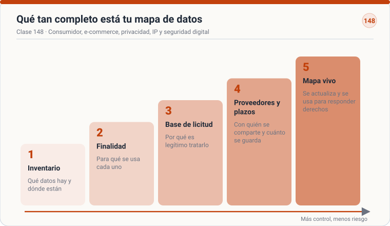

# Clase 148 — Mapa de datos y bases de licitud

> **Parte 11 · Consumidor, e-commerce, privacidad, IP y seguridad digital** — clase 8 de 14

**Estado de evidencia:** `DINAMICO` · **Jurisdicción:** Chile-first · **Fecha base normativa:** 07-08-2026 
**Decisión que habilita:** levantar el mapa de datos y asignar base de licitud a cada tratamiento 
**Entregable:** mapa de datos con finalidad, base de licitud, ubicación, destinatarios y plazo de conservación

## 🎯 Propósito

Construir el mapa de datos, que es el documento base de todo el cumplimiento: sin él no se puede responder un acceso ni notificar una brecha.

## 📚 Resultados de aprendizaje

Al finalizar esta clase podrás:

1. **Definir** con precisión los cuatro conceptos de la tabla siguiente y usarlos para describir un caso real.
2. **Explicar** por qué esta materia condiciona decisiones de otras partes del programa.
3. **Decidir** —levantar el mapa de datos y asignar base de licitud a cada tratamiento— y justificar la decisión por escrito.
4. **Producir** el entregable de la clase y contrastarlo contra su criterio de aceptación.
5. **Distinguir** el dato estable del dato dinámico que exige revalidación en la fuente oficial.

## 🧩 Conceptos centrales

| Concepto | Comprensión verificable |
|---|---|
| **Mapa de datos** | Inventario de qué datos se tratan, dónde y por qué. |
| **Base de licitud** | Fundamento legal que habilita el tratamiento. |
| **Minimización** | Principio de tratar solo los datos necesarios para la finalidad. |
| **Plazo de conservación** | Tiempo durante el cual se mantienen los datos. |

## 🗺️ Modelo mental: Qué tan completo está tu mapa de datos

> **La idea en una frase:** El mapa de datos es el documento base de todo el cumplimiento: sin saber qué datos existen, dónde están y con qué proveedores se comparten, no se puede responder un derecho de acceso ni reportar una vulneración.

**Qué mirar primero:** Cada peldaño suma información al mapa. Ubica en cuál estás hoy y define cuándo llegarás al siguiente. Un mapa que no se actualiza se vuelve decoración.

**Una analogía:** Es el plano de las cañerías de una casa: nadie lo mira hasta que hay una fuga, y ahí vale más que cualquier otro documento.

## 📖 Desarrollo

### 1. El fondo del asunto

El mapa de datos es el documento base de todo el cumplimiento: sin saber qué datos existen, dónde están y con qué proveedores se comparten, no se puede responder un derecho de acceso ni notificar una brecha. Debe incluir flujos hacia terceros y transferencias internacionales.

### 2. Cómo se traduce en la práctica

Levanta el inventario con quienes usan cada sistema, no solo con informática. Asigna a cada tratamiento una base de licitud y una finalidad y elimina lo que no necesitas (minimización). Define plazos de conservación y registra los proveedores. Programa revisiones periódicas y actualízalo cuando cambie un sistema o un proveedor.

### 3. Marco aplicable y quién interviene

- Ley 19.496 sobre protección de los derechos de los consumidores y su Reglamento de Comercio Electrónico
- Ley 19.628 sobre protección de la vida privada, vigente hasta la entrada en régimen de la Ley 21.719
- Ley 21.719 sobre protección de datos personales, con vigencia el 15 de octubre de 2027
- Ley 19.039 sobre propiedad industrial y Ley 17.336 sobre propiedad intelectual
- Ley 21.663 Marco de Ciberseguridad

**Autoridades o contrapartes involucradas:** SERNAC, Agencia de Protección de Datos Personales (en implementación), INAPI, ANCI.
**Profesionales de apoyo:** abogado de consumo y datos, DPO o responsable de privacidad, responsable de seguridad de la información. La participación concreta depende del riesgo, del
tamaño de la empresa y de la actividad económica.

### 4. Pruébalo tú: mini simulación

Arma el mapa de datos de tu empresa en una tabla con cinco columnas: dato (por ejemplo, correo del cliente), dónde está (sistema), para qué se usa, por qué es legítimo y cuánto tiempo se conserva. Completa al menos diez filas, incluyendo planillas y respaldos. Marca los datos que no necesitas y propón eliminarlos. Identifica con quiénes compartes información y qué contrato tienen. El ejercicio es ilustrativo: usa tus propios datos.

### 5. En qué se apoya

- **Ley 21.719 — Protección y tratamiento de los datos personales y crea la Agencia de Protección de Datos Personales** (Biblioteca del Congreso Nacional): La Ley 21.719 exige tratar los datos con finalidad y fundamento claros y limitar su conservación, principios que el mapa de datos permite documentar.
- **Normativa oficial consolidada** (Biblioteca del Congreso Nacional · LeyChile): La Ley 19.628 ya exige finalidad determinada y resguardo de los datos, base mínima que el mapa ayuda a cumplir.

*Las lecturas de apoyo ofrecen marcos conceptuales; lo que exige la ley chilena se verifica en las fuentes oficiales de esta clase.*

## 🧪 Taller guiado

Aplica esta clase a **una** de las siguientes líneas de negocio y repite después el ejercicio con
una segunda línea de carga regulatoria distinta:

| Línea | Carga regulatoria |
|---|---|
| SaaS B2B con IA | media |
| Servicios profesionales | baja |
| E-commerce D2C | media |
| Alimentos o foodtech | alta |
| Exportación de servicios | media |
| Fintech regulada | alta |
| Construcción o servicios técnicos | alta |

**Secuencia de trabajo:**

1. Delimita el contexto: actividad económica, escala, comuna y etapa de la empresa.
2. Reúne los antecedentes que la decisión exige y anota la fecha de cada fuente.
3. Identifica las alternativas reales, incluida la de no hacer nada.
4. Evalúa el impacto en mercado, caja, personas, regulación y operación.
5. Toma la decisión y regístrala con sus supuestos.
6. Produce el entregable.
7. Contrástalo contra el criterio de aceptación.
8. Anota lo que requiere validación profesional y programa su revisión.

### 📦 Entregable

Mapa de datos con finalidad, base de licitud, ubicación, destinatarios y plazo de conservación.

Debe incluir decisión, supuestos, fuentes con fecha de consulta, responsable, riesgos
identificados y próximos pasos.

## 🏆 Reto verificable

Resuelve la misma materia para una segunda línea de negocio con distinta carga regulatoria y
explica por escrito **qué cambió, por qué y qué fuente lo determina**.

## ✅ Criterio de aceptación

- [ ] el mapa incluye sistemas, planillas y proveedores
- [ ] cada tratamiento tiene base de licitud y plazo de conservación
- [ ] cada afirmación regulatoria está referida a una fuente oficial con fecha de consulta;
- [ ] los datos dinámicos quedan marcados para revalidación;
- [ ] hay un responsable asignado y evidencia reproducible del trabajo.

## ⚠️ Errores frecuentes

**Propios de esta clase:**

- Omitir del mapa los datos que viven en planillas y correos.
- Conservar datos indefinidamente sin plazo definido.

**Característicos de la parte 11:**

- Publicar precio o stock que después no se puede honrar.
- Tratar datos personales sin base de licitud ni registro de actividades de tratamiento.

## 🇨🇱 Checklist Chile

- [ ] ¿existe norma o autoridad específica para esta materia?
- [ ] ¿la fuente consultada está vigente a la fecha de ejecución?
- [ ] ¿se activa algún trámite ante el SII?
- [ ] ¿se activa algún requisito municipal o sectorial?
- [ ] ¿afecta a consumidores o al tratamiento de datos personales?
- [ ] ¿afecta a trabajadores o a la seguridad y salud en el trabajo?
- [ ] ¿afecta a impuestos, contabilidad o caja?
- [ ] ¿afecta a contratos o a propiedad intelectual?
- [ ] ¿requiere renovación, reporte periódico o revalidación?

## ❓ Preguntas de comprobación

1. ¿Tu mapa incluye planillas y correos, o solo los sistemas formales?
2. ¿Qué base de licitud sostiene cada tratamiento que identificaste?
3. ¿Cuánto tiempo conservas cada categoría de dato y por qué ese plazo?

## 🔗 Fuentes oficiales

**Biblioteca del Congreso Nacional · LeyChile — Normativa oficial consolidada**  
<https://www.bcn.cl/leychile/> · verificado 2026-11-05

- *Qué contiene:* Publica el texto oficial y consolidado de leyes, decretos y reglamentos, con la versión vigente a una fecha, el historial de modificaciones y la tramitación que las originó.
- *Cómo leerla:* Usa siempre el selector de versión vigente a la fecha en que ejecutarás el trámite, no la última publicada. Y lee el artículo transitorio: en normas en implantación gradual —jornada, datos personales— ahí está la fecha que realmente te aplica.
- *Uso en esta clase:* aporta el marco de «Normativa oficial consolidada» para levantar el mapa de datos y asignar base de licitud a cada tratamiento.

**Biblioteca del Congreso Nacional — Ley 21.719 — Protección y tratamiento de los datos personales y crea la Agencia de Protección de Datos Personales**  
<https://www.bcn.cl/leychile/navegar?idNorma=1209272> · verificado 2026-11-25

- *Qué contiene:* Reemplaza el texto de la Ley 19.628. Su artículo 14 sexies obliga a reportar a la Agencia las vulneraciones de seguridad con riesgo razonable para los titulares y a avisar a estos cuando hay datos sensibles, de menores de catorce años o económicos.
- *Cómo leerla:* Úsala como estándar de diseño del protocolo de incidentes. La vigencia de sus modificaciones se fijó en el 15-10-2027 por la Ley 21.855: comprueba la fecha en la ficha de la BCN antes de planificar.
- *Uso en esta clase:* aporta el marco de «Ley 21.719 — Protección y tratamiento de los datos personales y crea la Agencia de Protección de Datos Personales» para levantar el mapa de datos y asignar base de licitud a cada tratamiento.

Complementos del repositorio: [glosario](../../../docs/19_GLOSSARY.md) ·
[ruta de lecturas](../../../docs/15_BOOKS_AND_LEARNING_PATH.md) ·
[catálogo de fuentes](../../../docs/16_OFFICIAL_SOURCE_CATALOG.md).

> [!IMPORTANT]
> Material educativo. Para una decisión real de alto impacto hay que verificar la fuente oficial
> vigente y validar con el profesional competente.

---

| Anterior | Índice | Siguiente |
|---|---|---|
| [← 147 · Preparación para Ley 21.719 desde 1-dic-2026](../class-07-preparacion-para-ley-21-719-desde-1-dic-2026/README.md) | [Parte 11](../README.md) · [Programa](../../../README.md) | [149 · Derechos de titulares y gobierno de datos →](../class-09-derechos-de-titulares-y-gobierno-de-datos/README.md) |
