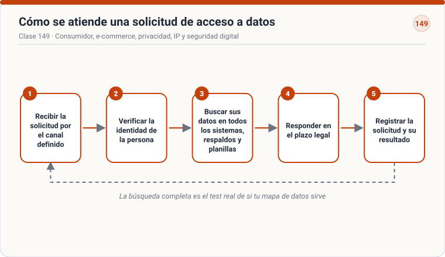

# Clase 149 — Derechos de titulares y gobierno de datos

> **Parte 11 · Consumidor, e-commerce, privacidad, IP y seguridad digital** — clase 9 de 14

**Estado de evidencia:** `DINAMICO` · **Jurisdicción:** Chile-first · **Fecha base normativa:** 07-08-2026 
**Decisión que habilita:** habilitar el canal y el procedimiento de atención de derechos 
**Entregable:** procedimiento de atención de derechos con canal publicado, plazos y registro de solicitudes

## 🎯 Propósito

Habilitar el canal y el procedimiento de atención de derechos, cuyo verdadero test es poder ubicar todos los datos de una persona en todos los sistemas.

## 📚 Resultados de aprendizaje

Al finalizar esta clase podrás:

1. **Definir** con precisión los cuatro conceptos de la tabla siguiente y usarlos para describir un caso real.
2. **Explicar** por qué esta materia condiciona decisiones de otras partes del programa.
3. **Decidir** —habilitar el canal y el procedimiento de atención de derechos— y justificar la decisión por escrito.
4. **Producir** el entregable de la clase y contrastarlo contra su criterio de aceptación.
5. **Distinguir** el dato estable del dato dinámico que exige revalidación en la fuente oficial.

## 🧩 Conceptos centrales

| Concepto | Comprensión verificable |
|---|---|
| **Derechos del titular** | Acceso, rectificación, cancelación, oposición y portabilidad. |
| **Plazo de respuesta** | Tiempo legal para atender la solicitud. |
| **Canal de ejercicio** | Medio publicado para que el titular ejerza sus derechos. |
| **Registro de solicitudes** | Evidencia de atención y resolución. |

## 🗺️ Modelo mental: Cómo se atiende una solicitud de acceso a datos

> **La idea en una frase:** Atender un derecho de acceso exige poder ubicar todos los datos de una persona en todos los sistemas, incluidos respaldos y planillas; ese es el test real de si el mapa de datos sirve.

**Lectura guiada:** Cada casilla es un paso del procedimiento. El tercero es el más difícil: si no sabes dónde están los datos, respondes de forma incompleta y puedes incumplir.

**Piénsalo así:** Es buscar tus llaves en toda la casa: solo las encuentras rápido si sabes en qué cajones las dejas.

## 📖 Desarrollo

### 1. El fondo del asunto

Atender un derecho de acceso exige poder ubicar todos los datos de una persona en todos los sistemas, incluidos respaldos y planillas. Ese es el test real de si el mapa de datos sirve. El canal debe estar publicado y la respuesta debe quedar registrada con su fecha.

### 2. Cómo se traduce en la práctica

Habilita un canal (correo o formulario) para ejercer derechos y publícalo. Define quién verifica la identidad, quién busca los datos y quién responde. Establece plazos internos y registra cada solicitud y su respuesta. Prueba el procedimiento con una solicitud simulada y mide cuánto tarda. Considera derechos como rectificación, supresión, oposición, portabilidad y bloqueo.

### 3. Marco aplicable y quién interviene

- Ley 19.496 sobre protección de los derechos de los consumidores y su Reglamento de Comercio Electrónico
- Ley 19.628 sobre protección de la vida privada, vigente hasta la entrada en régimen de la Ley 21.719
- Ley 21.719 sobre protección de datos personales, con vigencia el 15 de octubre de 2027
- Ley 19.039 sobre propiedad industrial y Ley 17.336 sobre propiedad intelectual
- Ley 21.663 Marco de Ciberseguridad

**Autoridades o contrapartes involucradas:** SERNAC, Agencia de Protección de Datos Personales (en implementación), INAPI, ANCI.
**Profesionales de apoyo:** abogado de consumo y datos, DPO o responsable de privacidad, responsable de seguridad de la información. La participación concreta depende del riesgo, del
tamaño de la empresa y de la actividad económica.

### 4. Un error y su corrección

El error: una empresa recibe una solicitud de acceso y entrega solo los datos del sistema de ventas, olvidando una planilla de marketing y los correos con un proveedor. La persona reclama que su información estaba incompleta. La corrección: un procedimiento que consulte todas las fuentes del mapa de datos, una persona responsable, plazos internos más cortos que los legales y un registro de cada solicitud (caso ilustrativo).

### 5. En qué se apoya

- **Ley 21.719 — Protección y tratamiento de los datos personales y crea la Agencia de Protección de Datos Personales** (Biblioteca del Congreso Nacional): La Ley 21.719 reconoce a las personas derechos de acceso, rectificación, supresión, oposición, portabilidad y bloqueo, que la empresa debe poder atender.
- **Normativa oficial consolidada** (Biblioteca del Congreso Nacional · LeyChile): El texto de la Ley 19.628 ya reconoce el derecho de acceso y rectificación de datos personales ante quien los trata.

*Las lecturas de apoyo ofrecen marcos conceptuales; lo que exige la ley chilena se verifica en las fuentes oficiales de esta clase.*

## 🧪 Taller guiado

Aplica esta clase a **una** de las siguientes líneas de negocio y repite después el ejercicio con
una segunda línea de carga regulatoria distinta:

| Línea | Carga regulatoria |
|---|---|
| SaaS B2B con IA | media |
| Servicios profesionales | baja |
| E-commerce D2C | media |
| Alimentos o foodtech | alta |
| Exportación de servicios | media |
| Fintech regulada | alta |
| Construcción o servicios técnicos | alta |

**Secuencia de trabajo:**

1. Delimita el contexto: actividad económica, escala, comuna y etapa de la empresa.
2. Reúne los antecedentes que la decisión exige y anota la fecha de cada fuente.
3. Identifica las alternativas reales, incluida la de no hacer nada.
4. Evalúa el impacto en mercado, caja, personas, regulación y operación.
5. Toma la decisión y regístrala con sus supuestos.
6. Produce el entregable.
7. Contrástalo contra el criterio de aceptación.
8. Anota lo que requiere validación profesional y programa su revisión.

### 📦 Entregable

Procedimiento de atención de derechos con canal publicado, plazos y registro de solicitudes.

Debe incluir decisión, supuestos, fuentes con fecha de consulta, responsable, riesgos
identificados y próximos pasos.

## 🏆 Reto verificable

Resuelve la misma materia para una segunda línea de negocio con distinta carga regulatoria y
explica por escrito **qué cambió, por qué y qué fuente lo determina**.

## ✅ Criterio de aceptación

- [ ] el canal está publicado y es accesible
- [ ] existe registro de solicitudes con plazo de respuesta controlado
- [ ] cada afirmación regulatoria está referida a una fuente oficial con fecha de consulta;
- [ ] los datos dinámicos quedan marcados para revalidación;
- [ ] hay un responsable asignado y evidencia reproducible del trabajo.

## ⚠️ Errores frecuentes

**Propios de esta clase:**

- No poder ubicar los datos de un titular en todos los sistemas.
- Atender solicitudes sin registrar fecha ni contenido de la respuesta.

**Característicos de la parte 11:**

- Publicar precio o stock que después no se puede honrar.
- Tratar datos personales sin base de licitud ni registro de actividades de tratamiento.

## 🇨🇱 Checklist Chile

- [ ] ¿existe norma o autoridad específica para esta materia?
- [ ] ¿la fuente consultada está vigente a la fecha de ejecución?
- [ ] ¿se activa algún trámite ante el SII?
- [ ] ¿se activa algún requisito municipal o sectorial?
- [ ] ¿afecta a consumidores o al tratamiento de datos personales?
- [ ] ¿afecta a trabajadores o a la seguridad y salud en el trabajo?
- [ ] ¿afecta a impuestos, contabilidad o caja?
- [ ] ¿afecta a contratos o a propiedad intelectual?
- [ ] ¿requiere renovación, reporte periódico o revalidación?

## ❓ Preguntas de comprobación

1. ¿Podrías reunir hoy todos los datos de una persona que los solicite?
2. ¿Dónde está publicado tu canal de ejercicio de derechos?
3. ¿Quién responde, en qué plazo y dónde queda registrada la respuesta?

## 🔗 Fuentes oficiales

**Biblioteca del Congreso Nacional · LeyChile — Normativa oficial consolidada**  
<https://www.bcn.cl/leychile/> · verificado 2026-11-05

- *Qué contiene:* Publica el texto oficial y consolidado de leyes, decretos y reglamentos, con la versión vigente a una fecha, el historial de modificaciones y la tramitación que las originó.
- *Cómo leerla:* Usa siempre el selector de versión vigente a la fecha en que ejecutarás el trámite, no la última publicada. Y lee el artículo transitorio: en normas en implantación gradual —jornada, datos personales— ahí está la fecha que realmente te aplica.
- *Uso en esta clase:* aporta el marco de «Normativa oficial consolidada» para habilitar el canal y el procedimiento de atención de derechos.

**Biblioteca del Congreso Nacional — Ley 21.719 — Protección y tratamiento de los datos personales y crea la Agencia de Protección de Datos Personales**  
<https://www.bcn.cl/leychile/navegar?idNorma=1209272> · verificado 2026-11-25

- *Qué contiene:* Reemplaza el texto de la Ley 19.628. Su artículo 14 sexies obliga a reportar a la Agencia las vulneraciones de seguridad con riesgo razonable para los titulares y a avisar a estos cuando hay datos sensibles, de menores de catorce años o económicos.
- *Cómo leerla:* Úsala como estándar de diseño del protocolo de incidentes. La vigencia de sus modificaciones se fijó en el 15-10-2027 por la Ley 21.855: comprueba la fecha en la ficha de la BCN antes de planificar.
- *Uso en esta clase:* aporta el marco de «Ley 21.719 — Protección y tratamiento de los datos personales y crea la Agencia de Protección de Datos Personales» para habilitar el canal y el procedimiento de atención de derechos.

Complementos del repositorio: [glosario](../../../docs/19_GLOSSARY.md) ·
[ruta de lecturas](../../../docs/15_BOOKS_AND_LEARNING_PATH.md) ·
[catálogo de fuentes](../../../docs/16_OFFICIAL_SOURCE_CATALOG.md).

> [!IMPORTANT]
> Material educativo. Para una decisión real de alto impacto hay que verificar la fuente oficial
> vigente y validar con el profesional competente.

---

| Anterior | Índice | Siguiente |
|---|---|---|
| [← 148 · Mapa de datos y bases de licitud](../class-08-mapa-de-datos-y-bases-de-licitud/README.md) | [Parte 11](../README.md) · [Programa](../../../README.md) | [150 · Registro de marca en INAPI →](../class-10-registro-de-marca-en-inapi/README.md) |
