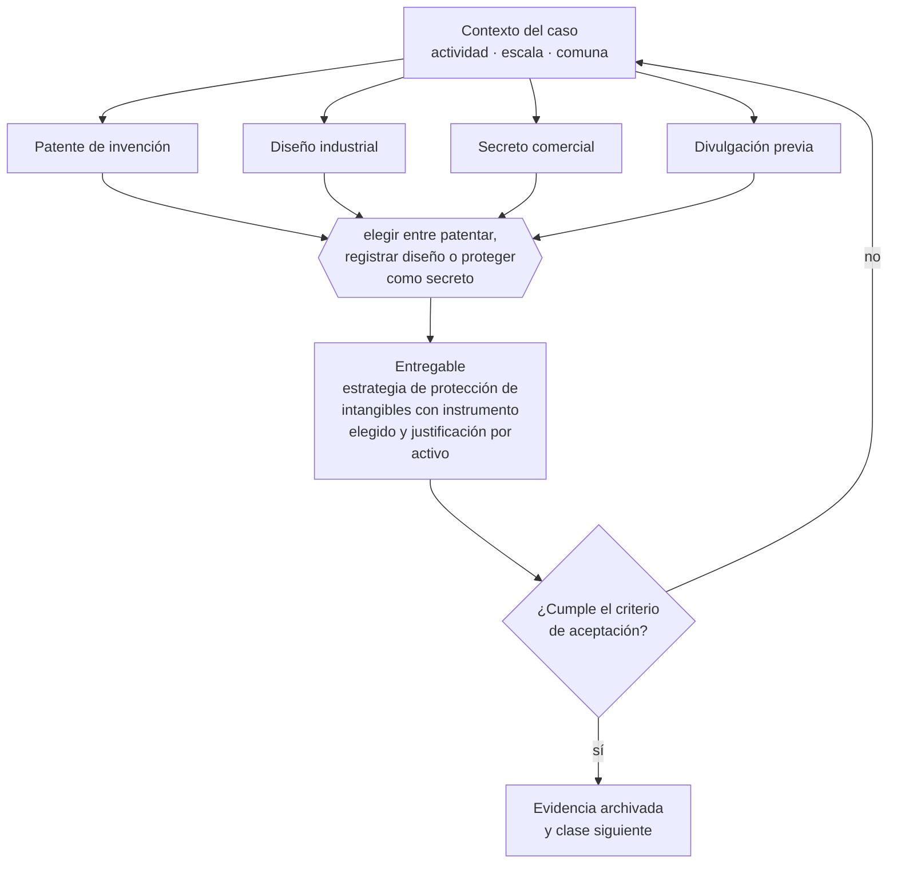

# Clase 151 — Patentes, diseños y secretos empresariales

> **Parte 11 · Consumidor, e-commerce, privacidad, IP y seguridad digital** — clase 11 de 14

**Estado de evidencia:** `DINAMICO` · **Jurisdicción:** Chile-first · **Fecha base normativa:** 07-08-2026 
**Decisión que habilita:** elegir entre patentar, registrar diseño o proteger como secreto 
**Entregable:** estrategia de protección de intangibles con instrumento elegido y justificación por activo

## 🎯 Propósito

Elegir entre patentar, registrar diseño o proteger como secreto según si la invención es reversible por ingeniería inversa y cuánto cuesta defenderla.

## 📚 Resultados de aprendizaje

Al finalizar esta clase podrás:

1. **Definir** con precisión los cuatro conceptos de la tabla siguiente y usarlos para describir un caso real.
2. **Explicar** por qué esta materia condiciona decisiones de otras partes del programa.
3. **Decidir** —elegir entre patentar, registrar diseño o proteger como secreto— y justificar la decisión por escrito.
4. **Producir** el entregable de la clase y contrastarlo contra su criterio de aceptación.
5. **Distinguir** el dato estable del dato dinámico que exige revalidación en la fuente oficial.

## 🧩 Conceptos centrales

| Concepto | Comprensión verificable |
|---|---|
| **Patente de invención** | Protección de una solución técnica nueva con altura inventiva. |
| **Diseño industrial** | Protección de la apariencia de un producto. |
| **Secreto comercial** | Información no divulgada con valor comercial y medidas de protección. |
| **Divulgación previa** | Publicación anterior que impide obtener la patente. |

## 🗺️ Flujo de razonamiento

## 📖 Desarrollo

### 1. El fondo del asunto

La elección entre patentar y mantener en secreto depende de si la invención es reversible por ingeniería inversa y del costo de defender. Patentar exige divulgar; el secreto exige acreditar medidas razonables de protección. Divulgar antes de solicitar la patente destruye la novedad y con ella el derecho.

### 2. Cómo se traduce en la práctica

Patentar exige divulgar y otorga exclusividad temporal; el secreto no exige divulgar pero obliga a acreditar medidas razonables de protección. La decisión es irreversible en un sentido: divulgar públicamente antes de solicitar la patente destruye la novedad y con ella el derecho.

### 3. Marco aplicable y quién interviene

- Ley 19.496 sobre protección de los derechos de los consumidores y su Reglamento de Comercio Electrónico
- Ley 19.628 sobre protección de la vida privada, vigente hasta la entrada en régimen de la Ley 21.719
- Ley 21.719 sobre protección de datos personales, con vigencia el 15 de octubre de 2027
- Ley 19.039 sobre propiedad industrial y Ley 17.336 sobre propiedad intelectual
- Ley 21.663 Marco de Ciberseguridad

**Autoridades o contrapartes involucradas:** SERNAC, Agencia de Protección de Datos Personales (en implementación), INAPI, ANCI.
**Profesionales de apoyo:** abogado de consumo y datos, DPO o responsable de privacidad, responsable de seguridad de la información. La participación concreta depende del riesgo, del
tamaño de la empresa y de la actividad económica.

## 🛡️ Protección del conocimiento: Protección de secretos comerciales

[Guía de inteligencia económica y protección del conocimiento, sección 8](../../../docs/21_INTELIGENCIA_ECONOMICA_Y_PROTECCION_DEL_CONOCIMIENTO.md#8-protección-de-secretos-comerciales)

**Lente para esta clase:** Elegir entre patentar y reservar como secreto comercial es una decisión de inteligencia: patentar divulga y el secreto exige probar medidas razonables de reserva.

| Nivel | Medida proporcionada |
|---|---|
| **Emprendedor o microempresa** | Decide qué se patenta, qué se reserva y qué se muestra en ferias, con un criterio escrito. |
| **Pyme** | Política de qué se publica, quién lo aprueba y cómo se fecha la invención antes de mostrarla. |
| **Gran empresa o multinacional** | Comité de propiedad intelectual con decisiones patentar o reservar y revisión de las publicaciones técnicas. |

**Actividad sin crear sistemas:** Para dos activos tuyos escribe la decisión (patente, diseño o secreto) y la medida de reserva que la sostendría ante un tribunal.

**Términos:** Secreto comercial (*Trade Secret*) · Medidas razonables (*Reasonable Measures*)

*Enfoque defensivo: reconocer, prevenir, documentar y escalar. No enseña a obtener información de forma indebida; la calificación jurídica de un hecho concreto corresponde a un abogado.*

## 🧪 Taller guiado

Aplica esta clase a **una** de las siguientes líneas de negocio y repite después el ejercicio con
una segunda línea de carga regulatoria distinta:

| Línea | Carga regulatoria |
|---|---|
| SaaS B2B con IA | media |
| Servicios profesionales | baja |
| E-commerce D2C | media |
| Alimentos o foodtech | alta |
| Exportación de servicios | media |
| Fintech regulada | alta |
| Construcción o servicios técnicos | alta |

**Secuencia de trabajo:**

1. Delimita el contexto: actividad económica, escala, comuna y etapa de la empresa.
2. Reúne los antecedentes que la decisión exige y anota la fecha de cada fuente.
3. Identifica las alternativas reales, incluida la de no hacer nada.
4. Evalúa el impacto en mercado, caja, personas, regulación y operación.
5. Toma la decisión y regístrala con sus supuestos.
6. Produce el entregable.
7. Contrástalo contra el criterio de aceptación.
8. Anota lo que requiere validación profesional y programa su revisión.

### 📦 Entregable

Estrategia de protección de intangibles con instrumento elegido y justificación por activo.

Debe incluir decisión, supuestos, fuentes con fecha de consulta, responsable, riesgos
identificados y próximos pasos.

## 🏆 Reto verificable

Resuelve la misma materia para una segunda línea de negocio con distinta carga regulatoria y
explica por escrito **qué cambió, por qué y qué fuente lo determina**.

## ✅ Criterio de aceptación

- [ ] cada activo intangible tiene instrumento de protección asignado
- [ ] las medidas de protección del secreto están documentadas
- [ ] cada afirmación regulatoria está referida a una fuente oficial con fecha de consulta;
- [ ] los datos dinámicos quedan marcados para revalidación;
- [ ] hay un responsable asignado y evidencia reproducible del trabajo.

## ⚠️ Errores frecuentes

**Propios de esta clase:**

- Presentar el producto públicamente antes de solicitar la patente.
- Declarar información como secreto sin medidas efectivas de protección.

**Característicos de la parte 11:**

- Publicar precio o stock que después no se puede honrar.
- Tratar datos personales sin base de licitud ni registro de actividades de tratamiento.

## 🇨🇱 Checklist Chile

- [ ] ¿existe norma o autoridad específica para esta materia?
- [ ] ¿la fuente consultada está vigente a la fecha de ejecución?
- [ ] ¿se activa algún trámite ante el SII?
- [ ] ¿se activa algún requisito municipal o sectorial?
- [ ] ¿afecta a consumidores o al tratamiento de datos personales?
- [ ] ¿afecta a trabajadores o a la seguridad y salud en el trabajo?
- [ ] ¿afecta a impuestos, contabilidad o caja?
- [ ] ¿afecta a contratos o a propiedad intelectual?
- [ ] ¿requiere renovación, reporte periódico o revalidación?

## ❓ Preguntas de comprobación

1. ¿Tu invención se puede deducir del producto una vez en el mercado?
2. ¿Divulgaste públicamente algo que pensabas patentar?
3. ¿Qué medidas concretas protegen la información que declaras como secreto?

## 🔗 Fuentes oficiales

**Instituto Nacional de Propiedad Industrial — Marcas, patentes y diseños industriales**  
<https://www.inapi.cl/> · verificado 2026-11-05

- *Qué contiene:* Administra el registro de marcas, patentes, diseños e indicaciones geográficas, y ofrece el buscador público de solicitudes y registros vigentes por clase.
- *Cómo leerla:* Empieza siempre por el buscador de anterioridades y por clases, no por el formulario de solicitud. Una marca disponible en tu clase puede estar tomada en la clase donde realmente operas, y eso solo se ve buscando por actividad.
- *Uso en esta clase:* aporta el marco de «Marcas, patentes y diseños industriales» para elegir entre patentar, registrar diseño o proteger como secreto.

**Biblioteca del Congreso Nacional · LeyChile — Normativa oficial consolidada**  
<https://www.bcn.cl/leychile/> · verificado 2026-11-05

- *Qué contiene:* Publica el texto oficial y consolidado de leyes, decretos y reglamentos, con la versión vigente a una fecha, el historial de modificaciones y la tramitación que las originó.
- *Cómo leerla:* Usa siempre el selector de versión vigente a la fecha en que ejecutarás el trámite, no la última publicada. Y lee el artículo transitorio: en normas en implantación gradual —jornada, datos personales— ahí está la fecha que realmente te aplica.
- *Uso en esta clase:* aporta el marco de «Normativa oficial consolidada» para elegir entre patentar, registrar diseño o proteger como secreto.

**Biblioteca del Congreso Nacional — DFL 4 de 2022 — Texto refundido de la Ley 19.039 de Propiedad Industrial**  
<https://www.bcn.cl/leychile/navegar?idNorma=1179684> · verificado 2026-11-12

- *Qué contiene:* Fija el texto vigente de la ley de propiedad industrial. Sus artículos 86 a 88 definen el secreto comercial por tres requisitos copulativos, describen qué constituye su violación y remiten a las acciones de observancia del Título X.
- *Cómo leerla:* Lee primero el artículo 86: sin las medidas razonables de reserva que exige, la información puede no calificar como secreto comercial. El artículo 87 exige ánimo de provecho propio o ajeno, o de perjudicar al poseedor; no basta con haber accedido.
- *Uso en esta clase:* aporta el marco de «DFL 4 de 2022 — Texto refundido de la Ley 19.039 de Propiedad Industrial» para elegir entre patentar, registrar diseño o proteger como secreto.

**Biblioteca del Congreso Nacional — Código Penal — Artículos 284 a 284 sexies (secreto comercial)**  
<https://www.bcn.cl/leychile/navegar?idNorma=1984> · verificado 2026-11-12

- *Qué contiene:* Tipifica el acceso a un secreto comercial mediante intromisión indebida, su revelación por quien tenía un deber de confidencialidad profesional, contractual o laboral, su aprovechamiento económico, y excluye el uso de la experiencia y competencias legítimamente adquiridas.
- *Cómo leerla:* Distingue quién se introduce (artículo 284), quién viola un deber (284 bis) y quién usa lo obtenido (284 ter). El artículo 284 quinquies protege al trabajador que ejerce su oficio; el 284 sexies remite a la ley de propiedad industrial para definir el secreto.
- *Uso en esta clase:* aporta el marco de «Código Penal — Artículos 284 a 284 sexies (secreto comercial)» para elegir entre patentar, registrar diseño o proteger como secreto.

Complementos del repositorio: [glosario](../../../docs/19_GLOSSARY.md) ·
[ruta de lecturas](../../../docs/15_BOOKS_AND_LEARNING_PATH.md) ·
[catálogo de fuentes](../../../docs/16_OFFICIAL_SOURCE_CATALOG.md).

> [!IMPORTANT]
> Material educativo. Para una decisión real de alto impacto hay que verificar la fuente oficial
> vigente y validar con el profesional competente.

---

| Anterior | Índice | Siguiente |
|---|---|---|
| [← 150 · Registro de marca en INAPI](../class-10-registro-de-marca-en-inapi/README.md) | [Parte 11](../README.md) · [Programa](../../../README.md) | [152 · Derecho de autor y licencias de software →](../class-12-derecho-de-autor-y-licencias-de-software/README.md) |
