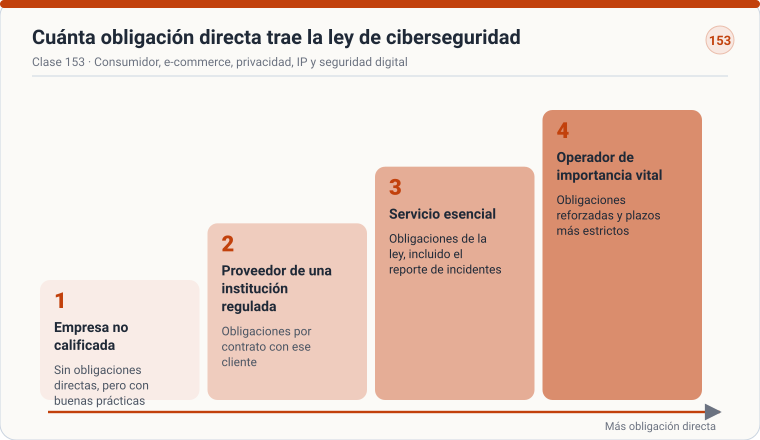

# Clase 153 — Ley Marco de Ciberseguridad y ciberhigiene empresarial

> **Parte 11 · Consumidor, e-commerce, privacidad, IP y seguridad digital** — clase 13 de 14

**Estado de evidencia:** `DINAMICO` · **Jurisdicción:** Chile-first · **Fecha base normativa:** 07-08-2026 
**Decisión que habilita:** determinar si la empresa tiene obligaciones directas o derivadas de sus clientes 
**Entregable:** diagnóstico de ciberhigiene con controles básicos implementados y brechas priorizadas

## 🎯 Propósito

Determinar si la empresa tiene obligaciones directas bajo la Ley 21.663 o si las recibirá trasladadas por contrato desde clientes regulados.

## 📚 Resultados de aprendizaje

Al finalizar esta clase podrás:

1. **Definir** con precisión los cuatro conceptos de la tabla siguiente y usarlos para describir un caso real.
2. **Explicar** por qué esta materia condiciona decisiones de otras partes del programa.
3. **Decidir** —determinar si la empresa tiene obligaciones directas o derivadas de sus clientes— y justificar la decisión por escrito.
4. **Producir** el entregable de la clase y contrastarlo contra su criterio de aceptación.
5. **Distinguir** el dato estable del dato dinámico que exige revalidación en la fuente oficial.

## 🧩 Conceptos centrales

| Concepto | Comprensión verificable |
|---|---|
| **Ley 21.663** | Ley marco de ciberseguridad. |
| **Servicio esencial** | Actividad cuya interrupción afecta significativamente. |
| **Operador de importancia vital** | Entidad calificada con obligaciones reforzadas. |
| **Ciberhigiene** | Conjunto de prácticas básicas que reducen la mayoría del riesgo. |

## 🗺️ Modelo mental: Cuánta obligación directa trae la ley de ciberseguridad

> **La idea en una frase:** La Ley 21.663 crea la Agencia Nacional de Ciberseguridad y establece obligaciones para servicios esenciales y operadores de importancia vital; aunque una pyme no esté calificada, sus clientes regulados pueden exigirle controles por contrato.

**Cómo leerlo:** Cada peldaño es un grado de obligación. Averigua en cuál estás tú y, si no estás obligada directamente, si alguno de tus clientes sí lo está.

**Piénsalo así:** Es el reglamento de un edificio: aplica directamente a los residentes, y a los visitantes y proveedores se les exige que cumplan lo mismo si entran.

## 📖 Desarrollo

### 1. El fondo del asunto

La Ley 21.663 crea la ANCI y establece obligaciones para servicios esenciales y operadores de importancia vital, incluyendo reporte de incidentes. Aunque una pyme no esté calificada, sus clientes regulados le trasladarán exigencias por contrato: es más barato adoptar la ciberhigiene básica antes de que la exija un cliente.

### 2. Cómo se traduce en la práctica

Verifica si tu empresa presta un servicio esencial o ha sido calificada como operador de importancia vital. Si no, revisa las exigencias de seguridad de tus clientes regulados. Aplica la ciberhigiene básica: copias de seguridad, accesos con doble factor, actualizaciones y capacitación. Documenta tus controles: serán la prueba ante clientes y autoridades.

### 3. Marco aplicable y quién interviene

- Ley 19.496 sobre protección de los derechos de los consumidores y su Reglamento de Comercio Electrónico
- Ley 19.628 sobre protección de la vida privada, vigente hasta la entrada en régimen de la Ley 21.719
- Ley 21.719 sobre protección de datos personales, con vigencia el 15 de octubre de 2027
- Ley 19.039 sobre propiedad industrial y Ley 17.336 sobre propiedad intelectual
- Ley 21.663 Marco de Ciberseguridad

**Autoridades o contrapartes involucradas:** SERNAC, Agencia de Protección de Datos Personales (en implementación), INAPI, ANCI.
**Profesionales de apoyo:** abogado de consumo y datos, DPO o responsable de privacidad, responsable de seguridad de la información. La participación concreta depende del riesgo, del
tamaño de la empresa y de la actividad económica.

### 4. Una conversación que enseña

Proveedor de software: «Una clínica nos pidió acreditar controles de seguridad». Asesora: «La clínica presta un servicio esencial y debe cumplir la ley; por contrato, le exige a sus proveedores medidas de ciberhigiene». Proveedor: «¿Debemos reportar incidentes a la Agencia?». Asesora: «Quizás no directamente, pero sí avisar a la clínica con rapidez y tener un plan de respuesta» (conversación ilustrativa).

### 5. En qué se apoya

- **Ley 21.663 — Ley Marco de Ciberseguridad** (Biblioteca del Congreso Nacional): La Ley 21.663 define los servicios esenciales y los operadores de importancia vital y las obligaciones de reporte de incidentes, según el texto consultado en la BCN.
- **Normativa oficial consolidada** (Biblioteca del Congreso Nacional · LeyChile): La Biblioteca del Congreso Nacional publica el texto vigente de la ley y su historia, y es la fuente para comprobar quién queda obligado.

*Las lecturas de apoyo ofrecen marcos conceptuales; lo que exige la ley chilena se verifica en las fuentes oficiales de esta clase.*

## 🧪 Taller guiado

Aplica esta clase a **una** de las siguientes líneas de negocio y repite después el ejercicio con
una segunda línea de carga regulatoria distinta:

| Línea | Carga regulatoria |
|---|---|
| SaaS B2B con IA | media |
| Servicios profesionales | baja |
| E-commerce D2C | media |
| Alimentos o foodtech | alta |
| Exportación de servicios | media |
| Fintech regulada | alta |
| Construcción o servicios técnicos | alta |

**Secuencia de trabajo:**

1. Delimita el contexto: actividad económica, escala, comuna y etapa de la empresa.
2. Reúne los antecedentes que la decisión exige y anota la fecha de cada fuente.
3. Identifica las alternativas reales, incluida la de no hacer nada.
4. Evalúa el impacto en mercado, caja, personas, regulación y operación.
5. Toma la decisión y regístrala con sus supuestos.
6. Produce el entregable.
7. Contrástalo contra el criterio de aceptación.
8. Anota lo que requiere validación profesional y programa su revisión.

### 📦 Entregable

Diagnóstico de ciberhigiene con controles básicos implementados y brechas priorizadas.

Debe incluir decisión, supuestos, fuentes con fecha de consulta, responsable, riesgos
identificados y próximos pasos.

## 🏆 Reto verificable

Resuelve la misma materia para una segunda línea de negocio con distinta carga regulatoria y
explica por escrito **qué cambió, por qué y qué fuente lo determina**.

## ✅ Criterio de aceptación

- [ ] el diagnóstico determina la condición de la empresa frente a la ley
- [ ] los controles básicos están implementados y verificados
- [ ] cada afirmación regulatoria está referida a una fuente oficial con fecha de consulta;
- [ ] los datos dinámicos quedan marcados para revalidación;
- [ ] hay un responsable asignado y evidencia reproducible del trabajo.

## ⚠️ Errores frecuentes

**Propios de esta clase:**

- Asumir que la ley no aplica y descubrir la exigencia por vía contractual.
- Implementar controles sin verificar que funcionan.

**Característicos de la parte 11:**

- Publicar precio o stock que después no se puede honrar.
- Tratar datos personales sin base de licitud ni registro de actividades de tratamiento.

## 🇨🇱 Checklist Chile

- [ ] ¿existe norma o autoridad específica para esta materia?
- [ ] ¿la fuente consultada está vigente a la fecha de ejecución?
- [ ] ¿se activa algún trámite ante el SII?
- [ ] ¿se activa algún requisito municipal o sectorial?
- [ ] ¿afecta a consumidores o al tratamiento de datos personales?
- [ ] ¿afecta a trabajadores o a la seguridad y salud en el trabajo?
- [ ] ¿afecta a impuestos, contabilidad o caja?
- [ ] ¿afecta a contratos o a propiedad intelectual?
- [ ] ¿requiere renovación, reporte periódico o revalidación?

## ❓ Preguntas de comprobación

1. ¿Alguno de tus clientes está regulado y podría trasladarte exigencias?
2. ¿Qué controles básicos tienes implementados y verificados, no solo declarados?
3. ¿Podrías responder hoy un cuestionario de seguridad de un cliente grande?

## 🔗 Fuentes oficiales

**Biblioteca del Congreso Nacional · LeyChile — Normativa oficial consolidada**  
<https://www.bcn.cl/leychile/> · verificado 2026-11-05

- *Qué contiene:* Publica el texto oficial y consolidado de leyes, decretos y reglamentos, con la versión vigente a una fecha, el historial de modificaciones y la tramitación que las originó.
- *Cómo leerla:* Usa siempre el selector de versión vigente a la fecha en que ejecutarás el trámite, no la última publicada. Y lee el artículo transitorio: en normas en implantación gradual —jornada, datos personales— ahí está la fecha que realmente te aplica.
- *Uso en esta clase:* aporta el marco de «Normativa oficial consolidada» para determinar si la empresa tiene obligaciones directas o derivadas de sus clientes.

**Biblioteca del Congreso Nacional — Ley 21.663 — Ley Marco de Ciberseguridad**  
<https://www.bcn.cl/leychile/navegar?idNorma=1202434> · verificado 2026-11-25

- *Qué contiene:* Define las instituciones comprendidas (servicios esenciales y operadores de importancia vital), el deber de reportar ciberincidentes al CSIRT Nacional con alerta a las tres horas, actualización a las setenta y dos y informe final a los quince días corridos (art. 9) y el concepto de incidente de efecto significativo (art. 27).
- *Cómo leerla:* Úsala para saber si la empresa es una institución comprendida antes de que ocurra el incidente. Los reglamentos y las instrucciones de la Agencia cambian los detalles; consúltalos en su sitio.
- *Uso en esta clase:* aporta el marco de «Ley 21.663 — Ley Marco de Ciberseguridad» para determinar si la empresa tiene obligaciones directas o derivadas de sus clientes.

Complementos del repositorio: [glosario](../../../docs/19_GLOSSARY.md) ·
[ruta de lecturas](../../../docs/15_BOOKS_AND_LEARNING_PATH.md) ·
[catálogo de fuentes](../../../docs/16_OFFICIAL_SOURCE_CATALOG.md).

> [!IMPORTANT]
> Material educativo. Para una decisión real de alto impacto hay que verificar la fuente oficial
> vigente y validar con el profesional competente.

---

| Anterior | Índice | Siguiente |
|---|---|---|
| [← 152 · Derecho de autor y licencias de software](../class-12-derecho-de-autor-y-licencias-de-software/README.md) | [Parte 11](../README.md) · [Programa](../../../README.md) | [154 · Respuesta a incidentes y evidencia →](../class-14-respuesta-a-incidentes-y-evidencia/README.md) |
