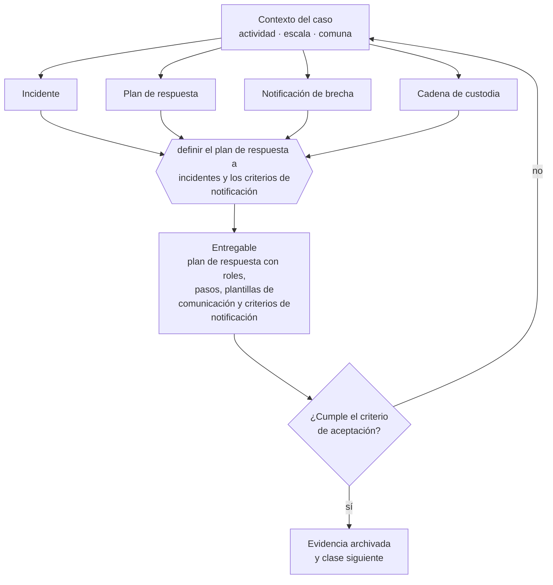

# Clase 154 — Respuesta a incidentes y evidencia

> **Parte 11 · Consumidor, e-commerce, privacidad, IP y seguridad digital** — clase 14 de 14

**Estado de evidencia:** `DINAMICO` · **Jurisdicción:** Chile-first · **Fecha base normativa:** 07-08-2026 
**Decisión que habilita:** definir el plan de respuesta a incidentes y los criterios de notificación 
**Entregable:** plan de respuesta con roles, pasos, plantillas de comunicación y criterios de notificación

## 🎯 Propósito

Tener el plan de respuesta antes del incidente y accesible fuera de los sistemas afectados, que es cuando se descubre si existía.

## 📚 Resultados de aprendizaje

Al finalizar esta clase podrás:

1. **Definir** con precisión los cuatro conceptos de la tabla siguiente y usarlos para describir un caso real.
2. **Explicar** por qué esta materia condiciona decisiones de otras partes del programa.
3. **Decidir** —definir el plan de respuesta a incidentes y los criterios de notificación— y justificar la decisión por escrito.
4. **Producir** el entregable de la clase y contrastarlo contra su criterio de aceptación.
5. **Distinguir** el dato estable del dato dinámico que exige revalidación en la fuente oficial.

## 🧩 Conceptos centrales

| Concepto | Comprensión verificable |
|---|---|
| **Incidente** | Evento que compromete disponibilidad, integridad o confidencialidad. |
| **Plan de respuesta** | Procedimiento con roles, pasos y comunicaciones. |
| **Notificación de brecha** | Obligación de informar a la autoridad y a los afectados. |
| **Cadena de custodia** | Registro que preserva el valor probatorio de la evidencia. |

## 🗺️ Flujo de razonamiento

## 📖 Desarrollo

### 1. El fondo del asunto

El plan de respuesta debe existir antes del incidente y debe estar impreso o accesible fuera de los sistemas afectados. Con la Ley 21.719 aparece la obligación de notificar brechas de datos personales en plazos breves, lo que exige tener predefinidos los criterios de evaluación y los destinatarios.

### 2. Cómo se traduce en la práctica

Con la Ley 21.719 aparece la obligación de notificar brechas de datos personales en plazos breves, lo que exige criterios de evaluación y destinatarios predefinidos. Improvisar la comunicación agrava el daño, y manipular la evidencia sin cadena de custodia elimina su valor probatorio posterior.

### 3. Marco aplicable y quién interviene

- Ley 19.496 sobre protección de los derechos de los consumidores y su Reglamento de Comercio Electrónico
- Ley 19.628 sobre protección de la vida privada, vigente hasta la entrada en régimen de la Ley 21.719
- Ley 21.719 sobre protección de datos personales, con vigencia el 15 de octubre de 2027
- Ley 19.039 sobre propiedad industrial y Ley 17.336 sobre propiedad intelectual
- Ley 21.663 Marco de Ciberseguridad

**Autoridades o contrapartes involucradas:** SERNAC, Agencia de Protección de Datos Personales (en implementación), INAPI, ANCI.
**Profesionales de apoyo:** abogado de consumo y datos, DPO o responsable de privacidad, responsable de seguridad de la información. La participación concreta depende del riesgo, del
tamaño de la empresa y de la actividad económica.

## 🛡️ Protección del conocimiento: Prevención y gestión de crisis

[Guía de inteligencia económica y protección del conocimiento, sección 13](../../../docs/21_INTELIGENCIA_ECONOMICA_Y_PROTECCION_DEL_CONOCIMIENTO.md#13-prevención-y-gestión-de-crisis)

**Lente para esta clase:** Una fuga de información es un incidente: contener, preservar la evidencia, evaluar la obligación de notificar y comunicar sin afirmar lo que no sabes.

| Nivel | Medida proporcionada |
|---|---|
| **Emprendedor o microempresa** | Lista de tres pasos: aislar, anotar qué pasó y llamar a un asesor. |
| **Pyme** | Plan de respuesta con roles y plantillas, accesible fuera de los sistemas afectados. |
| **Gran empresa o multinacional** | Equipo de respuesta, relación con autoridades y simulacros periódicos. |

**Actividad sin crear sistemas:** Simula el aviso de que un ex empleado envió información a un competidor y define las primeras seis acciones.

**Términos:** Cadena de custodia (*Chain of Custody*) · Incidente (*Incident*)

*Enfoque defensivo: reconocer, prevenir, documentar y escalar. No enseña a obtener información de forma indebida; la calificación jurídica de un hecho concreto corresponde a un abogado.*

## 🤝 Reputación y confianza: incidente de datos: qué se informa y a quién

[Guía de reputación, crisis y confianza, sección 13](../../../docs/22_REPUTACION_CRISIS_Y_CONFIANZA.md#13-obligaciones-de-información-y-colaboración-con-autoridades)

**Lente para esta clase:** Un incidente técnico se vuelve reputacional cuando los afectados se enteran por un tercero: la respuesta ordena primero qué datos y qué personas, y solo después qué se dice.

| Nivel | Medida proporcionada |
|---|---|
| **Emprendedor o microempresa** | Una hoja con quién decide, a quién se avisa primero y qué dato se vio comprometido, guardada fuera del sistema afectado. |
| **Pyme** | Registro del incidente, clasificación con la matriz de severidad y aviso a cada afectado con lenguaje claro y medidas recomendadas. |
| **Gran empresa o multinacional** | Comité con asesores externos, una sola vía hacia las autoridades y evaluación formal de cada deber de reporte aplicable. |

**Obligación legal:** Quien sea institución comprendida por la Ley 21.663 reporta al CSIRT Nacional: alerta en 3 horas, actualización en 72 horas e informe final en 15 días corridos (art. 9). El deber de reportar vulneraciones de datos del art. 14 sexies de la Ley 21.719 rige desde el 15-10-2027 (Ley 21.855).

**Recomendación profesional:** Aplicar desde ya el estándar futuro: registrar cada incidente, avisar a los afectados con datos sensibles o económicos y explicar medidas y consecuencias.

**Actividad:** Redacta el aviso de seis líneas que enviarías a 4.000 clientes si una planilla con su RUT salió por error: qué datos, qué hiciste y qué deben hacer ellos.

**Plantilla:** [Procedimiento de control de daños](../../../templates/27_procedimiento_control_de_danos.md)

**Términos:** Notificación de vulneración (*Breach notification*) · Titular de datos (*Data subject*)

**Simulación:** [caso 4 del expediente de reputación y crisis](../../../case-studies/23-reputacion-y-crisis-siete-casos.md#4-empresa-que-sufre-una-filtración-de-datos). Clasifica un envío erróneo de datos de clientes, decide a quién avisar y compara el aviso exigible hoy con el estándar que regirá después. Es una simulación ilustrativa, no una empresa real.

*Distingue lo que la ley exige de lo que conviene hacer. Las normas se leyeron en la Biblioteca del Congreso Nacional; verifica la versión vigente y consulta a un abogado antes de aplicarlas a un caso real.*

## 🧪 Taller guiado

Aplica esta clase a **una** de las siguientes líneas de negocio y repite después el ejercicio con
una segunda línea de carga regulatoria distinta:

| Línea | Carga regulatoria |
|---|---|
| SaaS B2B con IA | media |
| Servicios profesionales | baja |
| E-commerce D2C | media |
| Alimentos o foodtech | alta |
| Exportación de servicios | media |
| Fintech regulada | alta |
| Construcción o servicios técnicos | alta |

**Secuencia de trabajo:**

1. Delimita el contexto: actividad económica, escala, comuna y etapa de la empresa.
2. Reúne los antecedentes que la decisión exige y anota la fecha de cada fuente.
3. Identifica las alternativas reales, incluida la de no hacer nada.
4. Evalúa el impacto en mercado, caja, personas, regulación y operación.
5. Toma la decisión y regístrala con sus supuestos.
6. Produce el entregable.
7. Contrástalo contra el criterio de aceptación.
8. Anota lo que requiere validación profesional y programa su revisión.

### 📦 Entregable

Plan de respuesta con roles, pasos, plantillas de comunicación y criterios de notificación.

Debe incluir decisión, supuestos, fuentes con fecha de consulta, responsable, riesgos
identificados y próximos pasos.

## 🏆 Reto verificable

Resuelve la misma materia para una segunda línea de negocio con distinta carga regulatoria y
explica por escrito **qué cambió, por qué y qué fuente lo determina**.

## ✅ Criterio de aceptación

- [ ] el plan está accesible fuera de los sistemas afectados
- [ ] los criterios y plazos de notificación están definidos
- [ ] cada afirmación regulatoria está referida a una fuente oficial con fecha de consulta;
- [ ] los datos dinámicos quedan marcados para revalidación;
- [ ] hay un responsable asignado y evidencia reproducible del trabajo.

## ⚠️ Errores frecuentes

**Propios de esta clase:**

- Improvisar la comunicación del incidente y agravar el daño.
- Manipular la evidencia y perder su valor probatorio.

**Característicos de la parte 11:**

- Publicar precio o stock que después no se puede honrar.
- Tratar datos personales sin base de licitud ni registro de actividades de tratamiento.

## 🇨🇱 Checklist Chile

- [ ] ¿existe norma o autoridad específica para esta materia?
- [ ] ¿la fuente consultada está vigente a la fecha de ejecución?
- [ ] ¿se activa algún trámite ante el SII?
- [ ] ¿se activa algún requisito municipal o sectorial?
- [ ] ¿afecta a consumidores o al tratamiento de datos personales?
- [ ] ¿afecta a trabajadores o a la seguridad y salud en el trabajo?
- [ ] ¿afecta a impuestos, contabilidad o caja?
- [ ] ¿afecta a contratos o a propiedad intelectual?
- [ ] ¿requiere renovación, reporte periódico o revalidación?

## ❓ Preguntas de comprobación

1. ¿Dónde está tu plan de respuesta y podrías leerlo si los sistemas están caídos?
2. ¿Quién decide si una brecha debe notificarse y con qué criterio?
3. ¿Quién preserva la evidencia y cómo se documenta la cadena de custodia?

## 🔗 Fuentes oficiales

**Biblioteca del Congreso Nacional · LeyChile — Normativa oficial consolidada**  
<https://www.bcn.cl/leychile/> · verificado 2026-11-05

- *Qué contiene:* Publica el texto oficial y consolidado de leyes, decretos y reglamentos, con la versión vigente a una fecha, el historial de modificaciones y la tramitación que las originó.
- *Cómo leerla:* Usa siempre el selector de versión vigente a la fecha en que ejecutarás el trámite, no la última publicada. Y lee el artículo transitorio: en normas en implantación gradual —jornada, datos personales— ahí está la fecha que realmente te aplica.
- *Uso en esta clase:* aporta el marco de «Normativa oficial consolidada» para definir el plan de respuesta a incidentes y los criterios de notificación.

**Biblioteca del Congreso Nacional — Ley 21.459 — Delitos informáticos**  
<https://www.bcn.cl/leychile/navegar?idNorma=1177743> · verificado 2026-11-12

- *Qué contiene:* Tipifica el ataque a la integridad de un sistema, el acceso ilícito, la interceptación ilícita, el ataque a datos, la falsificación y el fraude informáticos, la receptación de datos y las circunstancias agravantes, además de reglas de investigación.
- *Cómo leerla:* El acceso ilícito exige superar barreras técnicas o excederse de la autorización; no cubre el uso indebido por quien accede con permiso. «Espionaje informático» es una categoría de estudio, no el nombre de un delito de esta ley.
- *Uso en esta clase:* aporta el marco de «Ley 21.459 — Delitos informáticos» para definir el plan de respuesta a incidentes y los criterios de notificación.

**Biblioteca del Congreso Nacional — Ley 21.663 — Ley Marco de Ciberseguridad**  
<https://www.bcn.cl/leychile/navegar?idNorma=1202434> · verificado 2026-11-25

- *Qué contiene:* Define las instituciones comprendidas (servicios esenciales y operadores de importancia vital), el deber de reportar ciberincidentes al CSIRT Nacional con alerta a las tres horas, actualización a las setenta y dos y informe final a los quince días corridos (art. 9) y el concepto de incidente de efecto significativo (art. 27).
- *Cómo leerla:* Úsala para saber si la empresa es una institución comprendida antes de que ocurra el incidente. Los reglamentos y las instrucciones de la Agencia cambian los detalles; consúltalos en su sitio.
- *Uso en esta clase:* aporta el marco de «Ley 21.663 — Ley Marco de Ciberseguridad» para definir el plan de respuesta a incidentes y los criterios de notificación.

**Biblioteca del Congreso Nacional — Ley 21.719 — Protección y tratamiento de los datos personales y crea la Agencia de Protección de Datos Personales**  
<https://www.bcn.cl/leychile/navegar?idNorma=1209272> · verificado 2026-11-25

- *Qué contiene:* Reemplaza el texto de la Ley 19.628. Su artículo 14 sexies obliga a reportar a la Agencia las vulneraciones de seguridad con riesgo razonable para los titulares y a avisar a estos cuando hay datos sensibles, de menores de catorce años o económicos.
- *Cómo leerla:* Úsala como estándar de diseño del protocolo de incidentes. La vigencia de sus modificaciones se fijó en el 15-10-2027 por la Ley 21.855: comprueba la fecha en la ficha de la BCN antes de planificar.
- *Uso en esta clase:* aporta el marco de «Ley 21.719 — Protección y tratamiento de los datos personales y crea la Agencia de Protección de Datos Personales» para definir el plan de respuesta a incidentes y los criterios de notificación.

**Biblioteca del Congreso Nacional — Ley 21.855 — Modifica la Ley 21.719 (vigencia y consejo de la Agencia)**  
<https://www.bcn.cl/leychile/navegar?idNorma=1230520> · verificado 2026-11-25

- *Qué contiene:* Sustituye la fecha de vigencia de la Ley 21.719 por el 15 de octubre de 2027, eleva a cinco los consejeros de la Agencia y ajusta su designación (Diario Oficial 44606).
- *Cómo leerla:* Úsala para corregir cualquier material que fije la vigencia de la Ley 21.719 el 1-12-2026. Es una ley breve: léela completa.
- *Uso en esta clase:* aporta el marco de «Ley 21.855 — Modifica la Ley 21.719 (vigencia y consejo de la Agencia)» para definir el plan de respuesta a incidentes y los criterios de notificación.

Complementos del repositorio: [glosario](../../../docs/19_GLOSSARY.md) ·
[ruta de lecturas](../../../docs/15_BOOKS_AND_LEARNING_PATH.md) ·
[catálogo de fuentes](../../../docs/16_OFFICIAL_SOURCE_CATALOG.md).

> [!IMPORTANT]
> Material educativo. Para una decisión real de alto impacto hay que verificar la fuente oficial
> vigente y validar con el profesional competente.

---

| Anterior | Índice | Siguiente |
|---|---|---|
| [← 153 · Ley Marco de Ciberseguridad y ciberhigiene empresarial](../class-13-ley-marco-de-ciberseguridad-y-ciberhigiene-empresarial/README.md) | [Parte 11](../README.md) · [Programa](../../../README.md) | [155 · Cuándo contratar versus externalizar →](../../part-12-personas-relaciones-laborales-y-seguridad-y-salud/class-01-cuando-contratar-versus-externalizar/README.md) |
