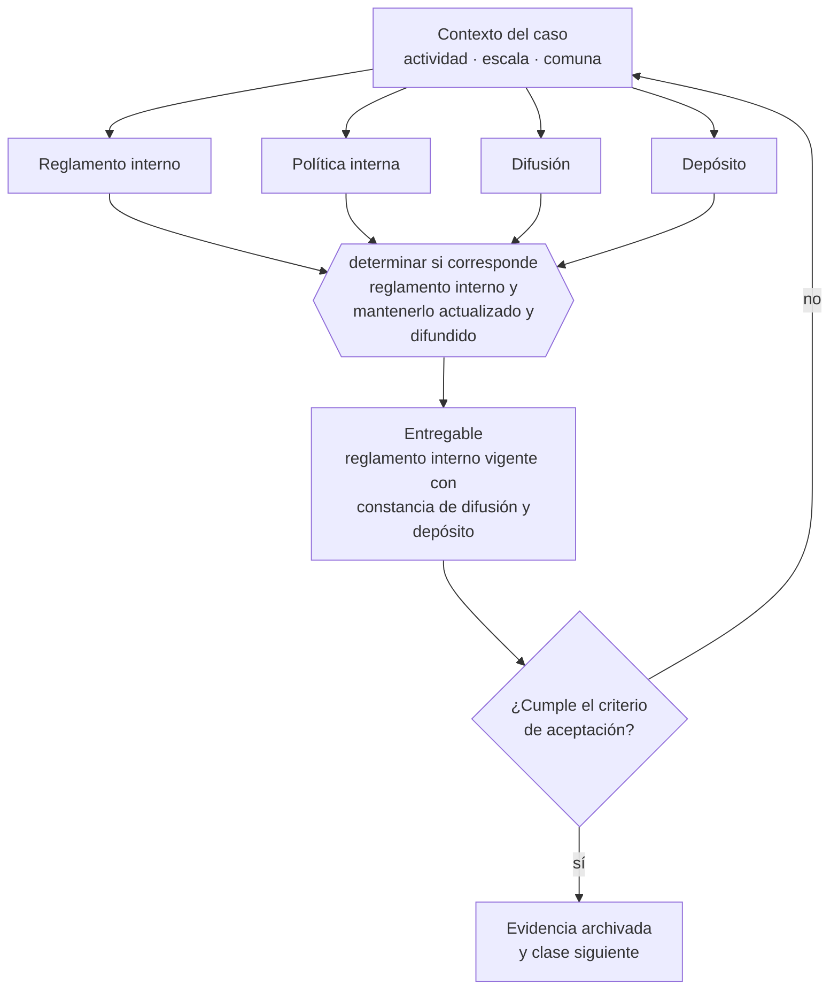

# Clase 163 — Reglamento interno y políticas

> **Parte 12 · Personas, relaciones laborales y seguridad y salud** — clase 9 de 14

**Estado de evidencia:** `VERIFICADO-FUENTE` · **Jurisdicción:** Chile-first · **Fecha base normativa:** 07-08-2026 
**Decisión que habilita:** determinar si corresponde reglamento interno y mantenerlo actualizado y difundido 
**Entregable:** reglamento interno vigente con constancia de difusión y depósito

## 🎯 Propósito

Mantener el reglamento interno vigente y difundido, porque sin él no hay fundamento para aplicar una medida disciplinaria.

## 📚 Resultados de aprendizaje

Al finalizar esta clase podrás:

1. **Definir** con precisión los cuatro conceptos de la tabla siguiente y usarlos para describir un caso real.
2. **Explicar** por qué esta materia condiciona decisiones de otras partes del programa.
3. **Decidir** —determinar si corresponde reglamento interno y mantenerlo actualizado y difundido— y justificar la decisión por escrito.
4. **Producir** el entregable de la clase y contrastarlo contra su criterio de aceptación.
5. **Distinguir** el dato estable del dato dinámico que exige revalidación en la fuente oficial.

## 🧩 Conceptos centrales

| Concepto | Comprensión verificable |
|---|---|
| **Reglamento interno** | Documento obligatorio sobre orden, higiene y seguridad según dotación. |
| **Política interna** | Norma de la empresa complementaria al reglamento. |
| **Difusión** | Obligación de entregar y dejar constancia de conocimiento. |
| **Depósito** | Entrega del reglamento ante las autoridades correspondientes. |

## 🗺️ Flujo de razonamiento

## 📖 Desarrollo

### 1. El fondo del asunto

El reglamento interno es obligatorio a partir de cierta dotación y debe difundirse y depositarse. Su valor práctico es habilitar sanciones: sin reglamento difundido, aplicar una medida disciplinaria queda sin fundamento. Debe actualizarse tras cambios legales relevantes como la Ley Karin.

### 2. Cómo se traduce en la práctica

Es obligatorio a partir de cierta dotación y debe difundirse y depositarse ante las autoridades correspondientes. Un reglamento desactualizado que no incorpora los cambios legales recientes —Ley Karin, entre otros— deja a la empresa sin el instrumento justo cuando lo necesita.

### 3. Marco aplicable y quién interviene

- Código del Trabajo
- Ley 21.561 de reducción gradual de jornada: 42 horas semanales desde el 26 de abril de 2026
- Ley 21.643 (Ley Karin) sobre acoso laboral, sexual y violencia en el trabajo
- Ley 16.744 sobre accidentes del trabajo y enfermedades profesionales y DS 44 de gestión preventiva
- Ley 20.123 sobre subcontratación y servicios transitorios
- Ley 21.850, art. 33 ter de la Ley sobre Impuesto a la Renta: crédito por remuneraciones en servicios del conocimiento exportados, incompatible con otras franquicias basadas en remuneraciones

**Autoridades o contrapartes involucradas:** Dirección del Trabajo, SUSESO, Mutualidades, Previred, IPS.
**Profesionales de apoyo:** abogado laboral, encargado de personas, prevencionista de riesgos, contador de remuneraciones. La participación concreta depende del riesgo, del
tamaño de la empresa y de la actividad económica.

## 🤝 Reputación y confianza: reclamos internos y política de comunicación laboral

[Guía de reputación, crisis y confianza, sección 6](../../../docs/22_REPUTACION_CRISIS_Y_CONFIANZA.md#6-gestión-de-reclamos-y-controversias)

**Lente para esta clase:** El mejor control de un conflicto laboral público es que el reclamo tenga un camino interno conocido, rápido y con respuesta, antes de que llegue a la prensa.

| Nivel | Medida proporcionada |
|---|---|
| **Emprendedor o microempresa** | Designar por escrito ante quién se plantea un reclamo y comprometer una respuesta con fecha, aunque sea una negativa fundada. |
| **Pyme** | Reglamento con cargos designados, protocolo conocido por todos, registro de reclamos y revisión trimestral con la jefatura. |
| **Gran empresa o multinacional** | Canales múltiples, representación de trabajadores en comités, indicadores de reclamos y auditoría interna del procedimiento. |

**Obligación legal:** El reglamento interno debe designar los cargos ante quienes los trabajadores plantean peticiones y reclamos, e incluir el protocolo de prevención del acoso y la violencia en el trabajo (Código del Trabajo, art. 154). Quien no está obligado a tener reglamento debe informar el protocolo al firmar el contrato (art. 154 bis).

**Recomendación profesional:** Publicar en lenguaje simple cómo se reclama, en cuántos días se responde y qué ocurre después; medir cuántos reclamos se resuelven en plazo.

**Actividad:** Escribe en cinco líneas el camino que sigue un reclamo de un trabajador, con responsable y plazo de respuesta en cada paso.

**Plantilla:** [Política de comunicación corporativa](../../../templates/25_politica_comunicacion_corporativa.md)

**Términos:** Gestión de reclamos (*Complaint handling*) · Relaciones laborales (*Employee relations*)

**Simulación:** [caso 5 del expediente de reputación y crisis](../../../case-studies/23-reputacion-y-crisis-siete-casos.md#5-empresa-con-conflicto-laboral-público). Examina cómo un reglamento sin canal de reclamo claro empuja el conflicto a la carta pública. Es una simulación ilustrativa, no una empresa real.

*Distingue lo que la ley exige de lo que conviene hacer. Las normas se leyeron en la Biblioteca del Congreso Nacional; verifica la versión vigente y consulta a un abogado antes de aplicarlas a un caso real.*

## 🧪 Taller guiado

Aplica esta clase a **una** de las siguientes líneas de negocio y repite después el ejercicio con
una segunda línea de carga regulatoria distinta:

| Línea | Carga regulatoria |
|---|---|
| SaaS B2B con IA | media |
| Servicios profesionales | baja |
| E-commerce D2C | media |
| Alimentos o foodtech | alta |
| Exportación de servicios | media |
| Fintech regulada | alta |
| Construcción o servicios técnicos | alta |

**Secuencia de trabajo:**

1. Delimita el contexto: actividad económica, escala, comuna y etapa de la empresa.
2. Reúne los antecedentes que la decisión exige y anota la fecha de cada fuente.
3. Identifica las alternativas reales, incluida la de no hacer nada.
4. Evalúa el impacto en mercado, caja, personas, regulación y operación.
5. Toma la decisión y regístrala con sus supuestos.
6. Produce el entregable.
7. Contrástalo contra el criterio de aceptación.
8. Anota lo que requiere validación profesional y programa su revisión.

### 📦 Entregable

Reglamento interno vigente con constancia de difusión y depósito.

Debe incluir decisión, supuestos, fuentes con fecha de consulta, responsable, riesgos
identificados y próximos pasos.

## 🏆 Reto verificable

Resuelve la misma materia para una segunda línea de negocio con distinta carga regulatoria y
explica por escrito **qué cambió, por qué y qué fuente lo determina**.

## ✅ Criterio de aceptación

- [ ] el reglamento está vigente y difundido con constancia
- [ ] incorpora las obligaciones legales actuales
- [ ] cada afirmación regulatoria está referida a una fuente oficial con fecha de consulta;
- [ ] los datos dinámicos quedan marcados para revalidación;
- [ ] hay un responsable asignado y evidencia reproducible del trabajo.

## ⚠️ Errores frecuentes

**Propios de esta clase:**

- Mantener un reglamento desactualizado que no incorpora los cambios legales.
- Aplicar sanciones no contempladas en el reglamento difundido.

**Característicos de la parte 12:**

- Contratar a honorarios a alguien que en los hechos es trabajador dependiente.
- No adecuar jornada y turnos al calendario de reducción legal.

## 🇨🇱 Checklist Chile

- [ ] ¿existe norma o autoridad específica para esta materia?
- [ ] ¿la fuente consultada está vigente a la fecha de ejecución?
- [ ] ¿se activa algún trámite ante el SII?
- [ ] ¿se activa algún requisito municipal o sectorial?
- [ ] ¿afecta a consumidores o al tratamiento de datos personales?
- [ ] ¿afecta a trabajadores o a la seguridad y salud en el trabajo?
- [ ] ¿afecta a impuestos, contabilidad o caja?
- [ ] ¿afecta a contratos o a propiedad intelectual?
- [ ] ¿requiere renovación, reporte periódico o revalidación?

## ❓ Preguntas de comprobación

1. ¿Tu reglamento interno está vigente e incorpora los cambios legales recientes?
2. ¿Puedes acreditar que cada trabajador lo recibió y lo conoció?
3. ¿Aplicaste alguna sanción no contemplada en el reglamento difundido?

## 🔗 Fuentes oficiales

**Dirección del Trabajo — Relaciones laborales y obligaciones del empleador**  
<https://www.dt.gob.cl/> · verificado 2026-11-05

- *Qué contiene:* Concentra el Código del Trabajo aplicado: dictámenes que interpretan la norma en casos concretos, la plataforma Mi DT para registrar contratos y finiquitos, y las guías de fiscalización.
- *Cómo leerla:* Los dictámenes valen más que las guías divulgativas: describen cómo la autoridad resolvió un caso real. Busca por materia y contrasta la fecha, porque un dictamen posterior puede cambiar el criterio anterior.
- *Uso en esta clase:* aporta el marco de «Relaciones laborales y obligaciones del empleador» para determinar si corresponde reglamento interno y mantenerlo actualizado y difundido.

**Biblioteca del Congreso Nacional · LeyChile — Normativa oficial consolidada**  
<https://www.bcn.cl/leychile/> · verificado 2026-11-05

- *Qué contiene:* Publica el texto oficial y consolidado de leyes, decretos y reglamentos, con la versión vigente a una fecha, el historial de modificaciones y la tramitación que las originó.
- *Cómo leerla:* Usa siempre el selector de versión vigente a la fecha en que ejecutarás el trámite, no la última publicada. Y lee el artículo transitorio: en normas en implantación gradual —jornada, datos personales— ahí está la fecha que realmente te aplica.
- *Uso en esta clase:* aporta el marco de «Normativa oficial consolidada» para determinar si corresponde reglamento interno y mantenerlo actualizado y difundido.

**Biblioteca del Congreso Nacional — Código del Trabajo (DFL 1 de 2002)**  
<https://www.bcn.cl/leychile/navegar?idNorma=207436> · verificado 2026-11-25

- *Qué contiene:* Incluye el contenido del reglamento interno y el protocolo contra el acoso y la violencia (art. 154), el procedimiento de investigación de denuncias (art. 211-C), las causales de término y su comunicación (arts. 161 y 162), las prácticas antisindicales (arts. 289 y 291) y la prohibición de reemplazar a trabajadores en huelga (art. 345).
- *Cómo leerla:* Úsalo para separar lo que el empleador debe hacer en un conflicto laboral de lo que solo conviene comunicar. Verifica siempre la versión vigente del artículo antes de citarlo.
- *Uso en esta clase:* aporta el marco de «Código del Trabajo (DFL 1 de 2002)» para determinar si corresponde reglamento interno y mantenerlo actualizado y difundido.

**Biblioteca del Congreso Nacional — Ley 21.643 — Prevención, investigación y sanción del acoso laboral, sexual y la violencia en el trabajo**  
<https://www.bcn.cl/leychile/navegar?idNorma=1200096> · verificado 2026-11-25

- *Qué contiene:* Modifica el Código del Trabajo para exigir un protocolo de prevención, fija la investigación de las denuncias en treinta días y dispone su vigencia el primer día del sexto mes subsiguiente a su publicación.
- *Cómo leerla:* Úsala para diseñar el protocolo y el procedimiento de investigación; la fecha de vigencia se calcula desde la publicación y debe comprobarse en el Diario Oficial.
- *Uso en esta clase:* aporta el marco de «Ley 21.643 — Prevención, investigación y sanción del acoso laboral, sexual y la violencia en el trabajo» para determinar si corresponde reglamento interno y mantenerlo actualizado y difundido.

Complementos del repositorio: [glosario](../../../docs/19_GLOSSARY.md) ·
[ruta de lecturas](../../../docs/15_BOOKS_AND_LEARNING_PATH.md) ·
[catálogo de fuentes](../../../docs/16_OFFICIAL_SOURCE_CATALOG.md).

> [!IMPORTANT]
> Material educativo. Para una decisión real de alto impacto hay que verificar la fuente oficial
> vigente y validar con el profesional competente.

---

| Anterior | Índice | Siguiente |
|---|---|---|
| [← 162 · Vacaciones, permisos y licencias](../class-08-vacaciones-permisos-y-licencias/README.md) | [Parte 12](../README.md) · [Programa](../../../README.md) | [164 · Ley Karin: prevención, denuncia e investigación →](../class-10-ley-karin-prevencion-denuncia-e-investigacion/README.md) |
