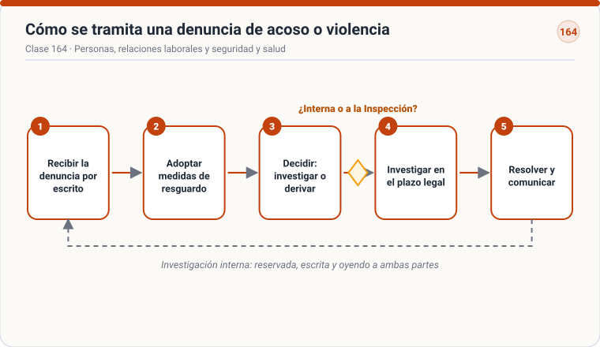

# Clase 164 — Ley Karin: prevención, denuncia e investigación

> **Parte 12 · Personas, relaciones laborales y seguridad y salud** — clase 10 de 14

**Estado de evidencia:** `VERIFICADO-FUENTE` · **Jurisdicción:** Chile-first · **Fecha base normativa:** 07-08-2026 
**Decisión que habilita:** implementar protocolo, canal y procedimiento de investigación conforme a la ley 
**Entregable:** protocolo Ley Karin con canal habilitado, procedimiento de investigación y registro de casos

## 🎯 Propósito

Implementar protocolo, canal de denuncia y procedimiento de investigación conforme a la Ley 21.643, que obliga a toda empresa con trabajadores.

## 📚 Resultados de aprendizaje

Al finalizar esta clase podrás:

1. **Definir** con precisión los cuatro conceptos de la tabla siguiente y usarlos para describir un caso real.
2. **Explicar** por qué esta materia condiciona decisiones de otras partes del programa.
3. **Decidir** —implementar protocolo, canal y procedimiento de investigación conforme a la ley— y justificar la decisión por escrito.
4. **Producir** el entregable de la clase y contrastarlo contra su criterio de aceptación.
5. **Distinguir** el dato estable del dato dinámico que exige revalidación en la fuente oficial.

## 🧩 Conceptos centrales

| Concepto | Comprensión verificable |
|---|---|
| **Ley 21.643** | Ley karin, sobre acoso laboral, sexual y violencia en el trabajo. |
| **Protocolo de prevención** | Documento obligatorio con medidas preventivas. |
| **Canal de denuncia** | Medio confidencial para reportar. |
| **Investigación** | Procedimiento reglado con plazos y debido proceso. |

## 🗺️ Modelo mental: Cómo se tramita una denuncia de acoso o violencia

> **La idea en una frase:** La Ley Karin obliga a todas las empresas con trabajadores a tener un protocolo de prevención, un canal de denuncia y un procedimiento de investigación con plazos.

**Lectura guiada:** Cada casilla es un paso del procedimiento. El rombo decide si se investiga internamente o se deriva a la Inspección del Trabajo; en ambos casos hay plazos y medidas de resguardo.

**Una analogía:** Es el protocolo de emergencia de un edificio: debe estar escrito, conocido y probado antes de que haya fuego.

## 📖 Desarrollo

### 1. El fondo del asunto

La Ley Karin obliga a todas las empresas con trabajadores a tener protocolo de prevención, canal de denuncia y procedimiento de investigación con plazos. La investigación puede ser interna o derivarse a la Dirección del Trabajo, y el incumplimiento del procedimiento genera responsabilidad aunque el hecho denunciado no se acredite.

### 2. Cómo se traduce en la práctica

Implementa el protocolo de prevención, difúndelo y deja constancia de su entrega. Habilita un canal de denuncia accesible y reservado. Define el procedimiento: recepción, medidas de resguardo, decisión de investigar o derivar en tres días e investigación concluida en treinta días, escrita, reservada y oyendo a ambas partes. Capacita a quienes investiguen.

### 3. Marco aplicable y quién interviene

- Código del Trabajo
- Ley 21.561 de reducción gradual de jornada: 42 horas semanales desde el 26 de abril de 2026
- Ley 21.643 (Ley Karin) sobre acoso laboral, sexual y violencia en el trabajo
- Ley 16.744 sobre accidentes del trabajo y enfermedades profesionales y DS 44 de gestión preventiva
- Ley 20.123 sobre subcontratación y servicios transitorios
- Ley 21.850, art. 33 ter de la Ley sobre Impuesto a la Renta: crédito por remuneraciones en servicios del conocimiento exportados, incompatible con otras franquicias basadas en remuneraciones

**Autoridades o contrapartes involucradas:** Dirección del Trabajo, SUSESO, Mutualidades, Previred, IPS.
**Profesionales de apoyo:** abogado laboral, encargado de personas, prevencionista de riesgos, contador de remuneraciones. La participación concreta depende del riesgo, del
tamaño de la empresa y de la actividad económica.

### 4. Pruébalo tú: mini simulación

Simula una denuncia en tu empresa. Escribe una línea de tiempo: día 1, recibes la denuncia y adoptas medidas de resguardo; día 3, decides si investigas internamente o derivas a la Inspección; hasta el día 30, concluyes la investigación si es interna. Define quién investiga, cómo se garantiza la reserva y cómo se informa a las partes. Anota las dudas que te surgieron. El ejercicio es ilustrativo y no reemplaza la asesoría de un abogado laboral.

### 5. En qué se apoya

- **Ley 21.643 — Prevención, investigación y sanción del acoso laboral, sexual y la violencia en el trabajo** (Biblioteca del Congreso Nacional): La Ley 21.643 exige un protocolo de prevención del acoso laboral, sexual y la violencia en el trabajo y modifica el procedimiento de investigación.
- **Código del Trabajo (DFL 1 de 2002)** (Biblioteca del Congreso Nacional): El artículo 211-C del Código del Trabajo establece la investigación interna o su remisión a la Inspección en tres días y su conclusión en treinta días, por escrito, reservada y oyendo a ambas partes.

*Las lecturas de apoyo ofrecen marcos conceptuales; lo que exige la ley chilena se verifica en las fuentes oficiales de esta clase.*

## 🤝 Reputación y confianza: denuncia, investigación y comunicación interna

[Guía de reputación, crisis y confianza, sección 14](../../../docs/22_REPUTACION_CRISIS_Y_CONFIANZA.md#14-conflictos-laborales-y-con-proveedores)

**Lente para esta clase:** Una denuncia mal manejada se transforma en crisis pública: la investigación protege a las personas y la comunicación debe esperar a los hechos sin filtrar identidades.

| Nivel | Medida proporcionada |
|---|---|
| **Emprendedor o microempresa** | Recibir la denuncia por escrito, apartar al denunciado del trato directo y decidir en 3 días si se investiga o se remite. |
| **Pyme** | Procedimiento con investigador designado, entrevistas con ambas partes, acta reservada y comunicación mínima al equipo. |
| **Gran empresa o multinacional** | Unidad especializada, protocolo auditado, asesoría externa independiente y reportes agregados al directorio sin identidades. |

**Obligación legal:** Presentada la denuncia en la empresa, el empleador dispone una investigación interna o remite los antecedentes a la Inspección del Trabajo en 3 días; la investigación concluye en 30 días, consta por escrito, es reservada y oye a ambas partes (Código del Trabajo, art. 211-C, según la Ley 21.643).

**Recomendación profesional:** Comunicar al equipo solo que existe un procedimiento y que no habrá represalias; no confirmar ni negar nombres hacia fuera.

**Actividad:** Lista en un cronograma de 30 días quién hace qué desde la recepción de una denuncia, y qué se dice al equipo en el día 1.

**Plantilla:** [Protocolo de escalamiento y vocería](../../../templates/28_protocolo_escalamiento_y_voceria.md)

**Términos:** Debido proceso (*Due process*) · Medida de resguardo (*Protective measure*)

**Simulación:** [caso 5 del expediente de reputación y crisis](../../../case-studies/23-reputacion-y-crisis-siete-casos.md#5-empresa-con-conflicto-laboral-público). Sigue una denuncia de acoso en medio de un conflicto colectivo y separa lo que se investiga de lo que se comunica. Es una simulación ilustrativa, no una empresa real.

*Distingue lo que la ley exige de lo que conviene hacer. Las normas se leyeron en la Biblioteca del Congreso Nacional; verifica la versión vigente y consulta a un abogado antes de aplicarlas a un caso real.*

## 🧪 Taller guiado

Aplica esta clase a **una** de las siguientes líneas de negocio y repite después el ejercicio con
una segunda línea de carga regulatoria distinta:

| Línea | Carga regulatoria |
|---|---|
| SaaS B2B con IA | media |
| Servicios profesionales | baja |
| E-commerce D2C | media |
| Alimentos o foodtech | alta |
| Exportación de servicios | media |
| Fintech regulada | alta |
| Construcción o servicios técnicos | alta |

**Secuencia de trabajo:**

1. Delimita el contexto: actividad económica, escala, comuna y etapa de la empresa.
2. Reúne los antecedentes que la decisión exige y anota la fecha de cada fuente.
3. Identifica las alternativas reales, incluida la de no hacer nada.
4. Evalúa el impacto en mercado, caja, personas, regulación y operación.
5. Toma la decisión y regístrala con sus supuestos.
6. Produce el entregable.
7. Contrástalo contra el criterio de aceptación.
8. Anota lo que requiere validación profesional y programa su revisión.

### 📦 Entregable

Protocolo ley karin con canal habilitado, procedimiento de investigación y registro de casos.

Debe incluir decisión, supuestos, fuentes con fecha de consulta, responsable, riesgos
identificados y próximos pasos.

## 🏆 Reto verificable

Resuelve la misma materia para una segunda línea de negocio con distinta carga regulatoria y
explica por escrito **qué cambió, por qué y qué fuente lo determina**.

## ✅ Criterio de aceptación

- [ ] el protocolo, el canal y el procedimiento están implementados
- [ ] hay personas designadas y capacitadas para investigar
- [ ] cada afirmación regulatoria está referida a una fuente oficial con fecha de consulta;
- [ ] los datos dinámicos quedan marcados para revalidación;
- [ ] hay un responsable asignado y evidencia reproducible del trabajo.

## ⚠️ Errores frecuentes

**Propios de esta clase:**

- Tener el protocolo sin canal operativo ni personas capacitadas para investigar.
- Investigar sin respetar plazos y garantías del debido proceso.

**Característicos de la parte 12:**

- Contratar a honorarios a alguien que en los hechos es trabajador dependiente.
- No adecuar jornada y turnos al calendario de reducción legal.

## 🇨🇱 Checklist Chile

- [ ] ¿existe norma o autoridad específica para esta materia?
- [ ] ¿la fuente consultada está vigente a la fecha de ejecución?
- [ ] ¿se activa algún trámite ante el SII?
- [ ] ¿se activa algún requisito municipal o sectorial?
- [ ] ¿afecta a consumidores o al tratamiento de datos personales?
- [ ] ¿afecta a trabajadores o a la seguridad y salud en el trabajo?
- [ ] ¿afecta a impuestos, contabilidad o caja?
- [ ] ¿afecta a contratos o a propiedad intelectual?
- [ ] ¿requiere renovación, reporte periódico o revalidación?

## ❓ Preguntas de comprobación

1. ¿Tienes protocolo, canal operativo y personas designadas y capacitadas para investigar?
2. ¿A quién llega una denuncia y qué pasa si involucra a esa misma persona?
3. ¿Podrías cumplir los plazos de investigación con los recursos actuales?

## 🔗 Fuentes oficiales

**Dirección del Trabajo — Relaciones laborales y obligaciones del empleador**  
<https://www.dt.gob.cl/> · verificado 2026-11-05

- *Qué contiene:* Concentra el Código del Trabajo aplicado: dictámenes que interpretan la norma en casos concretos, la plataforma Mi DT para registrar contratos y finiquitos, y las guías de fiscalización.
- *Cómo leerla:* Los dictámenes valen más que las guías divulgativas: describen cómo la autoridad resolvió un caso real. Busca por materia y contrasta la fecha, porque un dictamen posterior puede cambiar el criterio anterior.
- *Uso en esta clase:* aporta el marco de «Relaciones laborales y obligaciones del empleador» para implementar protocolo, canal y procedimiento de investigación conforme a la ley.

**Biblioteca del Congreso Nacional · LeyChile — Normativa oficial consolidada**  
<https://www.bcn.cl/leychile/> · verificado 2026-11-05

- *Qué contiene:* Publica el texto oficial y consolidado de leyes, decretos y reglamentos, con la versión vigente a una fecha, el historial de modificaciones y la tramitación que las originó.
- *Cómo leerla:* Usa siempre el selector de versión vigente a la fecha en que ejecutarás el trámite, no la última publicada. Y lee el artículo transitorio: en normas en implantación gradual —jornada, datos personales— ahí está la fecha que realmente te aplica.
- *Uso en esta clase:* aporta el marco de «Normativa oficial consolidada» para implementar protocolo, canal y procedimiento de investigación conforme a la ley.

**Biblioteca del Congreso Nacional — Código del Trabajo (DFL 1 de 2002)**  
<https://www.bcn.cl/leychile/navegar?idNorma=207436> · verificado 2026-11-25

- *Qué contiene:* Incluye el contenido del reglamento interno y el protocolo contra el acoso y la violencia (art. 154), el procedimiento de investigación de denuncias (art. 211-C), las causales de término y su comunicación (arts. 161 y 162), las prácticas antisindicales (arts. 289 y 291) y la prohibición de reemplazar a trabajadores en huelga (art. 345).
- *Cómo leerla:* Úsalo para separar lo que el empleador debe hacer en un conflicto laboral de lo que solo conviene comunicar. Verifica siempre la versión vigente del artículo antes de citarlo.
- *Uso en esta clase:* aporta el marco de «Código del Trabajo (DFL 1 de 2002)» para implementar protocolo, canal y procedimiento de investigación conforme a la ley.

**Biblioteca del Congreso Nacional — Ley 21.643 — Prevención, investigación y sanción del acoso laboral, sexual y la violencia en el trabajo**  
<https://www.bcn.cl/leychile/navegar?idNorma=1200096> · verificado 2026-11-25

- *Qué contiene:* Modifica el Código del Trabajo para exigir un protocolo de prevención, fija la investigación de las denuncias en treinta días y dispone su vigencia el primer día del sexto mes subsiguiente a su publicación.
- *Cómo leerla:* Úsala para diseñar el protocolo y el procedimiento de investigación; la fecha de vigencia se calcula desde la publicación y debe comprobarse en el Diario Oficial.
- *Uso en esta clase:* aporta el marco de «Ley 21.643 — Prevención, investigación y sanción del acoso laboral, sexual y la violencia en el trabajo» para implementar protocolo, canal y procedimiento de investigación conforme a la ley.

Complementos del repositorio: [glosario](../../../docs/19_GLOSSARY.md) ·
[ruta de lecturas](../../../docs/15_BOOKS_AND_LEARNING_PATH.md) ·
[catálogo de fuentes](../../../docs/16_OFFICIAL_SOURCE_CATALOG.md).

> [!IMPORTANT]
> Material educativo. Para una decisión real de alto impacto hay que verificar la fuente oficial
> vigente y validar con el profesional competente.

---

| Anterior | Índice | Siguiente |
|---|---|---|
| [← 163 · Reglamento interno y políticas](../class-09-reglamento-interno-y-politicas/README.md) | [Parte 12](../README.md) · [Programa](../../../README.md) | [165 · Subcontratación y servicios transitorios →](../class-11-subcontratacion-y-servicios-transitorios/README.md) |
