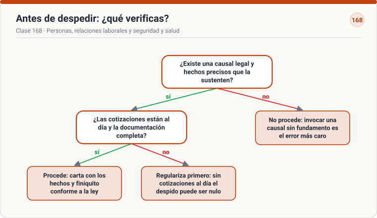

# Clase 168 — Término de contrato y documentación de salida

> **Parte 12 · Personas, relaciones laborales y seguridad y salud** — clase 14 de 14

**Estado de evidencia:** `VERIFICADO-FUENTE` · **Jurisdicción:** Chile-first · **Fecha base normativa:** 07-08-2026 
**Decisión que habilita:** ejecutar el término con causal correcta y documentación completa 
**Entregable:** checklist de término con causal fundada, carta, verificación de cotizaciones y finiquito

## 🎯 Propósito

Ejecutar el término con causal correcta y documentación completa, verificando las cotizaciones antes de comunicar la decisión.

## 📚 Resultados de aprendizaje

Al finalizar esta clase podrás:

1. **Definir** con precisión los cuatro conceptos de la tabla siguiente y usarlos para describir un caso real.
2. **Explicar** por qué esta materia condiciona decisiones de otras partes del programa.
3. **Decidir** —ejecutar el término con causal correcta y documentación completa— y justificar la decisión por escrito.
4. **Producir** el entregable de la clase y contrastarlo contra su criterio de aceptación.
5. **Distinguir** el dato estable del dato dinámico que exige revalidación en la fuente oficial.

## 🧩 Conceptos centrales

| Concepto | Comprensión verificable |
|---|---|
| **Causal de término** | Fundamento legal invocado para poner fin al contrato. |
| **Carta de aviso** | Comunicación con causal, hechos y fecha. |
| **Finiquito** | Documento que liquida las obligaciones pendientes. |
| **Documentación de salida** | Conjunto de entregas y devoluciones al término. |

## 🗺️ Modelo mental: Antes de despedir: ¿qué verificas?

> **La idea en una frase:** El término del contrato exige causal correcta, carta con hechos precisos, cotizaciones al día y finiquito conforme a la ley; los errores más caros son invocar una causal sin fundamento y no tener las cotizaciones al día.

**Cómo leerlo:** Recorre el árbol antes de cada desvinculación. Las dos preguntas protegen a la empresa de las dos fallas más costosas: la causal sin sustento y la documentación incompleta.

**Una analogía:** Es el control previo al despegue de un avión: no se omite aunque haya prisa, porque lo que se evita es mucho más costoso que la demora.

## 📖 Desarrollo

### 1. El fondo del asunto

El término de contrato exige causal correcta, carta con hechos precisos, cotizaciones al día y finiquito suscrito conforme a la ley. Los errores más caros son invocar una causal sin fundamento y no tener las cotizaciones pagadas, que puede obligar a seguir pagando remuneraciones.

### 2. Cómo se traduce en la práctica

Antes de despedir, consulta con un abogado laboral, revisa la causal con evidencia y comprueba el estado de las cotizaciones. Redacta la carta con hechos precisos y envíala dentro del plazo legal, con copia a la Inspección cuando corresponda. Prepara el finiquito y la documentación de salida. En conflictos colectivos, evita decisiones que parezcan represalias.

### 3. Marco aplicable y quién interviene

- Código del Trabajo
- Ley 21.561 de reducción gradual de jornada: 42 horas semanales desde el 26 de abril de 2026
- Ley 21.643 (Ley Karin) sobre acoso laboral, sexual y violencia en el trabajo
- Ley 16.744 sobre accidentes del trabajo y enfermedades profesionales y DS 44 de gestión preventiva
- Ley 20.123 sobre subcontratación y servicios transitorios
- Ley 21.850, art. 33 ter de la Ley sobre Impuesto a la Renta: crédito por remuneraciones en servicios del conocimiento exportados, incompatible con otras franquicias basadas en remuneraciones

**Autoridades o contrapartes involucradas:** Dirección del Trabajo, SUSESO, Mutualidades, Previred, IPS.
**Profesionales de apoyo:** abogado laboral, encargado de personas, prevencionista de riesgos, contador de remuneraciones. La participación concreta depende del riesgo, del
tamaño de la empresa y de la actividad económica.

### 4. Cómo se decide, paso a paso

Decide con tres pasos. Uno: ¿cuál es la causal y qué hechos concretos la prueban? Dos: ¿las cotizaciones están pagadas? Tres: ¿la carta de aviso y el finiquito cumplen los requisitos? Una empresa decide despedir por necesidades de la empresa, reúne la justificación económica, paga las cotizaciones atrasadas, comunica por escrito dentro del plazo legal y suscribe el finiquito con ministro de fe cuando corresponde.

### 5. En qué se apoya

- **Código del Trabajo (DFL 1 de 2002)** (Biblioteca del Congreso Nacional): Los artículos 161 y 162 del Código del Trabajo regulan la causal de necesidades de la empresa y la comunicación escrita del término del contrato.
- **The Hard Thing About Hard Things** (HarperBusiness): Horowitz relata decisiones difíciles de despido y reestructuración y la importancia de comunicarlas con claridad y respeto.

*Las lecturas de apoyo ofrecen marcos conceptuales; lo que exige la ley chilena se verifica en las fuentes oficiales de esta clase.*

## 🛡️ Protección del conocimiento: Contrainteligencia empresarial

[Guía de inteligencia económica y protección del conocimiento, sección 10](../../../docs/21_INTELIGENCIA_ECONOMICA_Y_PROTECCION_DEL_CONOCIMIENTO.md#10-contrainteligencia-empresarial)

**Lente para esta clase:** La salida de una persona es el momento de mayor riesgo de fuga; un cierre ordenado protege a la empresa y evita sospechas infundadas sobre quien se va.

| Nivel | Medida proporcionada |
|---|---|
| **Emprendedor o microempresa** | Lista de siete acciones del último día: devolver equipos, cerrar cuentas, cambiar claves compartidas y recordar el deber de reserva. |
| **Pyme** | Procedimiento de salida con responsable, cierre de accesos el mismo día y entrevista que registra qué información conocía la persona. |
| **Gran empresa o multinacional** | Salida coordinada entre personas, seguridad y tecnología, con revisión de accesos inusuales en las semanas previas a salidas críticas. |

**Actividad sin crear sistemas:** Arma la lista del último día para un cargo crítico y define quién verifica cada punto y dónde queda constancia.

**Términos:** Amenaza interna (*Insider Threat*) · Cierre de accesos (*Deprovisioning*)

*Enfoque defensivo: reconocer, prevenir, documentar y escalar. No enseña a obtener información de forma indebida; la calificación jurídica de un hecho concreto corresponde a un abogado.*

## 🤝 Reputación y confianza: desvinculaciones en tiempo de conflicto

[Guía de reputación, crisis y confianza, sección 14](../../../docs/22_REPUTACION_CRISIS_Y_CONFIANZA.md#14-conflictos-laborales-y-con-proveedores)

**Lente para esta clase:** Una desvinculación puede ser legal y aun así ser la noticia: en medio de un conflicto, el momento, el orden y el mensaje importan tanto como la causal.

| Nivel | Medida proporcionada |
|---|---|
| **Emprendedor o microempresa** | Antes de cualquier desvinculación en conflicto, revisar con un abogado la causal, la evidencia y el momento. |
| **Pyme** | Lista de verificación de salida: causal, comunicación escrita, documentos, mensaje interno y registro de la decisión. |
| **Gran empresa o multinacional** | Comité de personas y legal que revisa toda desvinculación colectiva y su mensaje, con análisis de riesgo de tutela y sindical. |

**Obligación legal:** El término por necesidades de la empresa es una causal legal (Código del Trabajo, art. 161) y la comunicación debe constar por escrito (art. 162). Ejercer presión con pérdida de empleo o cierre contra la sindicalización constituye práctica antisindical (arts. 289 y 291).

**Recomendación profesional:** Evitar decisiones masivas durante un conflicto abierto; si son inevitables, explicar los criterios y el apoyo ofrecido a quienes salen.

**Actividad:** Redacta el mensaje interno de cuatro líneas para anunciar un ajuste de dotación, sin culpar a nadie y con el apoyo que se ofrece.

**Plantilla:** [Guías de comunicación por audiencia](../../../templates/31_guias_comunicacion_por_audiencia.md)

**Términos:** Desvinculación (*Termination of employment*) · Práctica antisindical (*Unfair labor practice*)

**Simulación:** [caso 5 del expediente de reputación y crisis](../../../case-studies/23-reputacion-y-crisis-siete-casos.md#5-empresa-con-conflicto-laboral-público). Evalúa por qué un término de contrato durante un conflicto público se lee como represalia aunque tenga causal. Es una simulación ilustrativa, no una empresa real.

*Distingue lo que la ley exige de lo que conviene hacer. Las normas se leyeron en la Biblioteca del Congreso Nacional; verifica la versión vigente y consulta a un abogado antes de aplicarlas a un caso real.*

## 🧪 Taller guiado

Aplica esta clase a **una** de las siguientes líneas de negocio y repite después el ejercicio con
una segunda línea de carga regulatoria distinta:

| Línea | Carga regulatoria |
|---|---|
| SaaS B2B con IA | media |
| Servicios profesionales | baja |
| E-commerce D2C | media |
| Alimentos o foodtech | alta |
| Exportación de servicios | media |
| Fintech regulada | alta |
| Construcción o servicios técnicos | alta |

**Secuencia de trabajo:**

1. Delimita el contexto: actividad económica, escala, comuna y etapa de la empresa.
2. Reúne los antecedentes que la decisión exige y anota la fecha de cada fuente.
3. Identifica las alternativas reales, incluida la de no hacer nada.
4. Evalúa el impacto en mercado, caja, personas, regulación y operación.
5. Toma la decisión y regístrala con sus supuestos.
6. Produce el entregable.
7. Contrástalo contra el criterio de aceptación.
8. Anota lo que requiere validación profesional y programa su revisión.

### 📦 Entregable

Checklist de término con causal fundada, carta, verificación de cotizaciones y finiquito.

Debe incluir decisión, supuestos, fuentes con fecha de consulta, responsable, riesgos
identificados y próximos pasos.

## 🏆 Reto verificable

Resuelve la misma materia para una segunda línea de negocio con distinta carga regulatoria y
explica por escrito **qué cambió, por qué y qué fuente lo determina**.

## ✅ Criterio de aceptación

- [ ] la causal invocada está fundada en hechos acreditables
- [ ] las cotizaciones están verificadas antes de la comunicación
- [ ] cada afirmación regulatoria está referida a una fuente oficial con fecha de consulta;
- [ ] los datos dinámicos quedan marcados para revalidación;
- [ ] hay un responsable asignado y evidencia reproducible del trabajo.

## ⚠️ Errores frecuentes

**Propios de esta clase:**

- Invocar necesidades de la empresa sin poder acreditar los hechos.
- Comunicar el despido sin tener las cotizaciones íntegramente pagadas.

**Característicos de la parte 12:**

- Contratar a honorarios a alguien que en los hechos es trabajador dependiente.
- No adecuar jornada y turnos al calendario de reducción legal.

## 🇨🇱 Checklist Chile

- [ ] ¿existe norma o autoridad específica para esta materia?
- [ ] ¿la fuente consultada está vigente a la fecha de ejecución?
- [ ] ¿se activa algún trámite ante el SII?
- [ ] ¿se activa algún requisito municipal o sectorial?
- [ ] ¿afecta a consumidores o al tratamiento de datos personales?
- [ ] ¿afecta a trabajadores o a la seguridad y salud en el trabajo?
- [ ] ¿afecta a impuestos, contabilidad o caja?
- [ ] ¿afecta a contratos o a propiedad intelectual?
- [ ] ¿requiere renovación, reporte periódico o revalidación?

## ❓ Preguntas de comprobación

1. ¿Puedes acreditar con hechos la causal que piensas invocar?
2. ¿Verificaste el pago íntegro de cotizaciones antes de comunicar?
3. ¿Tu finiquito cumple las formalidades que le dan efecto liberatorio?

## 🔗 Fuentes oficiales

**Dirección del Trabajo — Relaciones laborales y obligaciones del empleador**  
<https://www.dt.gob.cl/> · verificado 2026-11-05

- *Qué contiene:* Concentra el Código del Trabajo aplicado: dictámenes que interpretan la norma en casos concretos, la plataforma Mi DT para registrar contratos y finiquitos, y las guías de fiscalización.
- *Cómo leerla:* Los dictámenes valen más que las guías divulgativas: describen cómo la autoridad resolvió un caso real. Busca por materia y contrasta la fecha, porque un dictamen posterior puede cambiar el criterio anterior.
- *Uso en esta clase:* aporta el marco de «Relaciones laborales y obligaciones del empleador» para ejecutar el término con causal correcta y documentación completa.

**Biblioteca del Congreso Nacional · LeyChile — Normativa oficial consolidada**  
<https://www.bcn.cl/leychile/> · verificado 2026-11-05

- *Qué contiene:* Publica el texto oficial y consolidado de leyes, decretos y reglamentos, con la versión vigente a una fecha, el historial de modificaciones y la tramitación que las originó.
- *Cómo leerla:* Usa siempre el selector de versión vigente a la fecha en que ejecutarás el trámite, no la última publicada. Y lee el artículo transitorio: en normas en implantación gradual —jornada, datos personales— ahí está la fecha que realmente te aplica.
- *Uso en esta clase:* aporta el marco de «Normativa oficial consolidada» para ejecutar el término con causal correcta y documentación completa.

**Biblioteca del Congreso Nacional — Código del Trabajo — Artículos 154 ter y 160 (reserva y causales)**  
<https://www.bcn.cl/leychile/navegar?idNorma=207436> · verificado 2026-11-12

- *Qué contiene:* El artículo 154 ter obliga al empleador a mantener reserva de la información privada del trabajador; el artículo 160 enumera causales de término sin indemnización, entre ellas la falta de probidad y las negociaciones prohibidas por escrito dentro del giro del negocio.
- *Cómo leerla:* El Código no enumera expresamente la revelación de secretos entre las letras del número 1 del artículo 160. Por eso conviene escribir el deber de reserva en el contrato y en el reglamento interno, y consultar a un abogado laboralista antes de invocar una causal.
- *Uso en esta clase:* aporta el marco de «Código del Trabajo — Artículos 154 ter y 160 (reserva y causales)» para ejecutar el término con causal correcta y documentación completa.

**Biblioteca del Congreso Nacional — Código del Trabajo (DFL 1 de 2002)**  
<https://www.bcn.cl/leychile/navegar?idNorma=207436> · verificado 2026-11-25

- *Qué contiene:* Incluye el contenido del reglamento interno y el protocolo contra el acoso y la violencia (art. 154), el procedimiento de investigación de denuncias (art. 211-C), las causales de término y su comunicación (arts. 161 y 162), las prácticas antisindicales (arts. 289 y 291) y la prohibición de reemplazar a trabajadores en huelga (art. 345).
- *Cómo leerla:* Úsalo para separar lo que el empleador debe hacer en un conflicto laboral de lo que solo conviene comunicar. Verifica siempre la versión vigente del artículo antes de citarlo.
- *Uso en esta clase:* aporta el marco de «Código del Trabajo (DFL 1 de 2002)» para ejecutar el término con causal correcta y documentación completa.

**HarperBusiness — The Hard Thing About Hard Things**  
<https://openlibrary.org/isbn/9780062273215> · verificado 2026-11-25

- *Qué contiene:* Relata decisiones difíciles de gestión al dirigir una empresa, incluidas las crisis. Se usa como lectura de apoyo conceptual y no como fuente normativa.
- *Cómo leerla:* Úsalo como marco conceptual para entender el porqué de la práctica, nunca como prueba de lo que exige la ley chilena; para eso están las fuentes oficiales de la clase.
- *Uso en esta clase:* aporta el marco de «The Hard Thing About Hard Things» para ejecutar el término con causal correcta y documentación completa.

Complementos del repositorio: [glosario](../../../docs/19_GLOSSARY.md) ·
[ruta de lecturas](../../../docs/15_BOOKS_AND_LEARNING_PATH.md) ·
[catálogo de fuentes](../../../docs/16_OFFICIAL_SOURCE_CATALOG.md).

> [!IMPORTANT]
> Material educativo. Para una decisión real de alto impacto hay que verificar la fuente oficial
> vigente y validar con el profesional competente.

---

| Anterior | Índice | Siguiente |
|---|---|---|
| [← 167 · Decreto 44 y gestión preventiva de riesgos](../class-13-decreto-44-y-gestion-preventiva-de-riesgos/README.md) | [Parte 12](../README.md) · [Programa](../../../README.md) | [169 · Diseño de procesos end-to-end →](../../part-13-operaciones-compras-inventario-y-calidad/class-01-diseno-de-procesos-end-to-end/README.md) |
