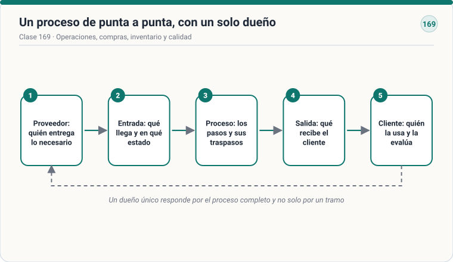

# Clase 169 — Diseño de procesos end-to-end

> **Parte 13 · Operaciones, compras, inventario y calidad** — clase 1 de 14

**Estado de evidencia:** `GUIA-PRACTICA` · **Jurisdicción:** Chile-first · **Fecha base normativa:** 07-08-2026 
**Decisión que habilita:** definir los procesos críticos, su dueño y sus puntos de traspaso 
**Entregable:** mapa SIPOC de los tres procesos críticos con dueño y handoffs identificados

## 🎯 Propósito

Mapear el flujo completo desde el gatillo del cliente hasta el resultado, porque los procesos fallan en los traspasos y no dentro de las actividades.

## 📚 Resultados de aprendizaje

Al finalizar esta clase podrás:

1. **Definir** con precisión los cuatro conceptos de la tabla siguiente y usarlos para describir un caso real.
2. **Explicar** por qué esta materia condiciona decisiones de otras partes del programa.
3. **Decidir** —definir los procesos críticos, su dueño y sus puntos de traspaso— y justificar la decisión por escrito.
4. **Producir** el entregable de la clase y contrastarlo contra su criterio de aceptación.
5. **Distinguir** el dato estable del dato dinámico que exige revalidación en la fuente oficial.

## 🧩 Conceptos centrales

| Concepto | Comprensión verificable |
|---|---|
| **Proceso end-to-end** | Secuencia completa desde el gatillo hasta el resultado para el cliente. |
| **Dueño de proceso** | Responsable único de su desempeño. |
| **Handoff** | Punto de traspaso entre áreas donde se pierde información. |
| **SIPOC** | Mapa de proveedor, entrada, proceso, salida y cliente. |

## 🗺️ Modelo mental: Un proceso de punta a punta, con un solo dueño

> **La idea en una frase:** Los procesos fallan en los traspasos, no en las actividades; mapear de punta a punta revela cuántas veces la información cambia de manos y dónde se pierde.

**Qué mirar primero:** Cada casilla es un tramo del proceso. Los traspasos entre casillas son donde se pierden datos y responsabilidad. Si nadie responde por el conjunto, nadie corrige los traspasos.

**Piénsalo así:** Es una carrera de postas: los corredores pueden ser veloces, pero si el bastón se cae en el traspaso, se pierde la carrera.

## 📖 Desarrollo

### 1. El fondo del asunto

Los procesos fallan en los traspasos, no en las actividades. Mapear end-to-end revela cuántas veces la información cambia de manos y dónde se pierde. Asignar un dueño único al proceso completo, y no a cada tramo, es lo que permite corregir sin negociar entre áreas.

### 2. Cómo se traduce en la práctica

Mapea el flujo real, no el que está en el manual, hablando con quienes lo ejecutan. Cuenta los traspasos y localiza los que pierden información. Asigna un dueño único con autoridad sobre el proceso completo y una métrica. Mejora primero los traspasos: formatos únicos, confirmaciones y plazos de respuesta. Revisa el mapa cada vez que cambie un cliente o un proveedor.

### 3. Marco aplicable y quién interviene

- ISO 9001 como referencia de sistema de gestión de calidad
- teoría de restricciones para capacidad y cuellos de botella
- trazabilidad de lote exigida en rubros regulados (alimentos, salud, químicos)

**Autoridades o contrapartes involucradas:** SEREMI de Salud en rubros con trazabilidad sanitaria, SERNAC en garantía y postventa.
**Profesionales de apoyo:** jefe de operaciones, comprador, encargado de calidad, prevencionista. La participación concreta depende del riesgo, del
tamaño de la empresa y de la actividad económica.

### 4. Pruébalo tú: mini simulación

Elige un proceso crítico de tu empresa, por ejemplo «del pedido a la entrega». Dibuja los cinco tramos y marca cada traspaso entre áreas. Para cada traspaso, escribe qué información viaja, en qué medio y qué pasa si se pierde. Designa a una persona como dueña del proceso completo, con una métrica de desempeño, como el porcentaje de pedidos entregados sin retrabajo. Los datos del ejercicio son ilustrativos.

### 5. En qué se apoya

- **The Goal** (North River Press): Goldratt muestra cómo el desempeño de un sistema depende del flujo completo y de sus restricciones, más que de la eficiencia de cada tramo por separado.
- **Lean Thinking** (Free Press): Womack y Jones proponen mapear el flujo de valor completo y eliminar las esperas y desperdicios entre actividades.

*Las lecturas de apoyo ofrecen marcos conceptuales; lo que exige la ley chilena se verifica en las fuentes oficiales de esta clase.*

## 🧪 Taller guiado

Aplica esta clase a **una** de las siguientes líneas de negocio y repite después el ejercicio con
una segunda línea de carga regulatoria distinta:

| Línea | Carga regulatoria |
|---|---|
| SaaS B2B con IA | media |
| Servicios profesionales | baja |
| E-commerce D2C | media |
| Alimentos o foodtech | alta |
| Exportación de servicios | media |
| Fintech regulada | alta |
| Construcción o servicios técnicos | alta |

**Secuencia de trabajo:**

1. Delimita el contexto: actividad económica, escala, comuna y etapa de la empresa.
2. Reúne los antecedentes que la decisión exige y anota la fecha de cada fuente.
3. Identifica las alternativas reales, incluida la de no hacer nada.
4. Evalúa el impacto en mercado, caja, personas, regulación y operación.
5. Toma la decisión y regístrala con sus supuestos.
6. Produce el entregable.
7. Contrástalo contra el criterio de aceptación.
8. Anota lo que requiere validación profesional y programa su revisión.

### 📦 Entregable

Mapa sipoc de los tres procesos críticos con dueño y handoffs identificados.

Debe incluir decisión, supuestos, fuentes con fecha de consulta, responsable, riesgos
identificados y próximos pasos.

## 🏆 Reto verificable

Resuelve la misma materia para una segunda línea de negocio con distinta carga regulatoria y
explica por escrito **qué cambió, por qué y qué fuente lo determina**.

## ✅ Criterio de aceptación

- [ ] cada proceso crítico tiene dueño único
- [ ] los handoffs están identificados con su riesgo
- [ ] cada afirmación regulatoria está referida a una fuente oficial con fecha de consulta;
- [ ] los datos dinámicos quedan marcados para revalidación;
- [ ] hay un responsable asignado y evidencia reproducible del trabajo.

## ⚠️ Errores frecuentes

**Propios de esta clase:**

- Mapear actividades por área y no el flujo completo del cliente.
- Dejar procesos sin dueño único y sin métrica de desempeño.

**Característicos de la parte 13:**

- Inventario teórico que no coincide con el físico y destruye la promesa de entrega.
- Proveedor crítico único sin plan alternativo.

## 🇨🇱 Checklist Chile

- [ ] ¿existe norma o autoridad específica para esta materia?
- [ ] ¿la fuente consultada está vigente a la fecha de ejecución?
- [ ] ¿se activa algún trámite ante el SII?
- [ ] ¿se activa algún requisito municipal o sectorial?
- [ ] ¿afecta a consumidores o al tratamiento de datos personales?
- [ ] ¿afecta a trabajadores o a la seguridad y salud en el trabajo?
- [ ] ¿afecta a impuestos, contabilidad o caja?
- [ ] ¿afecta a contratos o a propiedad intelectual?
- [ ] ¿requiere renovación, reporte periódico o revalidación?

## ❓ Preguntas de comprobación

1. ¿Cuántos traspasos entre personas o áreas tiene tu proceso principal?
2. ¿Quién es el dueño del flujo completo, no de un tramo?
3. ¿En qué traspaso se pierde más información o más tiempo?

## 🔗 Fuentes oficiales

**ChileAtiende · Autoridad Sanitaria Regional — Autorización sanitaria de alimentos**  
<https://www.chileatiende.gob.cl/fichas/172-autorizacion-sanitaria-de-alimentos> · verificado 2026-11-05

- *Qué contiene:* Detalla qué establecimientos requieren autorización sanitaria, qué antecedentes se presentan, qué condiciones de planta física se exigen y cuál es la vigencia del permiso.
- *Cómo leerla:* Léela antes de firmar el arriendo, no después: las exigencias de planta física —separación de áreas, superficies lavables, agua potable— se resuelven en el diseño y se vuelven carísimas de corregir sobre un local ya construido.
- *Uso en esta clase:* aporta el marco de «Autorización sanitaria de alimentos» para definir los procesos críticos, su dueño y sus puntos de traspaso.

**Servicio Nacional del Consumidor — Ley 19.496, comercio electrónico y garantía legal**  
<https://www.sernac.cl/> · verificado 2026-11-05

- *Qué contiene:* Publica la interpretación aplicada de la Ley del Consumidor: deberes de información en la oferta, reglas del comercio electrónico, garantía legal, contratos de adhesión y el procedimiento de reclamos.
- *Cómo leerla:* Entra por el rubro de tu negocio y revisa las alertas y procedimientos colectivos publicados: muestran qué está fiscalizando el servicio ahora, que es mejor predictor de tu riesgo que la lectura abstracta de la ley.
- *Uso en esta clase:* aporta el marco de «Ley 19.496, comercio electrónico y garantía legal» para definir los procesos críticos, su dueño y sus puntos de traspaso.

**North River Press — The Goal**  
<https://openlibrary.org/isbn/9781622313945> · verificado 2026-11-25

- *Qué contiene:* Novela que presenta la teoría de las restricciones: identificar y gestionar el cuello de botella de un sistema.
- *Cómo leerla:* Úsalo como marco conceptual para entender el porqué de la práctica, nunca como prueba de lo que exige la ley chilena; para eso están las fuentes oficiales de la clase.
- *Uso en esta clase:* aporta el marco de «The Goal» para definir los procesos críticos, su dueño y sus puntos de traspaso.

**Free Press — Lean Thinking**  
<https://openlibrary.org/isbn/9780684810355> · verificado 2026-11-25

- *Qué contiene:* Presenta los principios lean: valor, flujo, tracción y perfección. Se usa como lectura de apoyo conceptual y no como fuente normativa.
- *Cómo leerla:* Úsalo como marco conceptual para entender el porqué de la práctica, nunca como prueba de lo que exige la ley chilena; para eso están las fuentes oficiales de la clase.
- *Uso en esta clase:* aporta el marco de «Lean Thinking» para definir los procesos críticos, su dueño y sus puntos de traspaso.

Complementos del repositorio: [glosario](../../../docs/19_GLOSSARY.md) ·
[ruta de lecturas](../../../docs/15_BOOKS_AND_LEARNING_PATH.md) ·
[catálogo de fuentes](../../../docs/16_OFFICIAL_SOURCE_CATALOG.md).

> [!IMPORTANT]
> Material educativo. Para una decisión real de alto impacto hay que verificar la fuente oficial
> vigente y validar con el profesional competente.

---

| Anterior | Índice | Siguiente |
|---|---|---|
| **Inicio de la parte** | [Parte 13](../README.md) · [Programa](../../../README.md) | [170 · SOP y controles operacionales →](../class-02-sop-y-controles-operacionales/README.md) |
