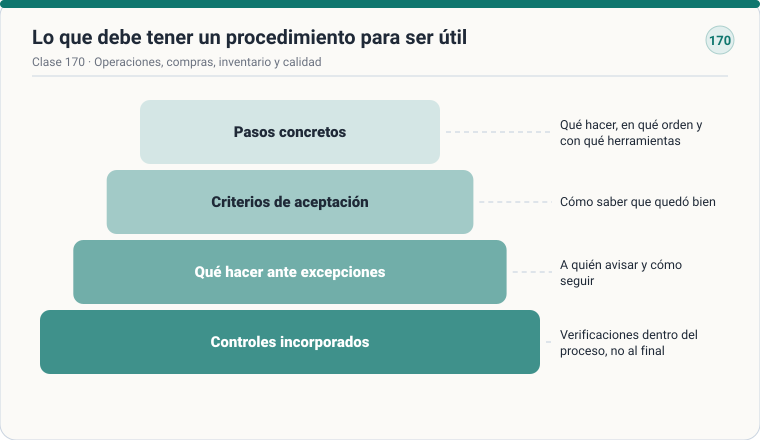

# Clase 170 — SOP y controles operacionales

> **Parte 13 · Operaciones, compras, inventario y calidad** — clase 2 de 14

**Estado de evidencia:** `GUIA-PRACTICA` · **Jurisdicción:** Chile-first · **Fecha base normativa:** 07-08-2026 
**Decisión que habilita:** documentar los procedimientos críticos con controles incorporados 
**Entregable:** SOP de los procesos críticos con puntos de control y criterios de aceptación

## 🎯 Propósito

Escribir procedimientos que alguien nuevo pueda ejecutar, con controles incorporados dentro del proceso y no al final.

## 📚 Resultados de aprendizaje

Al finalizar esta clase podrás:

1. **Definir** con precisión los cuatro conceptos de la tabla siguiente y usarlos para describir un caso real.
2. **Explicar** por qué esta materia condiciona decisiones de otras partes del programa.
3. **Decidir** —documentar los procedimientos críticos con controles incorporados— y justificar la decisión por escrito.
4. **Producir** el entregable de la clase y contrastarlo contra su criterio de aceptación.
5. **Distinguir** el dato estable del dato dinámico que exige revalidación en la fuente oficial.

## 🧩 Conceptos centrales

| Concepto | Comprensión verificable |
|---|---|
| **SOP** | Procedimiento operativo estándar, escrito y ejecutable. |
| **Control operacional** | Verificación incorporada en el proceso. |
| **Punto de control** | Momento donde se detecta el error antes de que avance. |
| **Versión vigente** | Edición actual del procedimiento, con fecha y responsable. |

## 🗺️ Modelo mental: Lo que debe tener un procedimiento para ser útil

> **La idea en una frase:** Un procedimiento útil se escribe para quien no estuvo cuando se decidió: pasos concretos, criterios de aceptación y qué hacer ante excepciones, con los controles dentro del proceso y no al final.

**Lectura guiada:** Cada capa responde una pregunta que quien ejecuta se hará. Si falta una, la persona improvisa, y la improvisación es la principal fuente de variabilidad.

**Para recordarlo:** Es una receta bien escrita: indica ingredientes, pasos, cómo saber que está lista y qué hacer si la masa no sube.

## 📖 Desarrollo

### 1. El fondo del asunto

Un SOP útil se escribe para quien no estuvo cuando se decidió: pasos concretos, criterios de aceptación y qué hacer ante excepciones. Los controles deben estar dentro del proceso, no al final: detectar el error en la entrega al cliente ya es tarde y caro.

### 2. Cómo se traduce en la práctica

Elige tus tres procesos más críticos y escribe un procedimiento para cada uno con pasos, criterios, excepciones y controles. Pruébalo con alguien que no lo conozca. Identifica puntos de control tempranos, donde un error es barato de corregir. Asigna una versión vigente con fecha y responsable, y retira las anteriores. Revísalos cuando algo falle.

### 3. Marco aplicable y quién interviene

- ISO 9001 como referencia de sistema de gestión de calidad
- teoría de restricciones para capacidad y cuellos de botella
- trazabilidad de lote exigida en rubros regulados (alimentos, salud, químicos)

**Autoridades o contrapartes involucradas:** SEREMI de Salud en rubros con trazabilidad sanitaria, SERNAC en garantía y postventa.
**Profesionales de apoyo:** jefe de operaciones, comprador, encargado de calidad, prevencionista. La participación concreta depende del riesgo, del
tamaño de la empresa y de la actividad económica.

### 4. Antes y después

Antes: el procedimiento de empaque de una tienda dice «embalar con cuidado y despachar». Cada persona lo hace distinto y un 6 % de los pedidos llega dañado. Después: un SOP de una página con fotos, un criterio (caja correcta, protección y etiqueta) y un control antes de cerrar la caja. Los pedidos dañados bajan a 1 % y el nuevo trabajador aprende en una mañana (caso ilustrativo).

### 5. En qué se apoya

- **The Checklist Manifesto** (Metropolitan Books): Gawande muestra cómo listas y procedimientos simples reducen errores evitables en tareas complejas, principio que sustenta un buen SOP.
- **Out of the Crisis** (Cambridge University Press): Deming sostiene que la calidad se construye en el proceso y no en la inspección final, que es la lógica de incorporar controles dentro del procedimiento.

*Las lecturas de apoyo ofrecen marcos conceptuales; lo que exige la ley chilena se verifica en las fuentes oficiales de esta clase.*

## 🧪 Taller guiado

Aplica esta clase a **una** de las siguientes líneas de negocio y repite después el ejercicio con
una segunda línea de carga regulatoria distinta:

| Línea | Carga regulatoria |
|---|---|
| SaaS B2B con IA | media |
| Servicios profesionales | baja |
| E-commerce D2C | media |
| Alimentos o foodtech | alta |
| Exportación de servicios | media |
| Fintech regulada | alta |
| Construcción o servicios técnicos | alta |

**Secuencia de trabajo:**

1. Delimita el contexto: actividad económica, escala, comuna y etapa de la empresa.
2. Reúne los antecedentes que la decisión exige y anota la fecha de cada fuente.
3. Identifica las alternativas reales, incluida la de no hacer nada.
4. Evalúa el impacto en mercado, caja, personas, regulación y operación.
5. Toma la decisión y regístrala con sus supuestos.
6. Produce el entregable.
7. Contrástalo contra el criterio de aceptación.
8. Anota lo que requiere validación profesional y programa su revisión.

### 📦 Entregable

Sop de los procesos críticos con puntos de control y criterios de aceptación.

Debe incluir decisión, supuestos, fuentes con fecha de consulta, responsable, riesgos
identificados y próximos pasos.

## 🏆 Reto verificable

Resuelve la misma materia para una segunda línea de negocio con distinta carga regulatoria y
explica por escrito **qué cambió, por qué y qué fuente lo determina**.

## ✅ Criterio de aceptación

- [ ] cada SOP tiene puntos de control intermedios
- [ ] los SOP están versionados con responsable y fecha
- [ ] cada afirmación regulatoria está referida a una fuente oficial con fecha de consulta;
- [ ] los datos dinámicos quedan marcados para revalidación;
- [ ] hay un responsable asignado y evidencia reproducible del trabajo.

## ⚠️ Errores frecuentes

**Propios de esta clase:**

- Escribir sop que describen lo que debería pasar y no lo que realmente se hace.
- Concentrar los controles al final del proceso.

**Característicos de la parte 13:**

- Inventario teórico que no coincide con el físico y destruye la promesa de entrega.
- Proveedor crítico único sin plan alternativo.

## 🇨🇱 Checklist Chile

- [ ] ¿existe norma o autoridad específica para esta materia?
- [ ] ¿la fuente consultada está vigente a la fecha de ejecución?
- [ ] ¿se activa algún trámite ante el SII?
- [ ] ¿se activa algún requisito municipal o sectorial?
- [ ] ¿afecta a consumidores o al tratamiento de datos personales?
- [ ] ¿afecta a trabajadores o a la seguridad y salud en el trabajo?
- [ ] ¿afecta a impuestos, contabilidad o caja?
- [ ] ¿afecta a contratos o a propiedad intelectual?
- [ ] ¿requiere renovación, reporte periódico o revalidación?

## ❓ Preguntas de comprobación

1. ¿Podría alguien nuevo ejecutar tu proceso crítico con el SOP en la mano?
2. ¿Dónde están tus puntos de control: dentro del proceso o al final?
3. ¿Tus SOP describen lo que se hace o lo que debería hacerse?

## 🔗 Fuentes oficiales

**ChileAtiende · Autoridad Sanitaria Regional — Autorización sanitaria de alimentos**  
<https://www.chileatiende.gob.cl/fichas/172-autorizacion-sanitaria-de-alimentos> · verificado 2026-11-05

- *Qué contiene:* Detalla qué establecimientos requieren autorización sanitaria, qué antecedentes se presentan, qué condiciones de planta física se exigen y cuál es la vigencia del permiso.
- *Cómo leerla:* Léela antes de firmar el arriendo, no después: las exigencias de planta física —separación de áreas, superficies lavables, agua potable— se resuelven en el diseño y se vuelven carísimas de corregir sobre un local ya construido.
- *Uso en esta clase:* aporta el marco de «Autorización sanitaria de alimentos» para documentar los procedimientos críticos con controles incorporados.

**Servicio Nacional del Consumidor — Ley 19.496, comercio electrónico y garantía legal**  
<https://www.sernac.cl/> · verificado 2026-11-05

- *Qué contiene:* Publica la interpretación aplicada de la Ley del Consumidor: deberes de información en la oferta, reglas del comercio electrónico, garantía legal, contratos de adhesión y el procedimiento de reclamos.
- *Cómo leerla:* Entra por el rubro de tu negocio y revisa las alertas y procedimientos colectivos publicados: muestran qué está fiscalizando el servicio ahora, que es mejor predictor de tu riesgo que la lectura abstracta de la ley.
- *Uso en esta clase:* aporta el marco de «Ley 19.496, comercio electrónico y garantía legal» para documentar los procedimientos críticos con controles incorporados.

**Metropolitan Books — The Checklist Manifesto**  
<https://openlibrary.org/isbn/9780312430009> · verificado 2026-11-25

- *Qué contiene:* Muestra cómo listas de verificación simples reducen errores evitables en trabajos complejos. Se usa como lectura de apoyo conceptual y no como fuente normativa.
- *Cómo leerla:* Úsalo como marco conceptual para entender el porqué de la práctica, nunca como prueba de lo que exige la ley chilena; para eso están las fuentes oficiales de la clase.
- *Uso en esta clase:* aporta el marco de «The Checklist Manifesto» para documentar los procedimientos críticos con controles incorporados.

**Cambridge University Press — Out of the Crisis**  
<https://openlibrary.org/isbn/9780521305532> · verificado 2026-11-25

- *Qué contiene:* Expone los catorce puntos de Deming y la calidad como responsabilidad de la dirección, con foco en variación y sistema.
- *Cómo leerla:* Úsalo como marco conceptual para entender el porqué de la práctica, nunca como prueba de lo que exige la ley chilena; para eso están las fuentes oficiales de la clase.
- *Uso en esta clase:* aporta el marco de «Out of the Crisis» para documentar los procedimientos críticos con controles incorporados.

Complementos del repositorio: [glosario](../../../docs/19_GLOSSARY.md) ·
[ruta de lecturas](../../../docs/15_BOOKS_AND_LEARNING_PATH.md) ·
[catálogo de fuentes](../../../docs/16_OFFICIAL_SOURCE_CATALOG.md).

> [!IMPORTANT]
> Material educativo. Para una decisión real de alto impacto hay que verificar la fuente oficial
> vigente y validar con el profesional competente.

---

| Anterior | Índice | Siguiente |
|---|---|---|
| [← 169 · Diseño de procesos end-to-end](../class-01-diseno-de-procesos-end-to-end/README.md) | [Parte 13](../README.md) · [Programa](../../../README.md) | [171 · Compras y homologación de proveedores →](../class-03-compras-y-homologacion-de-proveedores/README.md) |
