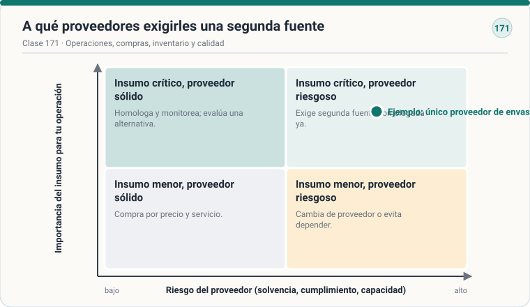

# Clase 171 — Compras y homologación de proveedores

> **Parte 13 · Operaciones, compras, inventario y calidad** — clase 3 de 14

**Estado de evidencia:** `GUIA-PRACTICA` · **Jurisdicción:** Chile-first · **Fecha base normativa:** 07-08-2026 
**Decisión que habilita:** definir el proceso de homologación y qué insumos exigen segunda fuente 
**Entregable:** procedimiento de homologación con criterios ponderados y registro de proveedores aprobados

## 🎯 Propósito

Homologar proveedores antes de necesitarlos, con criterios que incluyan riesgo y no solo precio.

## 📚 Resultados de aprendizaje

Al finalizar esta clase podrás:

1. **Definir** con precisión los cuatro conceptos de la tabla siguiente y usarlos para describir un caso real.
2. **Explicar** por qué esta materia condiciona decisiones de otras partes del programa.
3. **Decidir** —definir el proceso de homologación y qué insumos exigen segunda fuente— y justificar la decisión por escrito.
4. **Producir** el entregable de la clase y contrastarlo contra su criterio de aceptación.
5. **Distinguir** el dato estable del dato dinámico que exige revalidación en la fuente oficial.

## 🧩 Conceptos centrales

| Concepto | Comprensión verificable |
|---|---|
| **Homologación** | Proceso de aprobación previa de un proveedor. |
| **Criterio de evaluación** | Atributos con los que se compara: precio, calidad, plazo, riesgo. |
| **Proveedor alternativo** | Segunda fuente aprobada para el mismo insumo. |
| **Evaluación periódica** | Revisión del desempeño del proveedor en el tiempo. |

## 🗺️ Modelo mental: A qué proveedores exigirles una segunda fuente

> **La idea en una frase:** Homologar antes de comprar evita descubrir el problema con el pedido urgente; el criterio debe incluir riesgo, como solvencia, cumplimiento previsional y capacidad, y no solo precio.

**Cómo leerlo:** Ubica cada proveedor según el riesgo que representa y la importancia de lo que te vende. El cuadrante superior derecho exige acción antes de que ocurra la falla.

**Una imagen cotidiana:** Es revisar el paracaídas antes del salto: no quieres descubrir su estado durante la caída.

## 📖 Desarrollo

### 1. El fondo del asunto

Homologar antes de comprar evita descubrir el problema con el pedido urgente. El criterio debe incluir riesgo —solvencia, cumplimiento previsional, capacidad— y no solo precio. Tener una segunda fuente aprobada para insumos críticos es más barato que negociar bajo presión.

### 2. Cómo se traduce en la práctica

Define los criterios de homologación: solvencia, cumplimiento de obligaciones laborales y previsionales, certificaciones sectoriales, capacidad y precio. Solicita documentos y verifica referencias. Para los insumos críticos, exige una segunda fuente homologada. Evalúa periódicamente a los proveedores y registra el desempeño. Los certificados de cumplimiento protegen a la empresa.

### 3. Marco aplicable y quién interviene

- ISO 9001 como referencia de sistema de gestión de calidad
- teoría de restricciones para capacidad y cuellos de botella
- trazabilidad de lote exigida en rubros regulados (alimentos, salud, químicos)

**Autoridades o contrapartes involucradas:** SEREMI de Salud en rubros con trazabilidad sanitaria, SERNAC en garantía y postventa.
**Profesionales de apoyo:** jefe de operaciones, comprador, encargado de calidad, prevencionista. La participación concreta depende del riesgo, del
tamaño de la empresa y de la actividad económica.

### 4. Cómo se decide, paso a paso

Decide con tres preguntas. Uno: ¿el insumo es crítico para tu operación? Dos: ¿el proveedor tiene solvencia, cumple sus obligaciones laborales y tiene capacidad para tus volúmenes? Tres: ¿hay una alternativa calificada? Una empresa de alimentos descubre que su único proveedor de envases no tiene autorización sanitaria vigente; homologa un segundo proveedor antes de un lote grande.

### 5. En qué se apoya

- **Relaciones laborales y obligaciones del empleador** (Dirección del Trabajo): La Dirección del Trabajo informa los certificados de cumplimiento de obligaciones laborales y previsionales que una empresa puede exigir a sus proveedores.
- **Autorización sanitaria de alimentos** (ChileAtiende · Autoridad Sanitaria Regional): La autoridad sanitaria regional informa la autorización de alimentos, un requisito que se verifica al homologar proveedores del rubro.

*Las lecturas de apoyo ofrecen marcos conceptuales; lo que exige la ley chilena se verifica en las fuentes oficiales de esta clase.*

## 🛡️ Protección del conocimiento: Riesgos de las relaciones con terceros

[Guía de inteligencia económica y protección del conocimiento, sección 9](../../../docs/21_INTELIGENCIA_ECONOMICA_Y_PROTECCION_DEL_CONOCIMIENTO.md#9-riesgos-de-las-relaciones-con-terceros)

**Lente para esta clase:** Homologar proveedores es un filtro inicial, no una garantía permanente: revisa quién los controla, qué conocen de ti y qué cambió desde la homologación.

| Nivel | Medida proporcionada |
|---|---|
| **Emprendedor o microempresa** | Pregunta al proveedor quiénes son sus dueños y para quién más trabaja antes de entregarle información. |
| **Pyme** | Revisión anual de proveedores con acceso, atenta a cambios de propietarios y a relaciones con competidores. |
| **Gran empresa o multinacional** | Programa de homologación con revisión de propiedad, sanciones y conflictos, y reevaluación según criticidad. |

**Actividad sin crear sistemas:** Revisa un proveedor homologado hace más de un año y anota qué cambió en propiedad, clientes y acceso.

**Términos:** Homologación (*Vendor Qualification*) · Beneficiario final (*Ultimate Beneficial Owner*)

*Enfoque defensivo: reconocer, prevenir, documentar y escalar. No enseña a obtener información de forma indebida; la calificación jurídica de un hecho concreto corresponde a un abogado.*

## 🧪 Taller guiado

Aplica esta clase a **una** de las siguientes líneas de negocio y repite después el ejercicio con
una segunda línea de carga regulatoria distinta:

| Línea | Carga regulatoria |
|---|---|
| SaaS B2B con IA | media |
| Servicios profesionales | baja |
| E-commerce D2C | media |
| Alimentos o foodtech | alta |
| Exportación de servicios | media |
| Fintech regulada | alta |
| Construcción o servicios técnicos | alta |

**Secuencia de trabajo:**

1. Delimita el contexto: actividad económica, escala, comuna y etapa de la empresa.
2. Reúne los antecedentes que la decisión exige y anota la fecha de cada fuente.
3. Identifica las alternativas reales, incluida la de no hacer nada.
4. Evalúa el impacto en mercado, caja, personas, regulación y operación.
5. Toma la decisión y regístrala con sus supuestos.
6. Produce el entregable.
7. Contrástalo contra el criterio de aceptación.
8. Anota lo que requiere validación profesional y programa su revisión.

### 📦 Entregable

Procedimiento de homologación con criterios ponderados y registro de proveedores aprobados.

Debe incluir decisión, supuestos, fuentes con fecha de consulta, responsable, riesgos
identificados y próximos pasos.

## 🏆 Reto verificable

Resuelve la misma materia para una segunda línea de negocio con distinta carga regulatoria y
explica por escrito **qué cambió, por qué y qué fuente lo determina**.

## ✅ Criterio de aceptación

- [ ] los criterios de homologación incluyen riesgo
- [ ] los insumos críticos tienen segunda fuente identificada
- [ ] cada afirmación regulatoria está referida a una fuente oficial con fecha de consulta;
- [ ] los datos dinámicos quedan marcados para revalidación;
- [ ] hay un responsable asignado y evidencia reproducible del trabajo.

## ⚠️ Errores frecuentes

**Propios de esta clase:**

- Evaluar proveedores solo por precio e ignorar solvencia y cumplimiento.
- Depender de una fuente única en insumos críticos.

**Característicos de la parte 13:**

- Inventario teórico que no coincide con el físico y destruye la promesa de entrega.
- Proveedor crítico único sin plan alternativo.

## 🇨🇱 Checklist Chile

- [ ] ¿existe norma o autoridad específica para esta materia?
- [ ] ¿la fuente consultada está vigente a la fecha de ejecución?
- [ ] ¿se activa algún trámite ante el SII?
- [ ] ¿se activa algún requisito municipal o sectorial?
- [ ] ¿afecta a consumidores o al tratamiento de datos personales?
- [ ] ¿afecta a trabajadores o a la seguridad y salud en el trabajo?
- [ ] ¿afecta a impuestos, contabilidad o caja?
- [ ] ¿afecta a contratos o a propiedad intelectual?
- [ ] ¿requiere renovación, reporte periódico o revalidación?

## ❓ Preguntas de comprobación

1. ¿Qué criterios además del precio usas para aprobar un proveedor?
2. ¿Qué insumos críticos dependen hoy de una sola fuente?
3. ¿Cuándo evaluaste por última vez el desempeño de tus proveedores principales?

## 🔗 Fuentes oficiales

**ChileAtiende · Autoridad Sanitaria Regional — Autorización sanitaria de alimentos**  
<https://www.chileatiende.gob.cl/fichas/172-autorizacion-sanitaria-de-alimentos> · verificado 2026-11-05

- *Qué contiene:* Detalla qué establecimientos requieren autorización sanitaria, qué antecedentes se presentan, qué condiciones de planta física se exigen y cuál es la vigencia del permiso.
- *Cómo leerla:* Léela antes de firmar el arriendo, no después: las exigencias de planta física —separación de áreas, superficies lavables, agua potable— se resuelven en el diseño y se vuelven carísimas de corregir sobre un local ya construido.
- *Uso en esta clase:* aporta el marco de «Autorización sanitaria de alimentos» para definir el proceso de homologación y qué insumos exigen segunda fuente.

**Servicio Nacional del Consumidor — Ley 19.496, comercio electrónico y garantía legal**  
<https://www.sernac.cl/> · verificado 2026-11-05

- *Qué contiene:* Publica la interpretación aplicada de la Ley del Consumidor: deberes de información en la oferta, reglas del comercio electrónico, garantía legal, contratos de adhesión y el procedimiento de reclamos.
- *Cómo leerla:* Entra por el rubro de tu negocio y revisa las alertas y procedimientos colectivos publicados: muestran qué está fiscalizando el servicio ahora, que es mejor predictor de tu riesgo que la lectura abstracta de la ley.
- *Uso en esta clase:* aporta el marco de «Ley 19.496, comercio electrónico y garantía legal» para definir el proceso de homologación y qué insumos exigen segunda fuente.

**Dirección del Trabajo — Relaciones laborales y obligaciones del empleador**  
<https://www.dt.gob.cl/> · verificado 2026-11-05

- *Qué contiene:* Concentra el Código del Trabajo aplicado: dictámenes que interpretan la norma en casos concretos, la plataforma Mi DT para registrar contratos y finiquitos, y las guías de fiscalización.
- *Cómo leerla:* Los dictámenes valen más que las guías divulgativas: describen cómo la autoridad resolvió un caso real. Busca por materia y contrasta la fecha, porque un dictamen posterior puede cambiar el criterio anterior.
- *Uso en esta clase:* aporta el marco de «Relaciones laborales y obligaciones del empleador» para definir el proceso de homologación y qué insumos exigen segunda fuente.

Complementos del repositorio: [glosario](../../../docs/19_GLOSSARY.md) ·
[ruta de lecturas](../../../docs/15_BOOKS_AND_LEARNING_PATH.md) ·
[catálogo de fuentes](../../../docs/16_OFFICIAL_SOURCE_CATALOG.md).

> [!IMPORTANT]
> Material educativo. Para una decisión real de alto impacto hay que verificar la fuente oficial
> vigente y validar con el profesional competente.

---

| Anterior | Índice | Siguiente |
|---|---|---|
| [← 170 · SOP y controles operacionales](../class-02-sop-y-controles-operacionales/README.md) | [Parte 13](../README.md) · [Programa](../../../README.md) | [172 · Órdenes de compra y recepción →](../class-04-ordenes-de-compra-y-recepcion/README.md) |
