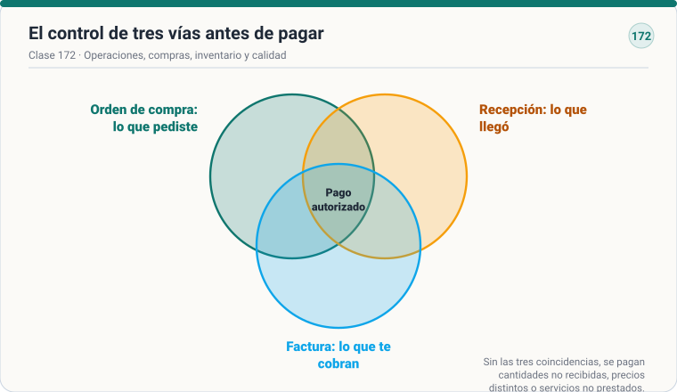

# Clase 172 — Órdenes de compra y recepción

> **Parte 13 · Operaciones, compras, inventario y calidad** — clase 4 de 14

**Estado de evidencia:** `GUIA-PRACTICA` · **Jurisdicción:** Chile-first · **Fecha base normativa:** 07-08-2026 
**Decisión que habilita:** implementar el control de tres vías antes de autorizar cualquier pago 
**Entregable:** procedimiento de compra y recepción con conciliación de tres vías y tratamiento de diferencias

## 🎯 Propósito

Implementar el control de tres vías —orden, recepción y factura— antes de autorizar cualquier pago, que es el control operativo de mayor retorno.

## 📚 Resultados de aprendizaje

Al finalizar esta clase podrás:

1. **Definir** con precisión los cuatro conceptos de la tabla siguiente y usarlos para describir un caso real.
2. **Explicar** por qué esta materia condiciona decisiones de otras partes del programa.
3. **Decidir** —implementar el control de tres vías antes de autorizar cualquier pago— y justificar la decisión por escrito.
4. **Producir** el entregable de la clase y contrastarlo contra su criterio de aceptación.
5. **Distinguir** el dato estable del dato dinámico que exige revalidación en la fuente oficial.

## 🧩 Conceptos centrales

| Concepto | Comprensión verificable |
|---|---|
| **Orden de compra** | Documento que formaliza el pedido con condiciones. |
| **Recepción** | Verificación de lo recibido contra lo pedido. |
| **Tres vías** | Conciliación entre orden, recepción y factura. |
| **Diferencia de recepción** | Discrepancia en cantidad, calidad o precio. |

## 🗺️ Modelo mental: El control de tres vías antes de pagar

> **La idea en una frase:** El control de tres vías —orden, recepción y factura— es el control más eficaz contra el fraude y el error en compras; sin él, se pagan cantidades no recibidas o precios distintos a los pactados.

**Qué mirar primero:** Los tres círculos deben coincidir en cantidad, precio y condiciones. Solo en el centro, donde coinciden, se autoriza el pago. Cualquier diferencia se investiga antes de pagar.

**Una analogía:** Es cotejar el menú, la comida servida y la cuenta antes de pagar: si no coinciden, se reclama antes y no después.

## 📖 Desarrollo

### 1. El fondo del asunto

El control de tres vías —orden, recepción y factura— es el control antifraude y antierror más eficaz en compras. Sin él, se pagan cantidades no recibidas, precios distintos a los pactados y servicios no prestados, y el descuadre aparece meses después sin poder reconstruirse.

### 2. Cómo se traduce en la práctica

Establece que toda compra tenga una orden de compra aprobada, una recepción registrada y una factura que coincida. Separa funciones: quien pide no recibe ni paga. Define cómo se tratan las diferencias de recepción y quién las resuelve. Revisa mensualmente las facturas sin orden o sin recepción. El control reduce errores y protege contra fraudes internos y externos.

### 3. Marco aplicable y quién interviene

- ISO 9001 como referencia de sistema de gestión de calidad
- teoría de restricciones para capacidad y cuellos de botella
- trazabilidad de lote exigida en rubros regulados (alimentos, salud, químicos)

**Autoridades o contrapartes involucradas:** SEREMI de Salud en rubros con trazabilidad sanitaria, SERNAC en garantía y postventa.
**Profesionales de apoyo:** jefe de operaciones, comprador, encargado de calidad, prevencionista. La participación concreta depende del riesgo, del
tamaño de la empresa y de la actividad económica.

### 4. Un error y su corrección

El error: una pyme paga facturas sin cotejarlas con la orden ni con la recepción. En un año descubre que pagó 40 cajas que no recibió y que dos facturas traían un precio mayor al cotizado. La corrección: un control de tres vías, con la recepción registrada por una persona distinta de quien compra y quien paga, y con la aceptación o el reclamo de facturas en el Registro de Compras y Ventas dentro de plazo (caso ilustrativo).

### 5. En qué se apoya

- **Registro de Compras y Ventas** (Servicio de Impuestos Internos): El Registro de Compras y Ventas del SII permite aceptar o reclamar las facturas recibidas, complemento de la verificación de tres vías.
- **The Checklist Manifesto** (Metropolitan Books): Gawande muestra que las verificaciones simples en puntos clave del proceso evitan errores costosos, como pagar sin cotejar.

*Las lecturas de apoyo ofrecen marcos conceptuales; lo que exige la ley chilena se verifica en las fuentes oficiales de esta clase.*

## 🧪 Taller guiado

Aplica esta clase a **una** de las siguientes líneas de negocio y repite después el ejercicio con
una segunda línea de carga regulatoria distinta:

| Línea | Carga regulatoria |
|---|---|
| SaaS B2B con IA | media |
| Servicios profesionales | baja |
| E-commerce D2C | media |
| Alimentos o foodtech | alta |
| Exportación de servicios | media |
| Fintech regulada | alta |
| Construcción o servicios técnicos | alta |

**Secuencia de trabajo:**

1. Delimita el contexto: actividad económica, escala, comuna y etapa de la empresa.
2. Reúne los antecedentes que la decisión exige y anota la fecha de cada fuente.
3. Identifica las alternativas reales, incluida la de no hacer nada.
4. Evalúa el impacto en mercado, caja, personas, regulación y operación.
5. Toma la decisión y regístrala con sus supuestos.
6. Produce el entregable.
7. Contrástalo contra el criterio de aceptación.
8. Anota lo que requiere validación profesional y programa su revisión.

### 📦 Entregable

Procedimiento de compra y recepción con conciliación de tres vías y tratamiento de diferencias.

Debe incluir decisión, supuestos, fuentes con fecha de consulta, responsable, riesgos
identificados y próximos pasos.

## 🏆 Reto verificable

Resuelve la misma materia para una segunda línea de negocio con distinta carga regulatoria y
explica por escrito **qué cambió, por qué y qué fuente lo determina**.

## ✅ Criterio de aceptación

- [ ] ningún pago se autoriza sin las tres vías conciliadas
- [ ] las diferencias tienen procedimiento de resolución
- [ ] cada afirmación regulatoria está referida a una fuente oficial con fecha de consulta;
- [ ] los datos dinámicos quedan marcados para revalidación;
- [ ] hay un responsable asignado y evidencia reproducible del trabajo.

## ⚠️ Errores frecuentes

**Propios de esta clase:**

- Pagar facturas sin verificar recepción efectiva.
- Recibir sin comparar contra la orden y aceptar diferencias de precio.

**Característicos de la parte 13:**

- Inventario teórico que no coincide con el físico y destruye la promesa de entrega.
- Proveedor crítico único sin plan alternativo.

## 🇨🇱 Checklist Chile

- [ ] ¿existe norma o autoridad específica para esta materia?
- [ ] ¿la fuente consultada está vigente a la fecha de ejecución?
- [ ] ¿se activa algún trámite ante el SII?
- [ ] ¿se activa algún requisito municipal o sectorial?
- [ ] ¿afecta a consumidores o al tratamiento de datos personales?
- [ ] ¿afecta a trabajadores o a la seguridad y salud en el trabajo?
- [ ] ¿afecta a impuestos, contabilidad o caja?
- [ ] ¿afecta a contratos o a propiedad intelectual?
- [ ] ¿requiere renovación, reporte periódico o revalidación?

## ❓ Preguntas de comprobación

1. ¿Se autoriza algún pago en tu empresa sin las tres vías conciliadas?
2. ¿Quién recibe la mercadería y compara contra la orden de compra?
3. ¿Qué diferencias de precio o cantidad detectaste el último trimestre?

## 🔗 Fuentes oficiales

**ChileAtiende · Autoridad Sanitaria Regional — Autorización sanitaria de alimentos**  
<https://www.chileatiende.gob.cl/fichas/172-autorizacion-sanitaria-de-alimentos> · verificado 2026-11-05

- *Qué contiene:* Detalla qué establecimientos requieren autorización sanitaria, qué antecedentes se presentan, qué condiciones de planta física se exigen y cuál es la vigencia del permiso.
- *Cómo leerla:* Léela antes de firmar el arriendo, no después: las exigencias de planta física —separación de áreas, superficies lavables, agua potable— se resuelven en el diseño y se vuelven carísimas de corregir sobre un local ya construido.
- *Uso en esta clase:* aporta el marco de «Autorización sanitaria de alimentos» para implementar el control de tres vías antes de autorizar cualquier pago.

**Servicio Nacional del Consumidor — Ley 19.496, comercio electrónico y garantía legal**  
<https://www.sernac.cl/> · verificado 2026-11-05

- *Qué contiene:* Publica la interpretación aplicada de la Ley del Consumidor: deberes de información en la oferta, reglas del comercio electrónico, garantía legal, contratos de adhesión y el procedimiento de reclamos.
- *Cómo leerla:* Entra por el rubro de tu negocio y revisa las alertas y procedimientos colectivos publicados: muestran qué está fiscalizando el servicio ahora, que es mejor predictor de tu riesgo que la lectura abstracta de la ley.
- *Uso en esta clase:* aporta el marco de «Ley 19.496, comercio electrónico y garantía legal» para implementar el control de tres vías antes de autorizar cualquier pago.

**Servicio de Impuestos Internos — Registro de Compras y Ventas**  
<https://www.sii.cl/destacados/f29/registrocompraventas.htm> · verificado 2026-11-05

- *Qué contiene:* Explica cómo el SII consolida los documentos tributarios electrónicos recibidos y emitidos, y cómo esa consolidación propone la declaración mensual de IVA.
- *Cómo leerla:* Fíjate en los plazos de aceptación o reclamo de una factura recibida: la página los trata como un detalle operativo, pero dejarlos vencer equivale a aceptar la factura con efecto tributario y mérito ejecutivo.
- *Uso en esta clase:* aporta el marco de «Registro de Compras y Ventas» para implementar el control de tres vías antes de autorizar cualquier pago.

**Metropolitan Books — The Checklist Manifesto**  
<https://openlibrary.org/isbn/9780312430009> · verificado 2026-11-25

- *Qué contiene:* Muestra cómo listas de verificación simples reducen errores evitables en trabajos complejos. Se usa como lectura de apoyo conceptual y no como fuente normativa.
- *Cómo leerla:* Úsalo como marco conceptual para entender el porqué de la práctica, nunca como prueba de lo que exige la ley chilena; para eso están las fuentes oficiales de la clase.
- *Uso en esta clase:* aporta el marco de «The Checklist Manifesto» para implementar el control de tres vías antes de autorizar cualquier pago.

Complementos del repositorio: [glosario](../../../docs/19_GLOSSARY.md) ·
[ruta de lecturas](../../../docs/15_BOOKS_AND_LEARNING_PATH.md) ·
[catálogo de fuentes](../../../docs/16_OFFICIAL_SOURCE_CATALOG.md).

> [!IMPORTANT]
> Material educativo. Para una decisión real de alto impacto hay que verificar la fuente oficial
> vigente y validar con el profesional competente.

---

| Anterior | Índice | Siguiente |
|---|---|---|
| [← 171 · Compras y homologación de proveedores](../class-03-compras-y-homologacion-de-proveedores/README.md) | [Parte 13](../README.md) · [Programa](../../../README.md) | [173 · Inventario, conteos y trazabilidad →](../class-05-inventario-conteos-y-trazabilidad/README.md) |
