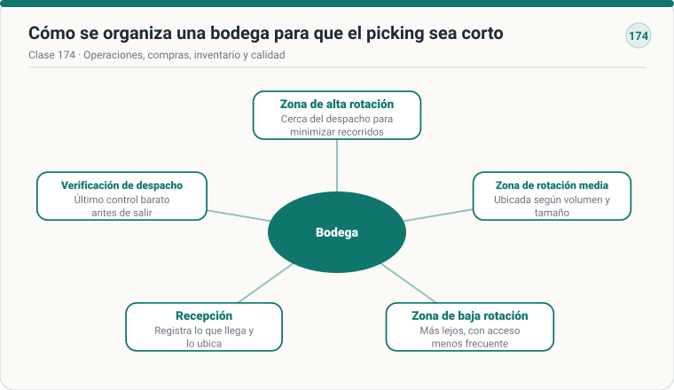

# Clase 174 — Bodega, picking y despacho

> **Parte 13 · Operaciones, compras, inventario y calidad** — clase 6 de 14

**Estado de evidencia:** `GUIA-PRACTICA` · **Jurisdicción:** Chile-first · **Fecha base normativa:** 07-08-2026 
**Decisión que habilita:** diseñar el layout y los controles de preparación y despacho 
**Entregable:** diseño de bodega con zonificación por rotación y procedimiento de verificación de despacho

## 🎯 Propósito

Diseñar el layout y los controles de preparación y despacho, porque el costo de bodega se explica por distancia recorrida y errores de picking.

## 📚 Resultados de aprendizaje

Al finalizar esta clase podrás:

1. **Definir** con precisión los cuatro conceptos de la tabla siguiente y usarlos para describir un caso real.
2. **Explicar** por qué esta materia condiciona decisiones de otras partes del programa.
3. **Decidir** —diseñar el layout y los controles de preparación y despacho— y justificar la decisión por escrito.
4. **Producir** el entregable de la clase y contrastarlo contra su criterio de aceptación.
5. **Distinguir** el dato estable del dato dinámico que exige revalidación en la fuente oficial.

## 🧩 Conceptos centrales

| Concepto | Comprensión verificable |
|---|---|
| **Picking** | Selección de productos para preparar un pedido. |
| **Layout de bodega** | Disposición física que determina la eficiencia del picking. |
| **Zonificación** | Agrupación por rotación o compatibilidad. |
| **Verificación de despacho** | Control previo a la salida. |

## 🗺️ Modelo mental: Cómo se organiza una bodega para que el picking sea corto

> **La idea en una frase:** El costo de bodega se explica por la distancia recorrida y los errores de picking; zonificar por rotación reduce ambos, y la verificación previa al despacho es el último control barato.

**Cómo leerlo:** El centro es la bodega y los satélites son sus zonas. Lo que más rota debe quedar más cerca del despacho; el último control antes de salir evita el costo de un error ya entregado.

**Para recordarlo:** Es una cocina bien dispuesta: lo que usas siempre está al alcance de la mano y lo que usas poco, en el estante superior.

## 📖 Desarrollo

### 1. El fondo del asunto

El costo de bodega se explica por distancia recorrida y por errores de picking. Zonificar por rotación reduce ambos. La verificación previa al despacho es el último control barato: un error detectado en bodega cuesta minutos, el mismo error detectado por el cliente cuesta el flete, la reposición y la relación.

### 2. Cómo se traduce en la práctica

Clasifica tus productos por rotación y reubícalos por zonas. Diseña el recorrido de picking para minimizar distancia y cruces. Define la verificación de despacho: lectura de códigos o doble revisión. Mide errores por cada cien pedidos y distancia por orden. Revisa el layout cada vez que cambie el mix de productos.

### 3. Marco aplicable y quién interviene

- ISO 9001 como referencia de sistema de gestión de calidad
- teoría de restricciones para capacidad y cuellos de botella
- trazabilidad de lote exigida en rubros regulados (alimentos, salud, químicos)

**Autoridades o contrapartes involucradas:** SEREMI de Salud en rubros con trazabilidad sanitaria, SERNAC en garantía y postventa.
**Profesionales de apoyo:** jefe de operaciones, comprador, encargado de calidad, prevencionista. La participación concreta depende del riesgo, del
tamaño de la empresa y de la actividad económica.

### 4. Caso trabajado

Una bodega de repuestos tenía sus productos más vendidos al fondo y cada picking recorría 400 metros; además, 3 de cada 100 pedidos salían con el producto equivocado. Al reubicar el 20 % de productos de mayor rotación cerca del despacho y verificar cada pedido con código de barras, el recorrido bajó a 150 metros y los errores a menos de 1 de cada 100 (caso ilustrativo).

### 5. En qué se apoya

- **Lean Thinking** (Free Press): Womack y Jones proponen eliminar movimientos y esperas que no agregan valor, principio aplicable al diseño del recorrido de una bodega.
- **Autorización sanitaria de alimentos** (ChileAtiende · Autoridad Sanitaria Regional): La autoridad sanitaria regional establece condiciones de almacenamiento para alimentos que condicionan la zonificación de la bodega en ese rubro.

*Las lecturas de apoyo ofrecen marcos conceptuales; lo que exige la ley chilena se verifica en las fuentes oficiales de esta clase.*

## 🧪 Taller guiado

Aplica esta clase a **una** de las siguientes líneas de negocio y repite después el ejercicio con
una segunda línea de carga regulatoria distinta:

| Línea | Carga regulatoria |
|---|---|
| SaaS B2B con IA | media |
| Servicios profesionales | baja |
| E-commerce D2C | media |
| Alimentos o foodtech | alta |
| Exportación de servicios | media |
| Fintech regulada | alta |
| Construcción o servicios técnicos | alta |

**Secuencia de trabajo:**

1. Delimita el contexto: actividad económica, escala, comuna y etapa de la empresa.
2. Reúne los antecedentes que la decisión exige y anota la fecha de cada fuente.
3. Identifica las alternativas reales, incluida la de no hacer nada.
4. Evalúa el impacto en mercado, caja, personas, regulación y operación.
5. Toma la decisión y regístrala con sus supuestos.
6. Produce el entregable.
7. Contrástalo contra el criterio de aceptación.
8. Anota lo que requiere validación profesional y programa su revisión.

### 📦 Entregable

Diseño de bodega con zonificación por rotación y procedimiento de verificación de despacho.

Debe incluir decisión, supuestos, fuentes con fecha de consulta, responsable, riesgos
identificados y próximos pasos.

## 🏆 Reto verificable

Resuelve la misma materia para una segunda línea de negocio con distinta carga regulatoria y
explica por escrito **qué cambió, por qué y qué fuente lo determina**.

## ✅ Criterio de aceptación

- [ ] la zonificación responde a la rotación real
- [ ] existe verificación documentada antes del despacho
- [ ] cada afirmación regulatoria está referida a una fuente oficial con fecha de consulta;
- [ ] los datos dinámicos quedan marcados para revalidación;
- [ ] hay un responsable asignado y evidencia reproducible del trabajo.

## ⚠️ Errores frecuentes

**Propios de esta clase:**

- Almacenar por orden de llegada sin considerar rotación.
- Despachar sin verificación y trasladar el control al cliente.

**Característicos de la parte 13:**

- Inventario teórico que no coincide con el físico y destruye la promesa de entrega.
- Proveedor crítico único sin plan alternativo.

## 🇨🇱 Checklist Chile

- [ ] ¿existe norma o autoridad específica para esta materia?
- [ ] ¿la fuente consultada está vigente a la fecha de ejecución?
- [ ] ¿se activa algún trámite ante el SII?
- [ ] ¿se activa algún requisito municipal o sectorial?
- [ ] ¿afecta a consumidores o al tratamiento de datos personales?
- [ ] ¿afecta a trabajadores o a la seguridad y salud en el trabajo?
- [ ] ¿afecta a impuestos, contabilidad o caja?
- [ ] ¿afecta a contratos o a propiedad intelectual?
- [ ] ¿requiere renovación, reporte periódico o revalidación?

## ❓ Preguntas de comprobación

1. ¿Está tu bodega ordenada por rotación o por orden de llegada?
2. ¿Verificas los pedidos antes de despachar y quién lo hace?
3. ¿Cuál es tu tasa de error de picking y cuánto te cuesta cada error?

## 🔗 Fuentes oficiales

**ChileAtiende · Autoridad Sanitaria Regional — Autorización sanitaria de alimentos**  
<https://www.chileatiende.gob.cl/fichas/172-autorizacion-sanitaria-de-alimentos> · verificado 2026-11-05

- *Qué contiene:* Detalla qué establecimientos requieren autorización sanitaria, qué antecedentes se presentan, qué condiciones de planta física se exigen y cuál es la vigencia del permiso.
- *Cómo leerla:* Léela antes de firmar el arriendo, no después: las exigencias de planta física —separación de áreas, superficies lavables, agua potable— se resuelven en el diseño y se vuelven carísimas de corregir sobre un local ya construido.
- *Uso en esta clase:* aporta el marco de «Autorización sanitaria de alimentos» para diseñar el layout y los controles de preparación y despacho.

**Servicio Nacional del Consumidor — Ley 19.496, comercio electrónico y garantía legal**  
<https://www.sernac.cl/> · verificado 2026-11-05

- *Qué contiene:* Publica la interpretación aplicada de la Ley del Consumidor: deberes de información en la oferta, reglas del comercio electrónico, garantía legal, contratos de adhesión y el procedimiento de reclamos.
- *Cómo leerla:* Entra por el rubro de tu negocio y revisa las alertas y procedimientos colectivos publicados: muestran qué está fiscalizando el servicio ahora, que es mejor predictor de tu riesgo que la lectura abstracta de la ley.
- *Uso en esta clase:* aporta el marco de «Ley 19.496, comercio electrónico y garantía legal» para diseñar el layout y los controles de preparación y despacho.

**Free Press — Lean Thinking**  
<https://openlibrary.org/isbn/9780684810355> · verificado 2026-11-25

- *Qué contiene:* Presenta los principios lean: valor, flujo, tracción y perfección. Se usa como lectura de apoyo conceptual y no como fuente normativa.
- *Cómo leerla:* Úsalo como marco conceptual para entender el porqué de la práctica, nunca como prueba de lo que exige la ley chilena; para eso están las fuentes oficiales de la clase.
- *Uso en esta clase:* aporta el marco de «Lean Thinking» para diseñar el layout y los controles de preparación y despacho.

Complementos del repositorio: [glosario](../../../docs/19_GLOSSARY.md) ·
[ruta de lecturas](../../../docs/15_BOOKS_AND_LEARNING_PATH.md) ·
[catálogo de fuentes](../../../docs/16_OFFICIAL_SOURCE_CATALOG.md).

> [!IMPORTANT]
> Material educativo. Para una decisión real de alto impacto hay que verificar la fuente oficial
> vigente y validar con el profesional competente.

---

| Anterior | Índice | Siguiente |
|---|---|---|
| [← 173 · Inventario, conteos y trazabilidad](../class-05-inventario-conteos-y-trazabilidad/README.md) | [Parte 13](../README.md) · [Programa](../../../README.md) | [175 · Logística directa e inversa →](../class-07-logistica-directa-e-inversa/README.md) |
