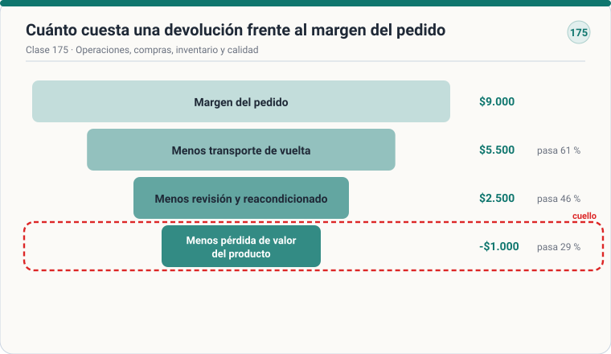

# Clase 175 — Logística directa e inversa

> **Parte 13 · Operaciones, compras, inventario y calidad** — clase 7 de 14

**Estado de evidencia:** `GUIA-PRACTICA` · **Jurisdicción:** Chile-first · **Fecha base normativa:** 07-08-2026 
**Decisión que habilita:** diseñar el flujo de devoluciones y su costo antes de prometer políticas de cambio 
**Entregable:** proceso de logística inversa con costo por devolución y criterios de aceptación

## 🎯 Propósito

Costear la logística inversa antes de prometer políticas de cambio, porque recibir, revisar y reponer puede costar más que el margen del pedido.

## 📚 Resultados de aprendizaje

Al finalizar esta clase podrás:

1. **Definir** con precisión los cuatro conceptos de la tabla siguiente y usarlos para describir un caso real.
2. **Explicar** por qué esta materia condiciona decisiones de otras partes del programa.
3. **Decidir** —diseñar el flujo de devoluciones y su costo antes de prometer políticas de cambio— y justificar la decisión por escrito.
4. **Producir** el entregable de la clase y contrastarlo contra su criterio de aceptación.
5. **Distinguir** el dato estable del dato dinámico que exige revalidación en la fuente oficial.

## 🧩 Conceptos centrales

| Concepto | Comprensión verificable |
|---|---|
| **Logística directa** | Flujo desde la empresa al cliente. |
| **Logística inversa** | Flujo de devoluciones, cambios y reparaciones. |
| **Costo de la devolución** | Transporte, revisión, reacondicionamiento y pérdida de valor. |
| **Última milla** | Tramo final de la entrega, el más caro por unidad. |

## 🗺️ Modelo mental: Cuánto cuesta una devolución frente al margen del pedido

> **La idea en una frase:** La logística inversa se subestima sistemáticamente en el comercio electrónico: recibir, revisar, reacondicionar y reponer un producto devuelto puede costar más que el margen del pedido.

**Qué mirar primero:** Cada barra resta un costo del margen original. La última muestra que, tras todas las etapas, la devolución puede dejar pérdida. Por eso la política de cambios debe diseñarse con su costo a la vista (cifras ilustrativas).

**Una imagen cotidiana:** Es devolver un regalo con gastos de envío: al final, lo que parecía un trámite simple cuesta más que lo que se ganó.

## 📖 Desarrollo

### 1. El fondo del asunto

La logística inversa se subestima sistemáticamente en e-commerce: recibir, revisar, reacondicionar y reponer un producto devuelto puede costar más que el margen del pedido. Diseñarla desde el inicio, con criterios claros de aceptación, evita que la tasa de devolución destruya la rentabilidad.

### 2. Cómo se traduce en la práctica

Mide cuánto cuesta cada etapa de una devolución: transporte, recepción, revisión, reacondicionado, reposición y pérdida de valor. Calcula la tasa de devolución por producto y la causa más común. Antes de prometer una política generosa de cambios, comprueba que tu margen la soporta y recuerda que la ley garantiza derechos que no puedes restringir, como la garantía legal y el retracto en los casos que corresponda.

### 3. Marco aplicable y quién interviene

- ISO 9001 como referencia de sistema de gestión de calidad
- teoría de restricciones para capacidad y cuellos de botella
- trazabilidad de lote exigida en rubros regulados (alimentos, salud, químicos)

**Autoridades o contrapartes involucradas:** SEREMI de Salud en rubros con trazabilidad sanitaria, SERNAC en garantía y postventa.
**Profesionales de apoyo:** jefe de operaciones, comprador, encargado de calidad, prevencionista. La participación concreta depende del riesgo, del
tamaño de la empresa y de la actividad económica.

### 4. Los números, paso a paso

Una tienda gana 9.000 pesos de margen por pedido. En una devolución paga 3.500 de transporte de vuelta, 3.000 de revisión y reacondicionado y el producto pierde 3.500 de valor por estar abierto. El resultado de esa operación es -1.000: la tienda pierde en cada devolución. Si el 15 % de los pedidos se devuelve, el margen total cae mucho más de lo previsto (cifras ilustrativas).

### 5. En qué se apoya

- **Ley 19.496, comercio electrónico y garantía legal** (Servicio Nacional del Consumidor): El SERNAC publica la interpretación de los derechos de retracto y garantía legal del consumidor, que condicionan el diseño de la logística inversa del comercio electrónico.
- **Ley 19.496 — Protección de los derechos de los consumidores** (Biblioteca del Congreso Nacional): La Ley 19.496 regula los derechos del consumidor ante productos defectuosos y la información que el proveedor debe entregar sobre su procedimiento de devolución.

*Las lecturas de apoyo ofrecen marcos conceptuales; lo que exige la ley chilena se verifica en las fuentes oficiales de esta clase.*

## 🧪 Taller guiado

Aplica esta clase a **una** de las siguientes líneas de negocio y repite después el ejercicio con
una segunda línea de carga regulatoria distinta:

| Línea | Carga regulatoria |
|---|---|
| SaaS B2B con IA | media |
| Servicios profesionales | baja |
| E-commerce D2C | media |
| Alimentos o foodtech | alta |
| Exportación de servicios | media |
| Fintech regulada | alta |
| Construcción o servicios técnicos | alta |

**Secuencia de trabajo:**

1. Delimita el contexto: actividad económica, escala, comuna y etapa de la empresa.
2. Reúne los antecedentes que la decisión exige y anota la fecha de cada fuente.
3. Identifica las alternativas reales, incluida la de no hacer nada.
4. Evalúa el impacto en mercado, caja, personas, regulación y operación.
5. Toma la decisión y regístrala con sus supuestos.
6. Produce el entregable.
7. Contrástalo contra el criterio de aceptación.
8. Anota lo que requiere validación profesional y programa su revisión.

### 📦 Entregable

Proceso de logística inversa con costo por devolución y criterios de aceptación.

Debe incluir decisión, supuestos, fuentes con fecha de consulta, responsable, riesgos
identificados y próximos pasos.

## 🏆 Reto verificable

Resuelve la misma materia para una segunda línea de negocio con distinta carga regulatoria y
explica por escrito **qué cambió, por qué y qué fuente lo determina**.

## ✅ Criterio de aceptación

- [ ] el costo por devolución está calculado
- [ ] los criterios de aceptación de devolución son operables
- [ ] cada afirmación regulatoria está referida a una fuente oficial con fecha de consulta;
- [ ] los datos dinámicos quedan marcados para revalidación;
- [ ] hay un responsable asignado y evidencia reproducible del trabajo.

## ⚠️ Errores frecuentes

**Propios de esta clase:**

- Ofrecer devolución sin costo sin haber calculado su efecto en la contribución.
- No reacondicionar y perder el valor completo del producto devuelto.

**Característicos de la parte 13:**

- Inventario teórico que no coincide con el físico y destruye la promesa de entrega.
- Proveedor crítico único sin plan alternativo.

## 🇨🇱 Checklist Chile

- [ ] ¿existe norma o autoridad específica para esta materia?
- [ ] ¿la fuente consultada está vigente a la fecha de ejecución?
- [ ] ¿se activa algún trámite ante el SII?
- [ ] ¿se activa algún requisito municipal o sectorial?
- [ ] ¿afecta a consumidores o al tratamiento de datos personales?
- [ ] ¿afecta a trabajadores o a la seguridad y salud en el trabajo?
- [ ] ¿afecta a impuestos, contabilidad o caja?
- [ ] ¿afecta a contratos o a propiedad intelectual?
- [ ] ¿requiere renovación, reporte periódico o revalidación?

## ❓ Preguntas de comprobación

1. ¿Cuánto te cuesta procesar una devolución, incluido el reacondicionamiento?
2. ¿Qué tasa de devolución tienes y cómo afecta tu contribución por pedido?
3. ¿Qué haces con el producto devuelto: se repone, se liquida o se pierde?

## 🔗 Fuentes oficiales

**Servicio Nacional del Consumidor — Ley 19.496, comercio electrónico y garantía legal**  
<https://www.sernac.cl/> · verificado 2026-11-05

- *Qué contiene:* Publica la interpretación aplicada de la Ley del Consumidor: deberes de información en la oferta, reglas del comercio electrónico, garantía legal, contratos de adhesión y el procedimiento de reclamos.
- *Cómo leerla:* Entra por el rubro de tu negocio y revisa las alertas y procedimientos colectivos publicados: muestran qué está fiscalizando el servicio ahora, que es mejor predictor de tu riesgo que la lectura abstracta de la ley.
- *Uso en esta clase:* aporta el marco de «Ley 19.496, comercio electrónico y garantía legal» para diseñar el flujo de devoluciones y su costo antes de prometer políticas de cambio.

**Biblioteca del Congreso Nacional — Ley 19.496 — Protección de los derechos de los consumidores**  
<https://www.bcn.cl/leychile/navegar?idNorma=61438> · verificado 2026-11-25

- *Qué contiene:* Fija los derechos básicos del consumidor, la obligación de cumplir lo ofrecido (art. 12), la publicidad veraz (arts. 28 y 33), la seguridad del producto y el deber de informar a la autoridad los peligros descubiertos después de vender (arts. 45 a 49) y las funciones de fiscalización del SERNAC (art. 58).
- *Cómo leerla:* Úsala para distinguir qué debe hacer un proveedor ante un producto riesgoso o una publicidad cuestionada de lo que solo conviene hacer. Lee el artículo completo en la versión vigente antes de aplicarlo a un caso concreto.
- *Uso en esta clase:* aporta el marco de «Ley 19.496 — Protección de los derechos de los consumidores» para diseñar el flujo de devoluciones y su costo antes de prometer políticas de cambio.

Complementos del repositorio: [glosario](../../../docs/19_GLOSSARY.md) ·
[ruta de lecturas](../../../docs/15_BOOKS_AND_LEARNING_PATH.md) ·
[catálogo de fuentes](../../../docs/16_OFFICIAL_SOURCE_CATALOG.md).

> [!IMPORTANT]
> Material educativo. Para una decisión real de alto impacto hay que verificar la fuente oficial
> vigente y validar con el profesional competente.

---

| Anterior | Índice | Siguiente |
|---|---|---|
| [← 174 · Bodega, picking y despacho](../class-06-bodega-picking-y-despacho/README.md) | [Parte 13](../README.md) · [Programa](../../../README.md) | [176 · Gestión de calidad y no conformidades →](../class-08-gestion-de-calidad-y-no-conformidades/README.md) |
