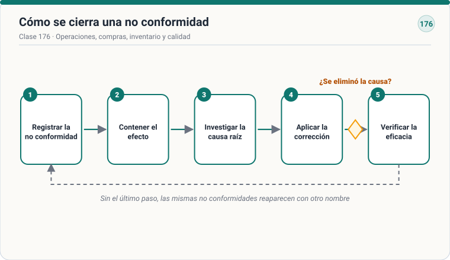

# Clase 176 — Gestión de calidad y no conformidades

> **Parte 13 · Operaciones, compras, inventario y calidad** — clase 8 de 14

**Estado de evidencia:** `GUIA-PRACTICA` · **Jurisdicción:** Chile-first · **Fecha base normativa:** 07-08-2026 
**Decisión que habilita:** definir cómo se registran y se cierran las no conformidades 
**Entregable:** procedimiento de no conformidades con análisis de causa raíz y verificación de eficacia

## 🎯 Propósito

Cerrar las no conformidades con análisis de causa raíz y verificación de eficacia, no solo con la acción inmediata.

## 📚 Resultados de aprendizaje

Al finalizar esta clase podrás:

1. **Definir** con precisión los cuatro conceptos de la tabla siguiente y usarlos para describir un caso real.
2. **Explicar** por qué esta materia condiciona decisiones de otras partes del programa.
3. **Decidir** —definir cómo se registran y se cierran las no conformidades— y justificar la decisión por escrito.
4. **Producir** el entregable de la clase y contrastarlo contra su criterio de aceptación.
5. **Distinguir** el dato estable del dato dinámico que exige revalidación en la fuente oficial.

## 🧩 Conceptos centrales

| Concepto | Comprensión verificable |
|---|---|
| **No conformidad** | Desviación respecto de un requisito. |
| **Acción correctiva** | Medida que ataca la causa raíz. |
| **Acción inmediata** | Contención del efecto mientras se investiga. |
| **Costo de la mala calidad** | Retrabajo, devoluciones, garantías y pérdida de clientes. |

## 🗺️ Modelo mental: Cómo se cierra una no conformidad

> **La idea en una frase:** Un sistema de calidad mínimo registra la no conformidad, contiene el efecto, investiga la causa raíz y verifica la eficacia de la corrección; sin el último paso, las mismas no conformidades reaparecen.

**Lectura guiada:** Sigue el flujo con cada falla. El rombo final decide si el problema se cerró o si debe volver al análisis. Cerrar sin verificar es declarar victoria sin comprobarla.

**Una analogía:** Es curar una herida: no basta con ponerle una venda, hay que limpiar la causa y revisar días después que sanó.

## 📖 Desarrollo

### 1. El fondo del asunto

Un sistema de calidad mínimo registra la no conformidad, contiene el efecto, investiga la causa raíz y verifica la eficacia de la corrección. Sin el último paso, las mismas no conformidades reaparecen y el registro se convierte en una lista de quejas sin efecto.

### 2. Cómo se traduce en la práctica

Define un registro simple de no conformidades con fecha, descripción, efecto, causa raíz, corrección y verificación. Distingue la acción inmediata de la correctiva. Analiza cada mes las no conformidades más repetidas y mide el costo de la mala calidad. Cuando el producto implique riesgo a la seguridad de las personas, activa los deberes de información y retiro que establece la ley.

### 3. Marco aplicable y quién interviene

- ISO 9001 como referencia de sistema de gestión de calidad
- teoría de restricciones para capacidad y cuellos de botella
- trazabilidad de lote exigida en rubros regulados (alimentos, salud, químicos)

**Autoridades o contrapartes involucradas:** SEREMI de Salud en rubros con trazabilidad sanitaria, SERNAC en garantía y postventa.
**Profesionales de apoyo:** jefe de operaciones, comprador, encargado de calidad, prevencionista. La participación concreta depende del riesgo, del
tamaño de la empresa y de la actividad económica.

### 4. Pruébalo tú: mini simulación

Elige una falla reciente de tu empresa, como un pedido entregado con producto equivocado. Escribe cómo la registrarías, qué harías de inmediato para contener su efecto, cuál es su causa raíz (usa cinco «por qué»), qué corrección aplicarías y cómo verificarías en un mes que no se repite. Anota quién es responsable de cada paso. Si no puedes llenar un paso, aún no tienes un sistema de calidad. El ejercicio es ilustrativo.

### 5. En qué se apoya

- **Out of the Crisis** (Cambridge University Press): Deming sostiene que la mayoría de los problemas de calidad se deben al sistema y no a las personas, y propone mejorarlo de manera continua con datos.
- **Ley 19.496 — Protección de los derechos de los consumidores** (Biblioteca del Congreso Nacional): Los artículos 45 y 46 de la Ley 19.496 obligan a informar riesgos y a dar aviso sin demora a la autoridad ante peligros no previstos de un producto.

*Las lecturas de apoyo ofrecen marcos conceptuales; lo que exige la ley chilena se verifica en las fuentes oficiales de esta clase.*

## 🤝 Reputación y confianza: producto con falla: del reclamo al retiro

[Guía de reputación, crisis y confianza, sección 11](../../../docs/22_REPUTACION_CRISIS_Y_CONFIANZA.md#11-comunicación-durante-fallas-operacionales-y-de-producto)

**Lente para esta clase:** Una no conformidad se vuelve crisis cuando afecta la seguridad de las personas: el sistema de calidad debe tener un umbral que active la comunicación sin esperar el informe final.

| Nivel | Medida proporcionada |
|---|---|
| **Emprendedor o microempresa** | Un registro de reclamos por lote y la regla de que tres casos iguales detienen las ventas del lote hasta revisar. |
| **Pyme** | Trazabilidad por lote, umbral escrito para detener ventas, plan de cambio o devolución y aviso a las autoridades. |
| **Gran empresa o multinacional** | Procedimiento de retiro de producto probado en simulación, contratos de proveedor con cláusula de retiro y comité de seguridad. |

**Obligación legal:** Quien descubre peligros no previstos después de vender debe ponerlos sin demora en conocimiento de la autoridad competente y advertir a los consumidores (Ley 19.496, arts. 45 y 46); el proveedor cambia el bien o restituye lo pagado (arts. 47 y 48) y facilita la fiscalización (art. 58).

**Recomendación profesional:** Medir la tasa de contacto efectiva del aviso y no dar por cerrada la campaña hasta superar la meta definida.

**Actividad:** Define el umbral numérico que detiene la venta de un lote y quién lo decide; escríbelo en una oración.

**Plantilla:** [Procedimiento de control de daños](../../../templates/27_procedimiento_control_de_danos.md)

**Términos:** Retiro de producto (*Product recall*) · No conformidad (*Nonconformity*)

**Simulación:** [caso 2 del expediente de reputación y crisis](../../../case-studies/23-reputacion-y-crisis-siete-casos.md#2-empresa-con-fallas-de-un-producto). Decide cuándo tres reclamos dejan de ser un problema de calidad y pasan a ser un riesgo que se informa a la autoridad. Es una simulación ilustrativa, no una empresa real.

*Distingue lo que la ley exige de lo que conviene hacer. Las normas se leyeron en la Biblioteca del Congreso Nacional; verifica la versión vigente y consulta a un abogado antes de aplicarlas a un caso real.*

## 🧪 Taller guiado

Aplica esta clase a **una** de las siguientes líneas de negocio y repite después el ejercicio con
una segunda línea de carga regulatoria distinta:

| Línea | Carga regulatoria |
|---|---|
| SaaS B2B con IA | media |
| Servicios profesionales | baja |
| E-commerce D2C | media |
| Alimentos o foodtech | alta |
| Exportación de servicios | media |
| Fintech regulada | alta |
| Construcción o servicios técnicos | alta |

**Secuencia de trabajo:**

1. Delimita el contexto: actividad económica, escala, comuna y etapa de la empresa.
2. Reúne los antecedentes que la decisión exige y anota la fecha de cada fuente.
3. Identifica las alternativas reales, incluida la de no hacer nada.
4. Evalúa el impacto en mercado, caja, personas, regulación y operación.
5. Toma la decisión y regístrala con sus supuestos.
6. Produce el entregable.
7. Contrástalo contra el criterio de aceptación.
8. Anota lo que requiere validación profesional y programa su revisión.

### 📦 Entregable

Procedimiento de no conformidades con análisis de causa raíz y verificación de eficacia.

Debe incluir decisión, supuestos, fuentes con fecha de consulta, responsable, riesgos
identificados y próximos pasos.

## 🏆 Reto verificable

Resuelve la misma materia para una segunda línea de negocio con distinta carga regulatoria y
explica por escrito **qué cambió, por qué y qué fuente lo determina**.

## ✅ Criterio de aceptación

- [ ] cada no conformidad registra causa raíz
- [ ] el cierre exige verificación de eficacia
- [ ] cada afirmación regulatoria está referida a una fuente oficial con fecha de consulta;
- [ ] los datos dinámicos quedan marcados para revalidación;
- [ ] hay un responsable asignado y evidencia reproducible del trabajo.

## ⚠️ Errores frecuentes

**Propios de esta clase:**

- Aplicar acciones inmediatas y no investigar la causa raíz.
- Cerrar acciones correctivas sin verificar que el problema no se repite.

**Característicos de la parte 13:**

- Inventario teórico que no coincide con el físico y destruye la promesa de entrega.
- Proveedor crítico único sin plan alternativo.

## 🇨🇱 Checklist Chile

- [ ] ¿existe norma o autoridad específica para esta materia?
- [ ] ¿la fuente consultada está vigente a la fecha de ejecución?
- [ ] ¿se activa algún trámite ante el SII?
- [ ] ¿se activa algún requisito municipal o sectorial?
- [ ] ¿afecta a consumidores o al tratamiento de datos personales?
- [ ] ¿afecta a trabajadores o a la seguridad y salud en el trabajo?
- [ ] ¿afecta a impuestos, contabilidad o caja?
- [ ] ¿afecta a contratos o a propiedad intelectual?
- [ ] ¿requiere renovación, reporte periódico o revalidación?

## ❓ Preguntas de comprobación

1. ¿Cuántas de tus no conformidades del año se repitieron?
2. ¿Registras la causa raíz o solo la acción tomada?
3. ¿Quién verifica que la corrección funcionó y cuándo?

## 🔗 Fuentes oficiales

**ChileAtiende · Autoridad Sanitaria Regional — Autorización sanitaria de alimentos**  
<https://www.chileatiende.gob.cl/fichas/172-autorizacion-sanitaria-de-alimentos> · verificado 2026-11-05

- *Qué contiene:* Detalla qué establecimientos requieren autorización sanitaria, qué antecedentes se presentan, qué condiciones de planta física se exigen y cuál es la vigencia del permiso.
- *Cómo leerla:* Léela antes de firmar el arriendo, no después: las exigencias de planta física —separación de áreas, superficies lavables, agua potable— se resuelven en el diseño y se vuelven carísimas de corregir sobre un local ya construido.
- *Uso en esta clase:* aporta el marco de «Autorización sanitaria de alimentos» para definir cómo se registran y se cierran las no conformidades.

**Servicio Nacional del Consumidor — Ley 19.496, comercio electrónico y garantía legal**  
<https://www.sernac.cl/> · verificado 2026-11-05

- *Qué contiene:* Publica la interpretación aplicada de la Ley del Consumidor: deberes de información en la oferta, reglas del comercio electrónico, garantía legal, contratos de adhesión y el procedimiento de reclamos.
- *Cómo leerla:* Entra por el rubro de tu negocio y revisa las alertas y procedimientos colectivos publicados: muestran qué está fiscalizando el servicio ahora, que es mejor predictor de tu riesgo que la lectura abstracta de la ley.
- *Uso en esta clase:* aporta el marco de «Ley 19.496, comercio electrónico y garantía legal» para definir cómo se registran y se cierran las no conformidades.

**Biblioteca del Congreso Nacional — Ley 19.496 — Protección de los derechos de los consumidores**  
<https://www.bcn.cl/leychile/navegar?idNorma=61438> · verificado 2026-11-25

- *Qué contiene:* Fija los derechos básicos del consumidor, la obligación de cumplir lo ofrecido (art. 12), la publicidad veraz (arts. 28 y 33), la seguridad del producto y el deber de informar a la autoridad los peligros descubiertos después de vender (arts. 45 a 49) y las funciones de fiscalización del SERNAC (art. 58).
- *Cómo leerla:* Úsala para distinguir qué debe hacer un proveedor ante un producto riesgoso o una publicidad cuestionada de lo que solo conviene hacer. Lee el artículo completo en la versión vigente antes de aplicarlo a un caso concreto.
- *Uso en esta clase:* aporta el marco de «Ley 19.496 — Protección de los derechos de los consumidores» para definir cómo se registran y se cierran las no conformidades.

**Cambridge University Press — Out of the Crisis**  
<https://openlibrary.org/isbn/9780521305532> · verificado 2026-11-25

- *Qué contiene:* Expone los catorce puntos de Deming y la calidad como responsabilidad de la dirección, con foco en variación y sistema.
- *Cómo leerla:* Úsalo como marco conceptual para entender el porqué de la práctica, nunca como prueba de lo que exige la ley chilena; para eso están las fuentes oficiales de la clase.
- *Uso en esta clase:* aporta el marco de «Out of the Crisis» para definir cómo se registran y se cierran las no conformidades.

Complementos del repositorio: [glosario](../../../docs/19_GLOSSARY.md) ·
[ruta de lecturas](../../../docs/15_BOOKS_AND_LEARNING_PATH.md) ·
[catálogo de fuentes](../../../docs/16_OFFICIAL_SOURCE_CATALOG.md).

> [!IMPORTANT]
> Material educativo. Para una decisión real de alto impacto hay que verificar la fuente oficial
> vigente y validar con el profesional competente.

---

| Anterior | Índice | Siguiente |
|---|---|---|
| [← 175 · Logística directa e inversa](../class-07-logistica-directa-e-inversa/README.md) | [Parte 13](../README.md) · [Programa](../../../README.md) | [177 · Capacidad y cuellos de botella →](../class-09-capacidad-y-cuellos-de-botella/README.md) |
