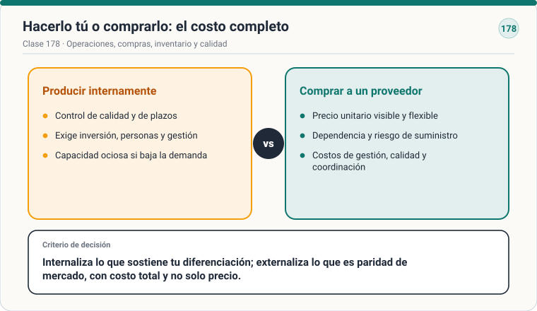

# Clase 178 — Make or buy

> **Parte 13 · Operaciones, compras, inventario y calidad** — clase 10 de 14

**Estado de evidencia:** `GUIA-PRACTICA` · **Jurisdicción:** Chile-first · **Fecha base normativa:** 07-08-2026 
**Decisión que habilita:** decidir qué se produce internamente y qué se compra, con criterio total 
**Entregable:** análisis make or buy con costo total de propiedad y evaluación de dependencia creada

## 🎯 Propósito

Decidir make or buy con costo total de propiedad, incluyendo gestión, riesgo de suministro y capacidad ociosa.

## 📚 Resultados de aprendizaje

Al finalizar esta clase podrás:

1. **Definir** con precisión los cuatro conceptos de la tabla siguiente y usarlos para describir un caso real.
2. **Explicar** por qué esta materia condiciona decisiones de otras partes del programa.
3. **Decidir** —decidir qué se produce internamente y qué se compra, con criterio total— y justificar la decisión por escrito.
4. **Producir** el entregable de la clase y contrastarlo contra su criterio de aceptación.
5. **Distinguir** el dato estable del dato dinámico que exige revalidación en la fuente oficial.

## 🧩 Conceptos centrales

| Concepto | Comprensión verificable |
|---|---|
| **Make or buy** | Decisión de producir internamente o comprar. |
| **Costo total de propiedad** | Costo completo incluyendo gestión, riesgo y capacidad ociosa. |
| **Competencia núcleo** | Capacidad que sostiene la diferenciación. |
| **Dependencia creada** | Riesgo de quedar atado al proveedor elegido. |

## 🗺️ Modelo mental: Hacerlo tú o comprarlo: el costo completo

> **La idea en una frase:** La decisión de hacer o comprar no se resuelve comparando un precio con un costo directo: hay que incluir gestión, calidad, riesgo de suministro y capacidad ociosa.

**Qué mirar primero:** Pesa los dos platos con el costo total en cada uno. La regla estratégica es no externalizar lo que sostiene tu diferencia, aunque el precio externo parezca atractivo.

**Para recordarlo:** Es decidir si cocinas en casa o pides comida: depende de cuánto valoras el sabor propio, tu tiempo, el costo real y qué harías si el repartidor no llega.

## 📖 Desarrollo

### 1. El fondo del asunto

La decisión no se resuelve comparando precio contra costo directo: hay que incluir gestión, calidad, riesgo de suministro y capacidad ociosa. La regla estratégica es no externalizar lo que sostiene la diferenciación, aunque comprarlo sea más barato hoy.

### 2. Cómo se traduce en la práctica

Calcula el costo total de propiedad de cada alternativa: precio, gestión, inspección, transporte, inventario, riesgo y capacidad ociosa. Evalúa la dependencia que creas y el plan si el proveedor falla. Define qué capacidades son núcleo para tu empresa y protégelas. Revisa la decisión cuando cambien volúmenes, costos o el mercado de proveedores.

### 3. Marco aplicable y quién interviene

- ISO 9001 como referencia de sistema de gestión de calidad
- teoría de restricciones para capacidad y cuellos de botella
- trazabilidad de lote exigida en rubros regulados (alimentos, salud, químicos)

**Autoridades o contrapartes involucradas:** SEREMI de Salud en rubros con trazabilidad sanitaria, SERNAC en garantía y postventa.
**Profesionales de apoyo:** jefe de operaciones, comprador, encargado de calidad, prevencionista. La participación concreta depende del riesgo, del
tamaño de la empresa y de la actividad económica.

### 4. Cómo se decide, paso a paso

Decide con tres preguntas. Uno: ¿esta actividad es la que me diferencia ante el cliente? Si sí, la hago yo. Dos: ¿cuál es el costo total de cada opción, incluida gestión, calidad y riesgo? Tres: ¿qué ocurre si el proveedor falla? Una empresa de cosmética fabrica su fórmula, que es su diferencia, y compra los envases a terceros con contratos de continuidad.

### 5. En qué se apoya

- **Playing to Win** (Harvard Business Review Press): Lafley y Martin proponen definir las capacidades que se necesitan para ganar y decidir con claridad cuáles se desarrollan internamente.
- **Lean Thinking** (Free Press): Womack y Jones tratan el flujo de valor completo, base para comparar el costo total de hacer o comprar una actividad.

*Las lecturas de apoyo ofrecen marcos conceptuales; lo que exige la ley chilena se verifica en las fuentes oficiales de esta clase.*

## 🧪 Taller guiado

Aplica esta clase a **una** de las siguientes líneas de negocio y repite después el ejercicio con
una segunda línea de carga regulatoria distinta:

| Línea | Carga regulatoria |
|---|---|
| SaaS B2B con IA | media |
| Servicios profesionales | baja |
| E-commerce D2C | media |
| Alimentos o foodtech | alta |
| Exportación de servicios | media |
| Fintech regulada | alta |
| Construcción o servicios técnicos | alta |

**Secuencia de trabajo:**

1. Delimita el contexto: actividad económica, escala, comuna y etapa de la empresa.
2. Reúne los antecedentes que la decisión exige y anota la fecha de cada fuente.
3. Identifica las alternativas reales, incluida la de no hacer nada.
4. Evalúa el impacto en mercado, caja, personas, regulación y operación.
5. Toma la decisión y regístrala con sus supuestos.
6. Produce el entregable.
7. Contrástalo contra el criterio de aceptación.
8. Anota lo que requiere validación profesional y programa su revisión.

### 📦 Entregable

Análisis make or buy con costo total de propiedad y evaluación de dependencia creada.

Debe incluir decisión, supuestos, fuentes con fecha de consulta, responsable, riesgos
identificados y próximos pasos.

## 🏆 Reto verificable

Resuelve la misma materia para una segunda línea de negocio con distinta carga regulatoria y
explica por escrito **qué cambió, por qué y qué fuente lo determina**.

## ✅ Criterio de aceptación

- [ ] el análisis usa costo total y no solo precio
- [ ] se evalúa la dependencia que crea la externalización
- [ ] cada afirmación regulatoria está referida a una fuente oficial con fecha de consulta;
- [ ] los datos dinámicos quedan marcados para revalidación;
- [ ] hay un responsable asignado y evidencia reproducible del trabajo.

## ⚠️ Errores frecuentes

**Propios de esta clase:**

- Comparar precio de compra contra costo directo interno sin incluir gestión.
- Externalizar la competencia núcleo por ahorro de corto plazo.

**Característicos de la parte 13:**

- Inventario teórico que no coincide con el físico y destruye la promesa de entrega.
- Proveedor crítico único sin plan alternativo.

## 🇨🇱 Checklist Chile

- [ ] ¿existe norma o autoridad específica para esta materia?
- [ ] ¿la fuente consultada está vigente a la fecha de ejecución?
- [ ] ¿se activa algún trámite ante el SII?
- [ ] ¿se activa algún requisito municipal o sectorial?
- [ ] ¿afecta a consumidores o al tratamiento de datos personales?
- [ ] ¿afecta a trabajadores o a la seguridad y salud en el trabajo?
- [ ] ¿afecta a impuestos, contabilidad o caja?
- [ ] ¿afecta a contratos o a propiedad intelectual?
- [ ] ¿requiere renovación, reporte periódico o revalidación?

## ❓ Preguntas de comprobación

1. ¿Tu comparación incluye gestión, calidad, riesgo y capacidad ociosa?
2. ¿Qué estás externalizando que en realidad sostiene tu diferenciación?
3. ¿Qué dependencia sin alternativa creó tu última decisión de comprar en vez de hacer?

## 🔗 Fuentes oficiales

**ChileAtiende · Autoridad Sanitaria Regional — Autorización sanitaria de alimentos**  
<https://www.chileatiende.gob.cl/fichas/172-autorizacion-sanitaria-de-alimentos> · verificado 2026-11-05

- *Qué contiene:* Detalla qué establecimientos requieren autorización sanitaria, qué antecedentes se presentan, qué condiciones de planta física se exigen y cuál es la vigencia del permiso.
- *Cómo leerla:* Léela antes de firmar el arriendo, no después: las exigencias de planta física —separación de áreas, superficies lavables, agua potable— se resuelven en el diseño y se vuelven carísimas de corregir sobre un local ya construido.
- *Uso en esta clase:* aporta el marco de «Autorización sanitaria de alimentos» para decidir qué se produce internamente y qué se compra, con criterio total.

**Servicio Nacional del Consumidor — Ley 19.496, comercio electrónico y garantía legal**  
<https://www.sernac.cl/> · verificado 2026-11-05

- *Qué contiene:* Publica la interpretación aplicada de la Ley del Consumidor: deberes de información en la oferta, reglas del comercio electrónico, garantía legal, contratos de adhesión y el procedimiento de reclamos.
- *Cómo leerla:* Entra por el rubro de tu negocio y revisa las alertas y procedimientos colectivos publicados: muestran qué está fiscalizando el servicio ahora, que es mejor predictor de tu riesgo que la lectura abstracta de la ley.
- *Uso en esta clase:* aporta el marco de «Ley 19.496, comercio electrónico y garantía legal» para decidir qué se produce internamente y qué se compra, con criterio total.

**Harvard Business Review Press — Playing to Win**  
<https://openlibrary.org/isbn/9781491528792> · verificado 2026-11-25

- *Qué contiene:* Plantea la estrategia como una cascada de elecciones: dónde jugar y cómo ganar. Se usa como lectura de apoyo conceptual y no como fuente normativa.
- *Cómo leerla:* Úsalo como marco conceptual para entender el porqué de la práctica, nunca como prueba de lo que exige la ley chilena; para eso están las fuentes oficiales de la clase.
- *Uso en esta clase:* aporta el marco de «Playing to Win» para decidir qué se produce internamente y qué se compra, con criterio total.

**Free Press — Lean Thinking**  
<https://openlibrary.org/isbn/9780684810355> · verificado 2026-11-25

- *Qué contiene:* Presenta los principios lean: valor, flujo, tracción y perfección. Se usa como lectura de apoyo conceptual y no como fuente normativa.
- *Cómo leerla:* Úsalo como marco conceptual para entender el porqué de la práctica, nunca como prueba de lo que exige la ley chilena; para eso están las fuentes oficiales de la clase.
- *Uso en esta clase:* aporta el marco de «Lean Thinking» para decidir qué se produce internamente y qué se compra, con criterio total.

Complementos del repositorio: [glosario](../../../docs/19_GLOSSARY.md) ·
[ruta de lecturas](../../../docs/15_BOOKS_AND_LEARNING_PATH.md) ·
[catálogo de fuentes](../../../docs/16_OFFICIAL_SOURCE_CATALOG.md).

> [!IMPORTANT]
> Material educativo. Para una decisión real de alto impacto hay que verificar la fuente oficial
> vigente y validar con el profesional competente.

---

| Anterior | Índice | Siguiente |
|---|---|---|
| [← 177 · Capacidad y cuellos de botella](../class-09-capacidad-y-cuellos-de-botella/README.md) | [Parte 13](../README.md) · [Programa](../../../README.md) | [179 · Continuidad de proveedores críticos →](../class-11-continuidad-de-proveedores-criticos/README.md) |
