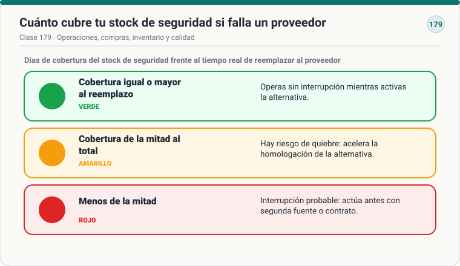

# Clase 179 — Continuidad de proveedores críticos

> **Parte 13 · Operaciones, compras, inventario y calidad** — clase 11 de 14

**Estado de evidencia:** `GUIA-PRACTICA` · **Jurisdicción:** Chile-first · **Fecha base normativa:** 07-08-2026 
**Decisión que habilita:** definir cómo se cubre la falla de cada proveedor crítico 
**Entregable:** plan de continuidad de suministro con alternativa, stock de seguridad y tiempo de reemplazo

## 🎯 Propósito

Cubrir la falla de cada proveedor crítico con tres palancas: alternativa homologada, stock de seguridad y cláusulas de continuidad.

## 📚 Resultados de aprendizaje

Al finalizar esta clase podrás:

1. **Definir** con precisión los cuatro conceptos de la tabla siguiente y usarlos para describir un caso real.
2. **Explicar** por qué esta materia condiciona decisiones de otras partes del programa.
3. **Decidir** —definir cómo se cubre la falla de cada proveedor crítico— y justificar la decisión por escrito.
4. **Producir** el entregable de la clase y contrastarlo contra su criterio de aceptación.
5. **Distinguir** el dato estable del dato dinámico que exige revalidación en la fuente oficial.

## 🧩 Conceptos centrales

| Concepto | Comprensión verificable |
|---|---|
| **Proveedor crítico** | Aquel cuya interrupción detiene la operación. |
| **Plan de contingencia** | Respuesta preparada ante su falla. |
| **Homologación de alternativa** | Proveedor sustituto ya aprobado. |
| **Stock de seguridad** | Inventario que cubre el tiempo de reemplazo. |

## 🗺️ Modelo mental: Cuánto cubre tu stock de seguridad si falla un proveedor

> **La idea en una frase:** La continuidad de proveedores críticos se resuelve con tres palancas: una segunda fuente homologada, un stock de seguridad calculado sobre el tiempo real de reemplazo y cláusulas de continuidad.

**Lectura guiada:** Compara los días que te cubre tu stock con los días que tardarías en reemplazar al proveedor. Si el stock dura menos que el reemplazo, hay un tramo sin cobertura que debes cerrar.

**Una imagen cotidiana:** Es la reserva de agua de un edificio: debe alcanzar para los días que toma reparar la cañería, no para los que uno quisiera.

## 📖 Desarrollo

### 1. El fondo del asunto

La continuidad de proveedores críticos se resuelve con tres palancas: segunda fuente homologada, stock de seguridad calculado sobre el tiempo real de reemplazo y cláusulas contractuales de continuidad. Ninguna sola basta; el stock sin alternativa solo compra tiempo.

### 2. Cómo se traduce en la práctica

Calcula el tiempo real de reemplazo de cada proveedor crítico, incluyendo homologación, pruebas y envío. Define el stock de seguridad para cubrir ese tiempo con un margen. Homologa una alternativa y negocia cláusulas de aviso, transición y entrega de información. Revisa cada año el plan y verifica que los plazos de pago se cumplan, porque la relación comercial también es una fuente de continuidad.

### 3. Marco aplicable y quién interviene

- ISO 9001 como referencia de sistema de gestión de calidad
- teoría de restricciones para capacidad y cuellos de botella
- trazabilidad de lote exigida en rubros regulados (alimentos, salud, químicos)

**Autoridades o contrapartes involucradas:** SEREMI de Salud en rubros con trazabilidad sanitaria, SERNAC en garantía y postventa.
**Profesionales de apoyo:** jefe de operaciones, comprador, encargado de calidad, prevencionista. La participación concreta depende del riesgo, del
tamaño de la empresa y de la actividad económica.

### 4. Una conversación que enseña

Jefa de operaciones: «Si nuestro proveedor de resinas deja de despachar, ¿cuánto tardamos en reemplazarlo?». Compras: «Unos 30 días con homologación incluida». Jefa: «¿Y nuestro stock?». Compras: «Cubre 12 días». Jefa: «Entonces hay 18 días sin cobertura. Subamos el stock a 20 días, aceleremos la homologación de un segundo proveedor y pidamos un aviso de 90 días en el contrato» (conversación ilustrativa).

### 5. En qué se apoya

- **The Black Swan** (Random House): Taleb sostiene que los sistemas deben diseñarse para resistir eventos improbables de gran impacto, idea que justifica la redundancia en proveedores críticos.
- **Ley 21.131 — Establece pago a treinta días** (Biblioteca del Congreso Nacional): La Ley 21.131 fija el pago de facturas en treinta días corridos, regla que importa para mantener buena relación con los proveedores de los que depende la operación.

*Las lecturas de apoyo ofrecen marcos conceptuales; lo que exige la ley chilena se verifica en las fuentes oficiales de esta clase.*

## 🤝 Reputación y confianza: proveedores críticos en conflicto o en falla

[Guía de reputación, crisis y confianza, sección 14](../../../docs/22_REPUTACION_CRISIS_Y_CONFIANZA.md#14-conflictos-laborales-y-con-proveedores)

**Lente para esta clase:** La reputación frente a proveedores se construye pagando y comunicando con criterio; en una falla, el mensaje a cada uno debe ser individual, escrito y consistente con el que reciben clientes y trabajadores.

| Nivel | Medida proporcionada |
|---|---|
| **Emprendedor o microempresa** | Lista de los tres proveedores que no se pueden reemplazar en 30 días, con contacto directo y acuerdo básico por escrito. |
| **Pyme** | Mapa de criticidad, contratos con plazos y escalamiento, y regla de priorización de pagos conocida por finanzas y gerencia. |
| **Gran empresa o multinacional** | Programa de proveedores críticos con auditoría, planes alternativos probados y comunicación coordinada con compras y legal. |

**Obligación legal:** El pago de la factura debe cumplirse en 30 días corridos desde su recepción; un plazo mayor exige acuerdo escrito, inscrito en el registro del Ministerio de Economía (Ley 21.131).

**Recomendación profesional:** Escribir a cada proveedor por separado con una propuesta concreta antes de que venza el pago; no usar publicaciones públicas como presión, porque imputar un incumplimiento no probado puede ser injuria.

**Actividad:** Redacta el correo de cinco líneas a un proveedor crítico al que no podrás pagar en la fecha pactada, con calendario propuesto.

**Plantilla:** [Guías de comunicación por audiencia](../../../templates/31_guias_comunicacion_por_audiencia.md)

**Términos:** Proveedor crítico (*Critical supplier*) · Priorización de pagos (*Payment prioritization*)

**Simulación:** [caso 7 del expediente de reputación y crisis](../../../case-studies/23-reputacion-y-crisis-siete-casos.md#7-empresa-que-enfrenta-problemas-de-liquidez-y-reclamos). Observa cómo tres proveedores que exigen pago exigen mensajes distintos y un criterio de priorización escrito. Es una simulación ilustrativa, no una empresa real.

*Distingue lo que la ley exige de lo que conviene hacer. Las normas se leyeron en la Biblioteca del Congreso Nacional; verifica la versión vigente y consulta a un abogado antes de aplicarlas a un caso real.*

## 🧪 Taller guiado

Aplica esta clase a **una** de las siguientes líneas de negocio y repite después el ejercicio con
una segunda línea de carga regulatoria distinta:

| Línea | Carga regulatoria |
|---|---|
| SaaS B2B con IA | media |
| Servicios profesionales | baja |
| E-commerce D2C | media |
| Alimentos o foodtech | alta |
| Exportación de servicios | media |
| Fintech regulada | alta |
| Construcción o servicios técnicos | alta |

**Secuencia de trabajo:**

1. Delimita el contexto: actividad económica, escala, comuna y etapa de la empresa.
2. Reúne los antecedentes que la decisión exige y anota la fecha de cada fuente.
3. Identifica las alternativas reales, incluida la de no hacer nada.
4. Evalúa el impacto en mercado, caja, personas, regulación y operación.
5. Toma la decisión y regístrala con sus supuestos.
6. Produce el entregable.
7. Contrástalo contra el criterio de aceptación.
8. Anota lo que requiere validación profesional y programa su revisión.

### 📦 Entregable

Plan de continuidad de suministro con alternativa, stock de seguridad y tiempo de reemplazo.

Debe incluir decisión, supuestos, fuentes con fecha de consulta, responsable, riesgos
identificados y próximos pasos.

## 🏆 Reto verificable

Resuelve la misma materia para una segunda línea de negocio con distinta carga regulatoria y
explica por escrito **qué cambió, por qué y qué fuente lo determina**.

## ✅ Criterio de aceptación

- [ ] cada proveedor crítico tiene alternativa identificada
- [ ] el stock de seguridad cubre el tiempo real de reemplazo
- [ ] cada afirmación regulatoria está referida a una fuente oficial con fecha de consulta;
- [ ] los datos dinámicos quedan marcados para revalidación;
- [ ] hay un responsable asignado y evidencia reproducible del trabajo.

## ⚠️ Errores frecuentes

**Propios de esta clase:**

- Mantener stock de seguridad sin haber homologado un proveedor alternativo.
- Calcular el stock con el plazo normal y no con el plazo de una interrupción.

**Característicos de la parte 13:**

- Inventario teórico que no coincide con el físico y destruye la promesa de entrega.
- Proveedor crítico único sin plan alternativo.

## 🇨🇱 Checklist Chile

- [ ] ¿existe norma o autoridad específica para esta materia?
- [ ] ¿la fuente consultada está vigente a la fecha de ejecución?
- [ ] ¿se activa algún trámite ante el SII?
- [ ] ¿se activa algún requisito municipal o sectorial?
- [ ] ¿afecta a consumidores o al tratamiento de datos personales?
- [ ] ¿afecta a trabajadores o a la seguridad y salud en el trabajo?
- [ ] ¿afecta a impuestos, contabilidad o caja?
- [ ] ¿afecta a contratos o a propiedad intelectual?
- [ ] ¿requiere renovación, reporte periódico o revalidación?

## ❓ Preguntas de comprobación

1. ¿Cuánto tardarías en reemplazar a tu proveedor más crítico?
2. ¿Tu stock de seguridad cubre ese plazo o el plazo normal de reposición?
3. ¿Tienes una alternativa ya homologada o solo identificada?

## 🔗 Fuentes oficiales

**ChileAtiende · Autoridad Sanitaria Regional — Autorización sanitaria de alimentos**  
<https://www.chileatiende.gob.cl/fichas/172-autorizacion-sanitaria-de-alimentos> · verificado 2026-11-05

- *Qué contiene:* Detalla qué establecimientos requieren autorización sanitaria, qué antecedentes se presentan, qué condiciones de planta física se exigen y cuál es la vigencia del permiso.
- *Cómo leerla:* Léela antes de firmar el arriendo, no después: las exigencias de planta física —separación de áreas, superficies lavables, agua potable— se resuelven en el diseño y se vuelven carísimas de corregir sobre un local ya construido.
- *Uso en esta clase:* aporta el marco de «Autorización sanitaria de alimentos» para definir cómo se cubre la falla de cada proveedor crítico.

**Servicio Nacional del Consumidor — Ley 19.496, comercio electrónico y garantía legal**  
<https://www.sernac.cl/> · verificado 2026-11-05

- *Qué contiene:* Publica la interpretación aplicada de la Ley del Consumidor: deberes de información en la oferta, reglas del comercio electrónico, garantía legal, contratos de adhesión y el procedimiento de reclamos.
- *Cómo leerla:* Entra por el rubro de tu negocio y revisa las alertas y procedimientos colectivos publicados: muestran qué está fiscalizando el servicio ahora, que es mejor predictor de tu riesgo que la lectura abstracta de la ley.
- *Uso en esta clase:* aporta el marco de «Ley 19.496, comercio electrónico y garantía legal» para definir cómo se cubre la falla de cada proveedor crítico.

**Biblioteca del Congreso Nacional — Ley 21.131 — Establece pago a treinta días**  
<https://www.bcn.cl/leychile/navegar?idNorma=1127890> · verificado 2026-11-25

- *Qué contiene:* Sustituye el artículo 2 de la Ley 19.983: el saldo de la factura se paga en treinta días corridos desde su recepción y un plazo mayor exige acuerdo escrito inscrito en el registro del Ministerio de Economía.
- *Cómo leerla:* Úsala para conocer qué plazo se puede prometer a un proveedor y qué debe constar por escrito al renegociar pagos.
- *Uso en esta clase:* aporta el marco de «Ley 21.131 — Establece pago a treinta días» para definir cómo se cubre la falla de cada proveedor crítico.

**Random House — The Black Swan**  
<https://openlibrary.org/isbn/9780812979183> · verificado 2026-11-25

- *Qué contiene:* Examina el impacto de los eventos improbables y los límites de la predicción. Se usa como lectura de apoyo conceptual y no como fuente normativa.
- *Cómo leerla:* Úsalo como marco conceptual para entender el porqué de la práctica, nunca como prueba de lo que exige la ley chilena; para eso están las fuentes oficiales de la clase.
- *Uso en esta clase:* aporta el marco de «The Black Swan» para definir cómo se cubre la falla de cada proveedor crítico.

Complementos del repositorio: [glosario](../../../docs/19_GLOSSARY.md) ·
[ruta de lecturas](../../../docs/15_BOOKS_AND_LEARNING_PATH.md) ·
[catálogo de fuentes](../../../docs/16_OFFICIAL_SOURCE_CATALOG.md).

> [!IMPORTANT]
> Material educativo. Para una decisión real de alto impacto hay que verificar la fuente oficial
> vigente y validar con el profesional competente.

---

| Anterior | Índice | Siguiente |
|---|---|---|
| [← 178 · Make or buy](../class-10-make-or-buy/README.md) | [Parte 13](../README.md) · [Programa](../../../README.md) | [180 · Mantenimiento y activos operativos →](../class-12-mantenimiento-y-activos-operativos/README.md) |
