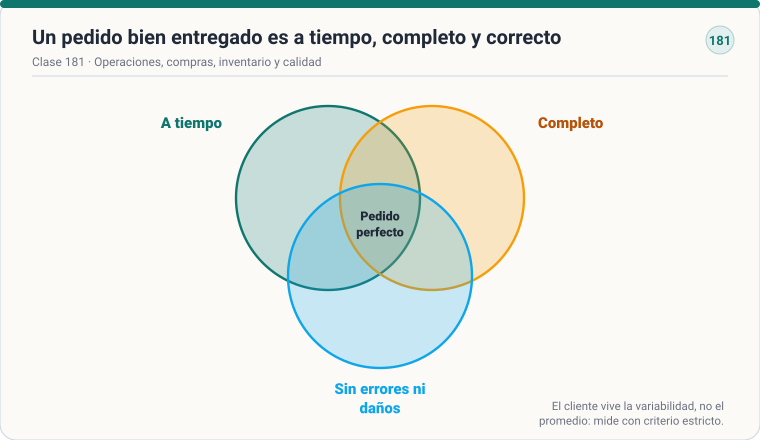

# Clase 181 — Indicadores OTIF, fill rate y lead time

> **Parte 13 · Operaciones, compras, inventario y calidad** — clase 13 de 14

**Estado de evidencia:** `GUIA-PRACTICA` · **Jurisdicción:** Chile-first · **Fecha base normativa:** 07-08-2026 
**Decisión que habilita:** definir los indicadores de servicio y su método de cálculo 
**Entregable:** panel de servicio con OTIF, fill rate, lead time promedio y variabilidad

## 🎯 Propósito

Medir el servicio con criterio estricto —completo y a tiempo— y reportar variabilidad además de promedio, porque el cliente experimenta la variabilidad.

## 📚 Resultados de aprendizaje

Al finalizar esta clase podrás:

1. **Definir** con precisión los cuatro conceptos de la tabla siguiente y usarlos para describir un caso real.
2. **Explicar** por qué esta materia condiciona decisiones de otras partes del programa.
3. **Decidir** —definir los indicadores de servicio y su método de cálculo— y justificar la decisión por escrito.
4. **Producir** el entregable de la clase y contrastarlo contra su criterio de aceptación.
5. **Distinguir** el dato estable del dato dinámico que exige revalidación en la fuente oficial.

## 🧩 Conceptos centrales

| Concepto | Comprensión verificable |
|---|---|
| **OTIF** | Entregas completas y a tiempo sobre el total. |
| **Fill rate** | Porcentaje del pedido atendido en la primera entrega. |
| **Lead time** | Tiempo desde el pedido hasta la entrega. |
| **Variabilidad** | Dispersión del lead time, que importa más que el promedio. |

## 🗺️ Modelo mental: Un pedido bien entregado es a tiempo, completo y correcto

> **La idea en una frase:** El cliente experimenta la variabilidad y no el promedio: un lead time de cinco días con una desviación grande es peor que uno consistente de siete; el OTIF debe medirse con criterio estricto, exigiendo que sea completo y a tiempo.

**Qué mirar primero:** Los tres círculos deben coincidir en cada pedido. Un indicador que cuenta como éxito un pedido tardío o incompleto esconde los problemas que el cliente sí ve.

**Piénsalo así:** Es un tren: no basta con que llegue en promedio a la hora, si algunas veces llega con una hora de retraso y otras con vagones menos.

## 📖 Desarrollo

### 1. El fondo del asunto

El cliente experimenta la variabilidad, no el promedio: un lead time de cinco días con desviación de cuatro es peor que uno de siete días consistente. Medir OTIF con criterio estricto —completo y a tiempo— evita el autoengaño de reportar cumplimiento parcial como éxito.

### 2. Cómo se traduce en la práctica

Define el OTIF con criterio estricto y mide también el fill rate, el lead time y su variabilidad. Calcula por cliente y por producto, no solo el promedio. Fija metas y revisa las causas de los pedidos fuera del criterio. Comparte los resultados con los clientes críticos y con tu equipo. Si el indicador es mejor de lo que perciben los clientes, está mal definido.

### 3. Marco aplicable y quién interviene

- ISO 9001 como referencia de sistema de gestión de calidad
- teoría de restricciones para capacidad y cuellos de botella
- trazabilidad de lote exigida en rubros regulados (alimentos, salud, químicos)

**Autoridades o contrapartes involucradas:** SEREMI de Salud en rubros con trazabilidad sanitaria, SERNAC en garantía y postventa.
**Profesionales de apoyo:** jefe de operaciones, comprador, encargado de calidad, prevencionista. La participación concreta depende del riesgo, del
tamaño de la empresa y de la actividad económica.

### 4. Un error y su corrección

El error: una empresa informa un OTIF de 95 % contando como éxito cualquier pedido entregado dentro de dos días de la fecha comprometida y con el 90 % de lo pedido. Sus clientes grandes reclaman. La corrección: medir con criterio estricto (en la fecha, con el 100 % de lo pedido y sin daños) y descubrir que el OTIF real era de 78 %. Con ese número identificó las causas y las corrigió (caso ilustrativo).

### 5. En qué se apoya

- **Out of the Crisis** (Cambridge University Press): Deming insiste en medir la variación de los procesos y no solo los promedios, porque el cliente experimenta la variabilidad.
- **The Goal** (North River Press): Goldratt relaciona el flujo y la entrega a tiempo con el desempeño del sistema completo.

*Las lecturas de apoyo ofrecen marcos conceptuales; lo que exige la ley chilena se verifica en las fuentes oficiales de esta clase.*

## 🧪 Taller guiado

Aplica esta clase a **una** de las siguientes líneas de negocio y repite después el ejercicio con
una segunda línea de carga regulatoria distinta:

| Línea | Carga regulatoria |
|---|---|
| SaaS B2B con IA | media |
| Servicios profesionales | baja |
| E-commerce D2C | media |
| Alimentos o foodtech | alta |
| Exportación de servicios | media |
| Fintech regulada | alta |
| Construcción o servicios técnicos | alta |

**Secuencia de trabajo:**

1. Delimita el contexto: actividad económica, escala, comuna y etapa de la empresa.
2. Reúne los antecedentes que la decisión exige y anota la fecha de cada fuente.
3. Identifica las alternativas reales, incluida la de no hacer nada.
4. Evalúa el impacto en mercado, caja, personas, regulación y operación.
5. Toma la decisión y regístrala con sus supuestos.
6. Produce el entregable.
7. Contrástalo contra el criterio de aceptación.
8. Anota lo que requiere validación profesional y programa su revisión.

### 📦 Entregable

Panel de servicio con otif, fill rate, lead time promedio y variabilidad.

Debe incluir decisión, supuestos, fuentes con fecha de consulta, responsable, riesgos
identificados y próximos pasos.

## 🏆 Reto verificable

Resuelve la misma materia para una segunda línea de negocio con distinta carga regulatoria y
explica por escrito **qué cambió, por qué y qué fuente lo determina**.

## ✅ Criterio de aceptación

- [ ] OTIF se mide con criterio de completo y a tiempo
- [ ] se reporta variabilidad además del promedio
- [ ] cada afirmación regulatoria está referida a una fuente oficial con fecha de consulta;
- [ ] los datos dinámicos quedan marcados para revalidación;
- [ ] hay un responsable asignado y evidencia reproducible del trabajo.

## ⚠️ Errores frecuentes

**Propios de esta clase:**

- Reportar entregas parciales como cumplidas.
- Medir solo el promedio del lead time e ignorar la dispersión.

**Característicos de la parte 13:**

- Inventario teórico que no coincide con el físico y destruye la promesa de entrega.
- Proveedor crítico único sin plan alternativo.

## 🇨🇱 Checklist Chile

- [ ] ¿existe norma o autoridad específica para esta materia?
- [ ] ¿la fuente consultada está vigente a la fecha de ejecución?
- [ ] ¿se activa algún trámite ante el SII?
- [ ] ¿se activa algún requisito municipal o sectorial?
- [ ] ¿afecta a consumidores o al tratamiento de datos personales?
- [ ] ¿afecta a trabajadores o a la seguridad y salud en el trabajo?
- [ ] ¿afecta a impuestos, contabilidad o caja?
- [ ] ¿afecta a contratos o a propiedad intelectual?
- [ ] ¿requiere renovación, reporte periódico o revalidación?

## ❓ Preguntas de comprobación

1. ¿Mides OTIF con criterio de completo y a tiempo o aceptas parciales?
2. ¿Cuál es la desviación de tu lead time, no solo el promedio?
3. ¿Coinciden tus indicadores en verde con la percepción de tus clientes?

## 🔗 Fuentes oficiales

**ChileAtiende · Autoridad Sanitaria Regional — Autorización sanitaria de alimentos**  
<https://www.chileatiende.gob.cl/fichas/172-autorizacion-sanitaria-de-alimentos> · verificado 2026-11-05

- *Qué contiene:* Detalla qué establecimientos requieren autorización sanitaria, qué antecedentes se presentan, qué condiciones de planta física se exigen y cuál es la vigencia del permiso.
- *Cómo leerla:* Léela antes de firmar el arriendo, no después: las exigencias de planta física —separación de áreas, superficies lavables, agua potable— se resuelven en el diseño y se vuelven carísimas de corregir sobre un local ya construido.
- *Uso en esta clase:* aporta el marco de «Autorización sanitaria de alimentos» para definir los indicadores de servicio y su método de cálculo.

**Servicio Nacional del Consumidor — Ley 19.496, comercio electrónico y garantía legal**  
<https://www.sernac.cl/> · verificado 2026-11-05

- *Qué contiene:* Publica la interpretación aplicada de la Ley del Consumidor: deberes de información en la oferta, reglas del comercio electrónico, garantía legal, contratos de adhesión y el procedimiento de reclamos.
- *Cómo leerla:* Entra por el rubro de tu negocio y revisa las alertas y procedimientos colectivos publicados: muestran qué está fiscalizando el servicio ahora, que es mejor predictor de tu riesgo que la lectura abstracta de la ley.
- *Uso en esta clase:* aporta el marco de «Ley 19.496, comercio electrónico y garantía legal» para definir los indicadores de servicio y su método de cálculo.

**Cambridge University Press — Out of the Crisis**  
<https://openlibrary.org/isbn/9780521305532> · verificado 2026-11-25

- *Qué contiene:* Expone los catorce puntos de Deming y la calidad como responsabilidad de la dirección, con foco en variación y sistema.
- *Cómo leerla:* Úsalo como marco conceptual para entender el porqué de la práctica, nunca como prueba de lo que exige la ley chilena; para eso están las fuentes oficiales de la clase.
- *Uso en esta clase:* aporta el marco de «Out of the Crisis» para definir los indicadores de servicio y su método de cálculo.

**North River Press — The Goal**  
<https://openlibrary.org/isbn/9781622313945> · verificado 2026-11-25

- *Qué contiene:* Novela que presenta la teoría de las restricciones: identificar y gestionar el cuello de botella de un sistema.
- *Cómo leerla:* Úsalo como marco conceptual para entender el porqué de la práctica, nunca como prueba de lo que exige la ley chilena; para eso están las fuentes oficiales de la clase.
- *Uso en esta clase:* aporta el marco de «The Goal» para definir los indicadores de servicio y su método de cálculo.

Complementos del repositorio: [glosario](../../../docs/19_GLOSSARY.md) ·
[ruta de lecturas](../../../docs/15_BOOKS_AND_LEARNING_PATH.md) ·
[catálogo de fuentes](../../../docs/16_OFFICIAL_SOURCE_CATALOG.md).

> [!IMPORTANT]
> Material educativo. Para una decisión real de alto impacto hay que verificar la fuente oficial
> vigente y validar con el profesional competente.

---

| Anterior | Índice | Siguiente |
|---|---|---|
| [← 180 · Mantenimiento y activos operativos](../class-12-mantenimiento-y-activos-operativos/README.md) | [Parte 13](../README.md) · [Programa](../../../README.md) | [182 · Mejora continua y automatización →](../class-14-mejora-continua-y-automatizacion/README.md) |
