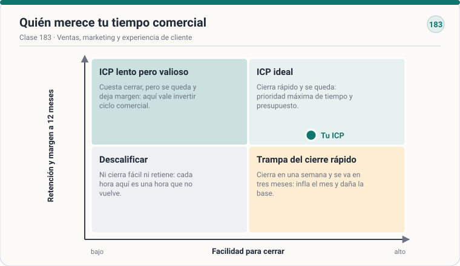

# Clase 183 — ICP y segmentación comercial

> **Parte 14 · Ventas, marketing y experiencia de cliente** — clase 1 de 14

**Estado de evidencia:** `GUIA-PRACTICA` · **Jurisdicción:** Chile-first · **Fecha base normativa:** 07-08-2026 
**Decisión que habilita:** definir a qué cuentas se dedica el tiempo comercial y a cuáles no 
**Entregable:** ICP comercial con señales de ajuste, criterios de descalificación y asignación de territorio

## 🎯 Propósito

Construir el ICP comercial mirando a los clientes que retienen y son rentables, no a los que cerraron más rápido.

## 📚 Resultados de aprendizaje

Al finalizar esta clase podrás:

1. **Definir** con precisión los cuatro conceptos de la tabla siguiente y usarlos para describir un caso real.
2. **Explicar** por qué esta materia condiciona decisiones de otras partes del programa.
3. **Decidir** —definir a qué cuentas se dedica el tiempo comercial y a cuáles no— y justificar la decisión por escrito.
4. **Producir** el entregable de la clase y contrastarlo contra su criterio de aceptación.
5. **Distinguir** el dato estable del dato dinámico que exige revalidación en la fuente oficial.

## 🧩 Conceptos centrales

| Concepto | Comprensión verificable |
|---|---|
| **ICP comercial** | Perfil de cuenta con mayor probabilidad de cerrar y retener. |
| **Señal de ajuste** | Atributo observable que predice éxito con el cliente. |
| **Territorio** | Asignación de cuentas por criterio geográfico o vertical. |
| **Descalificación** | Decisión de no perseguir una oportunidad. |

## 🗺️ Modelo mental: Quién merece tu tiempo comercial

> **La idea en una frase:** Tu mejor cliente no es el que cierra más rápido, sino el que se queda y deja margen; el tiempo comercial es limitado y debe ir hacia él.

**Cómo leerlo:** Ubica a tus últimos veinte clientes en los dos ejes. Si los que más retienen no son los que más rápido cerraron, tu tiempo comercial está mal asignado.

**Una imagen cotidiana:** Es como regar un campo: no se riega todo por igual, se riega donde la cosecha se repite año tras año.

## 📖 Desarrollo

### 1. El fondo del asunto

El ICP comercial se construye mirando los clientes que retienen y son rentables, no los que se cerraron más rápido. Descalificar temprano es una capacidad, no una pérdida: cada oportunidad perseguida sin ajuste consume tiempo que no vuelve.

### 2. Cómo se traduce en la práctica

Para construir el ICP parte por los datos y no por la intuición: lista tus clientes actuales, marca los que siguen activos después de 12 meses y dejan margen, y busca qué tienen en común (tamaño, rubro, área que decide, dolor que resolvías). Esos atributos observables son tus señales de ajuste. Luego escribe la regla de descalificación en una frase concreta, por ejemplo «no perseguimos cuentas sin un área de operaciones», y úsala en la primera conversación.

### 3. Marco aplicable y quién interviene

- embudo de adquisición y métricas por etapa
- calificación estructurada de oportunidades y discovery comercial
- revenue operations como integración de marketing, ventas y postventa

**Autoridades o contrapartes involucradas:** SERNAC en publicidad y ofertas, SUBTEL y SERNAC en contacto no solicitado.
**Profesionales de apoyo:** responsable comercial, marketing, customer success, abogado de consumo. La participación concreta depende del riesgo, del
tamaño de la empresa y de la actividad económica.

### 4. Caso trabajado

Una consultora cerró 12 clientes en el año. Siete eran pequeños y cerraron en menos de dos semanas, pero cinco se fueron antes de seis meses. Tres eran medianos, tardaron dos meses en cerrar y siguen activos con el doble de facturación. El perfil ideal no es «cierra rápido»: es «empresa mediana con un área de operaciones y un dolor medible». Descalificar a las pequeñas liberó cerca de un tercio del tiempo comercial (cifras ilustrativas).

### 5. En qué se apoya

- **Crossing the Chasm (3.ª ed., 2014)** (HarperBusiness): Moore sostiene que conviene concentrar la entrada en un segmento acotado y ganarlo antes de ampliar; el ICP aplica esa lógica al tiempo comercial.
- **Obviously Awesome (2019)** (Ambient Press): Dunford propone partir de los clientes que mejor encajan con el producto para definir el posicionamiento y a quién se le vende primero.

*Las lecturas de apoyo ofrecen marcos conceptuales; lo que exige la ley chilena se verifica en las fuentes oficiales de esta clase.*

## 🧪 Taller guiado

Aplica esta clase a **una** de las siguientes líneas de negocio y repite después el ejercicio con
una segunda línea de carga regulatoria distinta:

| Línea | Carga regulatoria |
|---|---|
| SaaS B2B con IA | media |
| Servicios profesionales | baja |
| E-commerce D2C | media |
| Alimentos o foodtech | alta |
| Exportación de servicios | media |
| Fintech regulada | alta |
| Construcción o servicios técnicos | alta |

**Secuencia de trabajo:**

1. Delimita el contexto: actividad económica, escala, comuna y etapa de la empresa.
2. Reúne los antecedentes que la decisión exige y anota la fecha de cada fuente.
3. Identifica las alternativas reales, incluida la de no hacer nada.
4. Evalúa el impacto en mercado, caja, personas, regulación y operación.
5. Toma la decisión y regístrala con sus supuestos.
6. Produce el entregable.
7. Contrástalo contra el criterio de aceptación.
8. Anota lo que requiere validación profesional y programa su revisión.

### 📦 Entregable

Icp comercial con señales de ajuste, criterios de descalificación y asignación de territorio.

Debe incluir decisión, supuestos, fuentes con fecha de consulta, responsable, riesgos
identificados y próximos pasos.

## 🏆 Reto verificable

Resuelve la misma materia para una segunda línea de negocio con distinta carga regulatoria y
explica por escrito **qué cambió, por qué y qué fuente lo determina**.

## ✅ Criterio de aceptación

- [ ] el ICP se deriva de clientes rentables y retenidos
- [ ] existen criterios explícitos de descalificación
- [ ] cada afirmación regulatoria está referida a una fuente oficial con fecha de consulta;
- [ ] los datos dinámicos quedan marcados para revalidación;
- [ ] hay un responsable asignado y evidencia reproducible del trabajo.

## ⚠️ Errores frecuentes

**Propios de esta clase:**

- Construir el icp desde los clientes que más rápido cerraron.
- No descalificar y mantener el pipeline lleno de oportunidades sin ajuste.

**Característicos de la parte 14:**

- Publicidad con condiciones no informadas que constituye infracción a la ley del consumidor.
- Pipeline inflado que produce decisiones de contratación equivocadas.

## 🇨🇱 Checklist Chile

- [ ] ¿existe norma o autoridad específica para esta materia?
- [ ] ¿la fuente consultada está vigente a la fecha de ejecución?
- [ ] ¿se activa algún trámite ante el SII?
- [ ] ¿se activa algún requisito municipal o sectorial?
- [ ] ¿afecta a consumidores o al tratamiento de datos personales?
- [ ] ¿afecta a trabajadores o a la seguridad y salud en el trabajo?
- [ ] ¿afecta a impuestos, contabilidad o caja?
- [ ] ¿afecta a contratos o a propiedad intelectual?
- [ ] ¿requiere renovación, reporte periódico o revalidación?

## ❓ Preguntas de comprobación

1. ¿Construiste tu ICP desde los clientes rentables o desde los fáciles de cerrar?
2. ¿Qué señales observables predicen que un cliente va a retener?
3. ¿Cuántas oportunidades activas de tu pipeline no cumplen tu ICP?

## 🔗 Fuentes oficiales

**Servicio Nacional del Consumidor — Ley 19.496, comercio electrónico y garantía legal**  
<https://www.sernac.cl/> · verificado 2026-11-05

- *Qué contiene:* Publica la interpretación aplicada de la Ley del Consumidor: deberes de información en la oferta, reglas del comercio electrónico, garantía legal, contratos de adhesión y el procedimiento de reclamos.
- *Cómo leerla:* Entra por el rubro de tu negocio y revisa las alertas y procedimientos colectivos publicados: muestran qué está fiscalizando el servicio ahora, que es mejor predictor de tu riesgo que la lectura abstracta de la ley.
- *Uso en esta clase:* aporta el marco de «Ley 19.496, comercio electrónico y garantía legal» para definir a qué cuentas se dedica el tiempo comercial y a cuáles no.

**Biblioteca del Congreso Nacional · LeyChile — Normativa oficial consolidada**  
<https://www.bcn.cl/leychile/> · verificado 2026-11-05

- *Qué contiene:* Publica el texto oficial y consolidado de leyes, decretos y reglamentos, con la versión vigente a una fecha, el historial de modificaciones y la tramitación que las originó.
- *Cómo leerla:* Usa siempre el selector de versión vigente a la fecha en que ejecutarás el trámite, no la última publicada. Y lee el artículo transitorio: en normas en implantación gradual —jornada, datos personales— ahí está la fecha que realmente te aplica.
- *Uso en esta clase:* aporta el marco de «Normativa oficial consolidada» para definir a qué cuentas se dedica el tiempo comercial y a cuáles no.

**HarperBusiness — Crossing the Chasm (3.ª ed., 2014)**  
<https://openlibrary.org/isbn/9780062292988> · verificado 2026-11-25

- *Qué contiene:* Explica cómo una empresa con tecnología o servicio nuevo pasa de los primeros adoptantes al mercado mayoritario concentrándose en un segmento acotado antes de ampliar.
- *Cómo leerla:* Úsalo como marco conceptual para entender el porqué de la práctica, nunca como prueba de lo que exige la ley chilena; para eso están las fuentes oficiales de la clase.
- *Uso en esta clase:* aporta el marco de «Crossing the Chasm (3.ª ed., 2014)» para definir a qué cuentas se dedica el tiempo comercial y a cuáles no.

**Ambient Press — Obviously Awesome (2019)**  
<https://openlibrary.org/isbn/9781999023003> · verificado 2026-11-25

- *Qué contiene:* Propone un método para definir el posicionamiento de un producto partiendo de los clientes que mejor encajan y del valor que reconocen.
- *Cómo leerla:* Úsalo como marco conceptual para entender el porqué de la práctica, nunca como prueba de lo que exige la ley chilena; para eso están las fuentes oficiales de la clase.
- *Uso en esta clase:* aporta el marco de «Obviously Awesome (2019)» para definir a qué cuentas se dedica el tiempo comercial y a cuáles no.

Complementos del repositorio: [glosario](../../../docs/19_GLOSSARY.md) ·
[ruta de lecturas](../../../docs/15_BOOKS_AND_LEARNING_PATH.md) ·
[catálogo de fuentes](../../../docs/16_OFFICIAL_SOURCE_CATALOG.md).

> [!IMPORTANT]
> Material educativo. Para una decisión real de alto impacto hay que verificar la fuente oficial
> vigente y validar con el profesional competente.

---

| Anterior | Índice | Siguiente |
|---|---|---|
| **Inicio de la parte** | [Parte 14](../README.md) · [Programa](../../../README.md) | [184 · Marca, posicionamiento y mensaje →](../class-02-marca-posicionamiento-y-mensaje/README.md) |
