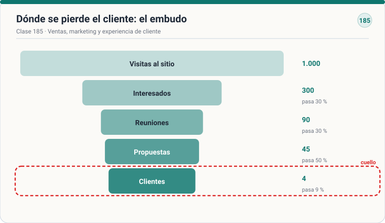

# Clase 185 — Embudo de adquisición

> **Parte 14 · Ventas, marketing y experiencia de cliente** — clase 3 de 14

**Estado de evidencia:** `GUIA-PRACTICA` · **Jurisdicción:** Chile-first · **Fecha base normativa:** 07-08-2026 
**Decisión que habilita:** identificar en qué etapa se pierde la mayor proporción y actuar ahí 
**Entregable:** embudo con tasas de conversión y velocidad por etapa, con cuello de botella identificado

## 🎯 Propósito

Medir la conversión por etapa para saber si el problema es de volumen, de calificación o de cierre, antes de invertir en más tráfico.

## 📚 Resultados de aprendizaje

Al finalizar esta clase podrás:

1. **Definir** con precisión los cuatro conceptos de la tabla siguiente y usarlos para describir un caso real.
2. **Explicar** por qué esta materia condiciona decisiones de otras partes del programa.
3. **Decidir** —identificar en qué etapa se pierde la mayor proporción y actuar ahí— y justificar la decisión por escrito.
4. **Producir** el entregable de la clase y contrastarlo contra su criterio de aceptación.
5. **Distinguir** el dato estable del dato dinámico que exige revalidación en la fuente oficial.

## 🧩 Conceptos centrales

| Concepto | Comprensión verificable |
|---|---|
| **Embudo** | Secuencia de etapas desde el primer contacto hasta la venta. |
| **Tasa de conversión** | Proporción que avanza de una etapa a la siguiente. |
| **Cuello de botella del embudo** | Etapa donde se pierde la mayor proporción. |
| **Velocidad** | Tiempo promedio entre etapas. |

## 🗺️ Modelo mental: Dónde se pierde el cliente: el embudo

> **La idea en una frase:** Antes de traer más gente al embudo, averigua en qué etapa se pierde la mayor parte: el esfuerzo rinde más donde el cuello es más angosto.

**Lectura guiada:** Cada barra es una etapa y el porcentaje a la derecha dice cuántos pasan a la siguiente. El recuadro rojo marca el cuello de botella: ahí está la mejora más barata (datos ilustrativos).

**Piénsalo así:** Es una cañería con un tramo estrecho: subir la presión al comienzo solo hace que el agua se derrame.

## 📖 Desarrollo

### 1. El fondo del asunto

Medir conversión por etapa permite saber si el problema es de volumen, de calificación o de cierre. Aumentar el tráfico cuando el problema está en el cierre solo aumenta el desperdicio. La velocidad del embudo determina cuánta caja se necesita para sostener el crecimiento.

### 2. Cómo se traduce en la práctica

Define cada etapa con un hecho observable (qué prueba que alguien pasó de interesado a reunión), mide cuántos entran y cuántos pasan cada mes y calcula el tiempo promedio entre etapas. Esa velocidad te dice cuánta caja necesitas mientras creces: un ciclo de 60 días exige financiar dos meses de costos antes de cobrar.

### 3. Marco aplicable y quién interviene

- embudo de adquisición y métricas por etapa
- calificación estructurada de oportunidades y discovery comercial
- revenue operations como integración de marketing, ventas y postventa

**Autoridades o contrapartes involucradas:** SERNAC en publicidad y ofertas, SUBTEL y SERNAC en contacto no solicitado.
**Profesionales de apoyo:** responsable comercial, marketing, customer success, abogado de consumo. La participación concreta depende del riesgo, del
tamaño de la empresa y de la actividad económica.

### 4. Los números, paso a paso

Con los datos ilustrativos del gráfico, duplicar el tráfico a 2.000 visitas daría 8 clientes en vez de 4. Subir el cierre de propuestas de 9 % a 18 % daría también 8 clientes sin gastar un peso adicional en tráfico. Revisar la etapa de cierre cuesta una tarde; duplicar el tráfico, un presupuesto.

### 5. En qué se apoya

- **The Lean Startup (2011)** (Crown Business): Ries propone medir con indicadores accionables por etapa y no con métricas de vanidad, para saber si lo que se hace mueve el resultado.
- **Traction (2015)** (Portfolio): Weinberg y Mares proponen probar varios canales de adquisición y concentrar el esfuerzo en el que muestra resultados.

*Las lecturas de apoyo ofrecen marcos conceptuales; lo que exige la ley chilena se verifica en las fuentes oficiales de esta clase.*

## 🧪 Taller guiado

Aplica esta clase a **una** de las siguientes líneas de negocio y repite después el ejercicio con
una segunda línea de carga regulatoria distinta:

| Línea | Carga regulatoria |
|---|---|
| SaaS B2B con IA | media |
| Servicios profesionales | baja |
| E-commerce D2C | media |
| Alimentos o foodtech | alta |
| Exportación de servicios | media |
| Fintech regulada | alta |
| Construcción o servicios técnicos | alta |

**Secuencia de trabajo:**

1. Delimita el contexto: actividad económica, escala, comuna y etapa de la empresa.
2. Reúne los antecedentes que la decisión exige y anota la fecha de cada fuente.
3. Identifica las alternativas reales, incluida la de no hacer nada.
4. Evalúa el impacto en mercado, caja, personas, regulación y operación.
5. Toma la decisión y regístrala con sus supuestos.
6. Produce el entregable.
7. Contrástalo contra el criterio de aceptación.
8. Anota lo que requiere validación profesional y programa su revisión.

### 📦 Entregable

Embudo con tasas de conversión y velocidad por etapa, con cuello de botella identificado.

Debe incluir decisión, supuestos, fuentes con fecha de consulta, responsable, riesgos
identificados y próximos pasos.

## 🏆 Reto verificable

Resuelve la misma materia para una segunda línea de negocio con distinta carga regulatoria y
explica por escrito **qué cambió, por qué y qué fuente lo determina**.

## ✅ Criterio de aceptación

- [ ] cada etapa tiene criterio objetivo de entrada y salida
- [ ] el cuello de botella está identificado con datos
- [ ] cada afirmación regulatoria está referida a una fuente oficial con fecha de consulta;
- [ ] los datos dinámicos quedan marcados para revalidación;
- [ ] hay un responsable asignado y evidencia reproducible del trabajo.

## ⚠️ Errores frecuentes

**Propios de esta clase:**

- Invertir en generar más contactos cuando el problema está en el cierre.
- Definir etapas sin criterio objetivo de avance.

**Característicos de la parte 14:**

- Publicidad con condiciones no informadas que constituye infracción a la ley del consumidor.
- Pipeline inflado que produce decisiones de contratación equivocadas.

## 🇨🇱 Checklist Chile

- [ ] ¿existe norma o autoridad específica para esta materia?
- [ ] ¿la fuente consultada está vigente a la fecha de ejecución?
- [ ] ¿se activa algún trámite ante el SII?
- [ ] ¿se activa algún requisito municipal o sectorial?
- [ ] ¿afecta a consumidores o al tratamiento de datos personales?
- [ ] ¿afecta a trabajadores o a la seguridad y salud en el trabajo?
- [ ] ¿afecta a impuestos, contabilidad o caja?
- [ ] ¿afecta a contratos o a propiedad intelectual?
- [ ] ¿requiere renovación, reporte periódico o revalidación?

## ❓ Preguntas de comprobación

1. ¿En qué etapa pierdes la mayor proporción de oportunidades?
2. ¿Qué criterio objetivo define que una oportunidad avanzó de etapa?
3. ¿Cuánto dura tu ciclo de venta y cómo lo financias?

## 🔗 Fuentes oficiales

**Servicio Nacional del Consumidor — Ley 19.496, comercio electrónico y garantía legal**  
<https://www.sernac.cl/> · verificado 2026-11-05

- *Qué contiene:* Publica la interpretación aplicada de la Ley del Consumidor: deberes de información en la oferta, reglas del comercio electrónico, garantía legal, contratos de adhesión y el procedimiento de reclamos.
- *Cómo leerla:* Entra por el rubro de tu negocio y revisa las alertas y procedimientos colectivos publicados: muestran qué está fiscalizando el servicio ahora, que es mejor predictor de tu riesgo que la lectura abstracta de la ley.
- *Uso en esta clase:* aporta el marco de «Ley 19.496, comercio electrónico y garantía legal» para identificar en qué etapa se pierde la mayor proporción y actuar ahí.

**Biblioteca del Congreso Nacional · LeyChile — Normativa oficial consolidada**  
<https://www.bcn.cl/leychile/> · verificado 2026-11-05

- *Qué contiene:* Publica el texto oficial y consolidado de leyes, decretos y reglamentos, con la versión vigente a una fecha, el historial de modificaciones y la tramitación que las originó.
- *Cómo leerla:* Usa siempre el selector de versión vigente a la fecha en que ejecutarás el trámite, no la última publicada. Y lee el artículo transitorio: en normas en implantación gradual —jornada, datos personales— ahí está la fecha que realmente te aplica.
- *Uso en esta clase:* aporta el marco de «Normativa oficial consolidada» para identificar en qué etapa se pierde la mayor proporción y actuar ahí.

**Crown Business — The Lean Startup (2011)**  
<https://openlibrary.org/isbn/9780307887894> · verificado 2026-11-25

- *Qué contiene:* Propone construir, medir y aprender con ciclos cortos y con indicadores accionables, en lugar de métricas de vanidad.
- *Cómo leerla:* Úsalo como marco conceptual para entender el porqué de la práctica, nunca como prueba de lo que exige la ley chilena; para eso están las fuentes oficiales de la clase.
- *Uso en esta clase:* aporta el marco de «The Lean Startup (2011)» para identificar en qué etapa se pierde la mayor proporción y actuar ahí.

**Portfolio — Traction (2015)**  
<https://openlibrary.org/isbn/9781591848363> · verificado 2026-11-25

- *Qué contiene:* Catálogo de canales de adquisición de clientes y un método para probarlos con experimentos pequeños y concentrar el esfuerzo en el que funciona.
- *Cómo leerla:* Úsalo como marco conceptual para entender el porqué de la práctica, nunca como prueba de lo que exige la ley chilena; para eso están las fuentes oficiales de la clase.
- *Uso en esta clase:* aporta el marco de «Traction (2015)» para identificar en qué etapa se pierde la mayor proporción y actuar ahí.

Complementos del repositorio: [glosario](../../../docs/19_GLOSSARY.md) ·
[ruta de lecturas](../../../docs/15_BOOKS_AND_LEARNING_PATH.md) ·
[catálogo de fuentes](../../../docs/16_OFFICIAL_SOURCE_CATALOG.md).

> [!IMPORTANT]
> Material educativo. Para una decisión real de alto impacto hay que verificar la fuente oficial
> vigente y validar con el profesional competente.

---

| Anterior | Índice | Siguiente |
|---|---|---|
| [← 184 · Marca, posicionamiento y mensaje](../class-02-marca-posicionamiento-y-mensaje/README.md) | [Parte 14](../README.md) · [Programa](../../../README.md) | [186 · Marketing de contenidos →](../class-04-marketing-de-contenidos/README.md) |
