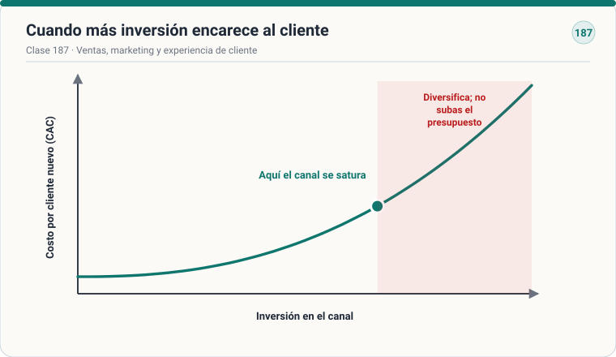

# Clase 187 — Publicidad digital y atribución

> **Parte 14 · Ventas, marketing y experiencia de cliente** — clase 5 de 14

**Estado de evidencia:** `GUIA-PRACTICA` · **Jurisdicción:** Chile-first · **Fecha base normativa:** 07-08-2026 
**Decisión que habilita:** decidir dónde invertir según el CAC por canal y su saturación 
**Entregable:** análisis de canales con CAC, volumen y señal de saturación por canal

## 🎯 Propósito

Decidir la inversión publicitaria por CAC por canal y señales de saturación, no por costo por clic.

## 📚 Resultados de aprendizaje

Al finalizar esta clase podrás:

1. **Definir** con precisión los cuatro conceptos de la tabla siguiente y usarlos para describir un caso real.
2. **Explicar** por qué esta materia condiciona decisiones de otras partes del programa.
3. **Decidir** —decidir dónde invertir según el CAC por canal y su saturación— y justificar la decisión por escrito.
4. **Producir** el entregable de la clase y contrastarlo contra su criterio de aceptación.
5. **Distinguir** el dato estable del dato dinámico que exige revalidación en la fuente oficial.

## 🧩 Conceptos centrales

| Concepto | Comprensión verificable |
|---|---|
| **Atribución** | Asignación del resultado a los canales que lo produjeron. |
| **CAC por canal** | Costo de adquisición desagregado. |
| **Ventana de atribución** | Período dentro del cual se atribuye la conversión. |
| **Canal saturado** | Aquel cuyo costo sube sin aumentar resultados. |

## 🗺️ Modelo mental: Cuando más inversión encarece al cliente

> **La idea en una frase:** Cada canal tiene un punto en que gastar más solo encarece al cliente nuevo: ahí se diversifica en vez de aumentar el presupuesto.

**Qué mirar primero:** A medida que se invierte más, el costo por cliente sube. Mientras la curva es plana conviene escalar; en la zona roja cada peso adicional compra menos.

**Una imagen cotidiana:** Es pescar en un estanque: los primeros lances sacan muchos peces; con el estanque ya pescado, cada pez cuesta más horas.

## 📖 Desarrollo

### 1. El fondo del asunto

Sin atribución, la inversión publicitaria se decide por intuición. Ningún modelo de atribución es exacto, pero cualquiera consistente permite comparar canales. La señal de saturación es que el CAC sube mientras el volumen se mantiene: ahí conviene diversificar y no aumentar presupuesto.

### 2. Cómo se traduce en la práctica

Mide todos los canales con el mismo método de atribución, aunque sea imperfecto, y compara su CAC y su volumen mes a mes. Elige una ventana de atribución acorde con tu ciclo de compra: una venta B2B de 60 días no se puede atribuir a una ventana de 7. Revisa además la publicidad contra la Ley del Consumidor: toda afirmación debe poder comprobarse.

### 3. Marco aplicable y quién interviene

- embudo de adquisición y métricas por etapa
- calificación estructurada de oportunidades y discovery comercial
- revenue operations como integración de marketing, ventas y postventa

**Autoridades o contrapartes involucradas:** SERNAC en publicidad y ofertas, SUBTEL y SERNAC en contacto no solicitado.
**Profesionales de apoyo:** responsable comercial, marketing, customer success, abogado de consumo. La participación concreta depende del riesgo, del
tamaño de la empresa y de la actividad económica.

### 4. Los números, paso a paso

Un canal trae 100 clientes con $2 millones (CAC de $20.000). Con $4 millones trae 150, no 200: el CAC promedio sube a $26.700, pero los 50 clientes adicionales costaron $40.000 cada uno. Lo que decide es el costo del cliente marginal, no el promedio (cifras ilustrativas).

### 5. En qué se apoya

- **Traction (2015)** (Portfolio): Weinberg y Mares recomiendan probar canales en pequeño y concentrarse en el que funciona, considerando que cada canal tiene un límite de escala.
- **Ley 19.496 — Protección de los derechos de los consumidores** (Biblioteca del Congreso Nacional): Los artículos 28 y 33 de la Ley 19.496 exigen que la publicidad no induzca a error y que la información sea comprobable.

*Las lecturas de apoyo ofrecen marcos conceptuales; lo que exige la ley chilena se verifica en las fuentes oficiales de esta clase.*

## 🤝 Reputación y confianza: publicidad veraz y terceros que hablan por tu marca

[Guía de reputación, crisis y confianza, sección 4](../../../docs/22_REPUTACION_CRISIS_Y_CONFIANZA.md#4-construcción-inicial-de-reputación-identidad-promesa-y-canales)

**Lente para esta clase:** Una pieza publicitaria publicada por un afiliado, un influenciador o una agencia sigue siendo un mensaje que beneficia a la empresa, y se juzga por su veracidad.

| Nivel | Medida proporcionada |
|---|---|
| **Emprendedor o microempresa** | Una regla escrita: ninguna afirmación sobre salud, ahorro o resultados sin una prueba guardada en una carpeta. |
| **Pyme** | Briefing y contrato con terceros, aprobación previa de piezas, registro de versiones y botón de retiro en 24 horas. |
| **Gran empresa o multinacional** | Revisión legal sistemática, auditoría de campañas, listado de afirmaciones prohibidas y sanciones contractuales a terceros. |

**Obligación legal:** Comete infracción quien, a sabiendas o debiendo saberlo, induce a error o engaño mediante cualquier mensaje publicitario (Ley 19.496, art. 28); la información debe ser susceptible de comprobación (art. 33).

**Recomendación profesional:** Contratar a terceros con derecho a auditar y a exigir el retiro; no responder una pieza cuestionada atribuyendo toda la culpa al tercero.

**Actividad:** Lista cinco afirmaciones que tu publicidad nunca podrá hacer sin prueba, y dónde guardarías la prueba de las que sí haces.

**Plantilla:** [Simulaciones de crisis para pymes](../../../templates/33_simulaciones_crisis_pyme.md)

**Términos:** Publicidad engañosa (*Misleading advertising*) · Aprobación previa (*Pre-approval*)

*Distingue lo que la ley exige de lo que conviene hacer. Las normas se leyeron en la Biblioteca del Congreso Nacional; verifica la versión vigente y consulta a un abogado antes de aplicarlas a un caso real.*

## 🧪 Taller guiado

Aplica esta clase a **una** de las siguientes líneas de negocio y repite después el ejercicio con
una segunda línea de carga regulatoria distinta:

| Línea | Carga regulatoria |
|---|---|
| SaaS B2B con IA | media |
| Servicios profesionales | baja |
| E-commerce D2C | media |
| Alimentos o foodtech | alta |
| Exportación de servicios | media |
| Fintech regulada | alta |
| Construcción o servicios técnicos | alta |

**Secuencia de trabajo:**

1. Delimita el contexto: actividad económica, escala, comuna y etapa de la empresa.
2. Reúne los antecedentes que la decisión exige y anota la fecha de cada fuente.
3. Identifica las alternativas reales, incluida la de no hacer nada.
4. Evalúa el impacto en mercado, caja, personas, regulación y operación.
5. Toma la decisión y regístrala con sus supuestos.
6. Produce el entregable.
7. Contrástalo contra el criterio de aceptación.
8. Anota lo que requiere validación profesional y programa su revisión.

### 📦 Entregable

Análisis de canales con cac, volumen y señal de saturación por canal.

Debe incluir decisión, supuestos, fuentes con fecha de consulta, responsable, riesgos
identificados y próximos pasos.

## 🏆 Reto verificable

Resuelve la misma materia para una segunda línea de negocio con distinta carga regulatoria y
explica por escrito **qué cambió, por qué y qué fuente lo determina**.

## ✅ Criterio de aceptación

- [ ] el CAC está calculado por canal
- [ ] se identifica la señal de saturación con datos
- [ ] cada afirmación regulatoria está referida a una fuente oficial con fecha de consulta;
- [ ] los datos dinámicos quedan marcados para revalidación;
- [ ] hay un responsable asignado y evidencia reproducible del trabajo.

## ⚠️ Errores frecuentes

**Propios de esta clase:**

- Evaluar canales por costo por clic en vez de por costo por cliente.
- Aumentar presupuesto en un canal saturado.

**Característicos de la parte 14:**

- Publicidad con condiciones no informadas que constituye infracción a la ley del consumidor.
- Pipeline inflado que produce decisiones de contratación equivocadas.

## 🇨🇱 Checklist Chile

- [ ] ¿existe norma o autoridad específica para esta materia?
- [ ] ¿la fuente consultada está vigente a la fecha de ejecución?
- [ ] ¿se activa algún trámite ante el SII?
- [ ] ¿se activa algún requisito municipal o sectorial?
- [ ] ¿afecta a consumidores o al tratamiento de datos personales?
- [ ] ¿afecta a trabajadores o a la seguridad y salud en el trabajo?
- [ ] ¿afecta a impuestos, contabilidad o caja?
- [ ] ¿afecta a contratos o a propiedad intelectual?
- [ ] ¿requiere renovación, reporte periódico o revalidación?

## ❓ Preguntas de comprobación

1. ¿Cuál es tu CAC por canal y no solo tu costo por clic?
2. ¿Qué canal muestra CAC creciente con volumen estancado?
3. ¿Qué ventana de atribución usas y por qué esa?

## 🔗 Fuentes oficiales

**Servicio Nacional del Consumidor — Ley 19.496, comercio electrónico y garantía legal**  
<https://www.sernac.cl/> · verificado 2026-11-05

- *Qué contiene:* Publica la interpretación aplicada de la Ley del Consumidor: deberes de información en la oferta, reglas del comercio electrónico, garantía legal, contratos de adhesión y el procedimiento de reclamos.
- *Cómo leerla:* Entra por el rubro de tu negocio y revisa las alertas y procedimientos colectivos publicados: muestran qué está fiscalizando el servicio ahora, que es mejor predictor de tu riesgo que la lectura abstracta de la ley.
- *Uso en esta clase:* aporta el marco de «Ley 19.496, comercio electrónico y garantía legal» para decidir dónde invertir según el CAC por canal y su saturación.

**Biblioteca del Congreso Nacional · LeyChile — Normativa oficial consolidada**  
<https://www.bcn.cl/leychile/> · verificado 2026-11-05

- *Qué contiene:* Publica el texto oficial y consolidado de leyes, decretos y reglamentos, con la versión vigente a una fecha, el historial de modificaciones y la tramitación que las originó.
- *Cómo leerla:* Usa siempre el selector de versión vigente a la fecha en que ejecutarás el trámite, no la última publicada. Y lee el artículo transitorio: en normas en implantación gradual —jornada, datos personales— ahí está la fecha que realmente te aplica.
- *Uso en esta clase:* aporta el marco de «Normativa oficial consolidada» para decidir dónde invertir según el CAC por canal y su saturación.

**Biblioteca del Congreso Nacional — Ley 19.496 — Protección de los derechos de los consumidores**  
<https://www.bcn.cl/leychile/navegar?idNorma=61438> · verificado 2026-11-25

- *Qué contiene:* Fija los derechos básicos del consumidor, la obligación de cumplir lo ofrecido (art. 12), la publicidad veraz (arts. 28 y 33), la seguridad del producto y el deber de informar a la autoridad los peligros descubiertos después de vender (arts. 45 a 49) y las funciones de fiscalización del SERNAC (art. 58).
- *Cómo leerla:* Úsala para distinguir qué debe hacer un proveedor ante un producto riesgoso o una publicidad cuestionada de lo que solo conviene hacer. Lee el artículo completo en la versión vigente antes de aplicarlo a un caso concreto.
- *Uso en esta clase:* aporta el marco de «Ley 19.496 — Protección de los derechos de los consumidores» para decidir dónde invertir según el CAC por canal y su saturación.

**Portfolio — Traction (2015)**  
<https://openlibrary.org/isbn/9781591848363> · verificado 2026-11-25

- *Qué contiene:* Catálogo de canales de adquisición de clientes y un método para probarlos con experimentos pequeños y concentrar el esfuerzo en el que funciona.
- *Cómo leerla:* Úsalo como marco conceptual para entender el porqué de la práctica, nunca como prueba de lo que exige la ley chilena; para eso están las fuentes oficiales de la clase.
- *Uso en esta clase:* aporta el marco de «Traction (2015)» para decidir dónde invertir según el CAC por canal y su saturación.

Complementos del repositorio: [glosario](../../../docs/19_GLOSSARY.md) ·
[ruta de lecturas](../../../docs/15_BOOKS_AND_LEARNING_PATH.md) ·
[catálogo de fuentes](../../../docs/16_OFFICIAL_SOURCE_CATALOG.md).

> [!IMPORTANT]
> Material educativo. Para una decisión real de alto impacto hay que verificar la fuente oficial
> vigente y validar con el profesional competente.

---

| Anterior | Índice | Siguiente |
|---|---|---|
| [← 186 · Marketing de contenidos](../class-04-marketing-de-contenidos/README.md) | [Parte 14](../README.md) · [Programa](../../../README.md) | [188 · Prospección B2B →](../class-06-prospeccion-b2b/README.md) |
