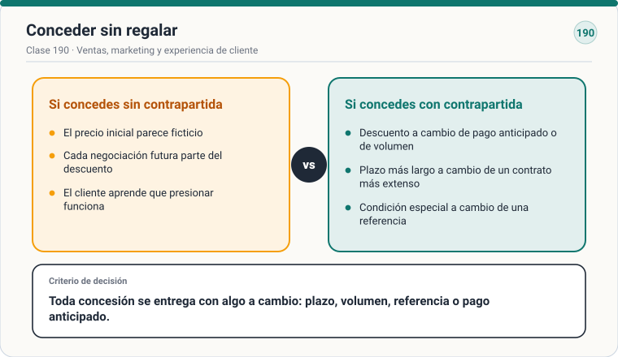

# Clase 190 — Propuesta, negociación y cierre

> **Parte 14 · Ventas, marketing y experiencia de cliente** — clase 8 de 14

**Estado de evidencia:** `GUIA-PRACTICA` · **Jurisdicción:** Chile-first · **Fecha base normativa:** 07-08-2026 
**Decisión que habilita:** definir la política de concesiones y qué se exige a cambio 
**Entregable:** plantilla de propuesta con alcance, exclusiones y matriz de concesiones con contrapartida

## 🎯 Propósito

Establecer una política de concesiones donde cada descuento tiene contrapartida, y propuestas con exclusiones tan explícitas como el alcance.

## 📚 Resultados de aprendizaje

Al finalizar esta clase podrás:

1. **Definir** con precisión los cuatro conceptos de la tabla siguiente y usarlos para describir un caso real.
2. **Explicar** por qué esta materia condiciona decisiones de otras partes del programa.
3. **Decidir** —definir la política de concesiones y qué se exige a cambio— y justificar la decisión por escrito.
4. **Producir** el entregable de la clase y contrastarlo contra su criterio de aceptación.
5. **Distinguir** el dato estable del dato dinámico que exige revalidación en la fuente oficial.

## 🧩 Conceptos centrales

| Concepto | Comprensión verificable |
|---|---|
| **Propuesta** | Documento que formaliza alcance, precio y condiciones. |
| **Concesión** | Cesión otorgada en la negociación. |
| **Contrapartida** | Valor obtenido a cambio de una concesión. |
| **Cierre** | Acuerdo formalizado con documento y condiciones. |

## 🗺️ Modelo mental: Conceder sin regalar

> **La idea en una frase:** Un descuento sin nada a cambio le enseña al cliente que el precio era negociable desde el comienzo; una concesión con contrapartida protege el valor.

**Qué mirar primero:** Compara los dos platos: a la izquierda, lo que ocurre cuando se cede gratis; a la derecha, cuando cada concesión trae su contrapartida.

**Para recordarlo:** Es un trueque: si entregas algo y no pides nada, no negociaste, regalaste.

## 📖 Desarrollo

### 1. El fondo del asunto

Toda concesión debe tener contrapartida: plazo, volumen, referencia, pago anticipado. Descontar sin contrapartida enseña al cliente que el precio inicial era ficticio y compromete todas las negociaciones futuras. La propuesta debe incluir exclusiones tan explícitas como el alcance.

### 2. Cómo se traduce en la práctica

Antes de negociar define por escrito qué puedes conceder, en qué orden y qué pedirás a cambio de cada cosa. Incluye en la propuesta lo que queda fuera del alcance con la misma claridad que lo incluido: es lo que más evita disputas después. Cierra con un documento firmado que recoja alcance, precio, plazos y las contrapartidas acordadas.

### 3. Marco aplicable y quién interviene

- embudo de adquisición y métricas por etapa
- calificación estructurada de oportunidades y discovery comercial
- revenue operations como integración de marketing, ventas y postventa

**Autoridades o contrapartes involucradas:** SERNAC en publicidad y ofertas, SUBTEL y SERNAC en contacto no solicitado.
**Profesionales de apoyo:** responsable comercial, marketing, customer success, abogado de consumo. La participación concreta depende del riesgo, del
tamaño de la empresa y de la actividad económica.

### 4. Los números, paso a paso

El cliente pide 10 % de descuento sobre $10 millones anuales. En vez de aceptar, la empresa ofrece 8 % si firma por dos años y paga el primero por adelantado. El cliente ahorra $800.000 al año; la empresa asegura $20 millones de ingreso y mejora su caja (cifras ilustrativas).

### 5. En qué se apoya

- **Getting to Yes (3.ª ed., 2011)** (Penguin): Fisher y Ury proponen negociar sobre intereses y no sobre posiciones y crear opciones de beneficio mutuo; la regla de la contrapartida es una forma operativa de aplicarlo al precio.

*Las lecturas de apoyo ofrecen marcos conceptuales; lo que exige la ley chilena se verifica en las fuentes oficiales de esta clase.*

## 🛡️ Protección del conocimiento: Inteligencia humana (HUMINT) en el mundo corporativo

[Guía de inteligencia económica y protección del conocimiento, sección 7](../../../docs/21_INTELIGENCIA_ECONOMICA_Y_PROTECCION_DEL_CONOCIMIENTO.md#7-inteligencia-humana-humint-en-el-mundo-corporativo)

**Lente para esta clase:** En una negociación la contraparte puede pedir más información de la necesaria para cotizar; la manipulación se detecta cuando el pedido supera la decisión que está en juego.

| Nivel | Medida proporcionada |
|---|---|
| **Emprendedor o microempresa** | Define antes de negociar tu precio mínimo y qué información de costos nunca revelas. |
| **Pyme** | Regla de que cada dato compartido se justifica por la decisión en juego y queda anotado en el expediente de la negociación. |
| **Gran empresa o multinacional** | Equipos de negociación con roles, cláusulas de acceso limitado y revisión legal de la información entregada. |

**Actividad sin crear sistemas:** Lista tres pedidos de información que una contraparte podría hacer y decide cuáles darías, por qué y con qué registro.

**Términos:** Manipulación en negociación (*Negotiation Manipulation*) · Elicitación (*Elicitation*)

*Enfoque defensivo: reconocer, prevenir, documentar y escalar. No enseña a obtener información de forma indebida; la calificación jurídica de un hecho concreto corresponde a un abogado.*

## 🧪 Taller guiado

Aplica esta clase a **una** de las siguientes líneas de negocio y repite después el ejercicio con
una segunda línea de carga regulatoria distinta:

| Línea | Carga regulatoria |
|---|---|
| SaaS B2B con IA | media |
| Servicios profesionales | baja |
| E-commerce D2C | media |
| Alimentos o foodtech | alta |
| Exportación de servicios | media |
| Fintech regulada | alta |
| Construcción o servicios técnicos | alta |

**Secuencia de trabajo:**

1. Delimita el contexto: actividad económica, escala, comuna y etapa de la empresa.
2. Reúne los antecedentes que la decisión exige y anota la fecha de cada fuente.
3. Identifica las alternativas reales, incluida la de no hacer nada.
4. Evalúa el impacto en mercado, caja, personas, regulación y operación.
5. Toma la decisión y regístrala con sus supuestos.
6. Produce el entregable.
7. Contrástalo contra el criterio de aceptación.
8. Anota lo que requiere validación profesional y programa su revisión.

### 📦 Entregable

Plantilla de propuesta con alcance, exclusiones y matriz de concesiones con contrapartida.

Debe incluir decisión, supuestos, fuentes con fecha de consulta, responsable, riesgos
identificados y próximos pasos.

## 🏆 Reto verificable

Resuelve la misma materia para una segunda línea de negocio con distinta carga regulatoria y
explica por escrito **qué cambió, por qué y qué fuente lo determina**.

## ✅ Criterio de aceptación

- [ ] cada concesión tiene contrapartida definida
- [ ] la propuesta incluye exclusiones explícitas
- [ ] cada afirmación regulatoria está referida a una fuente oficial con fecha de consulta;
- [ ] los datos dinámicos quedan marcados para revalidación;
- [ ] hay un responsable asignado y evidencia reproducible del trabajo.

## ⚠️ Errores frecuentes

**Propios de esta clase:**

- Descontar para cerrar sin obtener nada a cambio.
- Enviar propuestas sin exclusiones y quedar obligado a alcance no cotizado.

**Característicos de la parte 14:**

- Publicidad con condiciones no informadas que constituye infracción a la ley del consumidor.
- Pipeline inflado que produce decisiones de contratación equivocadas.

## 🇨🇱 Checklist Chile

- [ ] ¿existe norma o autoridad específica para esta materia?
- [ ] ¿la fuente consultada está vigente a la fecha de ejecución?
- [ ] ¿se activa algún trámite ante el SII?
- [ ] ¿se activa algún requisito municipal o sectorial?
- [ ] ¿afecta a consumidores o al tratamiento de datos personales?
- [ ] ¿afecta a trabajadores o a la seguridad y salud en el trabajo?
- [ ] ¿afecta a impuestos, contabilidad o caja?
- [ ] ¿afecta a contratos o a propiedad intelectual?
- [ ] ¿requiere renovación, reporte periódico o revalidación?

## ❓ Preguntas de comprobación

1. ¿Qué obtuviste a cambio del último descuento que otorgaste?
2. ¿Tus propuestas incluyen exclusiones explícitas o solo alcance?
3. ¿Con qué frecuencia terminas entregando más de lo cotizado?

## 🔗 Fuentes oficiales

**Servicio Nacional del Consumidor — Ley 19.496, comercio electrónico y garantía legal**  
<https://www.sernac.cl/> · verificado 2026-11-05

- *Qué contiene:* Publica la interpretación aplicada de la Ley del Consumidor: deberes de información en la oferta, reglas del comercio electrónico, garantía legal, contratos de adhesión y el procedimiento de reclamos.
- *Cómo leerla:* Entra por el rubro de tu negocio y revisa las alertas y procedimientos colectivos publicados: muestran qué está fiscalizando el servicio ahora, que es mejor predictor de tu riesgo que la lectura abstracta de la ley.
- *Uso en esta clase:* aporta el marco de «Ley 19.496, comercio electrónico y garantía legal» para definir la política de concesiones y qué se exige a cambio.

**Biblioteca del Congreso Nacional · LeyChile — Normativa oficial consolidada**  
<https://www.bcn.cl/leychile/> · verificado 2026-11-05

- *Qué contiene:* Publica el texto oficial y consolidado de leyes, decretos y reglamentos, con la versión vigente a una fecha, el historial de modificaciones y la tramitación que las originó.
- *Cómo leerla:* Usa siempre el selector de versión vigente a la fecha en que ejecutarás el trámite, no la última publicada. Y lee el artículo transitorio: en normas en implantación gradual —jornada, datos personales— ahí está la fecha que realmente te aplica.
- *Uso en esta clase:* aporta el marco de «Normativa oficial consolidada» para definir la política de concesiones y qué se exige a cambio.

**Penguin — Getting to Yes (3.ª ed., 2011)**  
<https://openlibrary.org/isbn/9780143118756> · verificado 2026-11-25

- *Qué contiene:* Expone la negociación basada en intereses: separar a las personas del problema, generar opciones de beneficio mutuo y usar criterios objetivos.
- *Cómo leerla:* Úsalo como marco conceptual para entender el porqué de la práctica, nunca como prueba de lo que exige la ley chilena; para eso están las fuentes oficiales de la clase.
- *Uso en esta clase:* aporta el marco de «Getting to Yes (3.ª ed., 2011)» para definir la política de concesiones y qué se exige a cambio.

Complementos del repositorio: [glosario](../../../docs/19_GLOSSARY.md) ·
[ruta de lecturas](../../../docs/15_BOOKS_AND_LEARNING_PATH.md) ·
[catálogo de fuentes](../../../docs/16_OFFICIAL_SOURCE_CATALOG.md).

> [!IMPORTANT]
> Material educativo. Para una decisión real de alto impacto hay que verificar la fuente oficial
> vigente y validar con el profesional competente.

---

| Anterior | Índice | Siguiente |
|---|---|---|
| [← 189 · Discovery comercial y calificación](../class-07-discovery-comercial-y-calificacion/README.md) | [Parte 14](../README.md) · [Programa](../../../README.md) | [191 · CRM y pipeline →](../class-09-crm-y-pipeline/README.md) |
