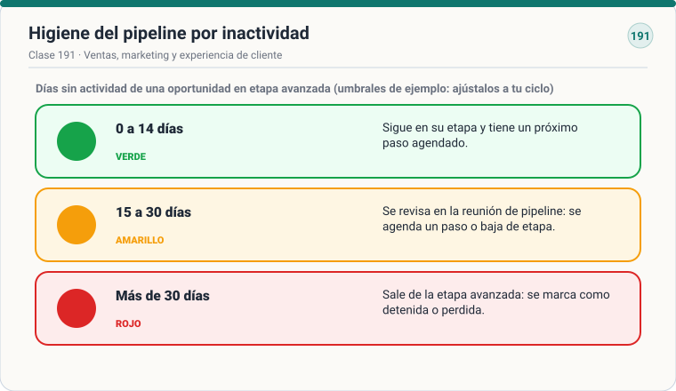

# Clase 191 — CRM y pipeline

> **Parte 14 · Ventas, marketing y experiencia de cliente** — clase 9 de 14

**Estado de evidencia:** `GUIA-PRACTICA` · **Jurisdicción:** Chile-first · **Fecha base normativa:** 07-08-2026 
**Decisión que habilita:** definir las reglas de higiene del pipeline y su revisión periódica 
**Entregable:** pipeline con etapas definidas, reglas de higiene y probabilidades calibradas con histórico

## 🎯 Propósito

Mantener la higiene del pipeline, porque un CRM con datos sucios produce forecast peores que no tener CRM: dan falsa confianza.

## 📚 Resultados de aprendizaje

Al finalizar esta clase podrás:

1. **Definir** con precisión los cuatro conceptos de la tabla siguiente y usarlos para describir un caso real.
2. **Explicar** por qué esta materia condiciona decisiones de otras partes del programa.
3. **Decidir** —definir las reglas de higiene del pipeline y su revisión periódica— y justificar la decisión por escrito.
4. **Producir** el entregable de la clase y contrastarlo contra su criterio de aceptación.
5. **Distinguir** el dato estable del dato dinámico que exige revalidación en la fuente oficial.

## 🧩 Conceptos centrales

| Concepto | Comprensión verificable |
|---|---|
| **CRM** | Sistema que registra cuentas, contactos y oportunidades. |
| **Pipeline** | Conjunto de oportunidades abiertas con etapa y monto. |
| **Higiene de datos** | Calidad y actualización de la información registrada. |
| **Probabilidad por etapa** | Factor histórico de cierre según la etapa. |

## 🗺️ Modelo mental: Higiene del pipeline por inactividad

> **La idea en una frase:** Un pipeline sin higiene da falsa confianza: una oportunidad sin actividad reciente no puede seguir en una etapa avanzada.

**Lectura guiada:** Cada banda es una regla de higiene: según los días sin actividad, la oportunidad se mantiene, se revisa o baja. Los umbrales son un ejemplo; ajústalos al largo de tu ciclo de venta.

**Una imagen cotidiana:** Es el inventario de una bodega: si nadie cuenta lo que hay, el sistema dice que tienes stock que ya no existe.

## 📖 Desarrollo

### 1. El fondo del asunto

Un CRM sin higiene de datos produce forecast peores que no tener CRM, porque dan falsa confianza. La regla mínima es que una oportunidad sin actividad reciente no puede seguir en etapa avanzada, y que las probabilidades por etapa se calibren con el histórico real.

### 2. Cómo se traduce en la práctica

Define las etapas con hechos verificables, el campo obligatorio de cada una y la regla de salida por inactividad. Calibra las probabilidades por etapa con tus cierres de los últimos doce meses y no con los de un manual. Programa una revisión semanal corta y haz visibles las oportunidades sin próximo paso.

### 3. Marco aplicable y quién interviene

- embudo de adquisición y métricas por etapa
- calificación estructurada de oportunidades y discovery comercial
- revenue operations como integración de marketing, ventas y postventa

**Autoridades o contrapartes involucradas:** SERNAC en publicidad y ofertas, SUBTEL y SERNAC en contacto no solicitado.
**Profesionales de apoyo:** responsable comercial, marketing, customer success, abogado de consumo. La participación concreta depende del riesgo, del
tamaño de la empresa y de la actividad económica.

### 4. Un error y su corrección

El error: una empresa reporta $300 millones en etapa avanzada con probabilidad de 60 % y proyecta $180 millones, pero nadie depura las oportunidades sin actividad. La corrección: aplicar la regla de 30 días sin movimiento. Salen $120 millones de la etapa avanzada y el pronóstico baja a $108 millones, mucho más cercano a lo que de verdad se cierra cada trimestre (cifras ilustrativas). Un pipeline limpio asusta más en la reunión, pero decide mejor.

### 5. En qué se apoya

- **Predictable Revenue (2011)** (PebbleStorm): Ross y Tyler insisten en medir el proceso comercial (volumen, conversión y ciclo) para poder pronosticar con datos y no con impresiones.

*Las lecturas de apoyo ofrecen marcos conceptuales; lo que exige la ley chilena se verifica en las fuentes oficiales de esta clase.*

## 🧪 Taller guiado

Aplica esta clase a **una** de las siguientes líneas de negocio y repite después el ejercicio con
una segunda línea de carga regulatoria distinta:

| Línea | Carga regulatoria |
|---|---|
| SaaS B2B con IA | media |
| Servicios profesionales | baja |
| E-commerce D2C | media |
| Alimentos o foodtech | alta |
| Exportación de servicios | media |
| Fintech regulada | alta |
| Construcción o servicios técnicos | alta |

**Secuencia de trabajo:**

1. Delimita el contexto: actividad económica, escala, comuna y etapa de la empresa.
2. Reúne los antecedentes que la decisión exige y anota la fecha de cada fuente.
3. Identifica las alternativas reales, incluida la de no hacer nada.
4. Evalúa el impacto en mercado, caja, personas, regulación y operación.
5. Toma la decisión y regístrala con sus supuestos.
6. Produce el entregable.
7. Contrástalo contra el criterio de aceptación.
8. Anota lo que requiere validación profesional y programa su revisión.

### 📦 Entregable

Pipeline con etapas definidas, reglas de higiene y probabilidades calibradas con histórico.

Debe incluir decisión, supuestos, fuentes con fecha de consulta, responsable, riesgos
identificados y próximos pasos.

## 🏆 Reto verificable

Resuelve la misma materia para una segunda línea de negocio con distinta carga regulatoria y
explica por escrito **qué cambió, por qué y qué fuente lo determina**.

## ✅ Criterio de aceptación

- [ ] existen reglas de depuración por antigüedad sin actividad
- [ ] las probabilidades por etapa se derivan del histórico
- [ ] cada afirmación regulatoria está referida a una fuente oficial con fecha de consulta;
- [ ] los datos dinámicos quedan marcados para revalidación;
- [ ] hay un responsable asignado y evidencia reproducible del trabajo.

## ⚠️ Errores frecuentes

**Propios de esta clase:**

- Mantener oportunidades muertas en el pipeline para inflar el forecast.
- Usar probabilidades por etapa arbitrarias en vez de históricas.

**Característicos de la parte 14:**

- Publicidad con condiciones no informadas que constituye infracción a la ley del consumidor.
- Pipeline inflado que produce decisiones de contratación equivocadas.

## 🇨🇱 Checklist Chile

- [ ] ¿existe norma o autoridad específica para esta materia?
- [ ] ¿la fuente consultada está vigente a la fecha de ejecución?
- [ ] ¿se activa algún trámite ante el SII?
- [ ] ¿se activa algún requisito municipal o sectorial?
- [ ] ¿afecta a consumidores o al tratamiento de datos personales?
- [ ] ¿afecta a trabajadores o a la seguridad y salud en el trabajo?
- [ ] ¿afecta a impuestos, contabilidad o caja?
- [ ] ¿afecta a contratos o a propiedad intelectual?
- [ ] ¿requiere renovación, reporte periódico o revalidación?

## ❓ Preguntas de comprobación

1. ¿Cuántas oportunidades de tu pipeline no tienen actividad en 30 días?
2. ¿Tus probabilidades por etapa vienen de tu histórico o son estimadas?
3. ¿Qué decisión tomaste el último año basada en un forecast que no se cumplió?

## 🔗 Fuentes oficiales

**Servicio Nacional del Consumidor — Ley 19.496, comercio electrónico y garantía legal**  
<https://www.sernac.cl/> · verificado 2026-11-05

- *Qué contiene:* Publica la interpretación aplicada de la Ley del Consumidor: deberes de información en la oferta, reglas del comercio electrónico, garantía legal, contratos de adhesión y el procedimiento de reclamos.
- *Cómo leerla:* Entra por el rubro de tu negocio y revisa las alertas y procedimientos colectivos publicados: muestran qué está fiscalizando el servicio ahora, que es mejor predictor de tu riesgo que la lectura abstracta de la ley.
- *Uso en esta clase:* aporta el marco de «Ley 19.496, comercio electrónico y garantía legal» para definir las reglas de higiene del pipeline y su revisión periódica.

**Biblioteca del Congreso Nacional · LeyChile — Normativa oficial consolidada**  
<https://www.bcn.cl/leychile/> · verificado 2026-11-05

- *Qué contiene:* Publica el texto oficial y consolidado de leyes, decretos y reglamentos, con la versión vigente a una fecha, el historial de modificaciones y la tramitación que las originó.
- *Cómo leerla:* Usa siempre el selector de versión vigente a la fecha en que ejecutarás el trámite, no la última publicada. Y lee el artículo transitorio: en normas en implantación gradual —jornada, datos personales— ahí está la fecha que realmente te aplica.
- *Uso en esta clase:* aporta el marco de «Normativa oficial consolidada» para definir las reglas de higiene del pipeline y su revisión periódica.

**PebbleStorm — Predictable Revenue (2011)**  
<https://openlibrary.org/isbn/9780984380213> · verificado 2026-11-25

- *Qué contiene:* Describe la prospección saliente como un proceso con roles especializados, listas acotadas y métricas, para volver predecible la generación de ingresos.
- *Cómo leerla:* Úsalo como marco conceptual para entender el porqué de la práctica, nunca como prueba de lo que exige la ley chilena; para eso están las fuentes oficiales de la clase.
- *Uso en esta clase:* aporta el marco de «Predictable Revenue (2011)» para definir las reglas de higiene del pipeline y su revisión periódica.

Complementos del repositorio: [glosario](../../../docs/19_GLOSSARY.md) ·
[ruta de lecturas](../../../docs/15_BOOKS_AND_LEARNING_PATH.md) ·
[catálogo de fuentes](../../../docs/16_OFFICIAL_SOURCE_CATALOG.md).

> [!IMPORTANT]
> Material educativo. Para una decisión real de alto impacto hay que verificar la fuente oficial
> vigente y validar con el profesional competente.

---

| Anterior | Índice | Siguiente |
|---|---|---|
| [← 190 · Propuesta, negociación y cierre](../class-08-propuesta-negociacion-y-cierre/README.md) | [Parte 14](../README.md) · [Programa](../../../README.md) | [192 · Onboarding de clientes →](../class-10-onboarding-de-clientes/README.md) |
