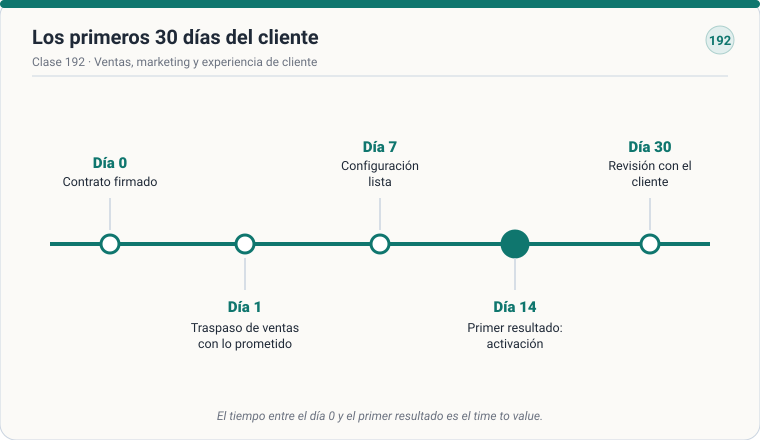

# Clase 192 — Onboarding de clientes

> **Parte 14 · Ventas, marketing y experiencia de cliente** — clase 10 de 14

**Estado de evidencia:** `GUIA-PRACTICA` · **Jurisdicción:** Chile-first · **Fecha base normativa:** 07-08-2026 
**Decisión que habilita:** diseñar el onboarding y definir el hito de activación 
**Entregable:** proceso de onboarding con hitos, responsables, time to value objetivo y traspaso documentado

## 🎯 Propósito

Diseñar el onboarding y definir el hito de activación, porque determina la retención más que cualquier acción posterior.

## 📚 Resultados de aprendizaje

Al finalizar esta clase podrás:

1. **Definir** con precisión los cuatro conceptos de la tabla siguiente y usarlos para describir un caso real.
2. **Explicar** por qué esta materia condiciona decisiones de otras partes del programa.
3. **Decidir** —diseñar el onboarding y definir el hito de activación— y justificar la decisión por escrito.
4. **Producir** el entregable de la clase y contrastarlo contra su criterio de aceptación.
5. **Distinguir** el dato estable del dato dinámico que exige revalidación en la fuente oficial.

## 🧩 Conceptos centrales

| Concepto | Comprensión verificable |
|---|---|
| **Onboarding** | Proceso de puesta en marcha del cliente nuevo. |
| **Time to value** | Tiempo hasta que el cliente obtiene el primer resultado. |
| **Hito de activación** | Evento que indica que el cliente está usando efectivamente. |
| **Traspaso comercial** | Entrega ordenada desde ventas a la operación. |

## 🗺️ Modelo mental: Los primeros 30 días del cliente

> **La idea en una frase:** La retención se decide en las primeras semanas: cuanto antes ve el cliente su primer resultado, menos probable es que se vaya.

**Cómo leerlo:** La línea es el primer mes. El hito grande es la activación: el momento en que el cliente usa el producto y obtiene algo. Todo lo anterior existe para llegar a ese punto.

**Una analogía:** Es el primer día en un gimnasio: si la primera semana nadie te muestra cómo usar las máquinas, no vuelves.

## 📖 Desarrollo

### 1. El fondo del asunto

El onboarding determina la retención más que cualquier acción posterior. Reducir el time to value es la palanca más efectiva contra el churn temprano. El traspaso desde ventas debe incluir lo prometido, no solo lo contratado: las expectativas creadas en la venta son parte del alcance real.

### 2. Cómo se traduce en la práctica

Define qué evento prueba que el cliente está en marcha, por ejemplo su primera factura emitida, y trabaja hacia atrás: qué debe estar listo, quién lo hace y en qué plazo. El traspaso desde ventas debe llevar escrito lo prometido y no solo lo contratado, porque las expectativas creadas en la venta son parte del alcance real.

### 3. Marco aplicable y quién interviene

- embudo de adquisición y métricas por etapa
- calificación estructurada de oportunidades y discovery comercial
- revenue operations como integración de marketing, ventas y postventa

**Autoridades o contrapartes involucradas:** SERNAC en publicidad y ofertas, SUBTEL y SERNAC en contacto no solicitado.
**Profesionales de apoyo:** responsable comercial, marketing, customer success, abogado de consumo. La participación concreta depende del riesgo, del
tamaño de la empresa y de la actividad económica.

### 4. Antes y después

Un software de facturación tarda 40 días en quedar operativo y pierde a 3 de cada 10 clientes antes del segundo mes. Al preparar plantillas y migrar los datos junto con el cliente, el primer resultado llega al día 12 y la pérdida temprana baja a 1 de cada 10 (cifras ilustrativas).

### 5. En qué se apoya

- **Customer Success (2016)** (Wiley): Mehta y sus coautores presentan el éxito del cliente como la disciplina que asegura que el cliente obtenga el resultado esperado, empezando por el onboarding.

*Las lecturas de apoyo ofrecen marcos conceptuales; lo que exige la ley chilena se verifica en las fuentes oficiales de esta clase.*

## 🧪 Taller guiado

Aplica esta clase a **una** de las siguientes líneas de negocio y repite después el ejercicio con
una segunda línea de carga regulatoria distinta:

| Línea | Carga regulatoria |
|---|---|
| SaaS B2B con IA | media |
| Servicios profesionales | baja |
| E-commerce D2C | media |
| Alimentos o foodtech | alta |
| Exportación de servicios | media |
| Fintech regulada | alta |
| Construcción o servicios técnicos | alta |

**Secuencia de trabajo:**

1. Delimita el contexto: actividad económica, escala, comuna y etapa de la empresa.
2. Reúne los antecedentes que la decisión exige y anota la fecha de cada fuente.
3. Identifica las alternativas reales, incluida la de no hacer nada.
4. Evalúa el impacto en mercado, caja, personas, regulación y operación.
5. Toma la decisión y regístrala con sus supuestos.
6. Produce el entregable.
7. Contrástalo contra el criterio de aceptación.
8. Anota lo que requiere validación profesional y programa su revisión.

### 📦 Entregable

Proceso de onboarding con hitos, responsables, time to value objetivo y traspaso documentado.

Debe incluir decisión, supuestos, fuentes con fecha de consulta, responsable, riesgos
identificados y próximos pasos.

## 🏆 Reto verificable

Resuelve la misma materia para una segunda línea de negocio con distinta carga regulatoria y
explica por escrito **qué cambió, por qué y qué fuente lo determina**.

## ✅ Criterio de aceptación

- [ ] el hito de activación está definido y se mide
- [ ] el traspaso registra compromisos adquiridos en la venta
- [ ] cada afirmación regulatoria está referida a una fuente oficial con fecha de consulta;
- [ ] los datos dinámicos quedan marcados para revalidación;
- [ ] hay un responsable asignado y evidencia reproducible del trabajo.

## ⚠️ Errores frecuentes

**Propios de esta clase:**

- Traspasar el cliente sin registrar lo prometido durante la venta.
- No definir hito de activación y no saber si el cliente está usando el servicio.

**Característicos de la parte 14:**

- Publicidad con condiciones no informadas que constituye infracción a la ley del consumidor.
- Pipeline inflado que produce decisiones de contratación equivocadas.

## 🇨🇱 Checklist Chile

- [ ] ¿existe norma o autoridad específica para esta materia?
- [ ] ¿la fuente consultada está vigente a la fecha de ejecución?
- [ ] ¿se activa algún trámite ante el SII?
- [ ] ¿se activa algún requisito municipal o sectorial?
- [ ] ¿afecta a consumidores o al tratamiento de datos personales?
- [ ] ¿afecta a trabajadores o a la seguridad y salud en el trabajo?
- [ ] ¿afecta a impuestos, contabilidad o caja?
- [ ] ¿afecta a contratos o a propiedad intelectual?
- [ ] ¿requiere renovación, reporte periódico o revalidación?

## ❓ Preguntas de comprobación

1. ¿Cuánto tarda un cliente nuevo en obtener su primer resultado?
2. ¿Qué hito indica que el cliente está usando efectivamente el servicio?
3. ¿Cómo se registra lo que se prometió durante la venta?

## 🔗 Fuentes oficiales

**Servicio Nacional del Consumidor — Ley 19.496, comercio electrónico y garantía legal**  
<https://www.sernac.cl/> · verificado 2026-11-05

- *Qué contiene:* Publica la interpretación aplicada de la Ley del Consumidor: deberes de información en la oferta, reglas del comercio electrónico, garantía legal, contratos de adhesión y el procedimiento de reclamos.
- *Cómo leerla:* Entra por el rubro de tu negocio y revisa las alertas y procedimientos colectivos publicados: muestran qué está fiscalizando el servicio ahora, que es mejor predictor de tu riesgo que la lectura abstracta de la ley.
- *Uso en esta clase:* aporta el marco de «Ley 19.496, comercio electrónico y garantía legal» para diseñar el onboarding y definir el hito de activación.

**Biblioteca del Congreso Nacional · LeyChile — Normativa oficial consolidada**  
<https://www.bcn.cl/leychile/> · verificado 2026-11-05

- *Qué contiene:* Publica el texto oficial y consolidado de leyes, decretos y reglamentos, con la versión vigente a una fecha, el historial de modificaciones y la tramitación que las originó.
- *Cómo leerla:* Usa siempre el selector de versión vigente a la fecha en que ejecutarás el trámite, no la última publicada. Y lee el artículo transitorio: en normas en implantación gradual —jornada, datos personales— ahí está la fecha que realmente te aplica.
- *Uso en esta clase:* aporta el marco de «Normativa oficial consolidada» para diseñar el onboarding y definir el hito de activación.

**Wiley — Customer Success (2016)**  
<https://openlibrary.org/isbn/9781119167969> · verificado 2026-11-25

- *Qué contiene:* Define el éxito del cliente como disciplina de negocio recurrente: onboarding, salud de cuenta, retención y expansión.
- *Cómo leerla:* Úsalo como marco conceptual para entender el porqué de la práctica, nunca como prueba de lo que exige la ley chilena; para eso están las fuentes oficiales de la clase.
- *Uso en esta clase:* aporta el marco de «Customer Success (2016)» para diseñar el onboarding y definir el hito de activación.

Complementos del repositorio: [glosario](../../../docs/19_GLOSSARY.md) ·
[ruta de lecturas](../../../docs/15_BOOKS_AND_LEARNING_PATH.md) ·
[catálogo de fuentes](../../../docs/16_OFFICIAL_SOURCE_CATALOG.md).

> [!IMPORTANT]
> Material educativo. Para una decisión real de alto impacto hay que verificar la fuente oficial
> vigente y validar con el profesional competente.

---

| Anterior | Índice | Siguiente |
|---|---|---|
| [← 191 · CRM y pipeline](../class-09-crm-y-pipeline/README.md) | [Parte 14](../README.md) · [Programa](../../../README.md) | [193 · Customer success y expansión →](../class-11-customer-success-y-expansion/README.md) |
