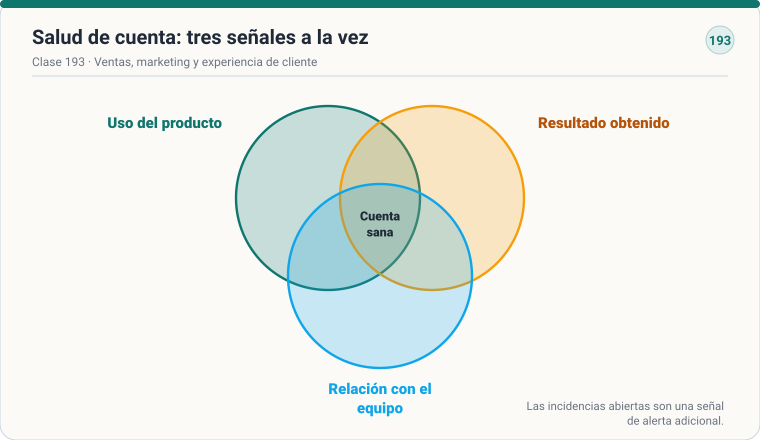

# Clase 193 — Customer success y expansión

> **Parte 14 · Ventas, marketing y experiencia de cliente** — clase 11 de 14

**Estado de evidencia:** `GUIA-PRACTICA` · **Jurisdicción:** Chile-first · **Fecha base normativa:** 07-08-2026 
**Decisión que habilita:** definir el indicador de salud de cuenta y las intervenciones por nivel de riesgo 
**Entregable:** modelo de salud de cuenta con señales de riesgo e intervenciones definidas

## 🎯 Propósito

Construir un indicador de salud de cuenta que permita intervenir antes de que el cliente decida irse.

## 📚 Resultados de aprendizaje

Al finalizar esta clase podrás:

1. **Definir** con precisión los cuatro conceptos de la tabla siguiente y usarlos para describir un caso real.
2. **Explicar** por qué esta materia condiciona decisiones de otras partes del programa.
3. **Decidir** —definir el indicador de salud de cuenta y las intervenciones por nivel de riesgo— y justificar la decisión por escrito.
4. **Producir** el entregable de la clase y contrastarlo contra su criterio de aceptación.
5. **Distinguir** el dato estable del dato dinámico que exige revalidación en la fuente oficial.

## 🧩 Conceptos centrales

| Concepto | Comprensión verificable |
|---|---|
| **Customer success** | Función que asegura que el cliente obtenga el resultado esperado. |
| **Salud de cuenta** | Indicador compuesto que anticipa renovación o fuga. |
| **Expansión** | Aumento de ingreso dentro de la base existente. |
| **Señal de riesgo** | Comportamiento que anticipa la salida del cliente. |

## 🗺️ Modelo mental: Salud de cuenta: tres señales a la vez

> **La idea en una frase:** La renovación se gana durante el período: un indicador de salud de cuenta permite intervenir cuando todavía hay tiempo.

**Qué mirar primero:** Una cuenta sana está en la intersección: usa el producto, obtiene el resultado que buscaba y mantiene relación con el equipo. Si falta una de las tres, hay una intervención definida.

**Piénsalo así:** Es el control médico anual: no esperas al síntoma para mirar presión, peso y análisis.

## 📖 Desarrollo

### 1. El fondo del asunto

La renovación se gana durante el período, no en el mes previo. Un indicador de salud de cuenta que combine uso, resultado obtenido, incidencias y relación permite intervenir cuando aún es posible. Sin él, la primera señal de fuga es el aviso de no renovación.

### 2. Cómo se traduce en la práctica

Elige tres o cuatro señales medibles (uso, resultado, incidencias, relación), asigna un peso a cada una y define qué se hace en cada nivel de riesgo y quién lo hace. Contrasta el indicador con las renovaciones reales: si las cuentas «verdes» se van, está mal calibrado. La expansión nace en cuentas sanas, no en cuentas a las que solo se les insiste.

### 3. Marco aplicable y quién interviene

- embudo de adquisición y métricas por etapa
- calificación estructurada de oportunidades y discovery comercial
- revenue operations como integración de marketing, ventas y postventa

**Autoridades o contrapartes involucradas:** SERNAC en publicidad y ofertas, SUBTEL y SERNAC en contacto no solicitado.
**Profesionales de apoyo:** responsable comercial, marketing, customer success, abogado de consumo. La participación concreta depende del riesgo, del
tamaño de la empresa y de la actividad económica.

### 4. Caso trabajado

Una cuenta usa el producto a diario, pero no logró el ahorro que esperaba y su contacto cambió de empresa. El indicador pasa de verde a amarillo tres meses antes de la renovación y el equipo agenda una revisión de resultados con el nuevo contacto. Sin indicador, la primera señal habría sido el aviso de no renovación (caso ilustrativo).

### 5. En qué se apoya

- **Customer Success (2016)** (Wiley): Mehta y sus coautores proponen seguir la salud del cliente con un conjunto de indicadores y actuar sobre ellos antes de la renovación.

*Las lecturas de apoyo ofrecen marcos conceptuales; lo que exige la ley chilena se verifica en las fuentes oficiales de esta clase.*

## 🤝 Reputación y confianza: comunicar antes de que el cliente pregunte

[Guía de reputación, crisis y confianza, sección 4](../../../docs/22_REPUTACION_CRISIS_Y_CONFIANZA.md#4-construcción-inicial-de-reputación-identidad-promesa-y-canales)

**Lente para esta clase:** El cliente perdona un retraso avisado y no perdona uno descubierto: la comunicación proactiva es el cimiento de la reputación en la operación diaria.

| Nivel | Medida proporcionada |
|---|---|
| **Emprendedor o microempresa** | Un mensaje tipo para cada falla probable (retraso, cobro erróneo, falta de stock) que se envía en la primera hora. |
| **Pyme** | Calendario de comunicaciones del ciclo de vida del cliente y plantillas con responsable y plazo de envío. |
| **Gran empresa o multinacional** | Customer success con alertas de riesgo de cuenta, comunicación segmentada y escalamiento a gerencia por severidad. |

**Obligación legal:** Respetar los términos, condiciones y modalidades ofrecidos al cliente es exigible (Ley 19.496, art. 12); por eso el aviso de un cambio debe preceder al incumplimiento y no seguirlo.

**Recomendación profesional:** Informar la nueva fecha realista, ofrecer una alternativa y comprometer la próxima actualización.

**Actividad:** Redacta un aviso proactivo de cuatro líneas para un pedido que llegará con siete días de retraso.

**Plantilla:** [Guías de comunicación por audiencia](../../../templates/31_guias_comunicacion_por_audiencia.md)

**Términos:** Comunicación proactiva (*Proactive communication*) · Experiencia del cliente (*Customer experience*)

**Simulación:** [caso 1 del expediente de reputación y crisis](../../../case-studies/23-reputacion-y-crisis-siete-casos.md#1-microempresa-con-una-controversia-pública). Compara una respuesta reactiva con un aviso proactivo ante un retraso en pedidos. Es una simulación ilustrativa, no una empresa real.

*Distingue lo que la ley exige de lo que conviene hacer. Las normas se leyeron en la Biblioteca del Congreso Nacional; verifica la versión vigente y consulta a un abogado antes de aplicarlas a un caso real.*

## 🧪 Taller guiado

Aplica esta clase a **una** de las siguientes líneas de negocio y repite después el ejercicio con
una segunda línea de carga regulatoria distinta:

| Línea | Carga regulatoria |
|---|---|
| SaaS B2B con IA | media |
| Servicios profesionales | baja |
| E-commerce D2C | media |
| Alimentos o foodtech | alta |
| Exportación de servicios | media |
| Fintech regulada | alta |
| Construcción o servicios técnicos | alta |

**Secuencia de trabajo:**

1. Delimita el contexto: actividad económica, escala, comuna y etapa de la empresa.
2. Reúne los antecedentes que la decisión exige y anota la fecha de cada fuente.
3. Identifica las alternativas reales, incluida la de no hacer nada.
4. Evalúa el impacto en mercado, caja, personas, regulación y operación.
5. Toma la decisión y regístrala con sus supuestos.
6. Produce el entregable.
7. Contrástalo contra el criterio de aceptación.
8. Anota lo que requiere validación profesional y programa su revisión.

### 📦 Entregable

Modelo de salud de cuenta con señales de riesgo e intervenciones definidas.

Debe incluir decisión, supuestos, fuentes con fecha de consulta, responsable, riesgos
identificados y próximos pasos.

## 🏆 Reto verificable

Resuelve la misma materia para una segunda línea de negocio con distinta carga regulatoria y
explica por escrito **qué cambió, por qué y qué fuente lo determina**.

## ✅ Criterio de aceptación

- [ ] el indicador combina uso, resultado e incidencias
- [ ] cada nivel de riesgo tiene intervención definida
- [ ] cada afirmación regulatoria está referida a una fuente oficial con fecha de consulta;
- [ ] los datos dinámicos quedan marcados para revalidación;
- [ ] hay un responsable asignado y evidencia reproducible del trabajo.

## ⚠️ Errores frecuentes

**Propios de esta clase:**

- Gestionar la renovación solo en el mes previo al vencimiento.
- Medir satisfacción declarada e ignorar el uso real.

**Característicos de la parte 14:**

- Publicidad con condiciones no informadas que constituye infracción a la ley del consumidor.
- Pipeline inflado que produce decisiones de contratación equivocadas.

## 🇨🇱 Checklist Chile

- [ ] ¿existe norma o autoridad específica para esta materia?
- [ ] ¿la fuente consultada está vigente a la fecha de ejecución?
- [ ] ¿se activa algún trámite ante el SII?
- [ ] ¿se activa algún requisito municipal o sectorial?
- [ ] ¿afecta a consumidores o al tratamiento de datos personales?
- [ ] ¿afecta a trabajadores o a la seguridad y salud en el trabajo?
- [ ] ¿afecta a impuestos, contabilidad o caja?
- [ ] ¿afecta a contratos o a propiedad intelectual?
- [ ] ¿requiere renovación, reporte periódico o revalidación?

## ❓ Preguntas de comprobación

1. ¿Qué señales anticipan que un cliente va a no renovar?
2. ¿Mides uso real o solo satisfacción declarada?
3. ¿Qué intervención concreta tienes definida para cada nivel de riesgo?

## 🔗 Fuentes oficiales

**Servicio Nacional del Consumidor — Ley 19.496, comercio electrónico y garantía legal**  
<https://www.sernac.cl/> · verificado 2026-11-05

- *Qué contiene:* Publica la interpretación aplicada de la Ley del Consumidor: deberes de información en la oferta, reglas del comercio electrónico, garantía legal, contratos de adhesión y el procedimiento de reclamos.
- *Cómo leerla:* Entra por el rubro de tu negocio y revisa las alertas y procedimientos colectivos publicados: muestran qué está fiscalizando el servicio ahora, que es mejor predictor de tu riesgo que la lectura abstracta de la ley.
- *Uso en esta clase:* aporta el marco de «Ley 19.496, comercio electrónico y garantía legal» para definir el indicador de salud de cuenta y las intervenciones por nivel de riesgo.

**Biblioteca del Congreso Nacional · LeyChile — Normativa oficial consolidada**  
<https://www.bcn.cl/leychile/> · verificado 2026-11-05

- *Qué contiene:* Publica el texto oficial y consolidado de leyes, decretos y reglamentos, con la versión vigente a una fecha, el historial de modificaciones y la tramitación que las originó.
- *Cómo leerla:* Usa siempre el selector de versión vigente a la fecha en que ejecutarás el trámite, no la última publicada. Y lee el artículo transitorio: en normas en implantación gradual —jornada, datos personales— ahí está la fecha que realmente te aplica.
- *Uso en esta clase:* aporta el marco de «Normativa oficial consolidada» para definir el indicador de salud de cuenta y las intervenciones por nivel de riesgo.

**Biblioteca del Congreso Nacional — Ley 19.496 — Protección de los derechos de los consumidores**  
<https://www.bcn.cl/leychile/navegar?idNorma=61438> · verificado 2026-11-25

- *Qué contiene:* Fija los derechos básicos del consumidor, la obligación de cumplir lo ofrecido (art. 12), la publicidad veraz (arts. 28 y 33), la seguridad del producto y el deber de informar a la autoridad los peligros descubiertos después de vender (arts. 45 a 49) y las funciones de fiscalización del SERNAC (art. 58).
- *Cómo leerla:* Úsala para distinguir qué debe hacer un proveedor ante un producto riesgoso o una publicidad cuestionada de lo que solo conviene hacer. Lee el artículo completo en la versión vigente antes de aplicarlo a un caso concreto.
- *Uso en esta clase:* aporta el marco de «Ley 19.496 — Protección de los derechos de los consumidores» para definir el indicador de salud de cuenta y las intervenciones por nivel de riesgo.

**Wiley — Customer Success (2016)**  
<https://openlibrary.org/isbn/9781119167969> · verificado 2026-11-25

- *Qué contiene:* Define el éxito del cliente como disciplina de negocio recurrente: onboarding, salud de cuenta, retención y expansión.
- *Cómo leerla:* Úsalo como marco conceptual para entender el porqué de la práctica, nunca como prueba de lo que exige la ley chilena; para eso están las fuentes oficiales de la clase.
- *Uso en esta clase:* aporta el marco de «Customer Success (2016)» para definir el indicador de salud de cuenta y las intervenciones por nivel de riesgo.

Complementos del repositorio: [glosario](../../../docs/19_GLOSSARY.md) ·
[ruta de lecturas](../../../docs/15_BOOKS_AND_LEARNING_PATH.md) ·
[catálogo de fuentes](../../../docs/16_OFFICIAL_SOURCE_CATALOG.md).

> [!IMPORTANT]
> Material educativo. Para una decisión real de alto impacto hay que verificar la fuente oficial
> vigente y validar con el profesional competente.

---

| Anterior | Índice | Siguiente |
|---|---|---|
| [← 192 · Onboarding de clientes](../class-10-onboarding-de-clientes/README.md) | [Parte 14](../README.md) · [Programa](../../../README.md) | [194 · Soporte, reclamos y voz del cliente →](../class-12-soporte-reclamos-y-voz-del-cliente/README.md) |
