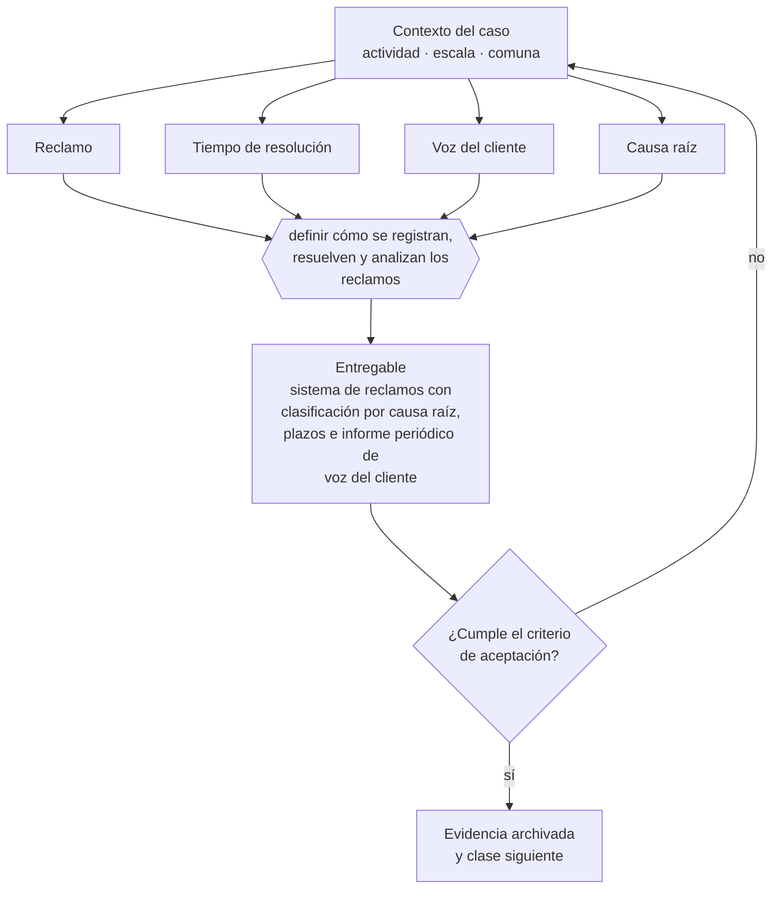

# Clase 194 — Soporte, reclamos y voz del cliente

> **Parte 14 · Ventas, marketing y experiencia de cliente** — clase 12 de 14

**Estado de evidencia:** `GUIA-PRACTICA` · **Jurisdicción:** Chile-first · **Fecha base normativa:** 07-08-2026 
**Decisión que habilita:** definir cómo se registran, resuelven y analizan los reclamos 
**Entregable:** sistema de reclamos con clasificación por causa raíz, plazos e informe periódico de voz del cliente

## 🎯 Propósito

Clasificar los reclamos por causa raíz para convertir una lista de problemas individuales en un diagnóstico operativo.

## 📚 Resultados de aprendizaje

Al finalizar esta clase podrás:

1. **Definir** con precisión los cuatro conceptos de la tabla siguiente y usarlos para describir un caso real.
2. **Explicar** por qué esta materia condiciona decisiones de otras partes del programa.
3. **Decidir** —definir cómo se registran, resuelven y analizan los reclamos— y justificar la decisión por escrito.
4. **Producir** el entregable de la clase y contrastarlo contra su criterio de aceptación.
5. **Distinguir** el dato estable del dato dinámico que exige revalidación en la fuente oficial.

## 🧩 Conceptos centrales

| Concepto | Comprensión verificable |
|---|---|
| **Reclamo** | Manifestación formal de insatisfacción. |
| **Tiempo de resolución** | Plazo desde el ingreso hasta el cierre. |
| **Voz del cliente** | Información estructurada proveniente de reclamos y consultas. |
| **Causa raíz** | Origen operativo del reclamo. |

## 🗺️ Flujo de razonamiento

## 📖 Desarrollo

### 1. El fondo del asunto

Los reclamos son la fuente de mejora más barata y la más ignorada. Clasificarlos por causa raíz convierte una lista de problemas individuales en un diagnóstico operativo. En venta a consumidores, además, el registro y la atención oportuna son evidencia frente a SERNAC.

### 2. Cómo se traduce en la práctica

Es la fuente de mejora más barata que existe y la más ignorada, porque cada reclamo se resuelve de forma aislada y nadie mira el patrón. En venta a consumidores, además, el registro y la atención oportuna son la evidencia que protege ante una fiscalización del SERNAC.

### 3. Marco aplicable y quién interviene

- embudo de adquisición y métricas por etapa
- calificación estructurada de oportunidades y discovery comercial
- revenue operations como integración de marketing, ventas y postventa

**Autoridades o contrapartes involucradas:** SERNAC en publicidad y ofertas, SUBTEL y SERNAC en contacto no solicitado.
**Profesionales de apoyo:** responsable comercial, marketing, customer success, abogado de consumo. La participación concreta depende del riesgo, del
tamaño de la empresa y de la actividad económica.

## 🤝 Reputación y confianza: reclamos como activo y controversias públicas

[Guía de reputación, crisis y confianza, sección 6](../../../docs/22_REPUTACION_CRISIS_Y_CONFIANZA.md#6-gestión-de-reclamos-y-controversias)

**Lente para esta clase:** Un reclamo bien resuelto es la mejor prueba de reputación; uno ignorado se convierte en publicación, y la diferencia suele ser la rapidez y el trato, no el dinero.

| Nivel | Medida proporcionada |
|---|---|
| **Emprendedor o microempresa** | Un canal único, un responsable con sustituto y una respuesta comprometida en 24 horas, con registro en una planilla. |
| **Pyme** | Ciclo completo de reclamo, clasificación por severidad, indicadores de plazo y revisión trimestral de causas repetidas. |
| **Gran empresa o multinacional** | Gestión de reclamos con trazabilidad, escalamiento a crisis, análisis de voz del cliente y reporte a gerencia y directorio. |

**Obligación legal:** Los proveedores deben facilitar la fiscalización del SERNAC y no negarse a entregar la información requerida (Ley 19.496, art. 58); el procedimiento voluntario colectivo del art. 54 H es una vía opcional.

**Recomendación profesional:** Responder una vez en público con el canal para resolver en privado, no borrar comentarios y no publicar datos del cliente.

**Actividad:** Escribe la respuesta pública de tres líneas a una reseña con una acusación parcialmente cierta, sin discutir y sin revelar datos.

**Plantilla:** [Registro de incidentes reputacionales](../../../templates/29_registro_incidentes_reputacionales.csv)

**Términos:** Voz del cliente (*Voice of the customer*) · Controversia pública (*Public controversy*)

**Simulación:** [caso 1 del expediente de reputación y crisis](../../../case-studies/23-reputacion-y-crisis-siete-casos.md#1-microempresa-con-una-controversia-pública). Sigue el camino de un reclamo individual hasta una publicación viral y las decisiones en cada etapa. Es una simulación ilustrativa, no una empresa real.

*Distingue lo que la ley exige de lo que conviene hacer. Las normas se leyeron en la Biblioteca del Congreso Nacional; verifica la versión vigente y consulta a un abogado antes de aplicarlas a un caso real.*

## 🧪 Taller guiado

Aplica esta clase a **una** de las siguientes líneas de negocio y repite después el ejercicio con
una segunda línea de carga regulatoria distinta:

| Línea | Carga regulatoria |
|---|---|
| SaaS B2B con IA | media |
| Servicios profesionales | baja |
| E-commerce D2C | media |
| Alimentos o foodtech | alta |
| Exportación de servicios | media |
| Fintech regulada | alta |
| Construcción o servicios técnicos | alta |

**Secuencia de trabajo:**

1. Delimita el contexto: actividad económica, escala, comuna y etapa de la empresa.
2. Reúne los antecedentes que la decisión exige y anota la fecha de cada fuente.
3. Identifica las alternativas reales, incluida la de no hacer nada.
4. Evalúa el impacto en mercado, caja, personas, regulación y operación.
5. Toma la decisión y regístrala con sus supuestos.
6. Produce el entregable.
7. Contrástalo contra el criterio de aceptación.
8. Anota lo que requiere validación profesional y programa su revisión.

### 📦 Entregable

Sistema de reclamos con clasificación por causa raíz, plazos e informe periódico de voz del cliente.

Debe incluir decisión, supuestos, fuentes con fecha de consulta, responsable, riesgos
identificados y próximos pasos.

## 🏆 Reto verificable

Resuelve la misma materia para una segunda línea de negocio con distinta carga regulatoria y
explica por escrito **qué cambió, por qué y qué fuente lo determina**.

## ✅ Criterio de aceptación

- [ ] los reclamos se clasifican por causa raíz
- [ ] existe informe periódico que alimenta mejoras operativas
- [ ] cada afirmación regulatoria está referida a una fuente oficial con fecha de consulta;
- [ ] los datos dinámicos quedan marcados para revalidación;
- [ ] hay un responsable asignado y evidencia reproducible del trabajo.

## ⚠️ Errores frecuentes

**Propios de esta clase:**

- Resolver reclamos individualmente sin analizar patrones.
- No registrar el reclamo cuando se resuelve informalmente.

**Característicos de la parte 14:**

- Publicidad con condiciones no informadas que constituye infracción a la ley del consumidor.
- Pipeline inflado que produce decisiones de contratación equivocadas.

## 🇨🇱 Checklist Chile

- [ ] ¿existe norma o autoridad específica para esta materia?
- [ ] ¿la fuente consultada está vigente a la fecha de ejecución?
- [ ] ¿se activa algún trámite ante el SII?
- [ ] ¿se activa algún requisito municipal o sectorial?
- [ ] ¿afecta a consumidores o al tratamiento de datos personales?
- [ ] ¿afecta a trabajadores o a la seguridad y salud en el trabajo?
- [ ] ¿afecta a impuestos, contabilidad o caja?
- [ ] ¿afecta a contratos o a propiedad intelectual?
- [ ] ¿requiere renovación, reporte periódico o revalidación?

## ❓ Preguntas de comprobación

1. ¿Clasificas los reclamos por causa raíz o solo por tipo de producto?
2. ¿Registras los que resuelves informalmente por teléfono o mensaje?
3. ¿Qué mejora operativa concreta salió de tus reclamos el último trimestre?

## 🔗 Fuentes oficiales

**Servicio Nacional del Consumidor — Ley 19.496, comercio electrónico y garantía legal**  
<https://www.sernac.cl/> · verificado 2026-11-05

- *Qué contiene:* Publica la interpretación aplicada de la Ley del Consumidor: deberes de información en la oferta, reglas del comercio electrónico, garantía legal, contratos de adhesión y el procedimiento de reclamos.
- *Cómo leerla:* Entra por el rubro de tu negocio y revisa las alertas y procedimientos colectivos publicados: muestran qué está fiscalizando el servicio ahora, que es mejor predictor de tu riesgo que la lectura abstracta de la ley.
- *Uso en esta clase:* aporta el marco de «Ley 19.496, comercio electrónico y garantía legal» para definir cómo se registran, resuelven y analizan los reclamos.

**Biblioteca del Congreso Nacional — Ley 19.496 — Protección de los derechos de los consumidores**  
<https://www.bcn.cl/leychile/navegar?idNorma=61438> · verificado 2026-11-25

- *Qué contiene:* Fija los derechos básicos del consumidor, la obligación de cumplir lo ofrecido (art. 12), la publicidad veraz (arts. 28 y 33), la seguridad del producto y el deber de informar a la autoridad los peligros descubiertos después de vender (arts. 45 a 49) y las funciones de fiscalización del SERNAC (art. 58).
- *Cómo leerla:* Úsala para distinguir qué debe hacer un proveedor ante un producto riesgoso o una publicidad cuestionada de lo que solo conviene hacer. Lee el artículo completo en la versión vigente antes de aplicarlo a un caso concreto.
- *Uso en esta clase:* aporta el marco de «Ley 19.496 — Protección de los derechos de los consumidores» para definir cómo se registran, resuelven y analizan los reclamos.

Complementos del repositorio: [glosario](../../../docs/19_GLOSSARY.md) ·
[ruta de lecturas](../../../docs/15_BOOKS_AND_LEARNING_PATH.md) ·
[catálogo de fuentes](../../../docs/16_OFFICIAL_SOURCE_CATALOG.md).

> [!IMPORTANT]
> Material educativo. Para una decisión real de alto impacto hay que verificar la fuente oficial
> vigente y validar con el profesional competente.

---

| Anterior | Índice | Siguiente |
|---|---|---|
| [← 193 · Customer success y expansión](../class-11-customer-success-y-expansion/README.md) | [Parte 14](../README.md) · [Programa](../../../README.md) | [195 · Referidos, partners y canales →](../class-13-referidos-partners-y-canales/README.md) |
