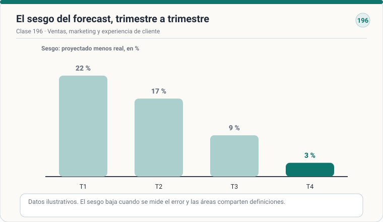

# Clase 196 — Revenue operations y forecast

> **Parte 14 · Ventas, marketing y experiencia de cliente** — clase 14 de 14

**Estado de evidencia:** `GUIA-PRACTICA` · **Jurisdicción:** Chile-first · **Fecha base normativa:** 07-08-2026 
**Decisión que habilita:** instalar un forecast con medición de error y definiciones comunes entre áreas 
**Entregable:** forecast de volumen, precio, ingreso y cobro con cadencia, error histórico y traducción a tres escenarios financieros

## 🎯 Propósito

Convertir pipeline en volumen, precio, ingreso y fecha de cobro para alimentar escenarios financieros con error conocido.

## 📚 Resultados de aprendizaje

Al finalizar esta clase podrás:

1. **Definir** con precisión los cuatro conceptos de la tabla siguiente y usarlos para describir un caso real.
2. **Explicar** por qué esta materia condiciona decisiones de otras partes del programa.
3. **Decidir** —instalar un forecast con medición de error y definiciones comunes entre áreas— y justificar la decisión por escrito.
4. **Producir** el entregable de la clase y contrastarlo contra su criterio de aceptación.
5. **Distinguir** el dato estable del dato dinámico que exige revalidación en la fuente oficial.

## 🧩 Conceptos centrales

| Concepto | Comprensión verificable |
|---|---|
| **Revenue operations** | Integración de datos y procesos de marketing, ventas y postventa. |
| **Forecast** | Proyección de ingresos por período. |
| **Sesgo del forecast** | Desviación sistemática entre proyección y realidad. |
| **Definición común** | Criterio único de etapa y de dato entre áreas. |

## 🗺️ Modelo mental: El sesgo del forecast, trimestre a trimestre

> **La idea en una frase:** Un forecast sirve cuando se mide su error y se corrige su sesgo; con definiciones comunes entre áreas, todos planifican con la misma demanda.

**Qué mirar primero:** Cada barra es el sesgo del trimestre: cuánto sobrestimó el pronóstico. La baja muestra el efecto de medir el error y de usar las mismas definiciones de etapa y de dato.

**Una analogía:** Es el pronóstico del tiempo: no pide acertar siempre, pide saber cuánto suele equivocarse para decidir si llevas paraguas.

## 📖 Desarrollo

### 1. El fondo del asunto

El forecast sirve si se mide su error histórico y se corrige el sesgo. Debe proyectar volumen, precio, fecha probable de cierre y fecha de cobro, no solo un total de ingresos. Su escenario base alimenta la proyección financiera; el error histórico y la distribución del pipeline fijan los rangos conservador y expansivo, de modo que ventas, caja, capacidad y contratación usen la misma demanda.

### 2. Cómo se traduce en la práctica

Proyecta volumen, precio, fecha de cierre y fecha de cobro por oportunidad, no solo un total. Registra cada trimestre el pronóstico y el resultado real, calcula el error y el sesgo, y úsalos para fijar tres escenarios (conservador, base y expansivo). Acuerda con marketing, ventas y postventa una definición única de cada etapa.

### 3. Marco aplicable y quién interviene

- embudo de adquisición y métricas por etapa
- calificación estructurada de oportunidades y discovery comercial
- revenue operations como integración de marketing, ventas y postventa

**Autoridades o contrapartes involucradas:** SERNAC en publicidad y ofertas, SUBTEL y SERNAC en contacto no solicitado.
**Profesionales de apoyo:** responsable comercial, marketing, customer success, abogado de consumo. La participación concreta depende del riesgo, del
tamaño de la empresa y de la actividad económica.

### 4. Los números, paso a paso

Una empresa proyecta $500 millones y cierra $410 millones: su sesgo es de +22 %. Corrige las probabilidades por etapa y exige fecha de cobro. Cuatro trimestres después el sesgo es de +3 % y caja, contratación y capacidad usan el mismo número (cifras ilustrativas).

### 5. En qué se apoya

- **Predictable Revenue (2011)** (PebbleStorm): Ross y Tyler defienden que los ingresos predecibles se construyen midiendo y ajustando un proceso comercial con definiciones estables.

*Las lecturas de apoyo ofrecen marcos conceptuales; lo que exige la ley chilena se verifica en las fuentes oficiales de esta clase.*

## 🧪 Taller guiado

Aplica esta clase a **una** de las siguientes líneas de negocio y repite después el ejercicio con
una segunda línea de carga regulatoria distinta:

| Línea | Carga regulatoria |
|---|---|
| SaaS B2B con IA | media |
| Servicios profesionales | baja |
| E-commerce D2C | media |
| Alimentos o foodtech | alta |
| Exportación de servicios | media |
| Fintech regulada | alta |
| Construcción o servicios técnicos | alta |

**Secuencia de trabajo:**

1. Delimita el contexto: actividad económica, escala, comuna y etapa de la empresa.
2. Reúne los antecedentes que la decisión exige y anota la fecha de cada fuente.
3. Identifica las alternativas reales, incluida la de no hacer nada.
4. Evalúa el impacto en mercado, caja, personas, regulación y operación.
5. Toma la decisión y regístrala con sus supuestos.
6. Produce el entregable.
7. Contrástalo contra el criterio de aceptación.
8. Anota lo que requiere validación profesional y programa su revisión.

### 📦 Entregable

Forecast de volumen, precio, ingreso y cobro con cadencia, error histórico y traducción a tres escenarios financieros.

Debe incluir decisión, supuestos, fuentes con fecha de consulta, responsable, riesgos
identificados y próximos pasos.

## 🏆 Reto verificable

Resuelve la misma materia para una segunda línea de negocio con distinta carga regulatoria y
explica por escrito **qué cambió, por qué y qué fuente lo determina**.

## ✅ Criterio de aceptación

- [ ] el error del forecast se mide y se reporta
- [ ] volumen por precio reconcilia con ingresos y calendario de cobro
- [ ] los rangos conservador, base y expansivo alimentan la proyección financiera
- [ ] cada afirmación regulatoria está referida a una fuente oficial con fecha de consulta;
- [ ] los datos dinámicos quedan marcados para revalidación;
- [ ] hay un responsable asignado y evidencia reproducible del trabajo.

## ⚠️ Errores frecuentes

**Propios de esta clase:**

- Proyectar ingresos sin medir el error de proyecciones anteriores.
- Entregar a finanzas un total que no se puede reconciliar con volumen, precio y fecha de cobro.

**Característicos de la parte 14:**

- Publicidad con condiciones no informadas que constituye infracción a la ley del consumidor.
- Pipeline inflado que produce decisiones de contratación equivocadas.

## 🇨🇱 Checklist Chile

- [ ] ¿existe norma o autoridad específica para esta materia?
- [ ] ¿la fuente consultada está vigente a la fecha de ejecución?
- [ ] ¿se activa algún trámite ante el SII?
- [ ] ¿se activa algún requisito municipal o sectorial?
- [ ] ¿afecta a consumidores o al tratamiento de datos personales?
- [ ] ¿afecta a trabajadores o a la seguridad y salud en el trabajo?
- [ ] ¿afecta a impuestos, contabilidad o caja?
- [ ] ¿afecta a contratos o a propiedad intelectual?
- [ ] ¿requiere renovación, reporte periódico o revalidación?

## ❓ Preguntas de comprobación

1. ¿Volumen por precio reconcilia con el ingreso previsto y su fecha de cobro?
2. ¿Cuál fue el error de tus últimos cuatro forecast y en qué dirección?
3. ¿Cómo se traducen ese error y el pipeline en tres escenarios financieros?

## 🔗 Fuentes oficiales

**Servicio Nacional del Consumidor — Ley 19.496, comercio electrónico y garantía legal**  
<https://www.sernac.cl/> · verificado 2026-11-05

- *Qué contiene:* Publica la interpretación aplicada de la Ley del Consumidor: deberes de información en la oferta, reglas del comercio electrónico, garantía legal, contratos de adhesión y el procedimiento de reclamos.
- *Cómo leerla:* Entra por el rubro de tu negocio y revisa las alertas y procedimientos colectivos publicados: muestran qué está fiscalizando el servicio ahora, que es mejor predictor de tu riesgo que la lectura abstracta de la ley.
- *Uso en esta clase:* aporta el marco de «Ley 19.496, comercio electrónico y garantía legal» para instalar un forecast con medición de error y definiciones comunes entre áreas.

**Biblioteca del Congreso Nacional · LeyChile — Normativa oficial consolidada**  
<https://www.bcn.cl/leychile/> · verificado 2026-11-05

- *Qué contiene:* Publica el texto oficial y consolidado de leyes, decretos y reglamentos, con la versión vigente a una fecha, el historial de modificaciones y la tramitación que las originó.
- *Cómo leerla:* Usa siempre el selector de versión vigente a la fecha en que ejecutarás el trámite, no la última publicada. Y lee el artículo transitorio: en normas en implantación gradual —jornada, datos personales— ahí está la fecha que realmente te aplica.
- *Uso en esta clase:* aporta el marco de «Normativa oficial consolidada» para instalar un forecast con medición de error y definiciones comunes entre áreas.

**PebbleStorm — Predictable Revenue (2011)**  
<https://openlibrary.org/isbn/9780984380213> · verificado 2026-11-25

- *Qué contiene:* Describe la prospección saliente como un proceso con roles especializados, listas acotadas y métricas, para volver predecible la generación de ingresos.
- *Cómo leerla:* Úsalo como marco conceptual para entender el porqué de la práctica, nunca como prueba de lo que exige la ley chilena; para eso están las fuentes oficiales de la clase.
- *Uso en esta clase:* aporta el marco de «Predictable Revenue (2011)» para instalar un forecast con medición de error y definiciones comunes entre áreas.

Complementos del repositorio: [glosario](../../../docs/19_GLOSSARY.md) ·
[ruta de lecturas](../../../docs/15_BOOKS_AND_LEARNING_PATH.md) ·
[catálogo de fuentes](../../../docs/16_OFFICIAL_SOURCE_CATALOG.md).

> [!IMPORTANT]
> Material educativo. Para una decisión real de alto impacto hay que verificar la fuente oficial
> vigente y validar con el profesional competente.

---

| Anterior | Índice | Siguiente |
|---|---|---|
| [← 195 · Referidos, partners y canales](../class-13-referidos-partners-y-canales/README.md) | [Parte 14](../README.md) · [Programa](../../../README.md) | [197 · Arquitectura tecnológica mínima viable →](../../part-15-tecnologia-datos-ia-y-operacion-digital/class-01-arquitectura-tecnologica-minima-viable/README.md) |
