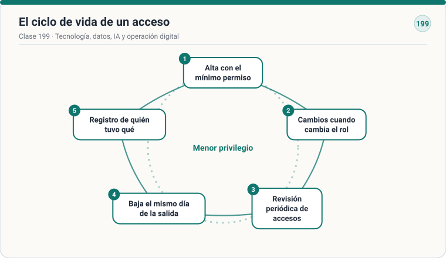

# Clase 199 — Dominio, correo, identidad y accesos

> **Parte 15 · Tecnología, datos, IA y operación digital** — clase 3 de 14

**Estado de evidencia:** `DINAMICO` · **Jurisdicción:** Chile-first · **Fecha base normativa:** 07-08-2026 
**Decisión que habilita:** definir la administración de identidad y el ciclo de vida de los accesos 
**Entregable:** inventario de accesos por persona y sistema con procedimiento de alta, cambio y baja

## 🎯 Propósito

Poner el dominio y las cuentas a nombre de la empresa y gobernar el ciclo de vida del acceso, en especial la baja.

## 📚 Resultados de aprendizaje

Al finalizar esta clase podrás:

1. **Definir** con precisión los cuatro conceptos de la tabla siguiente y usarlos para describir un caso real.
2. **Explicar** por qué esta materia condiciona decisiones de otras partes del programa.
3. **Decidir** —definir la administración de identidad y el ciclo de vida de los accesos— y justificar la decisión por escrito.
4. **Producir** el entregable de la clase y contrastarlo contra su criterio de aceptación.
5. **Distinguir** el dato estable del dato dinámico que exige revalidación en la fuente oficial.

## 🧩 Conceptos centrales

| Concepto | Comprensión verificable |
|---|---|
| **Dominio** | Nombre en internet que identifica a la empresa. |
| **Identidad corporativa** | Cuentas de usuario administradas centralmente. |
| **Menor privilegio** | Acceso limitado a lo estrictamente necesario. |
| **Ciclo de vida del acceso** | Alta, modificación y baja de permisos. |

## 🗺️ Modelo mental: El ciclo de vida de un acceso

> **La idea en una frase:** El dominio y las cuentas de correo deben estar a nombre de la empresa y no de una persona; el ciclo de vida del acceso, en especial la baja al salir alguien, es el control más descuidado.

**Qué mirar primero:** El ciclo se repite con cada persona. Lo que no se revisa se acumula: accesos de quienes cambiaron de rol o se fueron, que siguen abiertos sin que nadie lo note.

**Una imagen cotidiana:** Es el manejo de las llaves de una oficina: se entregan con registro, se cambian cuando alguien cambia de función y se recuperan el día que se va.

## 📖 Desarrollo

### 1. El fondo del asunto

El dominio y las cuentas de correo deben estar a nombre de la empresa y no de una persona: es el error que más bloquea operaciones cuando alguien se va. El ciclo de vida del acceso —especialmente la baja— es el control que más se omite y el que más incidentes previene.

### 2. Cómo se traduce en la práctica

Registra el dominio, el correo y las cuentas clave a nombre de la empresa, con al menos dos administradores. Otorga a cada persona los permisos mínimos para su función. Haz una lista de verificación de salida con la baja de accesos el mismo día. Revisa cada trimestre quién tiene acceso a qué. El acceso indebido a sistemas puede constituir un delito informático.

### 3. Marco aplicable y quién interviene

- Ley 21.663 Marco de Ciberseguridad y su reglamentación
- Ley 21.719 en lo relativo a tratamiento automatizado y decisiones basadas en datos
- controles de referencia tipo CIS Controls y NIST CSF adaptados a pyme

**Autoridades o contrapartes involucradas:** ANCI, CSIRT Nacional, Agencia de Protección de Datos Personales (en implementación).
**Profesionales de apoyo:** responsable de TI, consultor de ciberseguridad, analista de datos, abogado de datos. La participación concreta depende del riesgo, del
tamaño de la empresa y de la actividad económica.

### 4. Una conversación que enseña

Gerente: «Nuestro diseñador renunció hace dos meses y todavía puede entrar al sitio web». Encargado de sistemas: «Su cuenta no se dio de baja y el dominio está a su nombre». Gerente: «¿Y si decide cambiar el contenido?». Encargado: «Podría, y no tendríamos cómo recuperar el dominio sin su cooperación. Pasemos todo a la empresa y creemos una lista de baja el mismo día de cada salida» (conversación ilustrativa).

### 5. En qué se apoya

- **Ley 21.459 — Delitos informáticos** (Biblioteca del Congreso Nacional): La Ley 21.459 tipifica delitos informáticos como el acceso ilícito a sistemas, que muestra por qué los accesos de personas que ya no deben tenerlos son un riesgo legal.
- **Normativa oficial consolidada** (Biblioteca del Congreso Nacional · LeyChile): La Biblioteca del Congreso Nacional publica la ley y su contexto, referencia para entender las obligaciones de proteger los sistemas.

*Las lecturas de apoyo ofrecen marcos conceptuales; lo que exige la ley chilena se verifica en las fuentes oficiales de esta clase.*

## 🛡️ Protección del conocimiento: Ingeniería social empresarial

[Guía de inteligencia económica y protección del conocimiento, sección 6](../../../docs/21_INTELIGENCIA_ECONOMICA_Y_PROTECCION_DEL_CONOCIMIENTO.md#6-ingeniería-social-empresarial)

**Lente para esta clase:** Quien controla el correo y la identidad de la empresa controla la confianza: la ingeniería social apunta primero a cuentas, dominios y personas que aprueban.

| Nivel | Medida proporcionada |
|---|---|
| **Emprendedor o microempresa** | Doble verificación para pagos y cambios de cuenta; llamar a un número conocido antes de actuar sobre un correo. |
| **Pyme** | Regla de dos personas para pagos y cambios de datos bancarios, y política escrita que respalda a quien se niega a una excepción. |
| **Gran empresa o multinacional** | Entrenamiento por rol, simulacros de suplantación de ejecutivos y canal de reporte de intentos. |

**Actividad sin crear sistemas:** Escribe una política de una página: qué pedidos exigen verificación por otro canal y quién puede autorizar una excepción.

**Términos:** Ingeniería social (*Social Engineering*) · Suplantación (*Impersonation*)

*Enfoque defensivo: reconocer, prevenir, documentar y escalar. No enseña a obtener información de forma indebida; la calificación jurídica de un hecho concreto corresponde a un abogado.*

## 🧪 Taller guiado

Aplica esta clase a **una** de las siguientes líneas de negocio y repite después el ejercicio con
una segunda línea de carga regulatoria distinta:

| Línea | Carga regulatoria |
|---|---|
| SaaS B2B con IA | media |
| Servicios profesionales | baja |
| E-commerce D2C | media |
| Alimentos o foodtech | alta |
| Exportación de servicios | media |
| Fintech regulada | alta |
| Construcción o servicios técnicos | alta |

**Secuencia de trabajo:**

1. Delimita el contexto: actividad económica, escala, comuna y etapa de la empresa.
2. Reúne los antecedentes que la decisión exige y anota la fecha de cada fuente.
3. Identifica las alternativas reales, incluida la de no hacer nada.
4. Evalúa el impacto en mercado, caja, personas, regulación y operación.
5. Toma la decisión y regístrala con sus supuestos.
6. Produce el entregable.
7. Contrástalo contra el criterio de aceptación.
8. Anota lo que requiere validación profesional y programa su revisión.

### 📦 Entregable

Inventario de accesos por persona y sistema con procedimiento de alta, cambio y baja.

Debe incluir decisión, supuestos, fuentes con fecha de consulta, responsable, riesgos
identificados y próximos pasos.

## 🏆 Reto verificable

Resuelve la misma materia para una segunda línea de negocio con distinta carga regulatoria y
explica por escrito **qué cambió, por qué y qué fuente lo determina**.

## ✅ Criterio de aceptación

- [ ] el dominio y las cuentas están a nombre de la empresa
- [ ] existe procedimiento de baja verificado con casos reales
- [ ] cada afirmación regulatoria está referida a una fuente oficial con fecha de consulta;
- [ ] los datos dinámicos quedan marcados para revalidación;
- [ ] hay un responsable asignado y evidencia reproducible del trabajo.

## ⚠️ Errores frecuentes

**Propios de esta clase:**

- Registrar el dominio a nombre personal de un socio o proveedor.
- No revocar accesos al término de la relación laboral.

**Característicos de la parte 15:**

- Respaldos que nunca se probaron y no restauran cuando se necesitan.
- Accesos compartidos y credenciales que sobreviven a la salida de una persona.

## 🇨🇱 Checklist Chile

- [ ] ¿existe norma o autoridad específica para esta materia?
- [ ] ¿la fuente consultada está vigente a la fecha de ejecución?
- [ ] ¿se activa algún trámite ante el SII?
- [ ] ¿se activa algún requisito municipal o sectorial?
- [ ] ¿afecta a consumidores o al tratamiento de datos personales?
- [ ] ¿afecta a trabajadores o a la seguridad y salud en el trabajo?
- [ ] ¿afecta a impuestos, contabilidad o caja?
- [ ] ¿afecta a contratos o a propiedad intelectual?
- [ ] ¿requiere renovación, reporte periódico o revalidación?

## ❓ Preguntas de comprobación

1. ¿A nombre de quién están registrados tu dominio y tus cuentas principales?
2. ¿Qué accesos siguen activos de personas que ya no trabajan contigo?
3. ¿Existe un procedimiento de baja y alguien lo verifica?

## 🔗 Fuentes oficiales

**Biblioteca del Congreso Nacional · LeyChile — Normativa oficial consolidada**  
<https://www.bcn.cl/leychile/> · verificado 2026-11-05

- *Qué contiene:* Publica el texto oficial y consolidado de leyes, decretos y reglamentos, con la versión vigente a una fecha, el historial de modificaciones y la tramitación que las originó.
- *Cómo leerla:* Usa siempre el selector de versión vigente a la fecha en que ejecutarás el trámite, no la última publicada. Y lee el artículo transitorio: en normas en implantación gradual —jornada, datos personales— ahí está la fecha que realmente te aplica.
- *Uso en esta clase:* aporta el marco de «Normativa oficial consolidada» para definir la administración de identidad y el ciclo de vida de los accesos.

**Corporación de Fomento de la Producción — Innovación, inversión y garantías**  
<https://www.corfo.cl/> · verificado 2026-11-05

- *Qué contiene:* Reúne los instrumentos de fomento a la innovación y la inversión, incluidos programas de capital semilla, escalamiento, garantías y cobertura de riesgo para el sistema financiero.
- *Cómo leerla:* Filtra por etapa de la empresa antes que por monto. Y verifica el componente de innovación que exige cada instrumento: presentar una expansión comercial como innovación es la causa más común de rechazo.
- *Uso en esta clase:* aporta el marco de «Innovación, inversión y garantías» para definir la administración de identidad y el ciclo de vida de los accesos.

**Biblioteca del Congreso Nacional — Ley 21.459 — Delitos informáticos**  
<https://www.bcn.cl/leychile/navegar?idNorma=1177743> · verificado 2026-11-12

- *Qué contiene:* Tipifica el ataque a la integridad de un sistema, el acceso ilícito, la interceptación ilícita, el ataque a datos, la falsificación y el fraude informáticos, la receptación de datos y las circunstancias agravantes, además de reglas de investigación.
- *Cómo leerla:* El acceso ilícito exige superar barreras técnicas o excederse de la autorización; no cubre el uso indebido por quien accede con permiso. «Espionaje informático» es una categoría de estudio, no el nombre de un delito de esta ley.
- *Uso en esta clase:* aporta el marco de «Ley 21.459 — Delitos informáticos» para definir la administración de identidad y el ciclo de vida de los accesos.

Complementos del repositorio: [glosario](../../../docs/19_GLOSSARY.md) ·
[ruta de lecturas](../../../docs/15_BOOKS_AND_LEARNING_PATH.md) ·
[catálogo de fuentes](../../../docs/16_OFFICIAL_SOURCE_CATALOG.md).

> [!IMPORTANT]
> Material educativo. Para una decisión real de alto impacto hay que verificar la fuente oficial
> vigente y validar con el profesional competente.

---

| Anterior | Índice | Siguiente |
|---|---|---|
| [← 198 · Comprar, construir o integrar software](../class-02-comprar-construir-o-integrar-software/README.md) | [Parte 15](../README.md) · [Programa](../../../README.md) | [200 · Cloud, hosting y continuidad →](../class-04-cloud-hosting-y-continuidad/README.md) |
