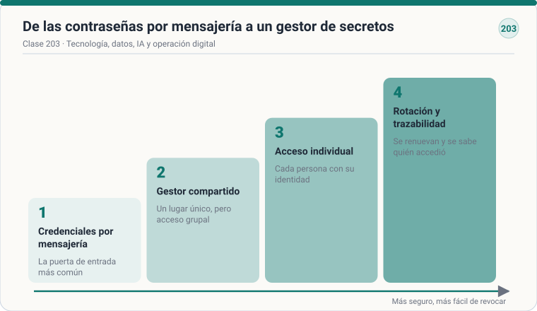

# Clase 203 — Gestión de secretos y privilegios

> **Parte 15 · Tecnología, datos, IA y operación digital** — clase 7 de 14

**Estado de evidencia:** `DINAMICO` · **Jurisdicción:** Chile-first · **Fecha base normativa:** 07-08-2026 
**Decisión que habilita:** definir cómo se almacenan, comparten y rotan las credenciales 
**Entregable:** inventario de secretos con gestor definido, política de rotación y cuentas privilegiadas nominativas

## 🎯 Propósito

Administrar credenciales en un gestor con acceso individual, para poder revocar sin cambiar todo y saber quién accedió a qué.

## 📚 Resultados de aprendizaje

Al finalizar esta clase podrás:

1. **Definir** con precisión los cuatro conceptos de la tabla siguiente y usarlos para describir un caso real.
2. **Explicar** por qué esta materia condiciona decisiones de otras partes del programa.
3. **Decidir** —definir cómo se almacenan, comparten y rotan las credenciales— y justificar la decisión por escrito.
4. **Producir** el entregable de la clase y contrastarlo contra su criterio de aceptación.
5. **Distinguir** el dato estable del dato dinámico que exige revalidación en la fuente oficial.

## 🧩 Conceptos centrales

| Concepto | Comprensión verificable |
|---|---|
| **Secreto** | Credencial, clave o token que da acceso a un sistema. |
| **Gestor de secretos** | Herramienta que almacena y controla el acceso a credenciales. |
| **Rotación** | Cambio periódico de credenciales. |
| **Cuenta privilegiada** | Acceso con permisos administrativos. |

## 🗺️ Modelo mental: De las contraseñas por mensajería a un gestor de secretos

> **La idea en una frase:** Las credenciales compartidas por mensajería son la puerta de entrada más común; un gestor de secretos con acceso individual permite revocar sin cambiar todo y deja trazabilidad de quién accedió.

**Lectura guiada:** Cada peldaño reduce un riesgo concreto. Subir uno ya mejora la seguridad: no hace falta esperar a tener un sistema perfecto para dejar de compartir contraseñas por chat.

**Una imagen cotidiana:** Es pasar de dejar la llave bajo el felpudo a una cerradura con tarjeta personal: cada acceso queda registrado y se puede anular uno sin cambiar toda la cerradura.

## 📖 Desarrollo

### 1. El fondo del asunto

Las credenciales compartidas por mensajería son la puerta de entrada más común. Un gestor de secretos con acceso individual permite revocar sin cambiar todo, y deja trazabilidad de quién accedió a qué. Las cuentas privilegiadas deben ser nominativas y auditables.

### 2. Cómo se traduce en la práctica

Haz un inventario de las credenciales que usa tu empresa y dónde se guardan. Reemplaza las compartidas por cuentas individuales o por un gestor de secretos. Define reglas de rotación y revocación al salir una persona. Separa las cuentas privilegiadas y limita su uso. Registra quién accede a qué y revisa los registros periódicamente.

### 3. Marco aplicable y quién interviene

- Ley 21.663 Marco de Ciberseguridad y su reglamentación
- Ley 21.719 en lo relativo a tratamiento automatizado y decisiones basadas en datos
- controles de referencia tipo CIS Controls y NIST CSF adaptados a pyme

**Autoridades o contrapartes involucradas:** ANCI, CSIRT Nacional, Agencia de Protección de Datos Personales (en implementación).
**Profesionales de apoyo:** responsable de TI, consultor de ciberseguridad, analista de datos, abogado de datos. La participación concreta depende del riesgo, del
tamaño de la empresa y de la actividad económica.

### 4. Un error y su corrección

El error: un equipo comparte la contraseña del panel de publicidad por un grupo de mensajería. Cuando un colaborador se va, nadie cambia la clave porque se usa en varias herramientas. Meses después, alguien accede con esa clave y pausa las campañas. La corrección: pasar a un gestor de secretos con acceso individual, rotación periódica, y registro de accesos; ahora se revoca a una persona en minutos (caso ilustrativo).

### 5. En qué se apoya

- **Ley 21.459 — Delitos informáticos** (Biblioteca del Congreso Nacional): La Ley 21.459 sanciona el acceso ilícito a sistemas informáticos, lo que da relevancia legal a controlar quién conserva credenciales.
- **Accelerate** (IT Revolution): Forsgren y sus coautores asocian prácticas disciplinadas de gestión técnica con mejores resultados, entre ellas el control de accesos y la automatización.

*Las lecturas de apoyo ofrecen marcos conceptuales; lo que exige la ley chilena se verifica en las fuentes oficiales de esta clase.*

## 🛡️ Protección del conocimiento: Contrainteligencia empresarial

[Guía de inteligencia económica y protección del conocimiento, sección 10](../../../docs/21_INTELIGENCIA_ECONOMICA_Y_PROTECCION_DEL_CONOCIMIENTO.md#10-contrainteligencia-empresarial)

**Lente para esta clase:** Necesidad de conocer y mínimo privilegio son contrainteligencia práctica: cada permiso de más es una puerta que alguien podría usar o que un tercero podría explotar.

| Nivel | Medida proporcionada |
|---|---|
| **Emprendedor o microempresa** | Una hoja con quién accede a qué, revisada al contratar, al salir alguien y cada seis meses. |
| **Pyme** | Revisión semestral de accesos por responsable de área, con cierre de los que no se justifican. |
| **Gran empresa o multinacional** | Gobierno de identidades con revisión por rol, separación de funciones y alertas de accesos anómalos. |

**Actividad sin crear sistemas:** Para tres cargos anota a qué información acceden hoy y a cuál necesitan acceder: la diferencia es tu brecha.

**Términos:** Mínimo privilegio (*Least Privilege*) · Necesidad de conocer (*Need-to-Know*)

*Enfoque defensivo: reconocer, prevenir, documentar y escalar. No enseña a obtener información de forma indebida; la calificación jurídica de un hecho concreto corresponde a un abogado.*

## 🧪 Taller guiado

Aplica esta clase a **una** de las siguientes líneas de negocio y repite después el ejercicio con
una segunda línea de carga regulatoria distinta:

| Línea | Carga regulatoria |
|---|---|
| SaaS B2B con IA | media |
| Servicios profesionales | baja |
| E-commerce D2C | media |
| Alimentos o foodtech | alta |
| Exportación de servicios | media |
| Fintech regulada | alta |
| Construcción o servicios técnicos | alta |

**Secuencia de trabajo:**

1. Delimita el contexto: actividad económica, escala, comuna y etapa de la empresa.
2. Reúne los antecedentes que la decisión exige y anota la fecha de cada fuente.
3. Identifica las alternativas reales, incluida la de no hacer nada.
4. Evalúa el impacto en mercado, caja, personas, regulación y operación.
5. Toma la decisión y regístrala con sus supuestos.
6. Produce el entregable.
7. Contrástalo contra el criterio de aceptación.
8. Anota lo que requiere validación profesional y programa su revisión.

### 📦 Entregable

Inventario de secretos con gestor definido, política de rotación y cuentas privilegiadas nominativas.

Debe incluir decisión, supuestos, fuentes con fecha de consulta, responsable, riesgos
identificados y próximos pasos.

## 🏆 Reto verificable

Resuelve la misma materia para una segunda línea de negocio con distinta carga regulatoria y
explica por escrito **qué cambió, por qué y qué fuente lo determina**.

## ✅ Criterio de aceptación

- [ ] las credenciales se administran en un gestor con acceso individual
- [ ] las cuentas privilegiadas son nominativas
- [ ] cada afirmación regulatoria está referida a una fuente oficial con fecha de consulta;
- [ ] los datos dinámicos quedan marcados para revalidación;
- [ ] hay un responsable asignado y evidencia reproducible del trabajo.

## ⚠️ Errores frecuentes

**Propios de esta clase:**

- Compartir credenciales por mensajería o correo.
- Mantener cuentas administrativas genéricas sin trazabilidad.

**Característicos de la parte 15:**

- Respaldos que nunca se probaron y no restauran cuando se necesitan.
- Accesos compartidos y credenciales que sobreviven a la salida de una persona.

## 🇨🇱 Checklist Chile

- [ ] ¿existe norma o autoridad específica para esta materia?
- [ ] ¿la fuente consultada está vigente a la fecha de ejecución?
- [ ] ¿se activa algún trámite ante el SII?
- [ ] ¿se activa algún requisito municipal o sectorial?
- [ ] ¿afecta a consumidores o al tratamiento de datos personales?
- [ ] ¿afecta a trabajadores o a la seguridad y salud en el trabajo?
- [ ] ¿afecta a impuestos, contabilidad o caja?
- [ ] ¿afecta a contratos o a propiedad intelectual?
- [ ] ¿requiere renovación, reporte periódico o revalidación?

## ❓ Preguntas de comprobación

1. ¿Cómo compartes hoy una credencial con alguien del equipo?
2. ¿Tus cuentas administrativas son nominativas o genéricas?
3. ¿Cuándo rotaste por última vez las credenciales críticas?

## 🔗 Fuentes oficiales

**Biblioteca del Congreso Nacional · LeyChile — Normativa oficial consolidada**  
<https://www.bcn.cl/leychile/> · verificado 2026-11-05

- *Qué contiene:* Publica el texto oficial y consolidado de leyes, decretos y reglamentos, con la versión vigente a una fecha, el historial de modificaciones y la tramitación que las originó.
- *Cómo leerla:* Usa siempre el selector de versión vigente a la fecha en que ejecutarás el trámite, no la última publicada. Y lee el artículo transitorio: en normas en implantación gradual —jornada, datos personales— ahí está la fecha que realmente te aplica.
- *Uso en esta clase:* aporta el marco de «Normativa oficial consolidada» para definir cómo se almacenan, comparten y rotan las credenciales.

**Corporación de Fomento de la Producción — Innovación, inversión y garantías**  
<https://www.corfo.cl/> · verificado 2026-11-05

- *Qué contiene:* Reúne los instrumentos de fomento a la innovación y la inversión, incluidos programas de capital semilla, escalamiento, garantías y cobertura de riesgo para el sistema financiero.
- *Cómo leerla:* Filtra por etapa de la empresa antes que por monto. Y verifica el componente de innovación que exige cada instrumento: presentar una expansión comercial como innovación es la causa más común de rechazo.
- *Uso en esta clase:* aporta el marco de «Innovación, inversión y garantías» para definir cómo se almacenan, comparten y rotan las credenciales.

**Biblioteca del Congreso Nacional — Ley 21.459 — Delitos informáticos**  
<https://www.bcn.cl/leychile/navegar?idNorma=1177743> · verificado 2026-11-12

- *Qué contiene:* Tipifica el ataque a la integridad de un sistema, el acceso ilícito, la interceptación ilícita, el ataque a datos, la falsificación y el fraude informáticos, la receptación de datos y las circunstancias agravantes, además de reglas de investigación.
- *Cómo leerla:* El acceso ilícito exige superar barreras técnicas o excederse de la autorización; no cubre el uso indebido por quien accede con permiso. «Espionaje informático» es una categoría de estudio, no el nombre de un delito de esta ley.
- *Uso en esta clase:* aporta el marco de «Ley 21.459 — Delitos informáticos» para definir cómo se almacenan, comparten y rotan las credenciales.

**IT Revolution — Accelerate**  
<https://openlibrary.org/isbn/9781942788379> · verificado 2026-11-25

- *Qué contiene:* Presenta evidencia sobre qué prácticas de ingeniería se asocian con mejor desempeño en la entrega de software.
- *Cómo leerla:* Úsalo como marco conceptual para entender el porqué de la práctica, nunca como prueba de lo que exige la ley chilena; para eso están las fuentes oficiales de la clase.
- *Uso en esta clase:* aporta el marco de «Accelerate» para definir cómo se almacenan, comparten y rotan las credenciales.

Complementos del repositorio: [glosario](../../../docs/19_GLOSSARY.md) ·
[ruta de lecturas](../../../docs/15_BOOKS_AND_LEARNING_PATH.md) ·
[catálogo de fuentes](../../../docs/16_OFFICIAL_SOURCE_CATALOG.md).

> [!IMPORTANT]
> Material educativo. Para una decisión real de alto impacto hay que verificar la fuente oficial
> vigente y validar con el profesional competente.

---

| Anterior | Índice | Siguiente |
|---|---|---|
| [← 202 · Ciberseguridad por capas para pyme](../class-06-ciberseguridad-por-capas-para-pyme/README.md) | [Parte 15](../README.md) · [Programa](../../../README.md) | [204 · Datos maestros y calidad de datos →](../class-08-datos-maestros-y-calidad-de-datos/README.md) |
