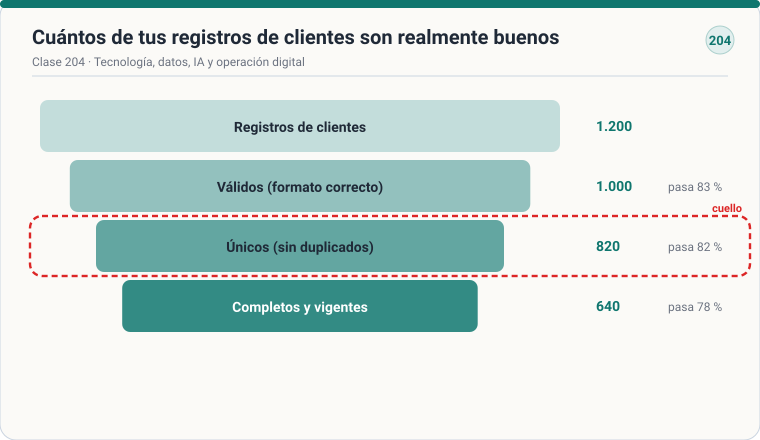

# Clase 204 — Datos maestros y calidad de datos

> **Parte 15 · Tecnología, datos, IA y operación digital** — clase 8 de 14

**Estado de evidencia:** `DINAMICO` · **Jurisdicción:** Chile-first · **Fecha base normativa:** 07-08-2026 
**Decisión que habilita:** definir las entidades maestras, sus reglas de calidad y su responsable 
**Entregable:** diccionario de datos maestros con formato, regla de validación y responsable por entidad

## 🎯 Propósito

Gobernar los datos maestros con formato, regla de validación y responsable, que es prerrequisito de cualquier analítica útil.

## 📚 Resultados de aprendizaje

Al finalizar esta clase podrás:

1. **Definir** con precisión los cuatro conceptos de la tabla siguiente y usarlos para describir un caso real.
2. **Explicar** por qué esta materia condiciona decisiones de otras partes del programa.
3. **Decidir** —definir las entidades maestras, sus reglas de calidad y su responsable— y justificar la decisión por escrito.
4. **Producir** el entregable de la clase y contrastarlo contra su criterio de aceptación.
5. **Distinguir** el dato estable del dato dinámico que exige revalidación en la fuente oficial.

## 🧩 Conceptos centrales

| Concepto | Comprensión verificable |
|---|---|
| **Dato maestro** | Información de referencia usada por varios procesos. |
| **Duplicado** | Registro repetido que fragmenta la información. |
| **Regla de calidad** | Criterio que define un dato válido. |
| **Responsable del dato** | Persona a cargo de su exactitud. |

## 🗺️ Modelo mental: Cuántos de tus registros de clientes son realmente buenos

> **La idea en una frase:** Sin datos maestros gobernados, cada área tiene su propia versión del cliente y ningún reporte cuadra; definir formato, regla de validación y responsable por entidad maestra es requisito de cualquier análisis.

**Cómo leerlo:** Cada barra es el resultado de aplicar una regla de calidad. Lo que queda al final es lo que realmente se puede usar. Los duplicados suelen ser la mayor pérdida (datos ilustrativos).

**Una analogía:** Es un directorio telefónico con números mal escritos, repetidos y desactualizados: está lleno, pero casi no sirve para llamar.

## 📖 Desarrollo

### 1. El fondo del asunto

Sin datos maestros gobernados, cada área tiene su propia versión del cliente y ningún reporte cuadra. Definir formato, regla de validación y responsable por entidad maestra es prerequisito de cualquier analítica: sin eso, los reportes se discuten en vez de usarse.

### 2. Cómo se traduce en la práctica

Define tus entidades maestras (clientes, productos, proveedores), con formato, reglas de validación y un responsable de cada una. Bloquea los duplicados en la entrada. Mide la calidad con indicadores como porcentaje de registros válidos, únicos y completos. Corrige en el origen: arreglar el reporte sin corregir el dato hace que el problema reaparezca. Los datos personales deben limitarse a lo necesario.

### 3. Marco aplicable y quién interviene

- Ley 21.663 Marco de Ciberseguridad y su reglamentación
- Ley 21.719 en lo relativo a tratamiento automatizado y decisiones basadas en datos
- controles de referencia tipo CIS Controls y NIST CSF adaptados a pyme

**Autoridades o contrapartes involucradas:** ANCI, CSIRT Nacional, Agencia de Protección de Datos Personales (en implementación).
**Profesionales de apoyo:** responsable de TI, consultor de ciberseguridad, analista de datos, abogado de datos. La participación concreta depende del riesgo, del
tamaño de la empresa y de la actividad económica.

### 4. Los números, paso a paso

Una empresa tiene 1.200 registros de clientes. Al aplicar reglas, 200 tienen un RUT con formato inválido, 180 son duplicados con distinto nombre y 180 no tienen datos de contacto vigentes: quedan 640 utilizables, el 53 %. Sus reportes de ventas por cliente no coincidían entre áreas por este motivo. Al nombrar un responsable del dato y una regla de alta, la calidad sube a 85 % en un trimestre (cifras ilustrativas).

### 5. En qué se apoya

- **Ley 21.719 — Protección y tratamiento de los datos personales y crea la Agencia de Protección de Datos Personales** (Biblioteca del Congreso Nacional): La Ley 21.719 incluye el principio de calidad de los datos, que exige que sean exactos y actualizados, y se alinea con la gobernanza de datos maestros.
- **Lean Analytics** (O'Reilly): Croll y Yoskovitz advierten que las métricas solo sirven si los datos de origen son confiables y las definiciones, claras.

*Las lecturas de apoyo ofrecen marcos conceptuales; lo que exige la ley chilena se verifica en las fuentes oficiales de esta clase.*

## 🧪 Taller guiado

Aplica esta clase a **una** de las siguientes líneas de negocio y repite después el ejercicio con
una segunda línea de carga regulatoria distinta:

| Línea | Carga regulatoria |
|---|---|
| SaaS B2B con IA | media |
| Servicios profesionales | baja |
| E-commerce D2C | media |
| Alimentos o foodtech | alta |
| Exportación de servicios | media |
| Fintech regulada | alta |
| Construcción o servicios técnicos | alta |

**Secuencia de trabajo:**

1. Delimita el contexto: actividad económica, escala, comuna y etapa de la empresa.
2. Reúne los antecedentes que la decisión exige y anota la fecha de cada fuente.
3. Identifica las alternativas reales, incluida la de no hacer nada.
4. Evalúa el impacto en mercado, caja, personas, regulación y operación.
5. Toma la decisión y regístrala con sus supuestos.
6. Produce el entregable.
7. Contrástalo contra el criterio de aceptación.
8. Anota lo que requiere validación profesional y programa su revisión.

### 📦 Entregable

Diccionario de datos maestros con formato, regla de validación y responsable por entidad.

Debe incluir decisión, supuestos, fuentes con fecha de consulta, responsable, riesgos
identificados y próximos pasos.

## 🏆 Reto verificable

Resuelve la misma materia para una segunda línea de negocio con distinta carga regulatoria y
explica por escrito **qué cambió, por qué y qué fuente lo determina**.

## ✅ Criterio de aceptación

- [ ] cada entidad maestra tiene responsable designado
- [ ] existen reglas de validación aplicadas en el origen
- [ ] cada afirmación regulatoria está referida a una fuente oficial con fecha de consulta;
- [ ] los datos dinámicos quedan marcados para revalidación;
- [ ] hay un responsable asignado y evidencia reproducible del trabajo.

## ⚠️ Errores frecuentes

**Propios de esta clase:**

- Construir reportes sobre datos maestros duplicados.
- No asignar responsable de la calidad de cada entidad maestra.

**Característicos de la parte 15:**

- Respaldos que nunca se probaron y no restauran cuando se necesitan.
- Accesos compartidos y credenciales que sobreviven a la salida de una persona.

## 🇨🇱 Checklist Chile

- [ ] ¿existe norma o autoridad específica para esta materia?
- [ ] ¿la fuente consultada está vigente a la fecha de ejecución?
- [ ] ¿se activa algún trámite ante el SII?
- [ ] ¿se activa algún requisito municipal o sectorial?
- [ ] ¿afecta a consumidores o al tratamiento de datos personales?
- [ ] ¿afecta a trabajadores o a la seguridad y salud en el trabajo?
- [ ] ¿afecta a impuestos, contabilidad o caja?
- [ ] ¿afecta a contratos o a propiedad intelectual?
- [ ] ¿requiere renovación, reporte periódico o revalidación?

## ❓ Preguntas de comprobación

1. ¿Cuántas versiones distintas del mismo cliente existen en tus sistemas?
2. ¿Quién es responsable de la exactitud de cada entidad maestra?
3. ¿Se valida el dato al ingresarlo o se corrige después?

## 🔗 Fuentes oficiales

**Biblioteca del Congreso Nacional · LeyChile — Normativa oficial consolidada**  
<https://www.bcn.cl/leychile/> · verificado 2026-11-05

- *Qué contiene:* Publica el texto oficial y consolidado de leyes, decretos y reglamentos, con la versión vigente a una fecha, el historial de modificaciones y la tramitación que las originó.
- *Cómo leerla:* Usa siempre el selector de versión vigente a la fecha en que ejecutarás el trámite, no la última publicada. Y lee el artículo transitorio: en normas en implantación gradual —jornada, datos personales— ahí está la fecha que realmente te aplica.
- *Uso en esta clase:* aporta el marco de «Normativa oficial consolidada» para definir las entidades maestras, sus reglas de calidad y su responsable.

**Corporación de Fomento de la Producción — Innovación, inversión y garantías**  
<https://www.corfo.cl/> · verificado 2026-11-05

- *Qué contiene:* Reúne los instrumentos de fomento a la innovación y la inversión, incluidos programas de capital semilla, escalamiento, garantías y cobertura de riesgo para el sistema financiero.
- *Cómo leerla:* Filtra por etapa de la empresa antes que por monto. Y verifica el componente de innovación que exige cada instrumento: presentar una expansión comercial como innovación es la causa más común de rechazo.
- *Uso en esta clase:* aporta el marco de «Innovación, inversión y garantías» para definir las entidades maestras, sus reglas de calidad y su responsable.

**Biblioteca del Congreso Nacional — Ley 21.719 — Protección y tratamiento de los datos personales y crea la Agencia de Protección de Datos Personales**  
<https://www.bcn.cl/leychile/navegar?idNorma=1209272> · verificado 2026-11-25

- *Qué contiene:* Reemplaza el texto de la Ley 19.628. Su artículo 14 sexies obliga a reportar a la Agencia las vulneraciones de seguridad con riesgo razonable para los titulares y a avisar a estos cuando hay datos sensibles, de menores de catorce años o económicos.
- *Cómo leerla:* Úsala como estándar de diseño del protocolo de incidentes. La vigencia de sus modificaciones se fijó en el 15-10-2027 por la Ley 21.855: comprueba la fecha en la ficha de la BCN antes de planificar.
- *Uso en esta clase:* aporta el marco de «Ley 21.719 — Protección y tratamiento de los datos personales y crea la Agencia de Protección de Datos Personales» para definir las entidades maestras, sus reglas de calidad y su responsable.

**O'Reilly — Lean Analytics**  
<https://openlibrary.org/isbn/9781449335717> · verificado 2026-11-25

- *Qué contiene:* Propone métricas por etapa de una startup y cómo elegir la métrica que importa en cada momento.
- *Cómo leerla:* Úsalo como marco conceptual para entender el porqué de la práctica, nunca como prueba de lo que exige la ley chilena; para eso están las fuentes oficiales de la clase.
- *Uso en esta clase:* aporta el marco de «Lean Analytics» para definir las entidades maestras, sus reglas de calidad y su responsable.

Complementos del repositorio: [glosario](../../../docs/19_GLOSSARY.md) ·
[ruta de lecturas](../../../docs/15_BOOKS_AND_LEARNING_PATH.md) ·
[catálogo de fuentes](../../../docs/16_OFFICIAL_SOURCE_CATALOG.md).

> [!IMPORTANT]
> Material educativo. Para una decisión real de alto impacto hay que verificar la fuente oficial
> vigente y validar con el profesional competente.

---

| Anterior | Índice | Siguiente |
|---|---|---|
| [← 203 · Gestión de secretos y privilegios](../class-07-gestion-de-secretos-y-privilegios/README.md) | [Parte 15](../README.md) · [Programa](../../../README.md) | [205 · Analítica y BI empresarial →](../class-09-analitica-y-bi-empresarial/README.md) |
