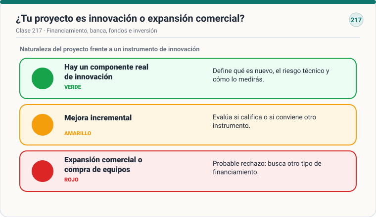

# Clase 217 — CORFO y financiamiento para innovación

> **Parte 16 · Financiamiento, banca, fondos e inversión** — clase 7 de 14

**Estado de evidencia:** `DINAMICO` · **Jurisdicción:** Chile-first · **Fecha base normativa:** 07-08-2026 
**Decisión que habilita:** determinar si el proyecto califica como innovación y si la contrapartida está disponible 
**Entregable:** evaluación de elegibilidad CORFO con instrumento, componente de innovación y contrapartida disponible

## 🎯 Propósito

Determinar si el proyecto califica realmente como innovación y si la contrapartida está disponible antes de postular a Corfo.

## 📚 Resultados de aprendizaje

Al finalizar esta clase podrás:

1. **Definir** con precisión los cuatro conceptos de la tabla siguiente y usarlos para describir un caso real.
2. **Explicar** por qué esta materia condiciona decisiones de otras partes del programa.
3. **Decidir** —determinar si el proyecto califica como innovación y si la contrapartida está disponible— y justificar la decisión por escrito.
4. **Producir** el entregable de la clase y contrastarlo contra su criterio de aceptación.
5. **Distinguir** el dato estable del dato dinámico que exige revalidación en la fuente oficial.

## 🧩 Conceptos centrales

| Concepto | Comprensión verificable |
|---|---|
| **CORFO** | Agencia de fomento a la innovación e inversión. |
| **Innovación** | Desarrollo de solución nueva con riesgo técnico o de mercado. |
| **Instrumento** | Programa específico con objetivo y reglas propias. |
| **Contrapartida** | Aporte del beneficiario, en dinero o valorizado. |

## 🗺️ Modelo mental: ¿Tu proyecto es innovación o expansión comercial?

> **La idea en una frase:** Los instrumentos de CORFO exigen un componente real de innovación y capacidad de ejecución; postular con un proyecto que en realidad es una expansión comercial produce rechazo.

**Qué mirar primero:** Clasifica tu proyecto en una banda antes de postular. La claridad sobre qué es nuevo y cuál es el riesgo técnico es lo que evalúan; la contrapartida debe estar disponible.

**Piénsalo así:** Es pedir una beca de investigación para abrir una sucursal: puede ser buen negocio, pero no es lo que la beca financia.

## 📖 Desarrollo

### 1. El fondo del asunto

Los instrumentos de CORFO exigen un componente real de innovación y capacidad de ejecución. Postular con un proyecto que es en realidad expansión comercial produce rechazo. La contrapartida debe estar disponible: comprometerla sin tenerla convierte la adjudicación en un problema.

### 2. Cómo se traduce en la práctica

Escribe qué es nuevo en tu proyecto, qué riesgo técnico o de mercado resuelve y cómo medirás los resultados. Verifica que el instrumento financie el tipo de gasto que planeas. Calcula la contrapartida y de dónde saldrá. Revisa cada convocatoria, porque las condiciones cambian. Un proyecto bien definido para el instrumento correcto aumenta mucho las probabilidades.

### 3. Marco aplicable y quién interviene

- FOGAPE y sistema de garantías estatales
- Ley 21.521 Fintec para plataformas de financiamiento colectivo
- instrumentos SAFE, notas convertibles y aumentos de capital en SpA

**Autoridades o contrapartes involucradas:** CMF, CORFO, SERCOTEC, BancoEstado y banca comercial.
**Profesionales de apoyo:** CFO, abogado corporativo, asesor financiero, contador. La participación concreta depende del riesgo, del
tamaño de la empresa y de la actividad económica.

### 4. Antes y después

Antes: una empresa de software postula a un instrumento de innovación con un proyecto para abrir oficinas en otra ciudad y comprar equipos; es rechazada. Después: separa lo que sí es innovación (un nuevo algoritmo con riesgo técnico y resultados medibles) y lo postula con un equipo, un plan de pruebas y la contrapartida asegurada; la expansión la financia con crédito. Obtiene el cofinanciamiento (caso ilustrativo).

### 5. En qué se apoya

- **Innovación, inversión y garantías** (Corporación de Fomento de la Producción): CORFO publica los instrumentos para innovación, sus requisitos y las contrapartidas exigidas a las empresas.
- **Business Model Generation** (Wiley): Osterwalder y Pigneur ayudan a describir con claridad qué es nuevo en el modelo de negocio, lo que sirve para sustentar el componente de innovación del proyecto.

*Las lecturas de apoyo ofrecen marcos conceptuales; lo que exige la ley chilena se verifica en las fuentes oficiales de esta clase.*

## 🛡️ Protección del conocimiento: Ejemplos por tipo de empresa

[Guía de inteligencia económica y protección del conocimiento, sección 15](../../../docs/21_INTELIGENCIA_ECONOMICA_Y_PROTECCION_DEL_CONOCIMIENTO.md#15-ejemplos-por-tipo-de-empresa)

**Lente para esta clase:** Postular a fondos exige describir la invención: decide qué divulgas, qué fechas dejas registradas y quién revisa el texto.

| Nivel | Medida proporcionada |
|---|---|
| **Emprendedor o microempresa** | Registro fechado de la invención y revisión de qué texto se envía. |
| **Pyme** | Plantilla de postulación con zonas reservadas y un revisor interno. |
| **Gran empresa o multinacional** | Revisión legal de las postulaciones y política de publicación científica. |

**Actividad sin crear sistemas:** Revisa una postulación y marca qué información, si se publicara, perjudicaría una patente o un secreto.

**Términos:** Novedad (*Novelty*) · Divulgación previa (*Prior Disclosure*)

*Enfoque defensivo: reconocer, prevenir, documentar y escalar. No enseña a obtener información de forma indebida; la calificación jurídica de un hecho concreto corresponde a un abogado.*

## 🧪 Taller guiado

Aplica esta clase a **una** de las siguientes líneas de negocio y repite después el ejercicio con
una segunda línea de carga regulatoria distinta:

| Línea | Carga regulatoria |
|---|---|
| SaaS B2B con IA | media |
| Servicios profesionales | baja |
| E-commerce D2C | media |
| Alimentos o foodtech | alta |
| Exportación de servicios | media |
| Fintech regulada | alta |
| Construcción o servicios técnicos | alta |

**Secuencia de trabajo:**

1. Delimita el contexto: actividad económica, escala, comuna y etapa de la empresa.
2. Reúne los antecedentes que la decisión exige y anota la fecha de cada fuente.
3. Identifica las alternativas reales, incluida la de no hacer nada.
4. Evalúa el impacto en mercado, caja, personas, regulación y operación.
5. Toma la decisión y regístrala con sus supuestos.
6. Produce el entregable.
7. Contrástalo contra el criterio de aceptación.
8. Anota lo que requiere validación profesional y programa su revisión.

### 📦 Entregable

Evaluación de elegibilidad corfo con instrumento, componente de innovación y contrapartida disponible.

Debe incluir decisión, supuestos, fuentes con fecha de consulta, responsable, riesgos
identificados y próximos pasos.

## 🏆 Reto verificable

Resuelve la misma materia para una segunda línea de negocio con distinta carga regulatoria y
explica por escrito **qué cambió, por qué y qué fuente lo determina**.

## ✅ Criterio de aceptación

- [ ] el componente de innovación está identificado y es defendible
- [ ] la contrapartida está disponible y documentada
- [ ] cada afirmación regulatoria está referida a una fuente oficial con fecha de consulta;
- [ ] los datos dinámicos quedan marcados para revalidación;
- [ ] hay un responsable asignado y evidencia reproducible del trabajo.

## ⚠️ Errores frecuentes

**Propios de esta clase:**

- Presentar expansión comercial como proyecto de innovación.
- Comprometer contrapartida que la empresa no tiene disponible.

**Característicos de la parte 16:**

- Financiar activos de largo plazo con líneas de corto plazo.
- Usar factoring de forma estructural y erosionar el margen.

## 🇨🇱 Checklist Chile

- [ ] ¿existe norma o autoridad específica para esta materia?
- [ ] ¿la fuente consultada está vigente a la fecha de ejecución?
- [ ] ¿se activa algún trámite ante el SII?
- [ ] ¿se activa algún requisito municipal o sectorial?
- [ ] ¿afecta a consumidores o al tratamiento de datos personales?
- [ ] ¿afecta a trabajadores o a la seguridad y salud en el trabajo?
- [ ] ¿afecta a impuestos, contabilidad o caja?
- [ ] ¿afecta a contratos o a propiedad intelectual?
- [ ] ¿requiere renovación, reporte periódico o revalidación?

## ❓ Preguntas de comprobación

1. ¿Dónde está el riesgo técnico o de mercado que hace innovador tu proyecto?
2. ¿Tienes la contrapartida disponible y documentada?
3. ¿Puedes ejecutar el proyecto en el plazo que exige el instrumento?

## 🔗 Fuentes oficiales

**Corporación de Fomento de la Producción — Innovación, inversión y garantías**  
<https://www.corfo.cl/> · verificado 2026-11-05

- *Qué contiene:* Reúne los instrumentos de fomento a la innovación y la inversión, incluidos programas de capital semilla, escalamiento, garantías y cobertura de riesgo para el sistema financiero.
- *Cómo leerla:* Filtra por etapa de la empresa antes que por monto. Y verifica el componente de innovación que exige cada instrumento: presentar una expansión comercial como innovación es la causa más común de rechazo.
- *Uso en esta clase:* aporta el marco de «Innovación, inversión y garantías» para determinar si el proyecto califica como innovación y si la contrapartida está disponible.

**Wiley — Business Model Generation**  
<https://openlibrary.org/isbn/9780470876411> · verificado 2026-11-25

- *Qué contiene:* Presenta el lienzo del modelo de negocio de nueve bloques y patrones para describir, diseñar y comparar modelos.
- *Cómo leerla:* Úsalo como marco conceptual para entender el porqué de la práctica, nunca como prueba de lo que exige la ley chilena; para eso están las fuentes oficiales de la clase.
- *Uso en esta clase:* aporta el marco de «Business Model Generation» para determinar si el proyecto califica como innovación y si la contrapartida está disponible.

Complementos del repositorio: [glosario](../../../docs/19_GLOSSARY.md) ·
[ruta de lecturas](../../../docs/15_BOOKS_AND_LEARNING_PATH.md) ·
[catálogo de fuentes](../../../docs/16_OFFICIAL_SOURCE_CATALOG.md).

> [!IMPORTANT]
> Material educativo. Para una decisión real de alto impacto hay que verificar la fuente oficial
> vigente y validar con el profesional competente.

---

| Anterior | Índice | Siguiente |
|---|---|---|
| [← 216 · SERCOTEC y programas de fomento](../class-06-sercotec-y-programas-de-fomento/README.md) | [Parte 16](../README.md) · [Programa](../../../README.md) | [218 · Start-Up Chile y ecosistema emprendedor →](../class-08-start-up-chile-y-ecosistema-emprendedor/README.md) |
