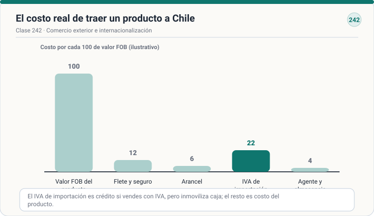

# Clase 242 — Importación de bienes a Chile

> **Parte 18 · Comercio exterior e internacionalización** — clase 4 de 14

**Estado de evidencia:** `VERIFICADO-FUENTE` · **Jurisdicción:** Chile-first · **Fecha base normativa:** 07-08-2026 
**Decisión que habilita:** calcular el costo total de internación antes de comprometer una importación 
**Entregable:** costeo completo de importación con todos los conceptos y visaciones exigidas por producto

## 🎯 Propósito

Calcular el costo total de internación hasta bodega, porque costear sobre el valor FOB es el error que destruye el margen de la importación.

## 📚 Resultados de aprendizaje

Al finalizar esta clase podrás:

1. **Definir** con precisión los cuatro conceptos de la tabla siguiente y usarlos para describir un caso real.
2. **Explicar** por qué esta materia condiciona decisiones de otras partes del programa.
3. **Decidir** —calcular el costo total de internación antes de comprometer una importación— y justificar la decisión por escrito.
4. **Producir** el entregable de la clase y contrastarlo contra su criterio de aceptación.
5. **Distinguir** el dato estable del dato dinámico que exige revalidación en la fuente oficial.

## 🧩 Conceptos centrales

| Concepto | Comprensión verificable |
|---|---|
| **Importación** | Ingreso legal de mercancía al territorio nacional. |
| **Declaración de ingreso** | Documento aduanero de la operación. |
| **Agente de aduana** | Profesional que tramita ante el servicio. |
| **Costo de internación** | Arancel, iva, transporte, almacenaje y gastos. |

## 🗺️ Modelo mental: El costo real de traer un producto a Chile

> **La idea en una frase:** El costo real de importar incluye arancel, IVA de importación, flete, seguro, almacenaje y honorarios del agente; calcular el precio de venta sobre el valor FOB es el error clásico que destruye márgenes.

**Lectura guiada:** Cada barra suma un costo al valor FOB. El IVA de importación, aunque recuperable, exige caja anticipada. El costo de internación es lo que importa para fijar el precio.

**Para recordarlo:** Es pagar un pasaje y olvidar impuestos de embarque, maletas y traslados: el precio final es mucho mayor que el del pasaje.

## 📖 Desarrollo

### 1. El fondo del asunto

El costo real de importar incluye arancel, IVA de importación, flete, seguro, almacenaje y honorarios del agente. Calcular el precio de venta sobre el valor FOB es el error clásico que destruye el margen. Además, ciertos productos requieren visaciones sanitarias o certificaciones previas al ingreso.

### 2. Cómo se traduce en la práctica

Calcula el costo total de internación por unidad antes de comprometer la importación: FOB, flete, seguro, arancel, honorarios, almacenaje y otros gastos. Fija el precio sobre ese costo. Considera el IVA de importación en tu flujo de caja. Cuenta con un agente de aduana y revisa los acuerdos comerciales que puedan reducir el arancel.

### 3. Marco aplicable y quién interviene

- Ordenanza de Aduanas y arancel aduanero chileno
- DL 825 en materia de exportación de bienes y servicios y recuperación de IVA exportador
- convenios para evitar la doble tributación suscritos por Chile
- Incoterms de la Cámara de Comercio Internacional
- Ley 21.850, art. 33 ter: crédito para servicios calificados como exportación por el Servicio Nacional de Aduanas, con tope de 75 UTM por trabajador

**Autoridades o contrapartes involucradas:** Servicio Nacional de Aduanas, SII, ProChile, Banco Central de Chile, SAG y SEREMI de Salud según producto.
**Profesionales de apoyo:** agente de aduana, abogado de comercio internacional, asesor tributario internacional, freight forwarder. La participación concreta depende del riesgo, del
tamaño de la empresa y de la actividad económica.

### 4. Los números, paso a paso

Una tienda importa un producto con valor FOB de 100.000 pesos por unidad. Suma flete y seguro (12.000), arancel (6.000) y agente y almacenaje (4.000): el costo de internación es 122.000, sin considerar el IVA de importación de 22 %, que deberá financiar hasta recuperarlo. Si fija su precio de venta sobre los 100.000 con 30 % de margen, vende a 130.000 y gana solo 8.000 por unidad en vez de 30.000 (cifras ilustrativas).

### 5. En qué se apoya

- **Importación, exportación y clasificación arancelaria** (Servicio Nacional de Aduanas): El Servicio Nacional de Aduanas informa los derechos, el IVA y los procedimientos que conforman el costo de internación de una importación.
- **Ventanilla única de comercio exterior** (Sistema Integrado de Comercio Exterior): SICEX integra los trámites de comercio exterior y ayuda a conocer los requisitos y costos que acompañan cada operación.

*Las lecturas de apoyo ofrecen marcos conceptuales; lo que exige la ley chilena se verifica en las fuentes oficiales de esta clase.*

## 🧪 Taller guiado

Aplica esta clase a **una** de las siguientes líneas de negocio y repite después el ejercicio con
una segunda línea de carga regulatoria distinta:

| Línea | Carga regulatoria |
|---|---|
| SaaS B2B con IA | media |
| Servicios profesionales | baja |
| E-commerce D2C | media |
| Alimentos o foodtech | alta |
| Exportación de servicios | media |
| Fintech regulada | alta |
| Construcción o servicios técnicos | alta |

**Secuencia de trabajo:**

1. Delimita el contexto: actividad económica, escala, comuna y etapa de la empresa.
2. Reúne los antecedentes que la decisión exige y anota la fecha de cada fuente.
3. Identifica las alternativas reales, incluida la de no hacer nada.
4. Evalúa el impacto en mercado, caja, personas, regulación y operación.
5. Toma la decisión y regístrala con sus supuestos.
6. Produce el entregable.
7. Contrástalo contra el criterio de aceptación.
8. Anota lo que requiere validación profesional y programa su revisión.

### 📦 Entregable

Costeo completo de importación con todos los conceptos y visaciones exigidas por producto.

Debe incluir decisión, supuestos, fuentes con fecha de consulta, responsable, riesgos
identificados y próximos pasos.

## 🏆 Reto verificable

Resuelve la misma materia para una segunda línea de negocio con distinta carga regulatoria y
explica por escrito **qué cambió, por qué y qué fuente lo determina**.

## ✅ Criterio de aceptación

- [ ] el costeo incluye todos los conceptos hasta bodega
- [ ] las visaciones exigidas por producto están identificadas
- [ ] cada afirmación regulatoria está referida a una fuente oficial con fecha de consulta;
- [ ] los datos dinámicos quedan marcados para revalidación;
- [ ] hay un responsable asignado y evidencia reproducible del trabajo.

## ⚠️ Errores frecuentes

**Propios de esta clase:**

- Costear la importación sobre el valor fob sin incluir internación.
- Importar productos que requieren visación previa sin haberla gestionado.

**Característicos de la parte 18:**

- Clasificar mal la partida arancelaria y pagar derechos o multas.
- Elegir un incoterm que traslada un riesgo logístico que la empresa no puede gestionar.

## 🇨🇱 Checklist Chile

- [ ] ¿existe norma o autoridad específica para esta materia?
- [ ] ¿la fuente consultada está vigente a la fecha de ejecución?
- [ ] ¿se activa algún trámite ante el SII?
- [ ] ¿se activa algún requisito municipal o sectorial?
- [ ] ¿afecta a consumidores o al tratamiento de datos personales?
- [ ] ¿afecta a trabajadores o a la seguridad y salud en el trabajo?
- [ ] ¿afecta a impuestos, contabilidad o caja?
- [ ] ¿afecta a contratos o a propiedad intelectual?
- [ ] ¿requiere renovación, reporte periódico o revalidación?

## ❓ Preguntas de comprobación

1. ¿Tu costeo llega hasta bodega o se detiene en el valor FOB?
2. ¿Qué visaciones exige tu producto y cuándo debes gestionarlas?
3. ¿Cuánto representa el almacenaje si la carga se detiene una semana?

## 🔗 Fuentes oficiales

**Servicio Nacional de Aduanas — Importación, exportación y clasificación arancelaria**  
<https://www.aduana.cl/> · verificado 2026-11-05

- *Qué contiene:* Publica el arancel aduanero con la clasificación del Sistema Armonizado, los regímenes de importación y exportación, la documentación exigida y las estadísticas de comercio exterior.
- *Cómo leerla:* La partida arancelaria decide arancel, certificaciones y acuerdos aplicables. Ante duda, usa el mecanismo de consulta de clasificación en vez de decidir por parecido de nombre: el error se paga en diferencias y multas.
- *Uso en esta clase:* aporta el marco de «Importación, exportación y clasificación arancelaria» para calcular el costo total de internación antes de comprometer una importación.

**Sistema Integrado de Comercio Exterior — Ventanilla única de comercio exterior**  
<https://www.sicexchile.cl/> · verificado 2026-11-05

- *Qué contiene:* Integra en una sola plataforma los trámites de los servicios que intervienen en una operación de comercio exterior, con el estado de cada visación.
- *Cómo leerla:* Úsala para descubrir qué servicios intervienen en tu producto antes de embarcar. La mercancía detenida en puerto esperando una visación es el costo típico de no haber hecho esta consulta a tiempo.
- *Uso en esta clase:* aporta el marco de «Ventanilla única de comercio exterior» para calcular el costo total de internación antes de comprometer una importación.

Complementos del repositorio: [glosario](../../../docs/19_GLOSSARY.md) ·
[ruta de lecturas](../../../docs/15_BOOKS_AND_LEARNING_PATH.md) ·
[catálogo de fuentes](../../../docs/16_OFFICIAL_SOURCE_CATALOG.md).

> [!IMPORTANT]
> Material educativo. Para una decisión real de alto impacto hay que verificar la fuente oficial
> vigente y validar con el profesional competente.

---

| Anterior | Índice | Siguiente |
|---|---|---|
| [← 241 · Clasificación arancelaria](../class-03-clasificacion-arancelaria/README.md) | [Parte 18](../README.md) · [Programa](../../../README.md) | [243 · Exportación de bienes →](../class-05-exportacion-de-bienes/README.md) |
