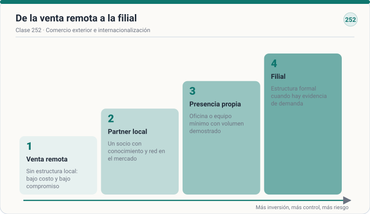

# Clase 252 — Filial, partner o venta remota

> **Parte 18 · Comercio exterior e internacionalización** — clase 14 de 14

**Estado de evidencia:** `VERIFICADO-FUENTE` · **Jurisdicción:** Chile-first · **Fecha base normativa:** 07-08-2026 
**Decisión que habilita:** elegir la forma de entrada proporcional a la evidencia de demanda 
**Entregable:** comparación de formas de entrada con costo de estructura, control y velocidad por alternativa

## 🎯 Propósito

Escalar la forma de entrada según la evidencia de demanda: venta remota, luego partner local y solo después filial.

## 📚 Resultados de aprendizaje

Al finalizar esta clase podrás:

1. **Definir** con precisión los cuatro conceptos de la tabla siguiente y usarlos para describir un caso real.
2. **Explicar** por qué esta materia condiciona decisiones de otras partes del programa.
3. **Decidir** —elegir la forma de entrada proporcional a la evidencia de demanda— y justificar la decisión por escrito.
4. **Producir** el entregable de la clase y contrastarlo contra su criterio de aceptación.
5. **Distinguir** el dato estable del dato dinámico que exige revalidación en la fuente oficial.

## 🧩 Conceptos centrales

| Concepto | Comprensión verificable |
|---|---|
| **Venta remota** | Exportación desde chile sin presencia en destino. |
| **Partner local** | Distribuidor o representante en el mercado destino. |
| **Filial** | Entidad propia constituida en el extranjero. |
| **Costo de estructura** | Carga de mantener presencia legal y operativa en destino. |

## 🗺️ Modelo mental: De la venta remota a la filial

> **La idea en una frase:** La secuencia habitual es venta remota, luego partner local y solo después filial, escalando la inversión según la evidencia de demanda; constituir una filial antes de tener volumen genera costos fijos que el mercado no justifica.

**Cómo leerlo:** Cada peldaño pide más compromiso y exige más evidencia. Subir sin ella es apostar con costos fijos; esperar demasiado puede dejar pasar la oportunidad. El criterio es la demanda demostrada.

**Una analogía:** Es mudarse a otra ciudad: primero visitas, luego arriendas por temporada y solo cuando estás seguro compras la casa.

## 📖 Desarrollo

### 1. El fondo del asunto

La secuencia habitual es venta remota, luego partner local y solo después filial, escalando la inversión según la evidencia de demanda. Constituir filial antes de tener volumen genera costos fijos, obligaciones tributarias y administración en una jurisdicción que aún no se conoce.

### 2. Cómo se traduce en la práctica

Define qué evidencia de demanda necesitas para subir cada peldaño: número de clientes, ingresos recurrentes, pipeline. Evalúa el costo de estructura (legal, tributario, personal) y el costo de oportunidad. Escoge partners con reputación y cláusulas claras de exclusividad, desempeño y término. Constituye una filial con asesoría tributaria y legal en el país de destino.

### 3. Marco aplicable y quién interviene

- Ordenanza de Aduanas y arancel aduanero chileno
- DL 825 en materia de exportación de bienes y servicios y recuperación de IVA exportador
- convenios para evitar la doble tributación suscritos por Chile
- Incoterms de la Cámara de Comercio Internacional
- Ley 21.850, art. 33 ter: crédito para servicios calificados como exportación por el Servicio Nacional de Aduanas, con tope de 75 UTM por trabajador

**Autoridades o contrapartes involucradas:** Servicio Nacional de Aduanas, SII, ProChile, Banco Central de Chile, SAG y SEREMI de Salud según producto.
**Profesionales de apoyo:** agente de aduana, abogado de comercio internacional, asesor tributario internacional, freight forwarder. La participación concreta depende del riesgo, del
tamaño de la empresa y de la actividad económica.

### 4. Un error y su corrección

El error: una empresa de software entusiasmada por un primer cliente en México abre una filial con oficina y tres empleados antes de tener un segundo cliente. Sus costos fijos mensuales superan 10 millones y la demanda no llega al ritmo esperado. La corrección: volver a venta remota, firmar un partner local que prueba el mercado con costos variables y reabrir la filial cuando el volumen la justifique (caso ilustrativo).

### 5. En qué se apoya

- **Programas, estudios de mercado y promoción** (ProChile): ProChile publica orientación sobre las formas de entrada a mercados y los apoyos para cada etapa.
- **Crossing the Chasm (3.ª ed., 2014)** (HarperBusiness): Moore propone avanzar por etapas, consolidando un segmento antes de ampliar, que es la misma lógica que escalar la inversión según la evidencia de demanda.

*Las lecturas de apoyo ofrecen marcos conceptuales; lo que exige la ley chilena se verifica en las fuentes oficiales de esta clase.*

## 🛡️ Protección del conocimiento: Riesgos de las relaciones con terceros

[Guía de inteligencia económica y protección del conocimiento, sección 9](../../../docs/21_INTELIGENCIA_ECONOMICA_Y_PROTECCION_DEL_CONOCIMIENTO.md#9-riesgos-de-las-relaciones-con-terceros)

**Lente para esta clase:** Un socio o filial en otro país tiene menos incentivos a cuidar tu conocimiento y tú menos capacidad de reclamo: la protección contractual debe anticiparse.

| Nivel | Medida proporcionada |
|---|---|
| **Emprendedor o microempresa** | Contrato con el agente local que fije confidencialidad, propiedad y jurisdicción antes de entregar nada. |
| **Pyme** | Entrega al socio extranjero solo lo necesario para vender, con registro y derecho de verificación. |
| **Gran empresa o multinacional** | Estructura con controles sobre la información que sale al exterior y revisión legal por jurisdicción. |

**Actividad sin crear sistemas:** Define qué información necesita un socio extranjero para vender tu producto y cuál nunca debería recibir.

**Términos:** Socio local (*Local Partner*) · Jurisdicción (*Jurisdiction*)

*Enfoque defensivo: reconocer, prevenir, documentar y escalar. No enseña a obtener información de forma indebida; la calificación jurídica de un hecho concreto corresponde a un abogado.*

## 🧪 Taller guiado

Aplica esta clase a **una** de las siguientes líneas de negocio y repite después el ejercicio con
una segunda línea de carga regulatoria distinta:

| Línea | Carga regulatoria |
|---|---|
| SaaS B2B con IA | media |
| Servicios profesionales | baja |
| E-commerce D2C | media |
| Alimentos o foodtech | alta |
| Exportación de servicios | media |
| Fintech regulada | alta |
| Construcción o servicios técnicos | alta |

**Secuencia de trabajo:**

1. Delimita el contexto: actividad económica, escala, comuna y etapa de la empresa.
2. Reúne los antecedentes que la decisión exige y anota la fecha de cada fuente.
3. Identifica las alternativas reales, incluida la de no hacer nada.
4. Evalúa el impacto en mercado, caja, personas, regulación y operación.
5. Toma la decisión y regístrala con sus supuestos.
6. Produce el entregable.
7. Contrástalo contra el criterio de aceptación.
8. Anota lo que requiere validación profesional y programa su revisión.

### 📦 Entregable

Comparación de formas de entrada con costo de estructura, control y velocidad por alternativa.

Debe incluir decisión, supuestos, fuentes con fecha de consulta, responsable, riesgos
identificados y próximos pasos.

## 🏆 Reto verificable

Resuelve la misma materia para una segunda línea de negocio con distinta carga regulatoria y
explica por escrito **qué cambió, por qué y qué fuente lo determina**.

## ✅ Criterio de aceptación

- [ ] la forma elegida es proporcional a la demanda verificada
- [ ] el acuerdo con partner incluye metas y término
- [ ] cada afirmación regulatoria está referida a una fuente oficial con fecha de consulta;
- [ ] los datos dinámicos quedan marcados para revalidación;
- [ ] hay un responsable asignado y evidencia reproducible del trabajo.

## ⚠️ Errores frecuentes

**Propios de esta clase:**

- Constituir filial antes de validar demanda sostenida.
- Depender de un partner exclusivo sin metas ni cláusula de término.

**Característicos de la parte 18:**

- Clasificar mal la partida arancelaria y pagar derechos o multas.
- Elegir un incoterm que traslada un riesgo logístico que la empresa no puede gestionar.

## 🇨🇱 Checklist Chile

- [ ] ¿existe norma o autoridad específica para esta materia?
- [ ] ¿la fuente consultada está vigente a la fecha de ejecución?
- [ ] ¿se activa algún trámite ante el SII?
- [ ] ¿se activa algún requisito municipal o sectorial?
- [ ] ¿afecta a consumidores o al tratamiento de datos personales?
- [ ] ¿afecta a trabajadores o a la seguridad y salud en el trabajo?
- [ ] ¿afecta a impuestos, contabilidad o caja?
- [ ] ¿afecta a contratos o a propiedad intelectual?
- [ ] ¿requiere renovación, reporte periódico o revalidación?

## ❓ Preguntas de comprobación

1. ¿Qué evidencia de demanda sostenida tienes en ese mercado?
2. ¿Tu acuerdo con el partner incluye metas y causal de término?
3. ¿Cuánto costaría al año mantener una filial en ese país?

## 🔗 Fuentes oficiales

**ProChile — Programas, estudios de mercado y promoción**  
<https://www.prochile.gob.cl/> · verificado 2026-11-05

- *Qué contiene:* Publica estudios de mercado por país y sector, agendas de negocios, ferias, y los programas de cofinanciamiento de actividades de promoción.
- *Cómo leerla:* Los estudios de mercado por país son el mejor uso gratuito: entregan tamaño, canales, competencia y requisitos de entrada verificados, que es justo lo que una estimación bottom-up necesita.
- *Uso en esta clase:* aporta el marco de «Programas, estudios de mercado y promoción» para elegir la forma de entrada proporcional a la evidencia de demanda.

**Biblioteca del Congreso Nacional · LeyChile — Normativa oficial consolidada**  
<https://www.bcn.cl/leychile/> · verificado 2026-11-05

- *Qué contiene:* Publica el texto oficial y consolidado de leyes, decretos y reglamentos, con la versión vigente a una fecha, el historial de modificaciones y la tramitación que las originó.
- *Cómo leerla:* Usa siempre el selector de versión vigente a la fecha en que ejecutarás el trámite, no la última publicada. Y lee el artículo transitorio: en normas en implantación gradual —jornada, datos personales— ahí está la fecha que realmente te aplica.
- *Uso en esta clase:* aporta el marco de «Normativa oficial consolidada» para elegir la forma de entrada proporcional a la evidencia de demanda.

**HarperBusiness — Crossing the Chasm (3.ª ed., 2014)**  
<https://openlibrary.org/isbn/9780062292988> · verificado 2026-11-25

- *Qué contiene:* Explica cómo una empresa con tecnología o servicio nuevo pasa de los primeros adoptantes al mercado mayoritario concentrándose en un segmento acotado antes de ampliar.
- *Cómo leerla:* Úsalo como marco conceptual para entender el porqué de la práctica, nunca como prueba de lo que exige la ley chilena; para eso están las fuentes oficiales de la clase.
- *Uso en esta clase:* aporta el marco de «Crossing the Chasm (3.ª ed., 2014)» para elegir la forma de entrada proporcional a la evidencia de demanda.

Complementos del repositorio: [glosario](../../../docs/19_GLOSSARY.md) ·
[ruta de lecturas](../../../docs/15_BOOKS_AND_LEARNING_PATH.md) ·
[catálogo de fuentes](../../../docs/16_OFFICIAL_SOURCE_CATALOG.md).

> [!IMPORTANT]
> Material educativo. Para una decisión real de alto impacto hay que verificar la fuente oficial
> vigente y validar con el profesional competente.

---

| Anterior | Índice | Siguiente |
|---|---|---|
| [← 251 · ProChile y entrada a mercados](../class-13-prochile-y-entrada-a-mercados/README.md) | [Parte 18](../README.md) · [Programa](../../../README.md) | [253 · Mapa integral de riesgos →](../../part-19-compliance-riesgos-y-responsabilidad-empresarial/class-01-mapa-integral-de-riesgos/README.md) |
