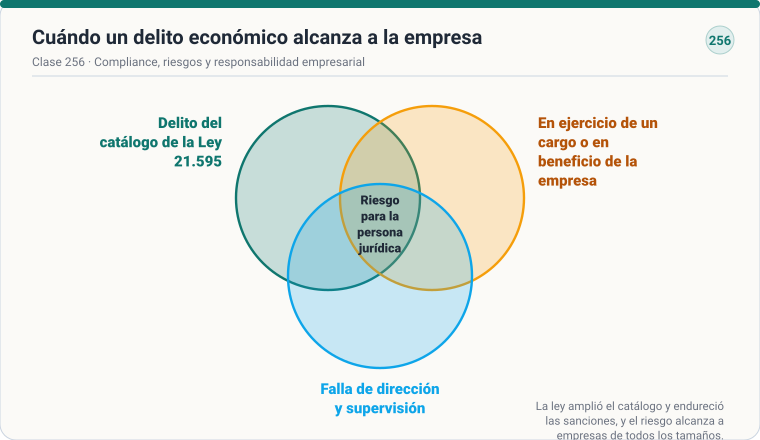

# Clase 256 — Ley 21.595 de Delitos Económicos

> **Parte 19 · Compliance, riesgos y responsabilidad empresarial** — clase 4 de 14

**Estado de evidencia:** `VERIFICADO-FUENTE` · **Jurisdicción:** Chile-first · **Fecha base normativa:** 07-08-2026 
**Decisión que habilita:** reevaluar la exposición de la empresa tras la ampliación del catálogo 
**Entregable:** actualización del diagnóstico de exposición penal con el catálogo ampliado y brechas de control

## 🎯 Propósito

Reevaluar la exposición penal tras la ampliación del catálogo de la Ley 21.595, que extendió el riesgo a empresas de todos los tamaños.

## 📚 Resultados de aprendizaje

Al finalizar esta clase podrás:

1. **Definir** con precisión los cuatro conceptos de la tabla siguiente y usarlos para describir un caso real.
2. **Explicar** por qué esta materia condiciona decisiones de otras partes del programa.
3. **Decidir** —reevaluar la exposición de la empresa tras la ampliación del catálogo— y justificar la decisión por escrito.
4. **Producir** el entregable de la clase y contrastarlo contra su criterio de aceptación.
5. **Distinguir** el dato estable del dato dinámico que exige revalidación en la fuente oficial.

## 🧩 Conceptos centrales

| Concepto | Comprensión verificable |
|---|---|
| **Ley 21.595** | Ley de delitos económicos y ambientales. |
| **Ampliación del catálogo** | Aumento de figuras que generan responsabilidad de la persona jurídica. |
| **Determinación de la pena** | Sistema de penas y multas aplicable. |
| **Deber de dirección y supervisión** | Obligación cuyo incumplimiento habilita la responsabilidad. |

## 🗺️ Modelo mental: Cuándo un delito económico alcanza a la empresa

> **La idea en una frase:** La Ley 21.595 amplió significativamente el catálogo de delitos que pueden generar responsabilidad de la persona jurídica y endureció las sanciones, extendiendo el riesgo a empresas de todos los tamaños.

**Qué mirar primero:** Cuando coinciden las tres condiciones, aparece el riesgo para la empresa. Cada círculo puede gestionarse: conocer el catálogo, controlar los beneficios indebidos y supervisar con diligencia.

**Una analogía:** Es una cadena de causas: basta con quitar un eslabón, como una supervisión diligente, para romper la responsabilidad.

## 📖 Desarrollo

### 1. El fondo del asunto

La Ley 21.595 amplió significativamente el catálogo de delitos que pueden generar responsabilidad de la persona jurídica y endureció las sanciones, extendiendo el riesgo a empresas de todos los tamaños. Esto convirtió el compliance de un tema de grandes corporaciones en una necesidad general.

### 2. Cómo se traduce en la práctica

Revisa el catálogo de delitos económicos y selecciona los que podrían ocurrir en tu actividad: delitos contra el patrimonio, la información reservada, el medio ambiente o la libre competencia. Evalúa quiénes ejercen cargos con poder de decisión y qué beneficios podrían buscar para la empresa. Refuerza la supervisión y actualiza tu modelo de prevención. La ley extiende el riesgo a todas las empresas.

### 3. Marco aplicable y quién interviene

- Ley 20.393 sobre responsabilidad penal de la persona jurídica
- Ley 21.595 sobre delitos económicos y ambientales
- Ley 19.913 que crea la UAF y establece sujetos obligados
- Ley 21.713 sobre cumplimiento de obligaciones tributarias
- Ley 21.643 en lo relativo a canal de denuncias e investigación interna

**Autoridades o contrapartes involucradas:** Ministerio Público, UAF, SII, CMF, Dirección del Trabajo.
**Profesionales de apoyo:** oficial de cumplimiento, abogado penal económico, auditor interno, corredor de seguros. La participación concreta depende del riesgo, del
tamaño de la empresa y de la actividad económica.

### 4. Una conversación que enseña

Gerente: «Pensamos que esto era solo para grandes empresas». Abogada: «La ley de delitos económicos amplió el catálogo, incluye delitos que podrían ocurrir en una pyme, como la apropiación indebida o el uso de información reservada, y considera el ejercicio de un cargo en la empresa». Gerente: «¿Qué hacemos?». Abogada: «Reevaluar la exposición, asegurar controles y dejar evidencia de supervisión» (conversación ilustrativa).

### 5. En qué se apoya

- **Ley 21.595 — Ley de Delitos Económicos** (Biblioteca del Congreso Nacional): La Ley 21.595 clasifica los delitos económicos y su artículo 2 incluye entre los de segunda categoría ciertos delitos cometidos en ejercicio de un cargo en una empresa o en su beneficio.
- **Código Penal — Artículos 284 a 284 sexies (secreto comercial)** (Biblioteca del Congreso Nacional): Los artículos 284 y siguientes del Código Penal, que tratan el secreto comercial, son un ejemplo de delitos que pueden alcanzar a la empresa según esa ley.

*Las lecturas de apoyo ofrecen marcos conceptuales; lo que exige la ley chilena se verifica en las fuentes oficiales de esta clase.*

## 🛡️ Protección del conocimiento: Marco legal chileno: obligación, recomendación y medida voluntaria

[Guía de inteligencia económica y protección del conocimiento, sección 12](../../../docs/21_INTELIGENCIA_ECONOMICA_Y_PROTECCION_DEL_CONOCIMIENTO.md#12-marco-legal-chileno-obligación-recomendación-y-medida-voluntaria)

**Lente para esta clase:** Los arts. 284, 284 bis y 284 ter del Código Penal son delitos económicos cuando se cometen desde una empresa o en beneficio de ella: el compliance debe incluirlos.

| Nivel | Medida proporcionada |
|---|---|
| **Emprendedor o microempresa** | Conoce el límite penal: no entrar, no copiar ni usar secretos de otro. |
| **Pyme** | Incluye en el mapa de riesgos la obtención o el uso de secretos de terceros, con respaldo de un abogado. |
| **Gran empresa o multinacional** | Integra el riesgo de obtención indebida de secretos al modelo de prevención, con controles y canal de denuncias. |

**Actividad sin crear sistemas:** Revisa si tu mapa de riesgos de delitos considera la obtención y el uso de secretos comerciales de terceros.

**Términos:** Delito económico (*Economic Crime*) · Secreto comercial (*Trade Secret*)

*Enfoque defensivo: reconocer, prevenir, documentar y escalar. No enseña a obtener información de forma indebida; la calificación jurídica de un hecho concreto corresponde a un abogado.*

## 🧪 Taller guiado

Aplica esta clase a **una** de las siguientes líneas de negocio y repite después el ejercicio con
una segunda línea de carga regulatoria distinta:

| Línea | Carga regulatoria |
|---|---|
| SaaS B2B con IA | media |
| Servicios profesionales | baja |
| E-commerce D2C | media |
| Alimentos o foodtech | alta |
| Exportación de servicios | media |
| Fintech regulada | alta |
| Construcción o servicios técnicos | alta |

**Secuencia de trabajo:**

1. Delimita el contexto: actividad económica, escala, comuna y etapa de la empresa.
2. Reúne los antecedentes que la decisión exige y anota la fecha de cada fuente.
3. Identifica las alternativas reales, incluida la de no hacer nada.
4. Evalúa el impacto en mercado, caja, personas, regulación y operación.
5. Toma la decisión y regístrala con sus supuestos.
6. Produce el entregable.
7. Contrástalo contra el criterio de aceptación.
8. Anota lo que requiere validación profesional y programa su revisión.

### 📦 Entregable

Actualización del diagnóstico de exposición penal con el catálogo ampliado y brechas de control.

Debe incluir decisión, supuestos, fuentes con fecha de consulta, responsable, riesgos
identificados y próximos pasos.

## 🏆 Reto verificable

Resuelve la misma materia para una segunda línea de negocio con distinta carga regulatoria y
explica por escrito **qué cambió, por qué y qué fuente lo determina**.

## ✅ Criterio de aceptación

- [ ] el diagnóstico considera el catálogo vigente
- [ ] las brechas de control están priorizadas por exposición
- [ ] cada afirmación regulatoria está referida a una fuente oficial con fecha de consulta;
- [ ] los datos dinámicos quedan marcados para revalidación;
- [ ] hay un responsable asignado y evidencia reproducible del trabajo.

## ⚠️ Errores frecuentes

**Propios de esta clase:**

- Mantener un diagnóstico de riesgo penal anterior a la reforma.
- Asumir que sin operaciones con el estado no hay exposición.

**Característicos de la parte 19:**

- Modelo de prevención de delitos en papel, sin evidencia de operación.
- No identificar la condición de sujeto obligado uaf y omitir reportes.

## 🇨🇱 Checklist Chile

- [ ] ¿existe norma o autoridad específica para esta materia?
- [ ] ¿la fuente consultada está vigente a la fecha de ejecución?
- [ ] ¿se activa algún trámite ante el SII?
- [ ] ¿se activa algún requisito municipal o sectorial?
- [ ] ¿afecta a consumidores o al tratamiento de datos personales?
- [ ] ¿afecta a trabajadores o a la seguridad y salud en el trabajo?
- [ ] ¿afecta a impuestos, contabilidad o caja?
- [ ] ¿afecta a contratos o a propiedad intelectual?
- [ ] ¿requiere renovación, reporte periódico o revalidación?

## ❓ Preguntas de comprobación

1. ¿Tu diagnóstico de riesgo penal es posterior a la entrada en vigencia de la reforma?
2. ¿Qué brechas de control tienes en los procesos de mayor exposición?
3. ¿Asumiste que sin operaciones con el Estado no hay exposición penal?

## 🔗 Fuentes oficiales

**Biblioteca del Congreso Nacional · LeyChile — Normativa oficial consolidada**  
<https://www.bcn.cl/leychile/> · verificado 2026-11-05

- *Qué contiene:* Publica el texto oficial y consolidado de leyes, decretos y reglamentos, con la versión vigente a una fecha, el historial de modificaciones y la tramitación que las originó.
- *Cómo leerla:* Usa siempre el selector de versión vigente a la fecha en que ejecutarás el trámite, no la última publicada. Y lee el artículo transitorio: en normas en implantación gradual —jornada, datos personales— ahí está la fecha que realmente te aplica.
- *Uso en esta clase:* aporta el marco de «Normativa oficial consolidada» para reevaluar la exposición de la empresa tras la ampliación del catálogo.

**Biblioteca del Congreso Nacional — Ley 21.595 — Ley de Delitos Económicos**  
<https://www.bcn.cl/leychile/navegar?idNorma=1195119> · verificado 2026-11-12

- *Qué contiene:* Clasifica los delitos económicos en categorías y fija reglas de determinación de penas. Su artículo 2 incluye entre los de segunda categoría los artículos 284, 284 bis y 284 ter del Código Penal cuando se cometen en ejercicio de un cargo en una empresa o en su beneficio.
- *Cómo leerla:* Úsala para saber cuándo la obtención o el uso de secretos comerciales deja de ser un problema individual y pasa a ser un riesgo para la empresa. Revisa en la versión vigente las categorías y las remisiones antes de aplicarla a un caso.
- *Uso en esta clase:* aporta el marco de «Ley 21.595 — Ley de Delitos Económicos» para reevaluar la exposición de la empresa tras la ampliación del catálogo.

**Biblioteca del Congreso Nacional — Código Penal — Artículos 284 a 284 sexies (secreto comercial)**  
<https://www.bcn.cl/leychile/navegar?idNorma=1984> · verificado 2026-11-12

- *Qué contiene:* Tipifica el acceso a un secreto comercial mediante intromisión indebida, su revelación por quien tenía un deber de confidencialidad profesional, contractual o laboral, su aprovechamiento económico, y excluye el uso de la experiencia y competencias legítimamente adquiridas.
- *Cómo leerla:* Distingue quién se introduce (artículo 284), quién viola un deber (284 bis) y quién usa lo obtenido (284 ter). El artículo 284 quinquies protege al trabajador que ejerce su oficio; el 284 sexies remite a la ley de propiedad industrial para definir el secreto.
- *Uso en esta clase:* aporta el marco de «Código Penal — Artículos 284 a 284 sexies (secreto comercial)» para reevaluar la exposición de la empresa tras la ampliación del catálogo.

Complementos del repositorio: [glosario](../../../docs/19_GLOSSARY.md) ·
[ruta de lecturas](../../../docs/15_BOOKS_AND_LEARNING_PATH.md) ·
[catálogo de fuentes](../../../docs/16_OFFICIAL_SOURCE_CATALOG.md).

> [!IMPORTANT]
> Material educativo. Para una decisión real de alto impacto hay que verificar la fuente oficial
> vigente y validar con el profesional competente.

---

| Anterior | Índice | Siguiente |
|---|---|---|
| [← 255 · Ley 20.393 y responsabilidad penal de la persona jurídica](../class-03-ley-20-393-y-responsabilidad-penal-de-la-persona-juridica/README.md) | [Parte 19](../README.md) · [Programa](../../../README.md) | [257 · Modelo de prevención de delitos →](../class-05-modelo-de-prevencion-de-delitos/README.md) |
