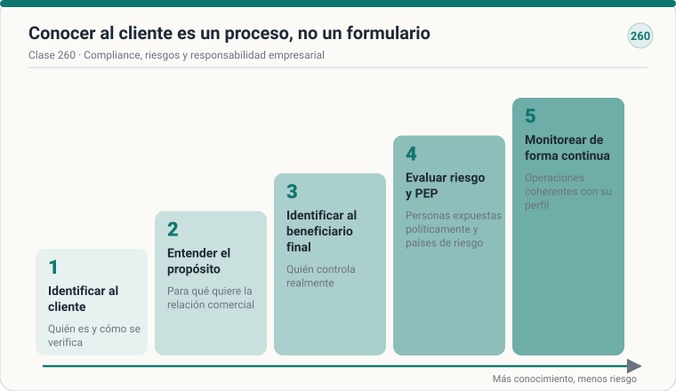

# Clase 260 — KYC, PEP, beneficiario final y debida diligencia

> **Parte 19 · Compliance, riesgos y responsabilidad empresarial** — clase 8 de 14

**Estado de evidencia:** `VERIFICADO-FUENTE` · **Jurisdicción:** Chile-first · **Fecha base normativa:** 07-08-2026 
**Decisión que habilita:** definir el procedimiento de conocimiento del cliente y su actualización 
**Entregable:** procedimiento KYC con identificación, beneficiario final, tratamiento de PEP y periodicidad de actualización

## 🎯 Propósito

Diseñar un procedimiento de conocimiento del cliente que llegue hasta el beneficiario final y se actualice de forma periódica.

## 📚 Resultados de aprendizaje

Al finalizar esta clase podrás:

1. **Definir** con precisión los cuatro conceptos de la tabla siguiente y usarlos para describir un caso real.
2. **Explicar** por qué esta materia condiciona decisiones de otras partes del programa.
3. **Decidir** —definir el procedimiento de conocimiento del cliente y su actualización— y justificar la decisión por escrito.
4. **Producir** el entregable de la clase y contrastarlo contra su criterio de aceptación.
5. **Distinguir** el dato estable del dato dinámico que exige revalidación en la fuente oficial.

## 🧩 Conceptos centrales

| Concepto | Comprensión verificable |
|---|---|
| **KYC** | Conocimiento del cliente. |
| **PEP** | Persona expuesta políticamente, con debida diligencia reforzada. |
| **Beneficiario final** | Persona natural que controla en última instancia. |
| **Debida diligencia continua** | Actualización periódica de la información del cliente. |

## 🗺️ Modelo mental: Conocer al cliente es un proceso, no un formulario

> **La idea en una frase:** La debida diligencia no es un formulario de una sola vez: exige identificar al cliente, entender el propósito de la relación, identificar al beneficiario final y monitorear las operaciones.

**Lectura guiada:** Cada peldaño suma información y reduce el riesgo. El último es el más olvidado: conocer al cliente al inicio no basta si luego sus operaciones dejan de calzar con su perfil.

**Una analogía:** Es conocer a un vecino nuevo: al principio sabes su nombre, con el tiempo entiendes su rutina y notas cuándo algo cambia.

## 📖 Desarrollo

### 1. El fondo del asunto

La debida diligencia no es un formulario de una sola vez: exige identificar al cliente, entender el propósito de la relación, identificar al beneficiario final y monitorear las operaciones. En sectores obligados, la falta de estos registros es infracción con independencia de que haya habido un delito.

### 2. Cómo se traduce en la práctica

Define el procedimiento de conocimiento del cliente según el riesgo: documentos, verificación, beneficiario final y perfil esperado. Identifica las personas expuestas políticamente y aplica medidas reforzadas. Monitorea las operaciones, actualiza la información periódicamente y documenta las decisiones. En los sectores obligados, estas medidas son un deber legal.

### 3. Marco aplicable y quién interviene

- Ley 20.393 sobre responsabilidad penal de la persona jurídica
- Ley 21.595 sobre delitos económicos y ambientales
- Ley 19.913 que crea la UAF y establece sujetos obligados
- Ley 21.713 sobre cumplimiento de obligaciones tributarias
- Ley 21.643 en lo relativo a canal de denuncias e investigación interna

**Autoridades o contrapartes involucradas:** Ministerio Público, UAF, SII, CMF, Dirección del Trabajo.
**Profesionales de apoyo:** oficial de cumplimiento, abogado penal económico, auditor interno, corredor de seguros. La participación concreta depende del riesgo, del
tamaño de la empresa y de la actividad económica.

### 4. Caso trabajado

Una empresa que vende maquinaria a compradores en efectivo pide a un cliente nuevo su RUT, el propósito de la compra y quién es su dueño final. Descubre que la sociedad está controlada por una persona expuesta políticamente. Aplica una debida diligencia reforzada, pide documentos adicionales y establece un seguimiento. Meses después detecta compras muy superiores a su perfil, las evalúa y reporta según corresponda (caso ilustrativo).

### 5. En qué se apoya

- **Sujetos obligados · Ley 19.913** (Unidad de Análisis Financiero): La UAF publica las guías sobre conocimiento del cliente, beneficiario final y personas expuestas políticamente para los sujetos obligados.
- **Normativa oficial consolidada** (Biblioteca del Congreso Nacional · LeyChile): La Ley 19.913 regula los deberes de debida diligencia y reporte, y se consulta en la Biblioteca del Congreso Nacional.

*Las lecturas de apoyo ofrecen marcos conceptuales; lo que exige la ley chilena se verifica en las fuentes oficiales de esta clase.*

## 🧪 Taller guiado

Aplica esta clase a **una** de las siguientes líneas de negocio y repite después el ejercicio con
una segunda línea de carga regulatoria distinta:

| Línea | Carga regulatoria |
|---|---|
| SaaS B2B con IA | media |
| Servicios profesionales | baja |
| E-commerce D2C | media |
| Alimentos o foodtech | alta |
| Exportación de servicios | media |
| Fintech regulada | alta |
| Construcción o servicios técnicos | alta |

**Secuencia de trabajo:**

1. Delimita el contexto: actividad económica, escala, comuna y etapa de la empresa.
2. Reúne los antecedentes que la decisión exige y anota la fecha de cada fuente.
3. Identifica las alternativas reales, incluida la de no hacer nada.
4. Evalúa el impacto en mercado, caja, personas, regulación y operación.
5. Toma la decisión y regístrala con sus supuestos.
6. Produce el entregable.
7. Contrástalo contra el criterio de aceptación.
8. Anota lo que requiere validación profesional y programa su revisión.

### 📦 Entregable

Procedimiento kyc con identificación, beneficiario final, tratamiento de pep y periodicidad de actualización.

Debe incluir decisión, supuestos, fuentes con fecha de consulta, responsable, riesgos
identificados y próximos pasos.

## 🏆 Reto verificable

Resuelve la misma materia para una segunda línea de negocio con distinta carga regulatoria y
explica por escrito **qué cambió, por qué y qué fuente lo determina**.

## ✅ Criterio de aceptación

- [ ] el procedimiento llega al beneficiario final
- [ ] existe periodicidad definida de actualización
- [ ] cada afirmación regulatoria está referida a una fuente oficial con fecha de consulta;
- [ ] los datos dinámicos quedan marcados para revalidación;
- [ ] hay un responsable asignado y evidencia reproducible del trabajo.

## ⚠️ Errores frecuentes

**Propios de esta clase:**

- Identificar solo a la persona que firma sin llegar al beneficiario final.
- No actualizar la información de clientes de relación prolongada.

**Característicos de la parte 19:**

- Modelo de prevención de delitos en papel, sin evidencia de operación.
- No identificar la condición de sujeto obligado uaf y omitir reportes.

## 🇨🇱 Checklist Chile

- [ ] ¿existe norma o autoridad específica para esta materia?
- [ ] ¿la fuente consultada está vigente a la fecha de ejecución?
- [ ] ¿se activa algún trámite ante el SII?
- [ ] ¿se activa algún requisito municipal o sectorial?
- [ ] ¿afecta a consumidores o al tratamiento de datos personales?
- [ ] ¿afecta a trabajadores o a la seguridad y salud en el trabajo?
- [ ] ¿afecta a impuestos, contabilidad o caja?
- [ ] ¿afecta a contratos o a propiedad intelectual?
- [ ] ¿requiere renovación, reporte periódico o revalidación?

## ❓ Preguntas de comprobación

1. ¿Llegas al beneficiario final o te detienes en el firmante?
2. ¿Con qué periodicidad actualizas la información de clientes antiguos?
3. ¿Cómo identificas y tratas a una persona expuesta políticamente?

## 🔗 Fuentes oficiales

**Unidad de Análisis Financiero — Sujetos obligados · Ley 19.913**  
<https://www.uaf.cl/es-cl/sujetos-obligados/sector-privado/quienes-deben-reportar> · verificado 2026-11-05

- *Qué contiene:* Enumera los sectores obligados a reportar, las obligaciones que se activan —designar oficial de cumplimiento, mantener registros, reportar ROS y ROE— y los umbrales aplicables.
- *Cómo leerla:* Busca tu actividad en la lista literal antes de asumir que no te aplica: inmobiliarias, casas de cambio, corredores y varias actividades con manejo de efectivo entran sin ser instituciones financieras.
- *Uso en esta clase:* aporta el marco de «Sujetos obligados · Ley 19.913» para definir el procedimiento de conocimiento del cliente y su actualización.

**Biblioteca del Congreso Nacional · LeyChile — Normativa oficial consolidada**  
<https://www.bcn.cl/leychile/> · verificado 2026-11-05

- *Qué contiene:* Publica el texto oficial y consolidado de leyes, decretos y reglamentos, con la versión vigente a una fecha, el historial de modificaciones y la tramitación que las originó.
- *Cómo leerla:* Usa siempre el selector de versión vigente a la fecha en que ejecutarás el trámite, no la última publicada. Y lee el artículo transitorio: en normas en implantación gradual —jornada, datos personales— ahí está la fecha que realmente te aplica.
- *Uso en esta clase:* aporta el marco de «Normativa oficial consolidada» para definir el procedimiento de conocimiento del cliente y su actualización.

Complementos del repositorio: [glosario](../../../docs/19_GLOSSARY.md) ·
[ruta de lecturas](../../../docs/15_BOOKS_AND_LEARNING_PATH.md) ·
[catálogo de fuentes](../../../docs/16_OFFICIAL_SOURCE_CATALOG.md).

> [!IMPORTANT]
> Material educativo. Para una decisión real de alto impacto hay que verificar la fuente oficial
> vigente y validar con el profesional competente.

---

| Anterior | Índice | Siguiente |
|---|---|---|
| [← 259 · UAF, Ley 19.913 y sujetos obligados](../class-07-uaf-ley-19-913-y-sujetos-obligados/README.md) | [Parte 19](../README.md) · [Programa](../../../README.md) | [261 · Anticorrupción, regalos y conflictos →](../class-09-anticorrupcion-regalos-y-conflictos/README.md) |
