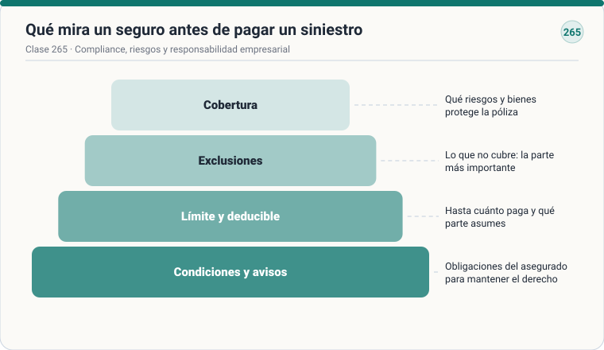

# Clase 265 — Seguros empresariales y transferencia de riesgo

> **Parte 19 · Compliance, riesgos y responsabilidad empresarial** — clase 13 de 14

**Estado de evidencia:** `VERIFICADO-FUENTE` · **Jurisdicción:** Chile-first · **Fecha base normativa:** 07-08-2026 
**Decisión que habilita:** determinar qué riesgos se transfieren a seguro y verificar sus exclusiones 
**Entregable:** programa de seguros con riesgos cubiertos, exclusiones relevantes, deducibles y sumas aseguradas

## 🎯 Propósito

Contratar seguros partiendo del mapa de riesgos y revisando las exclusiones, que es la parte importante y la menos leída de la póliza.

## 📚 Resultados de aprendizaje

Al finalizar esta clase podrás:

1. **Definir** con precisión los cuatro conceptos de la tabla siguiente y usarlos para describir un caso real.
2. **Explicar** por qué esta materia condiciona decisiones de otras partes del programa.
3. **Decidir** —determinar qué riesgos se transfieren a seguro y verificar sus exclusiones— y justificar la decisión por escrito.
4. **Producir** el entregable de la clase y contrastarlo contra su criterio de aceptación.
5. **Distinguir** el dato estable del dato dinámico que exige revalidación en la fuente oficial.

## 🧩 Conceptos centrales

| Concepto | Comprensión verificable |
|---|---|
| **Seguro empresarial** | Transferencia del riesgo a una aseguradora. |
| **Cobertura** | Riesgos y montos efectivamente amparados. |
| **Exclusión** | Situación que la póliza no cubre. |
| **Deducible** | Monto que asume el asegurado en cada siniestro. |

## 🗺️ Modelo mental: Qué mira un seguro antes de pagar un siniestro

> **La idea en una frase:** Las exclusiones son la parte importante de la póliza y la menos leída: muchas empresas descubren en el siniestro que su cobertura excluía justamente la causa ocurrida, por lo que el seguro debe partir del mapa de riesgos.

**Qué mirar primero:** Cada capa condiciona la anterior. Una cobertura amplia con muchas exclusiones puede ser menos útil que una más modesta que realmente cubre tu riesgo. Lee primero lo que no cubre.

**Piénsalo así:** Es un paraguas con agujeros: parece que te protege, hasta que llueve justo por donde está el agujero.

## 📖 Desarrollo

### 1. El fondo del asunto

Las exclusiones son la parte importante de la póliza y la menos leída. Muchas empresas descubren en el siniestro que su cobertura excluía justamente la causa ocurrida. Contratar seguros debe partir del mapa de riesgos: asegurar lo que puede quebrar la empresa, no lo que es fácil de asegurar.

### 2. Cómo se traduce en la práctica

Parte del mapa de riesgos y decide cuáles transferir a seguro y cuáles asumir. Pide a un corredor independiente que compare coberturas, exclusiones, límites y deducibles. Lee las exclusiones y verifica que no excluyan tus riesgos más probables. Conoce las obligaciones de aviso y de evidencia en el siniestro. Considera seguros cibernéticos y de responsabilidad civil.

### 3. Marco aplicable y quién interviene

- Ley 20.393 sobre responsabilidad penal de la persona jurídica
- Ley 21.595 sobre delitos económicos y ambientales
- Ley 19.913 que crea la UAF y establece sujetos obligados
- Ley 21.713 sobre cumplimiento de obligaciones tributarias
- Ley 21.643 en lo relativo a canal de denuncias e investigación interna

**Autoridades o contrapartes involucradas:** Ministerio Público, UAF, SII, CMF, Dirección del Trabajo.
**Profesionales de apoyo:** oficial de cumplimiento, abogado penal económico, auditor interno, corredor de seguros. La participación concreta depende del riesgo, del
tamaño de la empresa y de la actividad económica.

### 4. Los números, paso a paso

Una empresa de alimentos contrata un seguro de 200 millones contra incendio. Un corte eléctrico daña su cámara de frío y pierde 30 millones en mercadería; la póliza excluía daños por variación de tensión, y el seguro no paga. Con un deducible de 5 % y un límite de 200 millones, un incendio de 100 millones habría pagado 95 millones, pero la pérdida más probable estaba fuera de la cobertura (cifras ilustrativas).

### 5. En qué se apoya

- **Registro de Prestadores de Servicios Financieros · Ley 21.521** (Comisión para el Mercado Financiero): La CMF supervisa a las compañías de seguros y a los corredores y publica información sobre las entidades autorizadas a operar en el mercado asegurador.

*Las lecturas de apoyo ofrecen marcos conceptuales; lo que exige la ley chilena se verifica en las fuentes oficiales de esta clase.*

## 🤝 Reputación y confianza: aviso al seguro y evidencia de la crisis

[Guía de reputación, crisis y confianza, sección 10](../../../docs/22_REPUTACION_CRISIS_Y_CONFIANZA.md#10-protocolo-de-respuesta-ante-incidentes-y-control-de-daños)

**Lente para esta clase:** Una póliza puede perder su utilidad si el aviso llega tarde o la evidencia está incompleta: el procedimiento de crisis debe incluir al asegurador desde las primeras horas.

| Nivel | Medida proporcionada |
|---|---|
| **Emprendedor o microempresa** | Una hoja con el número de póliza, el corredor y el plazo de aviso, pegada junto al plan de crisis. |
| **Pyme** | Aviso al corredor y asegurador dentro del plazo contractual, evidencia ordenada y registro de lo comunicado. |
| **Gran empresa o multinacional** | Programa de seguros con revisión de cobertura reputacional y cibernética, cláusulas de gestión de crisis y simulación anual. |

**Obligación legal:** El plazo y la forma del aviso del siniestro y la cobertura dependen de la póliza y de su contrato; léelos antes de la crisis. Esta clase no se apoya en una norma general verificada en esta pasada.

**Recomendación profesional:** Incluir en el procedimiento de crisis la llamada al corredor dentro de las primeras 8 horas y guardar cada documento enviado.

**Actividad:** Busca en tu póliza más relevante el plazo de aviso de siniestro y regístralo en el protocolo de crisis.

**Plantilla:** [Procedimiento de control de daños](../../../templates/27_procedimiento_control_de_danos.md)

**Términos:** Aviso de siniestro (*Notice of claim*) · Cobertura cibernética (*Cyber coverage*)

*Distingue lo que la ley exige de lo que conviene hacer. Las normas se leyeron en la Biblioteca del Congreso Nacional; verifica la versión vigente y consulta a un abogado antes de aplicarlas a un caso real.*

## 🧪 Taller guiado

Aplica esta clase a **una** de las siguientes líneas de negocio y repite después el ejercicio con
una segunda línea de carga regulatoria distinta:

| Línea | Carga regulatoria |
|---|---|
| SaaS B2B con IA | media |
| Servicios profesionales | baja |
| E-commerce D2C | media |
| Alimentos o foodtech | alta |
| Exportación de servicios | media |
| Fintech regulada | alta |
| Construcción o servicios técnicos | alta |

**Secuencia de trabajo:**

1. Delimita el contexto: actividad económica, escala, comuna y etapa de la empresa.
2. Reúne los antecedentes que la decisión exige y anota la fecha de cada fuente.
3. Identifica las alternativas reales, incluida la de no hacer nada.
4. Evalúa el impacto en mercado, caja, personas, regulación y operación.
5. Toma la decisión y regístrala con sus supuestos.
6. Produce el entregable.
7. Contrástalo contra el criterio de aceptación.
8. Anota lo que requiere validación profesional y programa su revisión.

### 📦 Entregable

Programa de seguros con riesgos cubiertos, exclusiones relevantes, deducibles y sumas aseguradas.

Debe incluir decisión, supuestos, fuentes con fecha de consulta, responsable, riesgos
identificados y próximos pasos.

## 🏆 Reto verificable

Resuelve la misma materia para una segunda línea de negocio con distinta carga regulatoria y
explica por escrito **qué cambió, por qué y qué fuente lo determina**.

## ✅ Criterio de aceptación

- [ ] cada póliza está mapeada contra los riesgos priorizados
- [ ] las exclusiones relevantes están identificadas por escrito
- [ ] cada afirmación regulatoria está referida a una fuente oficial con fecha de consulta;
- [ ] los datos dinámicos quedan marcados para revalidación;
- [ ] hay un responsable asignado y evidencia reproducible del trabajo.

## ⚠️ Errores frecuentes

**Propios de esta clase:**

- Contratar pólizas sin revisar exclusiones frente al mapa de riesgos.
- Asegurar por sumas desactualizadas respecto del valor real de reposición.

**Característicos de la parte 19:**

- Modelo de prevención de delitos en papel, sin evidencia de operación.
- No identificar la condición de sujeto obligado uaf y omitir reportes.

## 🇨🇱 Checklist Chile

- [ ] ¿existe norma o autoridad específica para esta materia?
- [ ] ¿la fuente consultada está vigente a la fecha de ejecución?
- [ ] ¿se activa algún trámite ante el SII?
- [ ] ¿se activa algún requisito municipal o sectorial?
- [ ] ¿afecta a consumidores o al tratamiento de datos personales?
- [ ] ¿afecta a trabajadores o a la seguridad y salud en el trabajo?
- [ ] ¿afecta a impuestos, contabilidad o caja?
- [ ] ¿afecta a contratos o a propiedad intelectual?
- [ ] ¿requiere renovación, reporte periódico o revalidación?

## ❓ Preguntas de comprobación

1. ¿Qué excluye cada póliza que tienes y coincide con tus riesgos prioritarios?
2. ¿Están tus sumas aseguradas actualizadas al valor de reposición actual?
3. ¿Qué riesgo que podría quebrar tu empresa no está cubierto hoy?

## 🔗 Fuentes oficiales

**Comisión para el Mercado Financiero — Registro de Prestadores de Servicios Financieros · Ley 21.521**  
<https://www.cmfchile.cl/portal/principal/623/w4-article-60920.html> · verificado 2026-11-05

- *Qué contiene:* Establece qué servicios financieros tecnológicos requieren inscripción o autorización ante la CMF, con qué requisitos de capital, gobierno corporativo y gestión de riesgos.
- *Cómo leerla:* Califica primero tu servicio contra la lista de actividades reguladas; el nombre comercial no decide. Si califica, los requisitos de capital y gobierno son la variable que define si el modelo es viable, antes que el producto.
- *Uso en esta clase:* aporta el marco de «Registro de Prestadores de Servicios Financieros · Ley 21.521» para determinar qué riesgos se transfieren a seguro y verificar sus exclusiones.

Complementos del repositorio: [glosario](../../../docs/19_GLOSSARY.md) ·
[ruta de lecturas](../../../docs/15_BOOKS_AND_LEARNING_PATH.md) ·
[catálogo de fuentes](../../../docs/16_OFFICIAL_SOURCE_CATALOG.md).

> [!IMPORTANT]
> Material educativo. Para una decisión real de alto impacto hay que verificar la fuente oficial
> vigente y validar con el profesional competente.

---

| Anterior | Índice | Siguiente |
|---|---|---|
| [← 264 · Ciberseguridad y obligaciones sectoriales](../class-12-ciberseguridad-y-obligaciones-sectoriales/README.md) | [Parte 19](../README.md) · [Programa](../../../README.md) | [266 · Auditoría interna y plan anual de cumplimiento →](../class-14-auditoria-interna-y-plan-anual-de-cumplimiento/README.md) |
