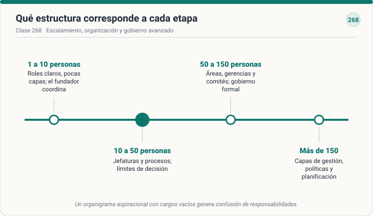

# Clase 268 — Diseño organizacional por etapas

> **Parte 20 · Escalamiento, organización y gobierno avanzado** — clase 2 de 14

**Estado de evidencia:** `GUIA-PRACTICA` · **Jurisdicción:** Chile-first · **Fecha base normativa:** 07-08-2026 
**Decisión que habilita:** definir la estructura de roles que corresponde a la etapa actual 
**Entregable:** diseño organizacional por roles con responsabilidades, reportes y brechas de dotación

## 🎯 Propósito

Diseñar la estructura de roles que corresponde a la etapa actual y no a la aspiracional, con responsabilidades y decisiones definidas.

## 📚 Resultados de aprendizaje

Al finalizar esta clase podrás:

1. **Definir** con precisión los cuatro conceptos de la tabla siguiente y usarlos para describir un caso real.
2. **Explicar** por qué esta materia condiciona decisiones de otras partes del programa.
3. **Decidir** —definir la estructura de roles que corresponde a la etapa actual— y justificar la decisión por escrito.
4. **Producir** el entregable de la clase y contrastarlo contra su criterio de aceptación.
5. **Distinguir** el dato estable del dato dinámico que exige revalidación en la fuente oficial.

## 🧩 Conceptos centrales

| Concepto | Comprensión verificable |
|---|---|
| **Diseño organizacional** | Estructura de roles, reportes y decisiones. |
| **Etapa organizacional** | Fase que determina qué estructura corresponde. |
| **Ámbito de control** | Número de reportes directos manejable. |
| **Rol versus persona** | Distinción entre lo que el cargo requiere y quién lo ocupa hoy. |

## 🗺️ Modelo mental: Qué estructura corresponde a cada etapa

> **La idea en una frase:** La estructura debe corresponder a la etapa: organigramas aspiracionales con cargos vacíos generan confusión de responsabilidades, y diseñar por roles y no por personas permite ver dónde hay sobrecarga.

**Qué mirar primero:** La línea muestra cómo cambia la estructura con el tamaño. Cada tramo exige más formalidad que el anterior, pero adelantarse cuesta tanto como llegar tarde.

**Una analogía:** Es la ropa de un niño que crece: una talla de más estorba, una de menos aprieta; hay que cambiarla cuando corresponde.

## 📖 Desarrollo

### 1. El fondo del asunto

La estructura debe corresponder a la etapa: organigramas aspiracionales con cargos vacíos generan confusión de responsabilidades. Diseñar por roles y no por personas permite ver dónde hay sobrecarga y qué se contrata primero cuando haya recursos.

### 2. Cómo se traduce en la práctica

Dibuja la estructura actual por roles, no por nombres, y marca dónde hay vacantes, sobrecarga o duplicidad. Define el rol de cada persona, su ámbito de control y a quién reporta. Evita crear cargos aspiracionales antes de que existan. Revisa la estructura cada seis meses y cuando cambie el tamaño o el negocio.

### 3. Marco aplicable y quién interviene

- presupuesto por centros de responsabilidad y control de gestión
- gobierno corporativo escalonado: consejo asesor, directorio y comités
- marcos de franquicia y licenciamiento de formato

**Autoridades o contrapartes involucradas:** CMF para sociedades anónimas, FNE en operaciones de concentración, SII en reorganizaciones.
**Profesionales de apoyo:** gerencia general, control de gestión, abogado corporativo, consultor organizacional. La participación concreta depende del riesgo, del
tamaño de la empresa y de la actividad económica.

### 4. Los números, paso a paso

Una empresa de 18 personas adopta un organigrama de gran compañía con seis gerencias, tres de ellas vacías. Las personas no saben a quién reportan y sus tareas se superponen: un cargo de «gerente de operaciones» lo cubre el fundador, que además es gerente comercial. Al rediseñar por roles, define cuatro roles con responsables, ámbitos de control de cinco a ocho personas y un plan de contratación según gatillos (cifras ilustrativas).

### 5. En qué se apoya

- **Scaling Up** (Gazelles): Harnish propone herramientas de gestión y estructura adecuadas a cada etapa de crecimiento de una empresa.
- **High Output Management** (Random House): Grove trata el ámbito de control y la organización de equipos para que la gestión sea efectiva a medida que crece la empresa.

*Las lecturas de apoyo ofrecen marcos conceptuales; lo que exige la ley chilena se verifica en las fuentes oficiales de esta clase.*

## 🤝 Reputación y confianza: roles, sustitutos y comité de crisis dimensionado

[Guía de reputación, crisis y confianza, sección 9](../../../docs/22_REPUTACION_CRISIS_Y_CONFIANZA.md#9-responsables-sustitutos-comité-de-crisis-y-vocería)

**Lente para esta clase:** Delegar sin sustituto es esperar que el día de la crisis estén todos: el comité debe ser proporcional al tamaño y cada rol debe tener un reemplazo conocido.

| Nivel | Medida proporcionada |
|---|---|
| **Emprendedor o microempresa** | Tres personas y un asesor de llamada: responsable, vocería y registro, con sustitutos nombrados por escrito. |
| **Pyme** | Comité de cinco a siete personas con roles, sustitutos, canal de convocatoria en 2 horas y acta de cada sesión. |
| **Gran empresa o multinacional** | Comité de crisis, comité operativo y directorio informado, con turnos y una sola vía hacia autoridades y medios. |

**Obligación legal:** No existe una obligación general de tener un comité de crisis; sí existen obligaciones de informar a autoridades (guía, sección 13) cuyo cumplimiento requiere un responsable y un sustituto.

**Recomendación profesional:** Si el titular está involucrado en el hecho, no dirige la respuesta sobre su conducta; entrena al sustituto.

**Actividad:** Completa la tabla de roles y sustitutos de tu empresa con nombres y teléfonos y verifica que ninguna persona ocupe dos roles críticos.

**Plantilla:** [Protocolo de escalamiento y vocería](../../../templates/28_protocolo_escalamiento_y_voceria.md)

**Términos:** Comité de crisis (*Crisis committee*) · Sustituto (*Alternate*)

*Distingue lo que la ley exige de lo que conviene hacer. Las normas se leyeron en la Biblioteca del Congreso Nacional; verifica la versión vigente y consulta a un abogado antes de aplicarlas a un caso real.*

## 🧪 Taller guiado

Aplica esta clase a **una** de las siguientes líneas de negocio y repite después el ejercicio con
una segunda línea de carga regulatoria distinta:

| Línea | Carga regulatoria |
|---|---|
| SaaS B2B con IA | media |
| Servicios profesionales | baja |
| E-commerce D2C | media |
| Alimentos o foodtech | alta |
| Exportación de servicios | media |
| Fintech regulada | alta |
| Construcción o servicios técnicos | alta |

**Secuencia de trabajo:**

1. Delimita el contexto: actividad económica, escala, comuna y etapa de la empresa.
2. Reúne los antecedentes que la decisión exige y anota la fecha de cada fuente.
3. Identifica las alternativas reales, incluida la de no hacer nada.
4. Evalúa el impacto en mercado, caja, personas, regulación y operación.
5. Toma la decisión y regístrala con sus supuestos.
6. Produce el entregable.
7. Contrástalo contra el criterio de aceptación.
8. Anota lo que requiere validación profesional y programa su revisión.

### 📦 Entregable

Diseño organizacional por roles con responsabilidades, reportes y brechas de dotación.

Debe incluir decisión, supuestos, fuentes con fecha de consulta, responsable, riesgos
identificados y próximos pasos.

## 🏆 Reto verificable

Resuelve la misma materia para una segunda línea de negocio con distinta carga regulatoria y
explica por escrito **qué cambió, por qué y qué fuente lo determina**.

## ✅ Criterio de aceptación

- [ ] la estructura es sostenible con los recursos actuales
- [ ] cada rol tiene responsabilidades y decisiones definidas
- [ ] cada afirmación regulatoria está referida a una fuente oficial con fecha de consulta;
- [ ] los datos dinámicos quedan marcados para revalidación;
- [ ] hay un responsable asignado y evidencia reproducible del trabajo.

## ⚠️ Errores frecuentes

**Propios de esta clase:**

- Diseñar el organigrama que se quisiera tener y no el que se puede sostener.
- Asignar roles a personas sin definir responsabilidades del rol.

**Característicos de la parte 20:**

- Abrir una segunda sucursal antes de que la primera tenga proceso estable.
- Crecer en headcount por encima de la capacidad de caja.

## 🇨🇱 Checklist Chile

- [ ] ¿existe norma o autoridad específica para esta materia?
- [ ] ¿la fuente consultada está vigente a la fecha de ejecución?
- [ ] ¿se activa algún trámite ante el SII?
- [ ] ¿se activa algún requisito municipal o sectorial?
- [ ] ¿afecta a consumidores o al tratamiento de datos personales?
- [ ] ¿afecta a trabajadores o a la seguridad y salud en el trabajo?
- [ ] ¿afecta a impuestos, contabilidad o caja?
- [ ] ¿afecta a contratos o a propiedad intelectual?
- [ ] ¿requiere renovación, reporte periódico o revalidación?

## ❓ Preguntas de comprobación

1. ¿Tu organigrama refleja la empresa que tienes o la que quisieras tener?
2. ¿Qué rol está sobrecargado y qué decisiones se retrasan por eso?
3. ¿Cada rol tiene responsabilidades y límites de decisión escritos?

## 🔗 Fuentes oficiales

**Corporación de Fomento de la Producción — Innovación, inversión y garantías**  
<https://www.corfo.cl/> · verificado 2026-11-05

- *Qué contiene:* Reúne los instrumentos de fomento a la innovación y la inversión, incluidos programas de capital semilla, escalamiento, garantías y cobertura de riesgo para el sistema financiero.
- *Cómo leerla:* Filtra por etapa de la empresa antes que por monto. Y verifica el componente de innovación que exige cada instrumento: presentar una expansión comercial como innovación es la causa más común de rechazo.
- *Uso en esta clase:* aporta el marco de «Innovación, inversión y garantías» para definir la estructura de roles que corresponde a la etapa actual.

**Servicio de Impuestos Internos — Nuevos contribuyentes, inicio de actividades y DTE**  
<https://www.sii.cl/ayudas/nuevos_contribuyentes/boleta-vys-facturador.html> · verificado 2026-11-05

- *Qué contiene:* Reúne el circuito completo del contribuyente nuevo: obtención de RUT, declaración de inicio de actividades, elección de códigos de actividad económica y habilitación para emitir documentos tributarios electrónicos.
- *Cómo leerla:* Sepáralo en dos actos distintos que la página trata seguidos: el RUT identifica, el inicio de actividades habilita. Lo que te bloquea para facturar casi siempre está en el segundo, no en el primero.
- *Uso en esta clase:* aporta el marco de «Nuevos contribuyentes, inicio de actividades y DTE» para definir la estructura de roles que corresponde a la etapa actual.

**Biblioteca del Congreso Nacional · LeyChile — Normativa oficial consolidada**  
<https://www.bcn.cl/leychile/> · verificado 2026-11-05

- *Qué contiene:* Publica el texto oficial y consolidado de leyes, decretos y reglamentos, con la versión vigente a una fecha, el historial de modificaciones y la tramitación que las originó.
- *Cómo leerla:* Usa siempre el selector de versión vigente a la fecha en que ejecutarás el trámite, no la última publicada. Y lee el artículo transitorio: en normas en implantación gradual —jornada, datos personales— ahí está la fecha que realmente te aplica.
- *Uso en esta clase:* aporta el marco de «Normativa oficial consolidada» para definir la estructura de roles que corresponde a la etapa actual.

**Gazelles — Scaling Up**  
<https://openlibrary.org/isbn/9780986019555> · verificado 2026-11-25

- *Qué contiene:* Reúne herramientas de gestión para crecer: personas, estrategia, ejecución y caja. Se usa como lectura de apoyo conceptual y no como fuente normativa.
- *Cómo leerla:* Úsalo como marco conceptual para entender el porqué de la práctica, nunca como prueba de lo que exige la ley chilena; para eso están las fuentes oficiales de la clase.
- *Uso en esta clase:* aporta el marco de «Scaling Up» para definir la estructura de roles que corresponde a la etapa actual.

**Random House — High Output Management**  
<https://openlibrary.org/isbn/9780330289634> · verificado 2026-11-25

- *Qué contiene:* Aplica ideas de producción a la gestión directiva: indicadores, reuniones uno a uno y apalancamiento del tiempo.
- *Cómo leerla:* Úsalo como marco conceptual para entender el porqué de la práctica, nunca como prueba de lo que exige la ley chilena; para eso están las fuentes oficiales de la clase.
- *Uso en esta clase:* aporta el marco de «High Output Management» para definir la estructura de roles que corresponde a la etapa actual.

Complementos del repositorio: [glosario](../../../docs/19_GLOSSARY.md) ·
[ruta de lecturas](../../../docs/15_BOOKS_AND_LEARNING_PATH.md) ·
[catálogo de fuentes](../../../docs/16_OFFICIAL_SOURCE_CATALOG.md).

> [!IMPORTANT]
> Material educativo. Para una decisión real de alto impacto hay que verificar la fuente oficial
> vigente y validar con el profesional competente.

---

| Anterior | Índice | Siguiente |
|---|---|---|
| [← 267 · De fundador a organización](../class-01-de-fundador-a-organizacion/README.md) | [Parte 20](../README.md) · [Programa](../../../README.md) | [269 · Delegación y accountability →](../class-03-delegacion-y-accountability/README.md) |
