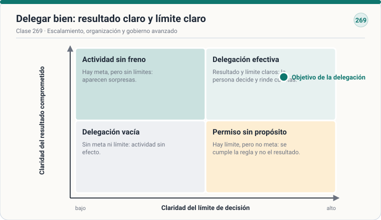

# Clase 269 — Delegación y accountability

> **Parte 20 · Escalamiento, organización y gobierno avanzado** — clase 3 de 14

**Estado de evidencia:** `GUIA-PRACTICA` · **Jurisdicción:** Chile-first · **Fecha base normativa:** 07-08-2026 
**Decisión que habilita:** definir resultados comprometidos, límites de decisión e instancias de rendición 
**Entregable:** matriz RACI de los procesos críticos con límites de decisión e instancia de rendición de cuentas

## 🎯 Propósito

Delegar con resultado comprometido y límite de decisión, revisado en una instancia periódica que exista de verdad.

## 📚 Resultados de aprendizaje

Al finalizar esta clase podrás:

1. **Definir** con precisión los cuatro conceptos de la tabla siguiente y usarlos para describir un caso real.
2. **Explicar** por qué esta materia condiciona decisiones de otras partes del programa.
3. **Decidir** —definir resultados comprometidos, límites de decisión e instancias de rendición— y justificar la decisión por escrito.
4. **Producir** el entregable de la clase y contrastarlo contra su criterio de aceptación.
5. **Distinguir** el dato estable del dato dinámico que exige revalidación en la fuente oficial.

## 🧩 Conceptos centrales

| Concepto | Comprensión verificable |
|---|---|
| **Accountability** | Responsabilidad por un resultado, no por una actividad. |
| **RACI** | Matriz de responsable, aprobador, consultado e informado. |
| **Límite de decisión** | Monto o materia hasta donde el rol decide sin consultar. |
| **Rendición de cuentas** | Instancia periódica de revisión del resultado comprometido. |

## 🗺️ Modelo mental: Delegar bien: resultado claro y límite claro

> **La idea en una frase:** Delegar sin límites produce sorpresas y delegar sin resultado comprometido produce actividad sin efecto: el par correcto es resultado comprometido más límite de decisión, revisado en una instancia periódica.

**Lectura guiada:** Ubica una delegación tuya según la claridad de su resultado y de su límite. Solo el cuadrante superior derecho permite soltar el control sin perderlo.

**Piénsalo así:** Es prestar el auto a un hijo: con destino y reglas claras, confías; sin ellas, esperas con el corazón en la mano.

## 📖 Desarrollo

### 1. El fondo del asunto

Delegar sin límites produce sorpresas y delegar sin resultado comprometido produce actividad sin efecto. El par correcto es resultado comprometido más límite de decisión, revisado en una instancia periódica. Sin esa instancia, la delegación se convierte en abandono.

### 2. Cómo se traduce en la práctica

Para cada delegación, define resultado, límites (montos, materias, excepciones) y rendición. Evita delegar tareas sueltas sin objetivo. Usa una matriz RACI cuando intervengan varias personas. Revisa los resultados en una instancia periódica y ajusta los límites según la evidencia. La confianza se construye con claridad y seguimiento, no con ausencia de control.

### 3. Marco aplicable y quién interviene

- presupuesto por centros de responsabilidad y control de gestión
- gobierno corporativo escalonado: consejo asesor, directorio y comités
- marcos de franquicia y licenciamiento de formato

**Autoridades o contrapartes involucradas:** CMF para sociedades anónimas, FNE en operaciones de concentración, SII en reorganizaciones.
**Profesionales de apoyo:** gerencia general, control de gestión, abogado corporativo, consultor organizacional. La participación concreta depende del riesgo, del
tamaño de la empresa y de la actividad económica.

### 4. Pruébalo tú: mini simulación

Elige una responsabilidad que quisieras delegar, como la gestión de reclamos. Escribe el resultado comprometido (por ejemplo, responder el 95 % en 24 horas), el límite de decisión (puede reembolsar hasta cierto monto) y la instancia de rendición (reunión semanal de 20 minutos). Dibuja el RACI de quién decide, quién ejecuta, quién es consultado y quién es informado. Prueba el esquema durante un mes. Las cifras son ilustrativas.

### 5. En qué se apoya

- **High Output Management** (Random House): Grove propone que la delegación se ajuste a la madurez de la persona y se acompañe con revisión periódica del resultado.
- **Team of Teams** (Portfolio): McChrystal y sus coautores plantean organizaciones con autonomía acotada y transparencia, donde las decisiones se toman cerca de la información.

*Las lecturas de apoyo ofrecen marcos conceptuales; lo que exige la ley chilena se verifica en las fuentes oficiales de esta clase.*

## 🧪 Taller guiado

Aplica esta clase a **una** de las siguientes líneas de negocio y repite después el ejercicio con
una segunda línea de carga regulatoria distinta:

| Línea | Carga regulatoria |
|---|---|
| SaaS B2B con IA | media |
| Servicios profesionales | baja |
| E-commerce D2C | media |
| Alimentos o foodtech | alta |
| Exportación de servicios | media |
| Fintech regulada | alta |
| Construcción o servicios técnicos | alta |

**Secuencia de trabajo:**

1. Delimita el contexto: actividad económica, escala, comuna y etapa de la empresa.
2. Reúne los antecedentes que la decisión exige y anota la fecha de cada fuente.
3. Identifica las alternativas reales, incluida la de no hacer nada.
4. Evalúa el impacto en mercado, caja, personas, regulación y operación.
5. Toma la decisión y regístrala con sus supuestos.
6. Produce el entregable.
7. Contrástalo contra el criterio de aceptación.
8. Anota lo que requiere validación profesional y programa su revisión.

### 📦 Entregable

Matriz raci de los procesos críticos con límites de decisión e instancia de rendición de cuentas.

Debe incluir decisión, supuestos, fuentes con fecha de consulta, responsable, riesgos
identificados y próximos pasos.

## 🏆 Reto verificable

Resuelve la misma materia para una segunda línea de negocio con distinta carga regulatoria y
explica por escrito **qué cambió, por qué y qué fuente lo determina**.

## ✅ Criterio de aceptación

- [ ] cada rol crítico tiene resultado comprometido y límite
- [ ] existe instancia periódica de rendición con evidencia
- [ ] cada afirmación regulatoria está referida a una fuente oficial con fecha de consulta;
- [ ] los datos dinámicos quedan marcados para revalidación;
- [ ] hay un responsable asignado y evidencia reproducible del trabajo.

## ⚠️ Errores frecuentes

**Propios de esta clase:**

- Delegar sin definir límite de decisión y luego cuestionar cada acción.
- No establecer instancia periódica y enterarse del problema tarde.

**Característicos de la parte 20:**

- Abrir una segunda sucursal antes de que la primera tenga proceso estable.
- Crecer en headcount por encima de la capacidad de caja.

## 🇨🇱 Checklist Chile

- [ ] ¿existe norma o autoridad específica para esta materia?
- [ ] ¿la fuente consultada está vigente a la fecha de ejecución?
- [ ] ¿se activa algún trámite ante el SII?
- [ ] ¿se activa algún requisito municipal o sectorial?
- [ ] ¿afecta a consumidores o al tratamiento de datos personales?
- [ ] ¿afecta a trabajadores o a la seguridad y salud en el trabajo?
- [ ] ¿afecta a impuestos, contabilidad o caja?
- [ ] ¿afecta a contratos o a propiedad intelectual?
- [ ] ¿requiere renovación, reporte periódico o revalidación?

## ❓ Preguntas de comprobación

1. ¿Qué resultado comprometió cada responsable para este trimestre?
2. ¿Hasta qué monto o materia puede decidir sin consultarte?
3. ¿Cuándo y cómo rinde cuentas, y con qué evidencia?

## 🔗 Fuentes oficiales

**Corporación de Fomento de la Producción — Innovación, inversión y garantías**  
<https://www.corfo.cl/> · verificado 2026-11-05

- *Qué contiene:* Reúne los instrumentos de fomento a la innovación y la inversión, incluidos programas de capital semilla, escalamiento, garantías y cobertura de riesgo para el sistema financiero.
- *Cómo leerla:* Filtra por etapa de la empresa antes que por monto. Y verifica el componente de innovación que exige cada instrumento: presentar una expansión comercial como innovación es la causa más común de rechazo.
- *Uso en esta clase:* aporta el marco de «Innovación, inversión y garantías» para definir resultados comprometidos, límites de decisión e instancias de rendición.

**Servicio de Impuestos Internos — Nuevos contribuyentes, inicio de actividades y DTE**  
<https://www.sii.cl/ayudas/nuevos_contribuyentes/boleta-vys-facturador.html> · verificado 2026-11-05

- *Qué contiene:* Reúne el circuito completo del contribuyente nuevo: obtención de RUT, declaración de inicio de actividades, elección de códigos de actividad económica y habilitación para emitir documentos tributarios electrónicos.
- *Cómo leerla:* Sepáralo en dos actos distintos que la página trata seguidos: el RUT identifica, el inicio de actividades habilita. Lo que te bloquea para facturar casi siempre está en el segundo, no en el primero.
- *Uso en esta clase:* aporta el marco de «Nuevos contribuyentes, inicio de actividades y DTE» para definir resultados comprometidos, límites de decisión e instancias de rendición.

**Biblioteca del Congreso Nacional · LeyChile — Normativa oficial consolidada**  
<https://www.bcn.cl/leychile/> · verificado 2026-11-05

- *Qué contiene:* Publica el texto oficial y consolidado de leyes, decretos y reglamentos, con la versión vigente a una fecha, el historial de modificaciones y la tramitación que las originó.
- *Cómo leerla:* Usa siempre el selector de versión vigente a la fecha en que ejecutarás el trámite, no la última publicada. Y lee el artículo transitorio: en normas en implantación gradual —jornada, datos personales— ahí está la fecha que realmente te aplica.
- *Uso en esta clase:* aporta el marco de «Normativa oficial consolidada» para definir resultados comprometidos, límites de decisión e instancias de rendición.

**Random House — High Output Management**  
<https://openlibrary.org/isbn/9780330289634> · verificado 2026-11-25

- *Qué contiene:* Aplica ideas de producción a la gestión directiva: indicadores, reuniones uno a uno y apalancamiento del tiempo.
- *Cómo leerla:* Úsalo como marco conceptual para entender el porqué de la práctica, nunca como prueba de lo que exige la ley chilena; para eso están las fuentes oficiales de la clase.
- *Uso en esta clase:* aporta el marco de «High Output Management» para definir resultados comprometidos, límites de decisión e instancias de rendición.

**Portfolio — Team of Teams**  
<https://openlibrary.org/isbn/9781611763720> · verificado 2026-11-25

- *Qué contiene:* Plantea cómo organizar equipos que se adaptan en entornos complejos mediante transparencia y autonomía. Se usa como lectura de apoyo conceptual y no como fuente normativa.
- *Cómo leerla:* Úsalo como marco conceptual para entender el porqué de la práctica, nunca como prueba de lo que exige la ley chilena; para eso están las fuentes oficiales de la clase.
- *Uso en esta clase:* aporta el marco de «Team of Teams» para definir resultados comprometidos, límites de decisión e instancias de rendición.

Complementos del repositorio: [glosario](../../../docs/19_GLOSSARY.md) ·
[ruta de lecturas](../../../docs/15_BOOKS_AND_LEARNING_PATH.md) ·
[catálogo de fuentes](../../../docs/16_OFFICIAL_SOURCE_CATALOG.md).

> [!IMPORTANT]
> Material educativo. Para una decisión real de alto impacto hay que verificar la fuente oficial
> vigente y validar con el profesional competente.

---

| Anterior | Índice | Siguiente |
|---|---|---|
| [← 268 · Diseño organizacional por etapas](../class-02-diseno-organizacional-por-etapas/README.md) | [Parte 20](../README.md) · [Programa](../../../README.md) | [270 · Presupuesto por centros de responsabilidad →](../class-04-presupuesto-por-centros-de-responsabilidad/README.md) |
