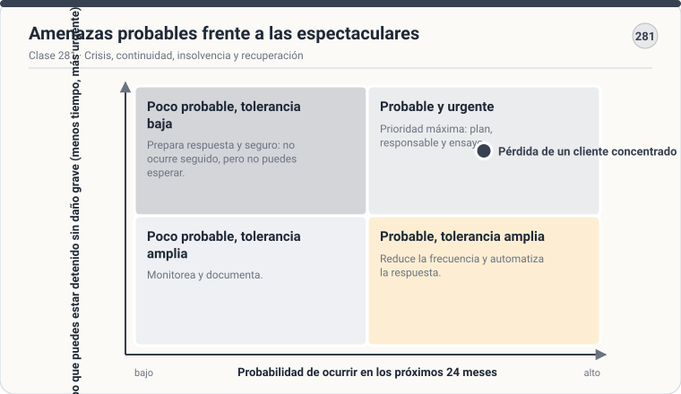

# Clase 281 — Mapa de amenazas y escenarios de crisis

> **Parte 21 · Crisis, continuidad, insolvencia y recuperación** — clase 1 de 14

**Estado de evidencia:** `VERIFICADO-FUENTE` · **Jurisdicción:** Chile-first · **Fecha base normativa:** 07-08-2026 
**Decisión que habilita:** identificar las amenazas concretas del negocio y su tiempo tolerable de indisponibilidad 
**Entregable:** mapa de amenazas con escenarios concretos, impacto operacional y tiempo tolerable por proceso

## 🎯 Propósito

Mapear las amenazas probables del negocio concreto y definir, para cada proceso, cuánto tiempo puede estar detenido antes del daño irreversible.

## 📚 Resultados de aprendizaje

Al finalizar esta clase podrás:

1. **Definir** con precisión los cuatro conceptos de la tabla siguiente y usarlos para describir un caso real.
2. **Explicar** por qué esta materia condiciona decisiones de otras partes del programa.
3. **Decidir** —identificar las amenazas concretas del negocio y su tiempo tolerable de indisponibilidad— y justificar la decisión por escrito.
4. **Producir** el entregable de la clase y contrastarlo contra su criterio de aceptación.
5. **Distinguir** el dato estable del dato dinámico que exige revalidación en la fuente oficial.

## 🧩 Conceptos centrales

| Concepto | Comprensión verificable |
|---|---|
| **Amenaza** | Evento externo o interno que puede interrumpir la operación. |
| **Escenario de crisis** | Descripción concreta de la materialización de una amenaza. |
| **Impacto operacional** | Efecto sobre la capacidad de entregar. |
| **Tiempo de indisponibilidad tolerable** | Plazo máximo antes de daño irreversible. |

## 🗺️ Modelo mental: Amenazas probables frente a las espectaculares

> **La idea en una frase:** El mapa de amenazas debe cubrir lo probable y no solo lo espectacular: la pérdida de un cliente concentrado, la salida de una persona clave, la falla de un proveedor único o un incidente informático.

**Lectura guiada:** Ubica cada amenaza según su probabilidad y cuánto tiempo puedes estar detenido. Las más cercanas al vértice superior derecho son las que exigen plan, responsable y ensayo hoy.

**Piénsalo así:** Es el pronóstico para un viaje: más que el meteorito que podría caer, importa la lluvia que casi seguro llegará y qué harás cuando llegue.

## 📖 Desarrollo

### 1. El fondo del asunto

El mapa de amenazas debe cubrir lo probable y no solo lo espectacular: pérdida de un cliente concentrado, salida de una persona clave, falla de un proveedor único, incidente informático, fiscalización, corte prolongado de suministro. Priorizar por impacto y por tiempo tolerable de indisponibilidad.

### 2. Cómo se traduce en la práctica

Lista las amenazas concretas: cliente concentrado, persona clave, proveedor único, falla tecnológica, incidente de seguridad, fraude, corte de servicios, reclamo regulatorio. Para cada una, estima probabilidad y el tiempo máximo que puedes estar detenido. Ordena y asigna un responsable y un plan a las más críticas. Revisa el mapa al menos una vez al año.

### 3. Marco aplicable y quién interviene

- Ley 20.720 sobre reorganización y liquidación de empresas y personas
- Ley 19.983 sobre mérito ejecutivo de la factura para cobranza
- continuidad de negocio: BIA, RTO, RPO y plan de comunicación de crisis

**Autoridades o contrapartes involucradas:** Superintendencia de Insolvencia y Reemprendimiento, Tribunales civiles, Dirección del Trabajo.
**Profesionales de apoyo:** abogado de insolvencia, veedor o liquidador, CFO, comunicaciones. La participación concreta depende del riesgo, del
tamaño de la empresa y de la actividad económica.

### 4. Caso trabajado

Una empresa de ingeniería escribe sus amenazas. Las más llamativas son un incendio y un ataque informático. Pero al medir probabilidad y tiempo tolerable, descubre que la más peligrosa es la salida de un ingeniero que concentra el conocimiento de tres clientes, con probabilidad media y una tolerancia de pocas semanas. Documenta su método, entrena a un segundo responsable y negocia cláusulas de continuidad. La amenaza espectacular quedó cubierta por el seguro (caso ilustrativo).

### 5. En qué se apoya

- **The Black Swan** (Random House): Taleb advierte que las amenazas de mayor impacto suelen estar fuera del radar y propone reducir la fragilidad en vez de intentar predecirlas todas.
- **Relaciones laborales y obligaciones del empleador** (Dirección del Trabajo): La Dirección del Trabajo informa las obligaciones laborales ante eventos que afectan la operación, que forman parte de las amenazas a considerar.

*Las lecturas de apoyo ofrecen marcos conceptuales; lo que exige la ley chilena se verifica en las fuentes oficiales de esta clase.*

## 🛡️ Protección del conocimiento: Prevención y gestión de crisis

[Guía de inteligencia económica y protección del conocimiento, sección 13](../../../docs/21_INTELIGENCIA_ECONOMICA_Y_PROTECCION_DEL_CONOCIMIENTO.md#13-prevención-y-gestión-de-crisis)

**Lente para esta clase:** La fuga o la aproximación hostil es un escenario de crisis: mapea su disparador, quién decide y qué se comunica en la primera hora.

| Nivel | Medida proporcionada |
|---|---|
| **Emprendedor o microempresa** | Define a quién llamas primero y qué no dices públicamente. |
| **Pyme** | Escenario de fuga en el plan de crisis con responsable, mensajes base y abogado de contacto. |
| **Gran empresa o multinacional** | Gestión de crisis con comité, voceros entrenados y protocolo de coordinación con autoridades. |

**Actividad sin crear sistemas:** Agrega al mapa de amenazas el escenario «filtración de información estratégica» con disparador, responsable y primera acción.

**Términos:** Gestión de crisis (*Crisis Management*) · Escenario de crisis (*Crisis Scenario*)

**Caso en desarrollo:** [NVIDIA: sospecha de espionaje y protección del conocimiento](../../../case-studies/22-nvidia-sospecha-de-espionaje-y-proteccion-del-conocimiento.md#6-análisis-de-decisiones-el-directorio). Compara las decisiones del directorio (investigador independiente, comunicación, rol del ejecutivo) con el plan de crisis de una pyme. Es una investigación **no concluida**: separa lo oficial, lo alegado y lo desconocido.

*Enfoque defensivo: reconocer, prevenir, documentar y escalar. No enseña a obtener información de forma indebida; la calificación jurídica de un hecho concreto corresponde a un abogado.*

## 🤝 Reputación y confianza: escenarios reputacionales y simulaciones de mesa

[Guía de reputación, crisis y confianza, sección 17](../../../docs/22_REPUTACION_CRISIS_Y_CONFIANZA.md#17-simulaciones-para-empresas-pequeñas-y-medianas)

**Lente para esta clase:** Un escenario sin ensayo es una hipótesis: las simulaciones de mesa convierten el mapa de amenazas en reflejos, y cuestan una hora, no una crisis.

| Nivel | Medida proporcionada |
|---|---|
| **Emprendedor o microempresa** | Una simulación de 60 minutos al año con el fundador, un socio y el asesor de llamada. |
| **Pyme** | Dos simulaciones al año con los sustitutos, rúbrica, acta y tres cambios concretos de procedimiento. |
| **Gran empresa o multinacional** | Programa anual de simulaciones por escenario, con evaluadores externos, indicadores de tiempo y revisión en directorio. |

**Obligación legal:** Los ejercicios no son obligatorios por ley general; sí lo son los reportes a autoridades en cada escenario aplicable, cuyo reloj debe ensayarse.

**Recomendación profesional:** Registrar cada ejercicio con su acta; una simulación sin acta no se cuenta como realizada.

**Actividad:** Elige una de las diez simulaciones de la plantilla 33 y define fecha, facilitador y participantes de tu primer ejercicio.

**Plantilla:** [Simulaciones de crisis para pymes](../../../templates/33_simulaciones_crisis_pyme.md)

**Términos:** Ejercicio de mesa (*Tabletop exercise*) · Escenario de crisis (*Crisis scenario*)

*Distingue lo que la ley exige de lo que conviene hacer. Las normas se leyeron en la Biblioteca del Congreso Nacional; verifica la versión vigente y consulta a un abogado antes de aplicarlas a un caso real.*

## 🧪 Taller guiado

Aplica esta clase a **una** de las siguientes líneas de negocio y repite después el ejercicio con
una segunda línea de carga regulatoria distinta:

| Línea | Carga regulatoria |
|---|---|
| SaaS B2B con IA | media |
| Servicios profesionales | baja |
| E-commerce D2C | media |
| Alimentos o foodtech | alta |
| Exportación de servicios | media |
| Fintech regulada | alta |
| Construcción o servicios técnicos | alta |

**Secuencia de trabajo:**

1. Delimita el contexto: actividad económica, escala, comuna y etapa de la empresa.
2. Reúne los antecedentes que la decisión exige y anota la fecha de cada fuente.
3. Identifica las alternativas reales, incluida la de no hacer nada.
4. Evalúa el impacto en mercado, caja, personas, regulación y operación.
5. Toma la decisión y regístrala con sus supuestos.
6. Produce el entregable.
7. Contrástalo contra el criterio de aceptación.
8. Anota lo que requiere validación profesional y programa su revisión.

### 📦 Entregable

Mapa de amenazas con escenarios concretos, impacto operacional y tiempo tolerable por proceso.

Debe incluir decisión, supuestos, fuentes con fecha de consulta, responsable, riesgos
identificados y próximos pasos.

## 🏆 Reto verificable

Resuelve la misma materia para una segunda línea de negocio con distinta carga regulatoria y
explica por escrito **qué cambió, por qué y qué fuente lo determina**.

## ✅ Criterio de aceptación

- [ ] los escenarios son concretos y propios del negocio
- [ ] cada proceso crítico tiene tiempo tolerable definido
- [ ] cada afirmación regulatoria está referida a una fuente oficial con fecha de consulta;
- [ ] los datos dinámicos quedan marcados para revalidación;
- [ ] hay un responsable asignado y evidencia reproducible del trabajo.

## ⚠️ Errores frecuentes

**Propios de esta clase:**

- Mapear solo catástrofes y omitir las interrupciones frecuentes y probables.
- No definir el tiempo tolerable y no poder priorizar la respuesta.

**Característicos de la parte 21:**

- Esperar a la cesación de pagos para buscar asesoría y perder la opción de reorganización.
- Recortar costos destruyendo la capacidad que permite recuperarse.

## 🇨🇱 Checklist Chile

- [ ] ¿existe norma o autoridad específica para esta materia?
- [ ] ¿la fuente consultada está vigente a la fecha de ejecución?
- [ ] ¿se activa algún trámite ante el SII?
- [ ] ¿se activa algún requisito municipal o sectorial?
- [ ] ¿afecta a consumidores o al tratamiento de datos personales?
- [ ] ¿afecta a trabajadores o a la seguridad y salud en el trabajo?
- [ ] ¿afecta a impuestos, contabilidad o caja?
- [ ] ¿afecta a contratos o a propiedad intelectual?
- [ ] ¿requiere renovación, reporte periódico o revalidación?

## ❓ Preguntas de comprobación

1. ¿Qué tres eventos probables detendrían tu operación este año?
2. ¿Cuánto tiempo puede estar detenido cada proceso crítico antes del daño irreversible?
3. ¿Qué amenaza descartaste por improbable que en realidad ya ocurrió en tu sector?

## 🔗 Fuentes oficiales

**Biblioteca del Congreso Nacional · LeyChile — Normativa oficial consolidada**  
<https://www.bcn.cl/leychile/> · verificado 2026-11-05

- *Qué contiene:* Publica el texto oficial y consolidado de leyes, decretos y reglamentos, con la versión vigente a una fecha, el historial de modificaciones y la tramitación que las originó.
- *Cómo leerla:* Usa siempre el selector de versión vigente a la fecha en que ejecutarás el trámite, no la última publicada. Y lee el artículo transitorio: en normas en implantación gradual —jornada, datos personales— ahí está la fecha que realmente te aplica.
- *Uso en esta clase:* aporta el marco de «Normativa oficial consolidada» para identificar las amenazas concretas del negocio y su tiempo tolerable de indisponibilidad.

**Dirección del Trabajo — Relaciones laborales y obligaciones del empleador**  
<https://www.dt.gob.cl/> · verificado 2026-11-05

- *Qué contiene:* Concentra el Código del Trabajo aplicado: dictámenes que interpretan la norma en casos concretos, la plataforma Mi DT para registrar contratos y finiquitos, y las guías de fiscalización.
- *Cómo leerla:* Los dictámenes valen más que las guías divulgativas: describen cómo la autoridad resolvió un caso real. Busca por materia y contrasta la fecha, porque un dictamen posterior puede cambiar el criterio anterior.
- *Uso en esta clase:* aporta el marco de «Relaciones laborales y obligaciones del empleador» para identificar las amenazas concretas del negocio y su tiempo tolerable de indisponibilidad.

**Nextgov/FCW — Nvidia spying allegations test Washington's defenses against tech espionage (11-11-2026)**  
<https://www.nextgov.com/cybersecurity/2026/11/nvidia-spying-allegations-test-washingtons-defenses-against-tech-espionage/417170/> · verificado 2026-11-12

- *Qué contiene:* Analiza el apoyo de contrainteligencia del Estado a las empresas tecnológicas, recoge las posiciones de legisladores, funcionarios y ejecutivos, y subraya el rol de la cultura de reporte y de los equipos de seguridad para detectar aproximaciones antes del acceso.
- *Cómo leerla:* Úsala para el enfoque defensivo y para ver qué apoyo estatal existe en Estados Unidos. Sus hechos sobre el caso son atribuciones y posiciones de parte; lo que no se informa figura como desconocido y no debe completarse con suposiciones.
- *Uso en esta clase:* aporta el marco de «Nvidia spying allegations test Washington's defenses against tech espionage (11-11-2026)» para identificar las amenazas concretas del negocio y su tiempo tolerable de indisponibilidad.

**Random House — The Black Swan**  
<https://openlibrary.org/isbn/9780812979183> · verificado 2026-11-25

- *Qué contiene:* Examina el impacto de los eventos improbables y los límites de la predicción. Se usa como lectura de apoyo conceptual y no como fuente normativa.
- *Cómo leerla:* Úsalo como marco conceptual para entender el porqué de la práctica, nunca como prueba de lo que exige la ley chilena; para eso están las fuentes oficiales de la clase.
- *Uso en esta clase:* aporta el marco de «The Black Swan» para identificar las amenazas concretas del negocio y su tiempo tolerable de indisponibilidad.

Complementos del repositorio: [glosario](../../../docs/19_GLOSSARY.md) ·
[ruta de lecturas](../../../docs/15_BOOKS_AND_LEARNING_PATH.md) ·
[catálogo de fuentes](../../../docs/16_OFFICIAL_SOURCE_CATALOG.md).

> [!IMPORTANT]
> Material educativo. Para una decisión real de alto impacto hay que verificar la fuente oficial
> vigente y validar con el profesional competente.

---

| Anterior | Índice | Siguiente |
|---|---|---|
| **Inicio de la parte** | [Parte 21](../README.md) · [Programa](../../../README.md) | [282 · Business Continuity Plan →](../class-02-business-continuity-plan/README.md) |
