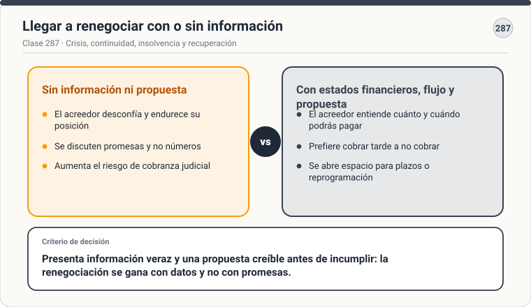

# Clase 287 — Renegociación de deuda

> **Parte 21 · Crisis, continuidad, insolvencia y recuperación** — clase 7 de 14

**Estado de evidencia:** `VERIFICADO-FUENTE` · **Jurisdicción:** Chile-first · **Fecha base normativa:** 07-08-2026 
**Decisión que habilita:** preparar y ejecutar la renegociación con propuesta fundada 
**Entregable:** propuesta de renegociación con flujo proyectado, capacidad de pago demostrada y calendario ofrecido

## 🎯 Propósito

Preparar la renegociación con flujo proyectado y propuesta concreta, porque el acreedor prefiere cobrar tarde a no cobrar.

## 📚 Resultados de aprendizaje

Al finalizar esta clase podrás:

1. **Definir** con precisión los cuatro conceptos de la tabla siguiente y usarlos para describir un caso real.
2. **Explicar** por qué esta materia condiciona decisiones de otras partes del programa.
3. **Decidir** —preparar y ejecutar la renegociación con propuesta fundada— y justificar la decisión por escrito.
4. **Producir** el entregable de la clase y contrastarlo contra su criterio de aceptación.
5. **Distinguir** el dato estable del dato dinámico que exige revalidación en la fuente oficial.

## 🧩 Conceptos centrales

| Concepto | Comprensión verificable |
|---|---|
| **Renegociación** | Modificación de condiciones de la deuda. |
| **Reprogramación** | Extensión de plazos con nuevo calendario. |
| **Quita** | Reducción del monto adeudado. |
| **Posición negociadora** | Fuerza relativa de las partes en la negociación. |

## 🗺️ Modelo mental: Llegar a renegociar con o sin información

> **La idea en una frase:** El acreedor prefiere cobrar tarde a no cobrar, lo que da margen de negociación si se llega con información y con una propuesta creíble; presentarse con estados financieros y un flujo proyectado cambia el resultado.

**Lectura guiada:** Compara los dos platos. En la renegociación, la credibilidad es el activo principal: lo que ofreces debe poder cumplirse con el flujo que muestras.

**Una imagen cotidiana:** Es pedir una prórroga en el banco: con tu situación documentada y una propuesta realista, escuchan; con excusas, solo ven riesgo.

## 📖 Desarrollo

### 1. El fondo del asunto

El acreedor prefiere cobrar tarde a no cobrar, lo que da margen de negociación si se llega con información y con una propuesta creíble. Presentarse con estados financieros, flujo proyectado y una oferta concreta es lo que distingue una renegociación exitosa de una petición de plazo.

### 2. Cómo se traduce en la práctica

Antes de renegociar, reúne estados financieros, flujo proyectado, detalle de deudas y garantías. Define cuánto puedes pagar con realismo y propón un calendario creíble. Negocia con cada acreedor por separado y por escrito, con el mismo criterio de priorización. No ofrezcas lo que no puedes cumplir: un segundo incumplimiento destruye la confianza.

### 3. Marco aplicable y quién interviene

- Ley 20.720 sobre reorganización y liquidación de empresas y personas
- Ley 19.983 sobre mérito ejecutivo de la factura para cobranza
- continuidad de negocio: BIA, RTO, RPO y plan de comunicación de crisis

**Autoridades o contrapartes involucradas:** Superintendencia de Insolvencia y Reemprendimiento, Tribunales civiles, Dirección del Trabajo.
**Profesionales de apoyo:** abogado de insolvencia, veedor o liquidador, CFO, comunicaciones. La participación concreta depende del riesgo, del
tamaño de la empresa y de la actividad económica.

### 4. Los números, paso a paso

Una empresa debe 60 millones a un banco y su flujo solo le permite pagar 2 millones al mes. Propone reprogramar a 36 meses con cuotas de 1,8 millones tras un período de gracia de tres meses y entrega estados financieros y un flujo de 13 semanas. El banco evalúa que recuperaría 100 % de su crédito en 3 años, mientras que en una liquidación recuperaría mucho menos. Acepta la reprogramación con una garantía adicional (cifras ilustrativas).

### 5. En qué se apoya

- **Registro de Prestadores de Servicios Financieros · Ley 21.521** (Comisión para el Mercado Financiero): La CMF mantiene información sobre las entidades financieras que otorgan crédito y son contraparte habitual de una renegociación.
- **Ley 21.131 — Establece pago a treinta días** (Biblioteca del Congreso Nacional): La Ley 21.131 fija los plazos de pago a proveedores, referencia al negociar calendarios con acreedores comerciales.

*Las lecturas de apoyo ofrecen marcos conceptuales; lo que exige la ley chilena se verifica en las fuentes oficiales de esta clase.*

## 🆕 Actualización normativa: Ley 21.850

[Guía de actualización, sección 7](../../../docs/20_LEY_21850_RECONSTRUCCION_NACIONAL.md#7-regularización-de-deudas-tributarias-y-municipales-beneficios-temporales)

**Lente para esta clase:** Al renegociar deudas incluye las tributarias y municipales: porcentaje condonable, pie de 10 %, máximo de tres convenios y condición resolutoria si se incumple una cuota.

**Estado:** Ventanas transitorias con término; confirma el plazo vigente. Texto leído en el Diario Oficial del 17-10-2026; lo que
dependa de circulares, resoluciones o decretos aún no verificados queda marcado como pendiente.

## 🤝 Reputación y confianza: renegociar con propuestas por escrito y por acreedor

[Guía de reputación, crisis y confianza, sección 15](../../../docs/22_REPUTACION_CRISIS_Y_CONFIANZA.md#15-comunicación-sobre-problemas-financieros-y-continuidad)

**Lente para esta clase:** Una renegociación fracasa cuando se promete lo mismo a todos o cuando el acreedor se entera por terceros: cada propuesta debe ser concreta, escrita y consistente.

| Nivel | Medida proporcionada |
|---|---|
| **Emprendedor o microempresa** | Una propuesta de una página por acreedor principal, con cuotas, fechas y qué ocurre si no se cumple. |
| **Pyme** | Mapa de acreedores, criterios de priorización, propuestas firmadas y seguimiento semanal de cumplimiento. |
| **Gran empresa o multinacional** | Programa de reestructuración con asesores financieros y legales, comunicación a bancos y pruebas de sensibilidad. |

**Obligación legal:** Los acuerdos de pago con proveedores constan por escrito; un plazo mayor a 30 días corridos para facturas exige acuerdo escrito inscrito (Ley 21.131).

**Recomendación profesional:** Cumplir la primera cuota de cada acuerdo: es la prueba más fuerte de que la empresa sostiene lo prometido.

**Actividad:** Redacta la propuesta de una página para tu mayor acreedor: monto, calendario de cuotas y garantías ofrecidas.

**Plantilla:** [Guías de comunicación por audiencia](../../../templates/31_guias_comunicacion_por_audiencia.md)

**Términos:** Renegociación (*Renegotiation*) · Acuerdo de pago (*Payment agreement*)

**Simulación:** [caso 7 del expediente de reputación y crisis](../../../case-studies/23-reputacion-y-crisis-siete-casos.md#7-empresa-que-enfrenta-problemas-de-liquidez-y-reclamos). Compara una propuesta común a todos los acreedores con propuestas ajustadas a cada uno. Es una simulación ilustrativa, no una empresa real.

*Distingue lo que la ley exige de lo que conviene hacer. Las normas se leyeron en la Biblioteca del Congreso Nacional; verifica la versión vigente y consulta a un abogado antes de aplicarlas a un caso real.*

## 🧪 Taller guiado

Aplica esta clase a **una** de las siguientes líneas de negocio y repite después el ejercicio con
una segunda línea de carga regulatoria distinta:

| Línea | Carga regulatoria |
|---|---|
| SaaS B2B con IA | media |
| Servicios profesionales | baja |
| E-commerce D2C | media |
| Alimentos o foodtech | alta |
| Exportación de servicios | media |
| Fintech regulada | alta |
| Construcción o servicios técnicos | alta |

**Secuencia de trabajo:**

1. Delimita el contexto: actividad económica, escala, comuna y etapa de la empresa.
2. Reúne los antecedentes que la decisión exige y anota la fecha de cada fuente.
3. Identifica las alternativas reales, incluida la de no hacer nada.
4. Evalúa el impacto en mercado, caja, personas, regulación y operación.
5. Toma la decisión y regístrala con sus supuestos.
6. Produce el entregable.
7. Contrástalo contra el criterio de aceptación.
8. Anota lo que requiere validación profesional y programa su revisión.

### 📦 Entregable

Propuesta de renegociación con flujo proyectado, capacidad de pago demostrada y calendario ofrecido.

Debe incluir decisión, supuestos, fuentes con fecha de consulta, responsable, riesgos
identificados y próximos pasos.

## 🏆 Reto verificable

Resuelve la misma materia para una segunda línea de negocio con distinta carga regulatoria y
explica por escrito **qué cambió, por qué y qué fuente lo determina**.

## ✅ Criterio de aceptación

- [ ] la propuesta se sustenta en un flujo proyectado verificable
- [ ] el calendario ofrecido es cumplible en el escenario conservador
- [ ] cada afirmación regulatoria está referida a una fuente oficial con fecha de consulta;
- [ ] los datos dinámicos quedan marcados para revalidación;
- [ ] hay un responsable asignado y evidencia reproducible del trabajo.

## ⚠️ Errores frecuentes

**Propios de esta clase:**

- Pedir plazo sin presentar información ni propuesta concreta.
- Comprometer un calendario que el flujo proyectado no soporta.

**Característicos de la parte 21:**

- Esperar a la cesación de pagos para buscar asesoría y perder la opción de reorganización.
- Recortar costos destruyendo la capacidad que permite recuperarse.

## 🇨🇱 Checklist Chile

- [ ] ¿existe norma o autoridad específica para esta materia?
- [ ] ¿la fuente consultada está vigente a la fecha de ejecución?
- [ ] ¿se activa algún trámite ante el SII?
- [ ] ¿se activa algún requisito municipal o sectorial?
- [ ] ¿afecta a consumidores o al tratamiento de datos personales?
- [ ] ¿afecta a trabajadores o a la seguridad y salud en el trabajo?
- [ ] ¿afecta a impuestos, contabilidad o caja?
- [ ] ¿afecta a contratos o a propiedad intelectual?
- [ ] ¿requiere renovación, reporte periódico o revalidación?

## ❓ Preguntas de comprobación

1. ¿Con qué información y qué propuesta concreta llegarías a la reunión?
2. ¿El calendario que ofrecerías se cumple en tu escenario conservador?
3. ¿Qué garantía adicional podrías ofrecer a cambio de plazo?

## 🔗 Fuentes oficiales

**Comisión para el Mercado Financiero — Registro de Prestadores de Servicios Financieros · Ley 21.521**  
<https://www.cmfchile.cl/portal/principal/623/w4-article-60920.html> · verificado 2026-11-05

- *Qué contiene:* Establece qué servicios financieros tecnológicos requieren inscripción o autorización ante la CMF, con qué requisitos de capital, gobierno corporativo y gestión de riesgos.
- *Cómo leerla:* Califica primero tu servicio contra la lista de actividades reguladas; el nombre comercial no decide. Si califica, los requisitos de capital y gobierno son la variable que define si el modelo es viable, antes que el producto.
- *Uso en esta clase:* aporta el marco de «Registro de Prestadores de Servicios Financieros · Ley 21.521» para preparar y ejecutar la renegociación con propuesta fundada.

**Biblioteca del Congreso Nacional · LeyChile — Normativa oficial consolidada**  
<https://www.bcn.cl/leychile/> · verificado 2026-11-05

- *Qué contiene:* Publica el texto oficial y consolidado de leyes, decretos y reglamentos, con la versión vigente a una fecha, el historial de modificaciones y la tramitación que las originó.
- *Cómo leerla:* Usa siempre el selector de versión vigente a la fecha en que ejecutarás el trámite, no la última publicada. Y lee el artículo transitorio: en normas en implantación gradual —jornada, datos personales— ahí está la fecha que realmente te aplica.
- *Uso en esta clase:* aporta el marco de «Normativa oficial consolidada» para preparar y ejecutar la renegociación con propuesta fundada.

**Diario Oficial de la República de Chile — Ley 21.850 publicada en el Diario Oficial N.º 44.576-B (17-10-2026)**  
<https://www.diariooficial.interior.gob.cl/publicaciones/2026/10/17/44576-B/01/2888352.pdf> · verificado 2026-11-05

- *Qué contiene:* Texto íntegro publicado el 17 de octubre de 2026, de 46 páginas, con los artículos permanentes y los transitorios de la ley, firmado electrónicamente con CVE 2888352.
- *Cómo leerla:* Usa el texto como fuente de la redacción exacta: cita artículo y transitorio, no resúmenes de prensa. Cuando la ley delegue en circulares, resoluciones o decretos, registra esa dependencia como pendiente hasta ver la instrucción oficial.
- *Uso en esta clase:* aporta el marco de «Ley 21.850 publicada en el Diario Oficial N.º 44.576-B (17-10-2026)» para preparar y ejecutar la renegociación con propuesta fundada.

**Biblioteca del Congreso Nacional · LeyChile — Ley 21.850, para la Reconstrucción Nacional y el Desarrollo Económico y Social**  
<https://www.bcn.cl/leychile/navegar?idNorma=1229250> · verificado 2026-11-05

- *Qué contiene:* Ficha de LeyChile de la Ley 21.850 con su texto consolidado, historia de la norma y vigencias. Reúne la modificación de la Ley sobre Impuesto a la Renta, del Código Tributario y del estatuto de capacitación, más las normas transitorias.
- *Cómo leerla:* Ve primero a los artículos 7, 8, 9, 18 y 29 y a los transitorios: separan lo vigente, lo futuro y lo transitorio. El 5.º y el 6.º transitorio fijan las tasas y las restituciones por año; anota la fecha de consulta con cada cifra.
- *Uso en esta clase:* aporta el marco de «Ley 21.850, para la Reconstrucción Nacional y el Desarrollo Económico y Social» para preparar y ejecutar la renegociación con propuesta fundada.

**Biblioteca del Congreso Nacional — Ley 21.131 — Establece pago a treinta días**  
<https://www.bcn.cl/leychile/navegar?idNorma=1127890> · verificado 2026-11-25

- *Qué contiene:* Sustituye el artículo 2 de la Ley 19.983: el saldo de la factura se paga en treinta días corridos desde su recepción y un plazo mayor exige acuerdo escrito inscrito en el registro del Ministerio de Economía.
- *Cómo leerla:* Úsala para conocer qué plazo se puede prometer a un proveedor y qué debe constar por escrito al renegociar pagos.
- *Uso en esta clase:* aporta el marco de «Ley 21.131 — Establece pago a treinta días» para preparar y ejecutar la renegociación con propuesta fundada.

Complementos del repositorio: [glosario](../../../docs/19_GLOSSARY.md) ·
[ruta de lecturas](../../../docs/15_BOOKS_AND_LEARNING_PATH.md) ·
[catálogo de fuentes](../../../docs/16_OFFICIAL_SOURCE_CATALOG.md).

> [!IMPORTANT]
> Material educativo. Para una decisión real de alto impacto hay que verificar la fuente oficial
> vigente y validar con el profesional competente.

---

| Anterior | Índice | Siguiente |
|---|---|---|
| [← 286 · Cliente o proveedor crítico en insolvencia](../class-06-cliente-o-proveedor-critico-en-insolvencia/README.md) | [Parte 21](../README.md) · [Programa](../../../README.md) | [288 · Cobranza y gestión de incobrables →](../class-08-cobranza-y-gestion-de-incobrables/README.md) |
