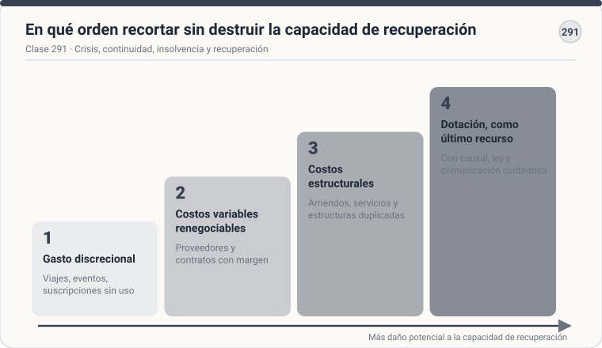

# Clase 291 — Plan de reducción de costos sin destruir capacidad

> **Parte 21 · Crisis, continuidad, insolvencia y recuperación** — clase 11 de 14

**Estado de evidencia:** `VERIFICADO-FUENTE` · **Jurisdicción:** Chile-first · **Fecha base normativa:** 07-08-2026 
**Decisión que habilita:** definir la secuencia de reducción de costos preservando capacidad de recuperación 
**Entregable:** plan de reducción con clasificación de costos, secuencia de corte y evaluación de efecto en capacidad

## 🎯 Propósito

Recortar respetando la jerarquía —discrecional, luego estructural renegociado, capacidad al final— para no destruir la posibilidad de recuperarse.

## 📚 Resultados de aprendizaje

Al finalizar esta clase podrás:

1. **Definir** con precisión los cuatro conceptos de la tabla siguiente y usarlos para describir un caso real.
2. **Explicar** por qué esta materia condiciona decisiones de otras partes del programa.
3. **Decidir** —definir la secuencia de reducción de costos preservando capacidad de recuperación— y justificar la decisión por escrito.
4. **Producir** el entregable de la clase y contrastarlo contra su criterio de aceptación.
5. **Distinguir** el dato estable del dato dinámico que exige revalidación en la fuente oficial.

## 🧩 Conceptos centrales

| Concepto | Comprensión verificable |
|---|---|
| **Reducción de costos** | Disminución de gasto con criterio de preservación de capacidad. |
| **Costo estructural** | Gasto que sostiene la capacidad de generar ingreso. |
| **Costo discrecional** | Gasto postergable sin afectar la operación. |
| **Capacidad de recuperación** | Posibilidad de volver a crecer después del ajuste. |

## 🗺️ Modelo mental: En qué orden recortar sin destruir la capacidad de recuperación

> **La idea en una frase:** El recorte indiscriminado destruye la capacidad de recuperación: se corta marketing, se pierde pipeline, se pierde venta y se corta más; la secuencia correcta empieza por lo discrecional.

**Cómo leerlo:** Cada peldaño es más costoso en capacidad que el anterior. Recorrerlos en orden permite ahorrar lo necesario sin cortar lo que la empresa necesitará para volver a crecer.

**Una imagen cotidiana:** Es aligerar una mochila en una subida: primero lo que no necesitas, luego lo que puedes reemplazar y solo al final lo que cargas por necesidad.

## 📖 Desarrollo

### 1. El fondo del asunto

El recorte indiscriminado destruye la capacidad de recuperación: se corta marketing, se pierde pipeline, se pierde venta y se corta más. La secuencia correcta es cortar discrecional primero, luego renegociar estructural y solo al final tocar la capacidad que genera ingreso.

### 2. Cómo se traduce en la práctica

Clasifica los costos en discrecionales, variables renegociables, estructurales y de personas. Calcula el ahorro potencial y el impacto de cada uno. Recorta en orden y evita las medidas que reducen la capacidad de generar ingresos. Si hay ajuste de dotación, consulta con un abogado laboral y comunica con cuidado: la causal, la forma y el mensaje importan.

### 3. Marco aplicable y quién interviene

- Ley 20.720 sobre reorganización y liquidación de empresas y personas
- Ley 19.983 sobre mérito ejecutivo de la factura para cobranza
- continuidad de negocio: BIA, RTO, RPO y plan de comunicación de crisis

**Autoridades o contrapartes involucradas:** Superintendencia de Insolvencia y Reemprendimiento, Tribunales civiles, Dirección del Trabajo.
**Profesionales de apoyo:** abogado de insolvencia, veedor o liquidador, CFO, comunicaciones. La participación concreta depende del riesgo, del
tamaño de la empresa y de la actividad económica.

### 4. Caso trabajado

Una empresa necesita reducir 15 % de sus costos. Su primera idea es despedir a seis vendedores. Al recorrer la secuencia, recorta 5 puntos con gastos discrecionales y suscripciones sin uso, renegocia contratos y obtiene 6 puntos más, reduce un arriendo duplicado y aporta 3 puntos. Solo el 1 % restante lo logra con ajustes de jornada acordados. Preserva el equipo comercial y recupera ventas antes que sus competidores (caso ilustrativo).

### 5. En qué se apoya

- **Código del Trabajo (DFL 1 de 2002)** (Biblioteca del Congreso Nacional): Los artículos 161 y 162 del Código del Trabajo regulan el término por necesidades de la empresa y su comunicación escrita.
- **The Hard Thing About Hard Things** (HarperBusiness): Horowitz describe decisiones de reducción de costos y de personal en una empresa en crisis y la importancia de comunicarlas con claridad.

*Las lecturas de apoyo ofrecen marcos conceptuales; lo que exige la ley chilena se verifica en las fuentes oficiales de esta clase.*

## 🤝 Reputación y confianza: reducir costos sin romper la confianza

[Guía de reputación, crisis y confianza, sección 14](../../../docs/22_REPUTACION_CRISIS_Y_CONFIANZA.md#14-conflictos-laborales-y-con-proveedores)

**Lente para esta clase:** Un recorte comunicado mal destruye más valor que el costo que ahorra: el mensaje, el orden y la ayuda a quienes salen determinan la reputación posterior.

| Nivel | Medida proporcionada |
|---|---|
| **Emprendedor o microempresa** | Informar primero a las personas afectadas, en persona, con carta clara y apoyo concreto, y luego al equipo. |
| **Pyme** | Plan de reducción con criterios, calendario, apoyo a la reinserción y mensaje coordinado entre áreas. |
| **Gran empresa o multinacional** | Programa de ajuste con asesoría laboral y comunicacional, diálogo con representantes y seguimiento del clima. |

**Obligación legal:** El término por necesidades de la empresa exige comunicación escrita al trabajador (Código del Trabajo, arts. 161 y 162); presionar con pérdida del empleo o cierre contra la sindicalización es práctica antisindical (arts. 289 y 291).

**Recomendación profesional:** Explicar los criterios, evitar anuncios en redes antes de informar a las personas y medir la rotación voluntaria posterior.

**Actividad:** Define el orden de tres comunicaciones de un ajuste de dotación (afectados, equipo, clientes) y el mensaje central de cada una.

**Plantilla:** [Guías de comunicación por audiencia](../../../templates/31_guias_comunicacion_por_audiencia.md)

**Términos:** Ajuste de dotación (*Headcount reduction*) · Clima laboral (*Workplace climate*)

**Simulación:** [caso 5 del expediente de reputación y crisis](../../../case-studies/23-reputacion-y-crisis-siete-casos.md#5-empresa-con-conflicto-laboral-público). Estudia cómo un ajuste de dotación en pleno conflicto cambia la lectura de la comunicación pública. Es una simulación ilustrativa, no una empresa real.

*Distingue lo que la ley exige de lo que conviene hacer. Las normas se leyeron en la Biblioteca del Congreso Nacional; verifica la versión vigente y consulta a un abogado antes de aplicarlas a un caso real.*

## 🧪 Taller guiado

Aplica esta clase a **una** de las siguientes líneas de negocio y repite después el ejercicio con
una segunda línea de carga regulatoria distinta:

| Línea | Carga regulatoria |
|---|---|
| SaaS B2B con IA | media |
| Servicios profesionales | baja |
| E-commerce D2C | media |
| Alimentos o foodtech | alta |
| Exportación de servicios | media |
| Fintech regulada | alta |
| Construcción o servicios técnicos | alta |

**Secuencia de trabajo:**

1. Delimita el contexto: actividad económica, escala, comuna y etapa de la empresa.
2. Reúne los antecedentes que la decisión exige y anota la fecha de cada fuente.
3. Identifica las alternativas reales, incluida la de no hacer nada.
4. Evalúa el impacto en mercado, caja, personas, regulación y operación.
5. Toma la decisión y regístrala con sus supuestos.
6. Produce el entregable.
7. Contrástalo contra el criterio de aceptación.
8. Anota lo que requiere validación profesional y programa su revisión.

### 📦 Entregable

Plan de reducción con clasificación de costos, secuencia de corte y evaluación de efecto en capacidad.

Debe incluir decisión, supuestos, fuentes con fecha de consulta, responsable, riesgos
identificados y próximos pasos.

## 🏆 Reto verificable

Resuelve la misma materia para una segunda línea de negocio con distinta carga regulatoria y
explica por escrito **qué cambió, por qué y qué fuente lo determina**.

## ✅ Criterio de aceptación

- [ ] los costos están clasificados en discrecional y estructural
- [ ] el plan evalúa el efecto de cada corte en la capacidad de generar ingreso
- [ ] cada afirmación regulatoria está referida a una fuente oficial con fecha de consulta;
- [ ] los datos dinámicos quedan marcados para revalidación;
- [ ] hay un responsable asignado y evidencia reproducible del trabajo.

## ⚠️ Errores frecuentes

**Propios de esta clase:**

- Aplicar un recorte porcentual parejo a todas las líneas de gasto.
- Cortar la capacidad comercial y entrar en espiral de caída de ingresos.

**Característicos de la parte 21:**

- Esperar a la cesación de pagos para buscar asesoría y perder la opción de reorganización.
- Recortar costos destruyendo la capacidad que permite recuperarse.

## 🇨🇱 Checklist Chile

- [ ] ¿existe norma o autoridad específica para esta materia?
- [ ] ¿la fuente consultada está vigente a la fecha de ejecución?
- [ ] ¿se activa algún trámite ante el SII?
- [ ] ¿se activa algún requisito municipal o sectorial?
- [ ] ¿afecta a consumidores o al tratamiento de datos personales?
- [ ] ¿afecta a trabajadores o a la seguridad y salud en el trabajo?
- [ ] ¿afecta a impuestos, contabilidad o caja?
- [ ] ¿afecta a contratos o a propiedad intelectual?
- [ ] ¿requiere renovación, reporte periódico o revalidación?

## ❓ Preguntas de comprobación

1. ¿Qué gastos tuyos son realmente discrecionales y cuáles sostienen la capacidad?
2. ¿Qué efecto tendría en tus ingresos el recorte que estás evaluando?
3. ¿Aplicarías un porcentaje parejo o priorizarías por efecto en la capacidad?

## 🔗 Fuentes oficiales

**Biblioteca del Congreso Nacional · LeyChile — Normativa oficial consolidada**  
<https://www.bcn.cl/leychile/> · verificado 2026-11-05

- *Qué contiene:* Publica el texto oficial y consolidado de leyes, decretos y reglamentos, con la versión vigente a una fecha, el historial de modificaciones y la tramitación que las originó.
- *Cómo leerla:* Usa siempre el selector de versión vigente a la fecha en que ejecutarás el trámite, no la última publicada. Y lee el artículo transitorio: en normas en implantación gradual —jornada, datos personales— ahí está la fecha que realmente te aplica.
- *Uso en esta clase:* aporta el marco de «Normativa oficial consolidada» para definir la secuencia de reducción de costos preservando capacidad de recuperación.

**Dirección del Trabajo — Relaciones laborales y obligaciones del empleador**  
<https://www.dt.gob.cl/> · verificado 2026-11-05

- *Qué contiene:* Concentra el Código del Trabajo aplicado: dictámenes que interpretan la norma en casos concretos, la plataforma Mi DT para registrar contratos y finiquitos, y las guías de fiscalización.
- *Cómo leerla:* Los dictámenes valen más que las guías divulgativas: describen cómo la autoridad resolvió un caso real. Busca por materia y contrasta la fecha, porque un dictamen posterior puede cambiar el criterio anterior.
- *Uso en esta clase:* aporta el marco de «Relaciones laborales y obligaciones del empleador» para definir la secuencia de reducción de costos preservando capacidad de recuperación.

**Biblioteca del Congreso Nacional — Código del Trabajo (DFL 1 de 2002)**  
<https://www.bcn.cl/leychile/navegar?idNorma=207436> · verificado 2026-11-25

- *Qué contiene:* Incluye el contenido del reglamento interno y el protocolo contra el acoso y la violencia (art. 154), el procedimiento de investigación de denuncias (art. 211-C), las causales de término y su comunicación (arts. 161 y 162), las prácticas antisindicales (arts. 289 y 291) y la prohibición de reemplazar a trabajadores en huelga (art. 345).
- *Cómo leerla:* Úsalo para separar lo que el empleador debe hacer en un conflicto laboral de lo que solo conviene comunicar. Verifica siempre la versión vigente del artículo antes de citarlo.
- *Uso en esta clase:* aporta el marco de «Código del Trabajo (DFL 1 de 2002)» para definir la secuencia de reducción de costos preservando capacidad de recuperación.

**HarperBusiness — The Hard Thing About Hard Things**  
<https://openlibrary.org/isbn/9780062273215> · verificado 2026-11-25

- *Qué contiene:* Relata decisiones difíciles de gestión al dirigir una empresa, incluidas las crisis. Se usa como lectura de apoyo conceptual y no como fuente normativa.
- *Cómo leerla:* Úsalo como marco conceptual para entender el porqué de la práctica, nunca como prueba de lo que exige la ley chilena; para eso están las fuentes oficiales de la clase.
- *Uso en esta clase:* aporta el marco de «The Hard Thing About Hard Things» para definir la secuencia de reducción de costos preservando capacidad de recuperación.

Complementos del repositorio: [glosario](../../../docs/19_GLOSSARY.md) ·
[ruta de lecturas](../../../docs/15_BOOKS_AND_LEARNING_PATH.md) ·
[catálogo de fuentes](../../../docs/16_OFFICIAL_SOURCE_CATALOG.md).

> [!IMPORTANT]
> Material educativo. Para una decisión real de alto impacto hay que verificar la fuente oficial
> vigente y validar con el profesional competente.

---

| Anterior | Índice | Siguiente |
|---|---|---|
| [← 290 · Protección de documentación y evidencia](../class-10-proteccion-de-documentacion-y-evidencia/README.md) | [Parte 21](../README.md) · [Programa](../../../README.md) | [292 · Comunicaciones con trabajadores y clientes →](../class-12-comunicaciones-con-trabajadores-y-clientes/README.md) |
