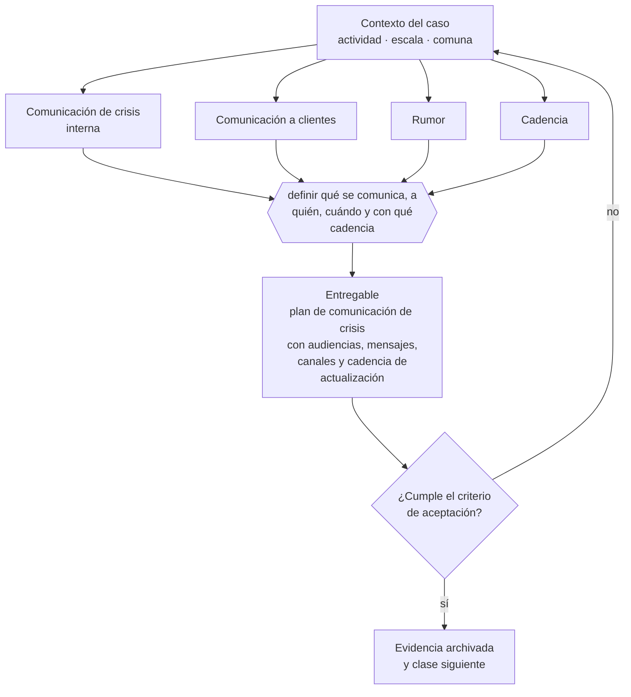

# Clase 292 — Comunicaciones con trabajadores y clientes

> **Parte 21 · Crisis, continuidad, insolvencia y recuperación** — clase 12 de 14

**Estado de evidencia:** `VERIFICADO-FUENTE` · **Jurisdicción:** Chile-first · **Fecha base normativa:** 07-08-2026 
**Decisión que habilita:** definir qué se comunica, a quién, cuándo y con qué cadencia 
**Entregable:** plan de comunicación de crisis con audiencias, mensajes, canales y cadencia de actualización

## 🎯 Propósito

Comunicar temprano, con lo que se sabe y lo que no, comprometiendo una fecha de siguiente actualización.

## 📚 Resultados de aprendizaje

Al finalizar esta clase podrás:

1. **Definir** con precisión los cuatro conceptos de la tabla siguiente y usarlos para describir un caso real.
2. **Explicar** por qué esta materia condiciona decisiones de otras partes del programa.
3. **Decidir** —definir qué se comunica, a quién, cuándo y con qué cadencia— y justificar la decisión por escrito.
4. **Producir** el entregable de la clase y contrastarlo contra su criterio de aceptación.
5. **Distinguir** el dato estable del dato dinámico que exige revalidación en la fuente oficial.

## 🧩 Conceptos centrales

| Concepto | Comprensión verificable |
|---|---|
| **Comunicación de crisis interna** | Información al equipo sobre la situación y las medidas. |
| **Comunicación a clientes** | Información sobre continuidad del servicio. |
| **Rumor** | Información no oficial que llena el vacío comunicacional. |
| **Cadencia** | Frecuencia comprometida de actualización. |

## 🗺️ Flujo de razonamiento

## 📖 Desarrollo

### 1. El fondo del asunto

En una crisis el vacío de información se llena con rumores, siempre peores que la realidad. Comunicar temprano con lo que se sabe, decir lo que no se sabe y comprometer una fecha de siguiente actualización sostiene la confianza incluso cuando las noticias son malas.

### 2. Cómo se traduce en la práctica

El vacío de información se llena con rumores, siempre peores que la realidad. Comunicar a clientes antes que al equipo destruye la credibilidad interna en el momento en que más se necesita, porque el equipo se entera de su propia situación por un tercero.

### 3. Marco aplicable y quién interviene

- Ley 20.720 sobre reorganización y liquidación de empresas y personas
- Ley 19.983 sobre mérito ejecutivo de la factura para cobranza
- continuidad de negocio: BIA, RTO, RPO y plan de comunicación de crisis

**Autoridades o contrapartes involucradas:** Superintendencia de Insolvencia y Reemprendimiento, Tribunales civiles, Dirección del Trabajo.
**Profesionales de apoyo:** abogado de insolvencia, veedor o liquidador, CFO, comunicaciones. La participación concreta depende del riesgo, del
tamaño de la empresa y de la actividad económica.

## 🤝 Reputación y confianza: el orden de las audiencias y la cadencia

[Guía de reputación, crisis y confianza, sección 10](../../../docs/22_REPUTACION_CRISIS_Y_CONFIANZA.md#10-protocolo-de-respuesta-ante-incidentes-y-control-de-daños)

**Lente para esta clase:** La clase enseña a comunicar con cadencia; el protocolo de 72 horas añade el orden: equipo interno, afectados, clientes, proveedores y público, siempre con la misma versión.

| Nivel | Medida proporcionada |
|---|---|
| **Emprendedor o microempresa** | Un mensaje base y un horario de actualización, con la regla de informar primero al equipo. |
| **Pyme** | Guías por audiencia, aprobación por dos personas, registro de cada envío y calendario de actualizaciones. |
| **Gran empresa o multinacional** | Comunicación coordinada con comités, plataformas internas y externas, y medición de la tasa de contacto por audiencia. |

**Obligación legal:** La comunicación no es una obligación en general; sí lo son los avisos a autoridades y los deberes con consumidores (guía, secciones 11 y 13). Lo que se comunique debe ser veraz (Ley 19.496, arts. 28 y 33).

**Recomendación profesional:** Usar las guías de la plantilla 31 y no cambiar los hechos entre audiencias, solo el énfasis.

**Actividad:** Redacta el mensaje base a trabajadores y a clientes ante una falla de servicio, con los mismos hechos y distinto énfasis.

**Plantilla:** [Guías de comunicación por audiencia](../../../templates/31_guias_comunicacion_por_audiencia.md)

**Términos:** Cadencia de actualización (*Update cadence*) · Audiencia (*Stakeholder audience*)

**Simulación:** [caso 5 del expediente de reputación y crisis](../../../case-studies/23-reputacion-y-crisis-siete-casos.md#5-empresa-con-conflicto-laboral-público). Compara una comunicación pública anterior a la interna con una que informa primero al equipo. Es una simulación ilustrativa, no una empresa real.

*Distingue lo que la ley exige de lo que conviene hacer. Las normas se leyeron en la Biblioteca del Congreso Nacional; verifica la versión vigente y consulta a un abogado antes de aplicarlas a un caso real.*

## 🧪 Taller guiado

Aplica esta clase a **una** de las siguientes líneas de negocio y repite después el ejercicio con
una segunda línea de carga regulatoria distinta:

| Línea | Carga regulatoria |
|---|---|
| SaaS B2B con IA | media |
| Servicios profesionales | baja |
| E-commerce D2C | media |
| Alimentos o foodtech | alta |
| Exportación de servicios | media |
| Fintech regulada | alta |
| Construcción o servicios técnicos | alta |

**Secuencia de trabajo:**

1. Delimita el contexto: actividad económica, escala, comuna y etapa de la empresa.
2. Reúne los antecedentes que la decisión exige y anota la fecha de cada fuente.
3. Identifica las alternativas reales, incluida la de no hacer nada.
4. Evalúa el impacto en mercado, caja, personas, regulación y operación.
5. Toma la decisión y regístrala con sus supuestos.
6. Produce el entregable.
7. Contrástalo contra el criterio de aceptación.
8. Anota lo que requiere validación profesional y programa su revisión.

### 📦 Entregable

Plan de comunicación de crisis con audiencias, mensajes, canales y cadencia de actualización.

Debe incluir decisión, supuestos, fuentes con fecha de consulta, responsable, riesgos
identificados y próximos pasos.

## 🏆 Reto verificable

Resuelve la misma materia para una segunda línea de negocio con distinta carga regulatoria y
explica por escrito **qué cambió, por qué y qué fuente lo determina**.

## ✅ Criterio de aceptación

- [ ] el plan define cadencia comprometida de actualización
- [ ] las audiencias están priorizadas con mensaje específico
- [ ] cada afirmación regulatoria está referida a una fuente oficial con fecha de consulta;
- [ ] los datos dinámicos quedan marcados para revalidación;
- [ ] hay un responsable asignado y evidencia reproducible del trabajo.

## ⚠️ Errores frecuentes

**Propios de esta clase:**

- Esperar a tener toda la información y dejar el vacío durante días.
- Comunicar a clientes antes que al equipo y perder credibilidad interna.

**Característicos de la parte 21:**

- Esperar a la cesación de pagos para buscar asesoría y perder la opción de reorganización.
- Recortar costos destruyendo la capacidad que permite recuperarse.

## 🇨🇱 Checklist Chile

- [ ] ¿existe norma o autoridad específica para esta materia?
- [ ] ¿la fuente consultada está vigente a la fecha de ejecución?
- [ ] ¿se activa algún trámite ante el SII?
- [ ] ¿se activa algún requisito municipal o sectorial?
- [ ] ¿afecta a consumidores o al tratamiento de datos personales?
- [ ] ¿afecta a trabajadores o a la seguridad y salud en el trabajo?
- [ ] ¿afecta a impuestos, contabilidad o caja?
- [ ] ¿afecta a contratos o a propiedad intelectual?
- [ ] ¿requiere renovación, reporte periódico o revalidación?

## ❓ Preguntas de comprobación

1. ¿A quién comunicarías primero y con qué mensaje?
2. ¿Qué cadencia de actualización puedes comprometer y sostener?
3. ¿Qué dirías sobre lo que aún no sabes, en vez de callarlo?

## 🔗 Fuentes oficiales

**Biblioteca del Congreso Nacional · LeyChile — Normativa oficial consolidada**  
<https://www.bcn.cl/leychile/> · verificado 2026-11-05

- *Qué contiene:* Publica el texto oficial y consolidado de leyes, decretos y reglamentos, con la versión vigente a una fecha, el historial de modificaciones y la tramitación que las originó.
- *Cómo leerla:* Usa siempre el selector de versión vigente a la fecha en que ejecutarás el trámite, no la última publicada. Y lee el artículo transitorio: en normas en implantación gradual —jornada, datos personales— ahí está la fecha que realmente te aplica.
- *Uso en esta clase:* aporta el marco de «Normativa oficial consolidada» para definir qué se comunica, a quién, cuándo y con qué cadencia.

**Dirección del Trabajo — Relaciones laborales y obligaciones del empleador**  
<https://www.dt.gob.cl/> · verificado 2026-11-05

- *Qué contiene:* Concentra el Código del Trabajo aplicado: dictámenes que interpretan la norma en casos concretos, la plataforma Mi DT para registrar contratos y finiquitos, y las guías de fiscalización.
- *Cómo leerla:* Los dictámenes valen más que las guías divulgativas: describen cómo la autoridad resolvió un caso real. Busca por materia y contrasta la fecha, porque un dictamen posterior puede cambiar el criterio anterior.
- *Uso en esta clase:* aporta el marco de «Relaciones laborales y obligaciones del empleador» para definir qué se comunica, a quién, cuándo y con qué cadencia.

**Biblioteca del Congreso Nacional — Ley 19.496 — Protección de los derechos de los consumidores**  
<https://www.bcn.cl/leychile/navegar?idNorma=61438> · verificado 2026-11-25

- *Qué contiene:* Fija los derechos básicos del consumidor, la obligación de cumplir lo ofrecido (art. 12), la publicidad veraz (arts. 28 y 33), la seguridad del producto y el deber de informar a la autoridad los peligros descubiertos después de vender (arts. 45 a 49) y las funciones de fiscalización del SERNAC (art. 58).
- *Cómo leerla:* Úsala para distinguir qué debe hacer un proveedor ante un producto riesgoso o una publicidad cuestionada de lo que solo conviene hacer. Lee el artículo completo en la versión vigente antes de aplicarlo a un caso concreto.
- *Uso en esta clase:* aporta el marco de «Ley 19.496 — Protección de los derechos de los consumidores» para definir qué se comunica, a quién, cuándo y con qué cadencia.

Complementos del repositorio: [glosario](../../../docs/19_GLOSSARY.md) ·
[ruta de lecturas](../../../docs/15_BOOKS_AND_LEARNING_PATH.md) ·
[catálogo de fuentes](../../../docs/16_OFFICIAL_SOURCE_CATALOG.md).

> [!IMPORTANT]
> Material educativo. Para una decisión real de alto impacto hay que verificar la fuente oficial
> vigente y validar con el profesional competente.

---

| Anterior | Índice | Siguiente |
|---|---|---|
| [← 291 · Plan de reducción de costos sin destruir capacidad](../class-11-plan-de-reduccion-de-costos-sin-destruir-capacidad/README.md) | [Parte 21](../README.md) · [Programa](../../../README.md) | [293 · Post-mortem y aprendizaje organizacional →](../class-13-post-mortem-y-aprendizaje-organizacional/README.md) |
