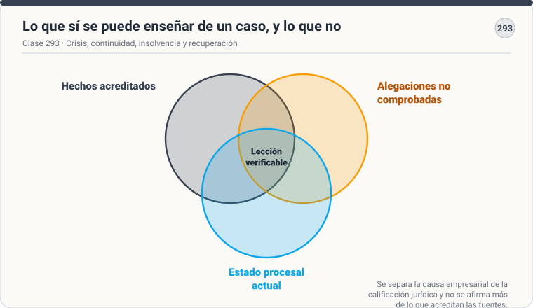

# Clase 293 — Post-mortem y aprendizaje organizacional

> **Parte 21 · Crisis, continuidad, insolvencia y recuperación** — clase 13 de 14

**Estado de evidencia:** `VERIFICADO-FUENTE` · **Jurisdicción:** Chile-first · **Fecha base normativa:** 07-08-2026 
**Decisión que habilita:** convertir un evento adverso en mejoras verificables sin exceder lo que acreditan las fuentes 
**Entregable:** post-mortem con cronología, estado de cada afirmación, causas empresariales, controles fallidos, acciones y responsable

## 🎯 Propósito

Extraer aprendizajes empresariales sin confundir señales, insolvencia, investigaciones, acusaciones, resoluciones civiles y sentencias.

## 📚 Resultados de aprendizaje

Al finalizar esta clase podrás:

1. **Definir** con precisión los cuatro conceptos de la tabla siguiente y usarlos para describir un caso real.
2. **Explicar** por qué esta materia condiciona decisiones de otras partes del programa.
3. **Decidir** —convertir un evento adverso en mejoras verificables sin exceder lo que acreditan las fuentes— y justificar la decisión por escrito.
4. **Producir** el entregable de la clase y contrastarlo contra su criterio de aceptación.
5. **Distinguir** el dato estable del dato dinámico que exige revalidación en la fuente oficial.

## 🧩 Conceptos centrales

| Concepto | Comprensión verificable |
|---|---|
| **Post-mortem** | Análisis estructurado de hechos, decisiones, controles y consecuencias. |
| **Estado procesal** | Calidad jurídica de una afirmación: investigación, acusación, declaración de culpabilidad, sentencia, resolución civil o recurso. |
| **Causa empresarial** | Falla de producto, liquidez, gobierno, control o comunicación que puede coexistir sin equivaler a delito. |
| **Aprendizaje organizacional** | Incorporación verificable del hallazgo a procesos y decisiones. |

## 🗺️ Modelo mental: Lo que sí se puede enseñar de un caso, y lo que no

> **La idea en una frase:** El aprendizaje comparado exige separar hechos acreditados, alegaciones y estado procesal, y distinguir la causa empresarial de la calificación jurídica, sin exceder lo que acreditan las fuentes.

**Lectura guiada:** Los círculos muestran tres niveles de certeza. La lección verificable solo se apoya en lo acreditado; lo alegado o lo pendiente se rotula como tal y no se usa para concluir.

**Piénsalo así:** Es la crónica de un partido: se cuenta el marcador, se informa lo que pidió el árbitro y se distingue de lo que opinan los hinchas.

## 📖 Desarrollo

### 1. El fondo del asunto

El aprendizaje comparado exige separar hechos acreditados, alegaciones y estado procesal, además de distinguir causa empresarial de calificación jurídica. FTX, Celsius, Terra, OneCoin, Madoff y AC Inversions permiten revisar custodia, rendimientos, producto, captación, auditoría, gobierno y crisis sin convertir el programa en un catálogo de fraudes. Una insolvencia no prueba fraude; una parte relacionada no es ilícita por sí misma; una rentabilidad alta exige evidencia reforzada.

### 2. Cómo se traduce en la práctica

Para cada caso, construye una tabla con tres columnas: hechos acreditados con su fuente, alegaciones y estado procesal. Distingue la causa empresarial (qué control faltó) de la calificación jurídica (qué delito se imputa). Convierte las lecciones en mejoras verificables dentro de tu empresa, con responsable y fecha. Cita siempre las fuentes y su fecha.

### 3. Marco aplicable y quién interviene

- Ley 20.720 sobre reorganización y liquidación de empresas y personas
- Ley 19.983 sobre mérito ejecutivo de la factura para cobranza
- continuidad de negocio: BIA, RTO, RPO y plan de comunicación de crisis

**Autoridades o contrapartes involucradas:** Superintendencia de Insolvencia y Reemprendimiento, Tribunales civiles, Dirección del Trabajo.
**Profesionales de apoyo:** abogado de insolvencia, veedor o liquidador, CFO, comunicaciones. La participación concreta depende del riesgo, del
tamaño de la empresa y de la actividad económica.

### 4. Antes y después

Antes: un equipo estudia el colapso de una plataforma y concluye «el fundador era un estafador y la causa fue la avaricia», mezclando hechos, opiniones y un proceso judicial en curso. Después: separan los hechos que consta en la sentencia, las alegaciones aún no probadas y el estado del proceso, y extraen lecciones de control: segregación de fondos, confirmaciones independientes y gobierno. La lección es más útil y más defendible (caso ilustrativo).

### 5. En qué se apoya

- **FTX y Alameda: condena y sentencia de Samuel Bankman-Fried** (Departamento de Justicia de Estados Unidos): El Departamento de Justicia de EE. UU. informa la condena del fundador de FTX, fuente de hechos acreditados sobre el caso.
- **The Fifth Discipline** (Doubleday): Senge sostiene que las organizaciones aprenden cuando examinan sus modelos mentales y los efectos sistémicos de sus decisiones, base de un buen post-mortem.

*Las lecturas de apoyo ofrecen marcos conceptuales; lo que exige la ley chilena se verifica en las fuentes oficiales de esta clase.*

## 🛡️ Protección del conocimiento: Espionaje industrial: antecedentes y casos

[Guía de inteligencia económica y protección del conocimiento, sección 5](../../../docs/21_INTELIGENCIA_ECONOMICA_Y_PROTECCION_DEL_CONOCIMIENTO.md#5-espionaje-industrial-antecedentes-y-casos)

**Lente para esta clase:** Un post-mortem de una fuga o de un espionaje sirve si separa hechos, hipótesis y lecciones: usa los casos de Coca-Cola, Kolon y Waymo para entrenar ese método.

| Nivel | Medida proporcionada |
|---|---|
| **Emprendedor o microempresa** | Escribe una página: qué pasó, qué señal se ignoró y qué cambiarías. |
| **Pyme** | Post-mortem sin culpables, con acciones y fecha de revisión. |
| **Gran empresa o multinacional** | Revisión formal con comité y seguimiento de acciones. |

**Actividad sin crear sistemas:** Toma uno de los casos históricos (guía, sección 5) y escribe el post-mortem: hechos, señales y control que lo habría detectado.

**Términos:** Espionaje industrial (*Industrial Espionage*) · Lección aprendida (*Lesson Learned*)

*Enfoque defensivo: reconocer, prevenir, documentar y escalar. No enseña a obtener información de forma indebida; la calificación jurídica de un hecho concreto corresponde a un abogado.*

## 🤝 Reputación y confianza: aprender sin culpas y comprobar lo prometido

[Guía de reputación, crisis y confianza, sección 16](../../../docs/22_REPUTACION_CRISIS_Y_CONFIANZA.md#16-recuperación-de-confianza-con-acciones-comprobables)

**Lente para esta clase:** El post-mortem cierra la crisis solo si convierte lo aprendido en cambios comprobables: una lección que no cambia un procedimiento no es una lección.

| Nivel | Medida proporcionada |
|---|---|
| **Emprendedor o microempresa** | Una reunión de una hora sin buscar culpables, con tres cambios concretos y fecha. |
| **Pyme** | Post-mortem con causa raíz, acciones correctivas con responsable y revisión de cumplimiento a 30 y 90 días. |
| **Gran empresa o multinacional** | Programa de aprendizaje con registro de lecciones, actualización de políticas y reporte público de avances cuando corresponda. |

**Obligación legal:** No hay una obligación general de publicar el post-mortem; sí hay deberes de informar a autoridades y de reparar a los afectados según el caso.

**Recomendación profesional:** Publicar el avance de cada compromiso con su evidencia; la confianza se recupera con hechos comprobables.

**Actividad:** Escribe tres compromisos de mejora de una crisis pasada con la prueba que un tercero podría comprobar de cada uno.

**Plantilla:** [Indicadores de confianza](../../../templates/32_indicadores_de_confianza.csv)

**Términos:** Causa raíz (*Root cause*) · Recuperación de confianza (*Trust recovery*)

**Simulación:** [caso 2 del expediente de reputación y crisis](../../../case-studies/23-reputacion-y-crisis-siete-casos.md#2-empresa-con-fallas-de-un-producto). Traza qué evidencia permite afirmar que la causa de la falla de un producto fue corregida. Es una simulación ilustrativa, no una empresa real.

*Distingue lo que la ley exige de lo que conviene hacer. Las normas se leyeron en la Biblioteca del Congreso Nacional; verifica la versión vigente y consulta a un abogado antes de aplicarlas a un caso real.*

## 🧪 Taller guiado

Aplica esta clase a **una** de las siguientes líneas de negocio y repite después el ejercicio con
una segunda línea de carga regulatoria distinta:

| Línea | Carga regulatoria |
|---|---|
| SaaS B2B con IA | media |
| Servicios profesionales | baja |
| E-commerce D2C | media |
| Alimentos o foodtech | alta |
| Exportación de servicios | media |
| Fintech regulada | alta |
| Construcción o servicios técnicos | alta |

**Secuencia de trabajo:**

1. Delimita el contexto: actividad económica, escala, comuna y etapa de la empresa.
2. Reúne los antecedentes que la decisión exige y anota la fecha de cada fuente.
3. Identifica las alternativas reales, incluida la de no hacer nada.
4. Evalúa el impacto en mercado, caja, personas, regulación y operación.
5. Toma la decisión y regístrala con sus supuestos.
6. Produce el entregable.
7. Contrástalo contra el criterio de aceptación.
8. Anota lo que requiere validación profesional y programa su revisión.

### 📦 Entregable

Post-mortem con cronología, estado de cada afirmación, causas empresariales, controles fallidos, acciones y responsable.

Debe incluir decisión, supuestos, fuentes con fecha de consulta, responsable, riesgos
identificados y próximos pasos.

## 🏆 Reto verificable

Resuelve la misma materia para una segunda línea de negocio con distinta carga regulatoria y
explica por escrito **qué cambió, por qué y qué fuente lo determina**.

## ✅ Criterio de aceptación

- [ ] cada afirmación jurídica identifica jurisdicción, fuente, fecha y estado procesal
- [ ] cada causa empresarial deriva en una acción con responsable, plazo y prueba de efectividad
- [ ] cada afirmación regulatoria está referida a una fuente oficial con fecha de consulta;
- [ ] los datos dinámicos quedan marcados para revalidación;
- [ ] hay un responsable asignado y evidencia reproducible del trabajo.

## ⚠️ Errores frecuentes

**Propios de esta clase:**

- Presentar una acusación o investigación como si fuera sentencia firme.
- Usar la etiqueta fraude como explicación total y omitir fallas de gobierno, producto, liquidez y control.

**Característicos de la parte 21:**

- Esperar a la cesación de pagos para buscar asesoría y perder la opción de reorganización.
- Recortar costos destruyendo la capacidad que permite recuperarse.

## 🇨🇱 Checklist Chile

- [ ] ¿existe norma o autoridad específica para esta materia?
- [ ] ¿la fuente consultada está vigente a la fecha de ejecución?
- [ ] ¿se activa algún trámite ante el SII?
- [ ] ¿se activa algún requisito municipal o sectorial?
- [ ] ¿afecta a consumidores o al tratamiento de datos personales?
- [ ] ¿afecta a trabajadores o a la seguridad y salud en el trabajo?
- [ ] ¿afecta a impuestos, contabilidad o caja?
- [ ] ¿afecta a contratos o a propiedad intelectual?
- [ ] ¿requiere renovación, reporte periódico o revalidación?

## ❓ Preguntas de comprobación

1. ¿Qué afirmaciones del caso son hechos acreditados y cuáles alegaciones o etapas previas?
2. ¿Qué falla empresarial explica el daño sin anticipar una calificación penal?
3. ¿Qué control concreto cambiarás, quién lo implementará y cómo probarás su efectividad?

## 🔗 Fuentes oficiales

**Departamento de Justicia de Estados Unidos — FTX y Alameda: condena y sentencia de Samuel Bankman-Fried**  
<https://www.justice.gov/archives/opa/pr/samuel-bankman-fried-sentenced-25-years-his-orchestration-multiple-fraudulent-schemes> · verificado 2026-11-05

- *Qué contiene:* Resume la condena dictada tras juicio y la sentencia de marzo de 2024, incluidos hechos acreditados sobre fondos de clientes, privilegios de Alameda, información financiera y ocultamiento a clientes, inversionistas y prestamistas.
- *Cómo leerla:* Úsala para estudiar segregación de fondos, partes relacionadas, autorización, tesorería y evidencia de gobierno. No copies tipos penales ni reglas estadounidenses a Chile: contrasta cada obligación local con contrato, actividad y norma chilena aplicable.
- *Uso en esta clase:* aporta el marco de «FTX y Alameda: condena y sentencia de Samuel Bankman-Fried» para convertir un evento adverso en mejoras verificables sin exceder lo que acreditan las fuentes.

**Departamento de Justicia de Estados Unidos — Celsius: declaración de culpabilidad y sentencia del fundador**  
<https://www.justice.gov/usao-sdny/pr/founder-celsius-sentenced-12-years-fraud-and-market-manipulation> · verificado 2026-11-05

- *Qué contiene:* Registra que Alexander Mashinsky se declaró culpable en diciembre de 2024 y fue sentenciado en mayo de 2025, y describe hallazgos sobre sostenibilidad de rendimientos, liquidez, uso de depósitos y comunicación de riesgos.
- *Cómo leerla:* Distingue los hechos reconocidos en la declaración de culpabilidad y considerados en la sentencia de las reglas aplicables a una empresa chilena. El aprendizaje empresarial es probar la fuente del rendimiento, el calce de liquidez y la evidencia detrás de cada comunicación.
- *Uso en esta clase:* aporta el marco de «Celsius: declaración de culpabilidad y sentencia del fundador» para convertir un evento adverso en mejoras verificables sin exceder lo que acreditan las fuentes.

**Departamento de Justicia de Estados Unidos — Terraform, UST y LUNA: declaración de culpabilidad y sentencia de Do Kwon**  
<https://www.justice.gov/usao-sdny/pr/crypto-enabled-fraudster-sentenced-orchestrating-40-billion-fraud> · verificado 2026-11-05

- *Qué contiene:* Registra la declaración de culpabilidad de agosto de 2025 y la sentencia de diciembre de 2025, y describe hechos sobre el funcionamiento comunicado de UST, intervenciones no reveladas y respuesta posterior a la pérdida de estabilidad.
- *Cómo leerla:* Úsala para someter a estrés el mecanismo del producto, sus dependencias, incentivos, liquidez y comunicación. La sentencia estadounidense acredita conducta en ese proceso; no crea por sí sola una regla jurídica aplicable en Chile.
- *Uso en esta clase:* aporta el marco de «Terraform, UST y LUNA: declaración de culpabilidad y sentencia de Do Kwon» para convertir un evento adverso en mejoras verificables sin exceder lo que acreditan las fuentes.

**Departamento de Justicia de Estados Unidos — OneCoin: sentencia del cofundador Karl Sebastian Greenwood**  
<https://www.justice.gov/usao-sdny/pr/co-founder-multibillion-dollar-cryptocurrency-scheme-onecoin-sentenced-20-years-prison> · verificado 2026-11-05

- *Qué contiene:* Documenta la sentencia de septiembre de 2023 de un cofundador y describe la comercialización multinivel de un producto presentado como criptomoneda, mientras la otra cofundadora permanecía prófuga a la fecha de la fuente.
- *Cómo leerla:* Separa el estado procesal de cada persona. Para debida diligencia, verifica existencia y funcionamiento del producto, infraestructura, posibilidad real de transar, modelo comercial, gobierno y evidencia independiente antes de evaluar promesas de rentabilidad.
- *Uso en esta clase:* aporta el marco de «OneCoin: sentencia del cofundador Karl Sebastian Greenwood» para convertir un evento adverso en mejoras verificables sin exceder lo que acreditan las fuentes.

**U.S. Securities and Exchange Commission — Reformas posteriores a Madoff sobre custodia y verificación independiente**  
<https://www.sec.gov/spotlight/secpostmadoffreforms.htm> · verificado 2026-09-28

- *Qué contiene:* Explica controles adoptados después del caso Madoff, entre ellos custodia independiente, exámenes sorpresa, revisión por terceros y confirmación de que los activos informados existen.
- *Cómo leerla:* Toma los principios de independencia, confirmación y separación de custodia como aprendizaje de control. Sus exigencias concretas pertenecen al marco estadounidense y no deben presentarse como obligaciones chilenas sin una norma local aplicable.
- *Uso en esta clase:* aporta el marco de «Reformas posteriores a Madoff sobre custodia y verificación independiente» para convertir un evento adverso en mejoras verificables sin exceder lo que acreditan las fuentes.

**Ministerio Público de Chile — AC Inversions: reformalización y peritajes contables de la investigación**  
<https://www.fiscaliadechile.cl/actualidad/noticias/regionales/caso-ac-inversions-fiscalia-de-alta-complejidad-reformalizo> · verificado 2026-11-05

- *Qué contiene:* Informa la reformalización de febrero de 2018 y los resultados entonces atribuidos por la Fiscalía a peritajes contables sobre captación y perjuicio en la investigación por estafa, infracción a la Ley de Bancos y lavado de activos.
- *Cómo leerla:* Es una fuente de investigación y reformalización, no una sentencia. Sirve para diseñar verificaciones chilenas sobre captación, contratos, cuentas receptoras, autorización para operar, procedencia del rendimiento y peritaje contable sin anticipar conclusiones penales.
- *Uso en esta clase:* aporta el marco de «AC Inversions: reformalización y peritajes contables de la investigación» para convertir un evento adverso en mejoras verificables sin exceder lo que acreditan las fuentes.

**Departamento de Justicia de EE. UU. — Condena de una ex asistente de Coca-Cola por conspirar para robar secretos comerciales (2007)**  
<https://www.justice.gov/archive/usao/gan/press/2007/02-02-07.pdf> · verificado 2026-11-12

- *Qué contiene:* Comunicado archivado de la fiscalía federal de Atlanta sobre el veredicto contra una ex asistente administrativa de Coca-Cola por conspirar para robar y vender secretos comerciales de la empresa, con la investigación encubierta del FBI.
- *Cómo leerla:* Es un caso de amenaza interna con acceso cotidiano. Los detalles de quién alertó a la empresa provienen de la cobertura de prensa del juicio y deben contrastarse con el comunicado, cuyo PDF archivado no se pudo abrir en esta consulta.
- *Uso en esta clase:* aporta el marco de «Condena de una ex asistente de Coca-Cola por conspirar para robar secretos comerciales (2007)» para convertir un evento adverso en mejoras verificables sin exceder lo que acreditan las fuentes.

**Departamento de Justicia de EE. UU. — Kolon Industries se declara culpable de conspirar para robar secretos de DuPont sobre Kevlar (2015)**  
<https://www.justice.gov/usao-edva/pr/kolon-industries-inc-pleads-guilty-conspiring-steal-dupont-trade-secrets-involving> · verificado 2026-11-12

- *Qué contiene:* Relata que entre junio de 2006 y febrero de 2009 una empresa conspiró con ex empleados de DuPont para obtener secretos de fabricación de Kevlar, y que fue sentenciada el 30-04-2015 a US$ 85 millones de multa y US$ 275 millones de restitución.
- *Cómo leerla:* Muestra que contratar a personas con conocimiento de otra empresa puede ser el canal de transferencia indebida. Es un acuerdo de culpabilidad de una empresa; no extiende responsabilidad a terceros que no aparecen en la declaración de hechos.
- *Uso en esta clase:* aporta el marco de «Kolon Industries se declara culpable de conspirar para robar secretos de DuPont sobre Kevlar (2015)» para convertir un evento adverso en mejoras verificables sin exceder lo que acreditan las fuentes.

**Departamento de Justicia de EE. UU. — Ex ejecutivo de Uber condenado a 18 meses por robo de secretos comerciales de Google (2020)**  
<https://www.justice.gov/usao-ndca/pr/former-uber-executive-sentenced-18-months-jail-trade-secret-theft-google> · verificado 2026-11-12

- *Qué contiene:* Informa que el 04-08-2020 un ex ingeniero se declaró culpable y fue sentenciado a 18 meses por descargar en 2016 archivos del programa de autos autónomos de su empleador al prepararse para irse, con multa y restitución.
- *Cómo leerla:* Ilustra que la salida de personal es el momento de mayor riesgo de fuga. La condena corresponde a uno de los 33 cargos originales, por acuerdo de culpabilidad, y se refiere al hecho admitido, no al conjunto de la disputa entre las empresas.
- *Uso en esta clase:* aporta el marco de «Ex ejecutivo de Uber condenado a 18 meses por robo de secretos comerciales de Google (2020)» para convertir un evento adverso en mejoras verificables sin exceder lo que acreditan las fuentes.

**Congressional Research Service — Stealing Trade Secrets and Economic Espionage: An Overview of the Economic Espionage Act (R42681)**  
<https://www.everycrsreport.com/reports/R42681.html> · verificado 2026-11-12

- *Qué contiene:* Explica la Economic Espionage Act de 1996 y su distinción entre el espionaje económico en beneficio de un Estado extranjero (18 U.S.C. § 1831) y el robo de secretos comerciales con fin comercial (§ 1832), con sanciones y reformas posteriores.
- *Cómo leerla:* Es derecho estadounidense: sirve para entender el vocabulario y la distinción conceptual, no como norma aplicable en Chile. La página es una copia pública del informe; su fecha de actualización figura en el encabezado.
- *Uso en esta clase:* aporta el marco de «Stealing Trade Secrets and Economic Espionage: An Overview of the Economic Espionage Act (R42681)» para convertir un evento adverso en mejoras verificables sin exceder lo que acreditan las fuentes.

**Doubleday — The Fifth Discipline**  
<https://openlibrary.org/isbn/9780385517829> · verificado 2026-11-25

- *Qué contiene:* Presenta las organizaciones que aprenden: pensamiento sistémico, modelos mentales y visión compartida. Se usa como lectura de apoyo conceptual y no como fuente normativa.
- *Cómo leerla:* Úsalo como marco conceptual para entender el porqué de la práctica, nunca como prueba de lo que exige la ley chilena; para eso están las fuentes oficiales de la clase.
- *Uso en esta clase:* aporta el marco de «The Fifth Discipline» para convertir un evento adverso en mejoras verificables sin exceder lo que acreditan las fuentes.

Complementos del repositorio: [glosario](../../../docs/19_GLOSSARY.md) ·
[ruta de lecturas](../../../docs/15_BOOKS_AND_LEARNING_PATH.md) ·
[catálogo de fuentes](../../../docs/16_OFFICIAL_SOURCE_CATALOG.md).

> [!IMPORTANT]
> Material educativo. Para una decisión real de alto impacto hay que verificar la fuente oficial
> vigente y validar con el profesional competente.

---

| Anterior | Índice | Siguiente |
|---|---|---|
| [← 292 · Comunicaciones con trabajadores y clientes](../class-12-comunicaciones-con-trabajadores-y-clientes/README.md) | [Parte 21](../README.md) · [Programa](../../../README.md) | [294 · Plan de recuperación y vuelta a crecimiento →](../class-14-plan-de-recuperacion-y-vuelta-a-crecimiento/README.md) |
