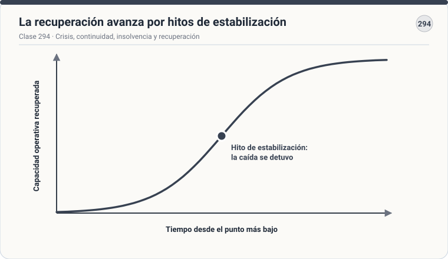

# Clase 294 — Plan de recuperación y vuelta a crecimiento

> **Parte 21 · Crisis, continuidad, insolvencia y recuperación** — clase 14 de 14

**Estado de evidencia:** `VERIFICADO-FUENTE` · **Jurisdicción:** Chile-first · **Fecha base normativa:** 07-08-2026 
**Decisión que habilita:** definir los hitos de estabilización y la secuencia de recuperación 
**Entregable:** plan de recuperación con hitos de estabilización, secuencia de reconstrucción y meta de reserva

## 🎯 Propósito

Definir hitos observables de estabilización y reconstituir la reserva antes de volver a crecer.

## 📚 Resultados de aprendizaje

Al finalizar esta clase podrás:

1. **Definir** con precisión los cuatro conceptos de la tabla siguiente y usarlos para describir un caso real.
2. **Explicar** por qué esta materia condiciona decisiones de otras partes del programa.
3. **Decidir** —definir los hitos de estabilización y la secuencia de recuperación— y justificar la decisión por escrito.
4. **Producir** el entregable de la clase y contrastarlo contra su criterio de aceptación.
5. **Distinguir** el dato estable del dato dinámico que exige revalidación en la fuente oficial.

## 🧩 Conceptos centrales

| Concepto | Comprensión verificable |
|---|---|
| **Plan de recuperación** | Secuencia para volver a la operación y al crecimiento. |
| **Hito de estabilización** | Condición que indica que la crisis está contenida. |
| **Reconstrucción de capacidad** | Recuperación de recursos recortados durante la crisis. |
| **Reserva reconstituida** | Restablecimiento del colchón de caja. |

## 🗺️ Modelo mental: La recuperación avanza por hitos de estabilización

> **La idea en una frase:** Salir de la crisis exige un plan tan explícito como el de contención: qué indica que está estabilizada, en qué orden se recupera la capacidad y cuándo se reconstituye la reserva.

**Cómo leerlo:** La curva es lenta al comienzo, se acelera tras el hito de estabilización y se aplana al recuperarse. Volver a crecer antes del hito, sin reserva ni capacidad, puede repetir la crisis.

**Para recordarlo:** Es la rehabilitación tras una lesión: no corres hasta que el músculo lo permite, y cada etapa tiene criterios claros para avanzar.

## 📖 Desarrollo

### 1. El fondo del asunto

Salir de la crisis exige un plan tan explícito como el de contención: qué indica que está estabilizada, en qué orden se recupera capacidad y cuándo se reconstituye la reserva. Volver a crecer antes de reconstituir la reserva deja a la empresa expuesta al siguiente golpe.

### 2. Cómo se traduce en la práctica

Define los hitos de estabilización con números: caja, clientes, plazos de pago y reserva. Establece el orden en que recuperarás capacidad (equipo comercial, atención, producción) y cuándo reconstituirás la reserva. Revisa el plan mensualmente y comunica avances comprobables a clientes, trabajadores y proveedores. No declares victoria antes de los hitos.

### 3. Marco aplicable y quién interviene

- Ley 20.720 sobre reorganización y liquidación de empresas y personas
- Ley 19.983 sobre mérito ejecutivo de la factura para cobranza
- continuidad de negocio: BIA, RTO, RPO y plan de comunicación de crisis

**Autoridades o contrapartes involucradas:** Superintendencia de Insolvencia y Reemprendimiento, Tribunales civiles, Dirección del Trabajo.
**Profesionales de apoyo:** abogado de insolvencia, veedor o liquidador, CFO, comunicaciones. La participación concreta depende del riesgo, del
tamaño de la empresa y de la actividad económica.

### 4. Los números, paso a paso

Una empresa que sobrevivió a una caída de ventas de 40 % define tres hitos: caja positiva por tres semanas seguidas, 90 % de los clientes críticos retenidos y reserva de un mes de gastos reconstituida. Alcanza el primero a los dos meses, el segundo a los cinco y el tercero al octavo mes. Solo entonces vuelve a contratar. Una competidora que creció antes de estabilizarse volvió a quedar sin caja en el mes siguiente (cifras ilustrativas).

### 5. En qué se apoya

- **Normativa oficial consolidada** (Biblioteca del Congreso Nacional · LeyChile): Las leyes laborales, comerciales y concursales, consultables en la Biblioteca del Congreso Nacional, fijan las obligaciones que acompañan la recuperación de una empresa.
- **Relaciones laborales y obligaciones del empleador** (Dirección del Trabajo): La Dirección del Trabajo informa las obligaciones del empleador en procesos de reincorporación y reconstrucción de la dotación.

*Las lecturas de apoyo ofrecen marcos conceptuales; lo que exige la ley chilena se verifica en las fuentes oficiales de esta clase.*

## 🤝 Reputación y confianza: recuperar confianza con acciones comprobables

[Guía de reputación, crisis y confianza, sección 16](../../../docs/22_REPUTACION_CRISIS_Y_CONFIANZA.md#16-recuperación-de-confianza-con-acciones-comprobables)

**Lente para esta clase:** La vuelta al crecimiento depende de que clientes, trabajadores y proveedores vean hechos: el plan de recuperación define qué se compromete, con qué prueba y en qué fecha.

| Nivel | Medida proporcionada |
|---|---|
| **Emprendedor o microempresa** | Tres compromisos con prueba y fecha, publicados en el canal oficial y revisados a 7, 30 y 90 días. |
| **Pyme** | Plan con diagnóstico, medidas por audiencia, indicadores de confianza y reuniones de seguimiento con acta. |
| **Gran empresa o multinacional** | Programa de recuperación con comité, metas por audiencia, auditoría independiente y reporte periódico al directorio. |

**Obligación legal:** Lo comprometido a los clientes obliga (Ley 19.496, art. 12); los compromisos con proveedores y trabajadores constan por escrito y rigen según su contrato y la ley.

**Recomendación profesional:** Usar la plantilla 32 de indicadores y reunirse a 7, 30, 90 y 180 días con el mismo tablero.

**Actividad:** Elige cuatro indicadores de la plantilla 32 para tu empresa y define meta, responsable y frecuencia de cada uno.

**Plantilla:** [Plan de respuesta y recuperación](../../../templates/30_plan_respuesta_y_recuperacion.md)

**Términos:** Indicadores de confianza (*Trust indicators*) · Plan de recuperación (*Recovery plan*)

**Simulación:** [caso 7 del expediente de reputación y crisis](../../../case-studies/23-reputacion-y-crisis-siete-casos.md#7-empresa-que-enfrenta-problemas-de-liquidez-y-reclamos). Construye un plan de 180 días con indicadores para clientes, proveedores y trabajadores tras una crisis de liquidez. Es una simulación ilustrativa, no una empresa real.

*Distingue lo que la ley exige de lo que conviene hacer. Las normas se leyeron en la Biblioteca del Congreso Nacional; verifica la versión vigente y consulta a un abogado antes de aplicarlas a un caso real.*

## 🧪 Taller guiado

Aplica esta clase a **una** de las siguientes líneas de negocio y repite después el ejercicio con
una segunda línea de carga regulatoria distinta:

| Línea | Carga regulatoria |
|---|---|
| SaaS B2B con IA | media |
| Servicios profesionales | baja |
| E-commerce D2C | media |
| Alimentos o foodtech | alta |
| Exportación de servicios | media |
| Fintech regulada | alta |
| Construcción o servicios técnicos | alta |

**Secuencia de trabajo:**

1. Delimita el contexto: actividad económica, escala, comuna y etapa de la empresa.
2. Reúne los antecedentes que la decisión exige y anota la fecha de cada fuente.
3. Identifica las alternativas reales, incluida la de no hacer nada.
4. Evalúa el impacto en mercado, caja, personas, regulación y operación.
5. Toma la decisión y regístrala con sus supuestos.
6. Produce el entregable.
7. Contrástalo contra el criterio de aceptación.
8. Anota lo que requiere validación profesional y programa su revisión.

### 📦 Entregable

Plan de recuperación con hitos de estabilización, secuencia de reconstrucción y meta de reserva.

Debe incluir decisión, supuestos, fuentes con fecha de consulta, responsable, riesgos
identificados y próximos pasos.

## 🏆 Reto verificable

Resuelve la misma materia para una segunda línea de negocio con distinta carga regulatoria y
explica por escrito **qué cambió, por qué y qué fuente lo determina**.

## ✅ Criterio de aceptación

- [ ] los hitos de estabilización son observables
- [ ] la reconstitución de la reserva tiene meta y plazo
- [ ] cada afirmación regulatoria está referida a una fuente oficial con fecha de consulta;
- [ ] los datos dinámicos quedan marcados para revalidación;
- [ ] hay un responsable asignado y evidencia reproducible del trabajo.

## ⚠️ Errores frecuentes

**Propios de esta clase:**

- Reanudar el crecimiento antes de reconstituir la reserva de caja.
- Recuperar capacidad en orden inverso al que sostiene el ingreso.

**Característicos de la parte 21:**

- Esperar a la cesación de pagos para buscar asesoría y perder la opción de reorganización.
- Recortar costos destruyendo la capacidad que permite recuperarse.

## 🇨🇱 Checklist Chile

- [ ] ¿existe norma o autoridad específica para esta materia?
- [ ] ¿la fuente consultada está vigente a la fecha de ejecución?
- [ ] ¿se activa algún trámite ante el SII?
- [ ] ¿se activa algún requisito municipal o sectorial?
- [ ] ¿afecta a consumidores o al tratamiento de datos personales?
- [ ] ¿afecta a trabajadores o a la seguridad y salud en el trabajo?
- [ ] ¿afecta a impuestos, contabilidad o caja?
- [ ] ¿afecta a contratos o a propiedad intelectual?
- [ ] ¿requiere renovación, reporte periódico o revalidación?

## ❓ Preguntas de comprobación

1. ¿Qué hito observable te indicaría que la crisis está contenida?
2. ¿En qué orden recuperarías la capacidad que recortaste?
3. ¿Qué nivel de reserva debes reconstituir antes de volver a invertir en crecimiento?

## 🔗 Fuentes oficiales

**Biblioteca del Congreso Nacional · LeyChile — Normativa oficial consolidada**  
<https://www.bcn.cl/leychile/> · verificado 2026-11-05

- *Qué contiene:* Publica el texto oficial y consolidado de leyes, decretos y reglamentos, con la versión vigente a una fecha, el historial de modificaciones y la tramitación que las originó.
- *Cómo leerla:* Usa siempre el selector de versión vigente a la fecha en que ejecutarás el trámite, no la última publicada. Y lee el artículo transitorio: en normas en implantación gradual —jornada, datos personales— ahí está la fecha que realmente te aplica.
- *Uso en esta clase:* aporta el marco de «Normativa oficial consolidada» para definir los hitos de estabilización y la secuencia de recuperación.

**Dirección del Trabajo — Relaciones laborales y obligaciones del empleador**  
<https://www.dt.gob.cl/> · verificado 2026-11-05

- *Qué contiene:* Concentra el Código del Trabajo aplicado: dictámenes que interpretan la norma en casos concretos, la plataforma Mi DT para registrar contratos y finiquitos, y las guías de fiscalización.
- *Cómo leerla:* Los dictámenes valen más que las guías divulgativas: describen cómo la autoridad resolvió un caso real. Busca por materia y contrasta la fecha, porque un dictamen posterior puede cambiar el criterio anterior.
- *Uso en esta clase:* aporta el marco de «Relaciones laborales y obligaciones del empleador» para definir los hitos de estabilización y la secuencia de recuperación.

**Biblioteca del Congreso Nacional — Ley 19.496 — Protección de los derechos de los consumidores**  
<https://www.bcn.cl/leychile/navegar?idNorma=61438> · verificado 2026-11-25

- *Qué contiene:* Fija los derechos básicos del consumidor, la obligación de cumplir lo ofrecido (art. 12), la publicidad veraz (arts. 28 y 33), la seguridad del producto y el deber de informar a la autoridad los peligros descubiertos después de vender (arts. 45 a 49) y las funciones de fiscalización del SERNAC (art. 58).
- *Cómo leerla:* Úsala para distinguir qué debe hacer un proveedor ante un producto riesgoso o una publicidad cuestionada de lo que solo conviene hacer. Lee el artículo completo en la versión vigente antes de aplicarlo a un caso concreto.
- *Uso en esta clase:* aporta el marco de «Ley 19.496 — Protección de los derechos de los consumidores» para definir los hitos de estabilización y la secuencia de recuperación.

Complementos del repositorio: [glosario](../../../docs/19_GLOSSARY.md) ·
[ruta de lecturas](../../../docs/15_BOOKS_AND_LEARNING_PATH.md) ·
[catálogo de fuentes](../../../docs/16_OFFICIAL_SOURCE_CATALOG.md).

> [!IMPORTANT]
> Material educativo. Para una decisión real de alto impacto hay que verificar la fuente oficial
> vigente y validar con el profesional competente.

---

| Anterior | Índice | Siguiente |
|---|---|---|
| [← 293 · Post-mortem y aprendizaje organizacional](../class-13-post-mortem-y-aprendizaje-organizacional/README.md) | [Parte 21](../README.md) · [Programa](../../../README.md) | [295 · Construir una empresa transferible →](../../part-22-venta-sucesion-transformacion-y-cierre/class-01-construir-una-empresa-transferible/README.md) |
