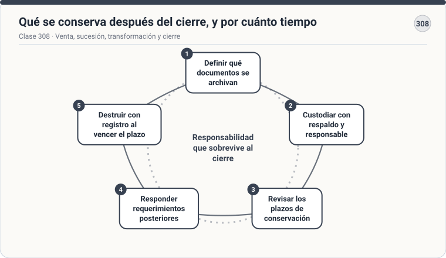

# Clase 308 — Lecciones aprendidas y archivo legal

> **Parte 22 · Venta, sucesión, transformación y cierre** — clase 14 de 14

**Estado de evidencia:** `VERIFICADO-FUENTE` · **Jurisdicción:** Chile-first · **Fecha base normativa:** 07-08-2026 
**Decisión que habilita:** definir qué se conserva, por cuánto tiempo y quién responde 
**Entregable:** archivo legal post-cierre con inventario, plazos de conservación, custodio designado y documento de lecciones aprendidas

## 🎯 Propósito

Conservar el archivo legal durante los plazos de prescripción con un custodio designado, porque el cierre no extingue todas las responsabilidades.

## 📚 Resultados de aprendizaje

Al finalizar esta clase podrás:

1. **Definir** con precisión los cuatro conceptos de la tabla siguiente y usarlos para describir un caso real.
2. **Explicar** por qué esta materia condiciona decisiones de otras partes del programa.
3. **Decidir** —definir qué se conserva, por cuánto tiempo y quién responde— y justificar la decisión por escrito.
4. **Producir** el entregable de la clase y contrastarlo contra su criterio de aceptación.
5. **Distinguir** el dato estable del dato dinámico que exige revalidación en la fuente oficial.

## 🧩 Conceptos centrales

| Concepto | Comprensión verificable |
|---|---|
| **Archivo legal** | Conjunto de documentos que deben conservarse tras el cierre. |
| **Plazo de conservación** | Período legal de retención posterior. |
| **Lecciones aprendidas** | Análisis de lo que funcionó y lo que no. |
| **Responsabilidad posterior** | Obligaciones que sobreviven al cierre. |

## 🗺️ Modelo mental: Qué se conserva después del cierre, y por cuánto tiempo

> **La idea en una frase:** El cierre no extingue todas las responsabilidades: subsisten plazos de prescripción tributaria y laboral durante los cuales puede haber requerimientos, por lo que el archivo legal debe conservarse y poder consultarse.

**Lectura guiada:** El ciclo se mantiene mientras corran los plazos. Quien cierra y no deja un archivo ni un responsable no podrá defenderse si años después llega un requerimiento.

**Una analogía:** Es guardar la factura de un electrodoméstico mientras dure la garantía: lo más probable es que nunca la necesites, pero si la necesitas, solo ella te defiende.

## 📖 Desarrollo

### 1. El fondo del asunto

El cierre no extingue todas las responsabilidades: subsisten plazos de prescripción tributaria y laboral durante los cuales puede haber requerimientos. Por eso el archivo legal debe conservarse organizado y accesible durante todo ese período, con un responsable designado.

### 2. Cómo se traduce en la práctica

Define qué documentos conservarás (societarios, tributarios, laborales, contratos) y por cuánto tiempo según los plazos legales. Guarda copias respaldadas, designa un responsable y registra dónde están. Escribe las lecciones aprendidas del ciclo de la empresa y compártelas con los socios. Destruye los documentos solo al vencer los plazos, dejando constancia de la destrucción.

### 3. Marco aplicable y quién interviene

- Ley 20.720 en escenarios de cierre por insolvencia
- Código Tributario y normas del SII sobre término de giro
- Código del Trabajo en materia de finiquitos y causales de término
- normas societarias sobre disolución y liquidación

**Autoridades o contrapartes involucradas:** SII, Dirección del Trabajo, Registro de Empresas y Sociedades, Conservador de Bienes Raíces.
**Profesionales de apoyo:** abogado corporativo y tributario, banquero de inversión o asesor M&A, contador, abogado laboral. La participación concreta depende del riesgo, del
tamaño de la empresa y de la actividad económica.

### 4. Una conversación que enseña

Ex socio: «Cerramos hace dos años y el SII nos pide documentos de un período anterior». Contador: «Los plazos de prescripción siguen corriendo y el archivo lo guardamos en una carpeta con respaldo». Ex socio: «Menos mal que alguien tenía la clave». Contador: «Por eso dejamos un responsable y un índice; sin ellos, habría que reconstruir todo con costos mayores» (conversación ilustrativa).

### 5. En qué se apoya

- **Carpeta Tributaria Electrónica** (Servicio de Impuestos Internos): La carpeta tributaria electrónica permite recuperar parte de la información tributaria de la empresa aun después de su cierre.
- **Relaciones laborales y obligaciones del empleador** (Dirección del Trabajo): La Dirección del Trabajo informa los plazos de conservación de los registros laborales, relevantes ante reclamos posteriores.

*Las lecturas de apoyo ofrecen marcos conceptuales; lo que exige la ley chilena se verifica en las fuentes oficiales de esta clase.*

## 🧪 Taller guiado

Aplica esta clase a **una** de las siguientes líneas de negocio y repite después el ejercicio con
una segunda línea de carga regulatoria distinta:

| Línea | Carga regulatoria |
|---|---|
| SaaS B2B con IA | media |
| Servicios profesionales | baja |
| E-commerce D2C | media |
| Alimentos o foodtech | alta |
| Exportación de servicios | media |
| Fintech regulada | alta |
| Construcción o servicios técnicos | alta |

**Secuencia de trabajo:**

1. Delimita el contexto: actividad económica, escala, comuna y etapa de la empresa.
2. Reúne los antecedentes que la decisión exige y anota la fecha de cada fuente.
3. Identifica las alternativas reales, incluida la de no hacer nada.
4. Evalúa el impacto en mercado, caja, personas, regulación y operación.
5. Toma la decisión y regístrala con sus supuestos.
6. Produce el entregable.
7. Contrástalo contra el criterio de aceptación.
8. Anota lo que requiere validación profesional y programa su revisión.

### 📦 Entregable

Archivo legal post-cierre con inventario, plazos de conservación, custodio designado y documento de lecciones aprendidas.

Debe incluir decisión, supuestos, fuentes con fecha de consulta, responsable, riesgos
identificados y próximos pasos.

## 🏆 Reto verificable

Resuelve la misma materia para una segunda línea de negocio con distinta carga regulatoria y
explica por escrito **qué cambió, por qué y qué fuente lo determina**.

## ✅ Criterio de aceptación

- [ ] los plazos de conservación están identificados por tipo de documento
- [ ] hay custodio designado con datos de contacto
- [ ] cada afirmación regulatoria está referida a una fuente oficial con fecha de consulta;
- [ ] los datos dinámicos quedan marcados para revalidación;
- [ ] hay un responsable asignado y evidencia reproducible del trabajo.

## ⚠️ Errores frecuentes

**Propios de esta clase:**

- Destruir documentación antes del vencimiento de los plazos de prescripción.
- Cerrar sin dejar un responsable de custodia identificable.

**Característicos de la parte 22:**

- Vender una empresa cuya operación depende de relaciones personales del fundador.
- No ordenar contratos, propiedad intelectual y laboral antes de la due diligence.

## 🇨🇱 Checklist Chile

- [ ] ¿existe norma o autoridad específica para esta materia?
- [ ] ¿la fuente consultada está vigente a la fecha de ejecución?
- [ ] ¿se activa algún trámite ante el SII?
- [ ] ¿se activa algún requisito municipal o sectorial?
- [ ] ¿afecta a consumidores o al tratamiento de datos personales?
- [ ] ¿afecta a trabajadores o a la seguridad y salud en el trabajo?
- [ ] ¿afecta a impuestos, contabilidad o caja?
- [ ] ¿afecta a contratos o a propiedad intelectual?
- [ ] ¿requiere renovación, reporte periódico o revalidación?

## ❓ Preguntas de comprobación

1. ¿Qué plazos de prescripción aplican a tu caso y hasta cuándo debes conservar?
2. ¿Quién es el custodio del archivo y cómo se le ubica en dos años más?
3. ¿Qué aprendizaje documentaste de este ciclo para el siguiente proyecto?

## 🔗 Fuentes oficiales

**Servicio de Impuestos Internos — Carpeta Tributaria Electrónica**  
<https://zeus.sii.cl/dii_doc/carpeta_tributaria/html/generar_carpeta.htm> · verificado 2026-11-05

- *Qué contiene:* Permite generar el expediente que acredita la situación tributaria de la empresa: inicio de actividades, régimen, declaraciones presentadas y timbraje.
- *Cómo leerla:* Es el documento que pedirán banco, inversionista y comprador. Genera una hoy aunque no la necesites: lo que muestre es exactamente lo que verá un tercero al evaluarte.
- *Uso en esta clase:* aporta el marco de «Carpeta Tributaria Electrónica» para definir qué se conserva, por cuánto tiempo y quién responde.

**Dirección del Trabajo — Relaciones laborales y obligaciones del empleador**  
<https://www.dt.gob.cl/> · verificado 2026-11-05

- *Qué contiene:* Concentra el Código del Trabajo aplicado: dictámenes que interpretan la norma en casos concretos, la plataforma Mi DT para registrar contratos y finiquitos, y las guías de fiscalización.
- *Cómo leerla:* Los dictámenes valen más que las guías divulgativas: describen cómo la autoridad resolvió un caso real. Busca por materia y contrasta la fecha, porque un dictamen posterior puede cambiar el criterio anterior.
- *Uso en esta clase:* aporta el marco de «Relaciones laborales y obligaciones del empleador» para definir qué se conserva, por cuánto tiempo y quién responde.

**Biblioteca del Congreso Nacional · LeyChile — Normativa oficial consolidada**  
<https://www.bcn.cl/leychile/> · verificado 2026-11-05

- *Qué contiene:* Publica el texto oficial y consolidado de leyes, decretos y reglamentos, con la versión vigente a una fecha, el historial de modificaciones y la tramitación que las originó.
- *Cómo leerla:* Usa siempre el selector de versión vigente a la fecha en que ejecutarás el trámite, no la última publicada. Y lee el artículo transitorio: en normas en implantación gradual —jornada, datos personales— ahí está la fecha que realmente te aplica.
- *Uso en esta clase:* aporta el marco de «Normativa oficial consolidada» para definir qué se conserva, por cuánto tiempo y quién responde.

Complementos del repositorio: [glosario](../../../docs/19_GLOSSARY.md) ·
[ruta de lecturas](../../../docs/15_BOOKS_AND_LEARNING_PATH.md) ·
[catálogo de fuentes](../../../docs/16_OFFICIAL_SOURCE_CATALOG.md).

> [!IMPORTANT]
> Material educativo. Para una decisión real de alto impacto hay que verificar la fuente oficial
> vigente y validar con el profesional competente.

---

| Anterior | Índice | Siguiente |
|---|---|---|
| [← 307 · Cierre de permisos, contratos, datos y cuentas](../class-13-cierre-de-permisos-contratos-datos-y-cuentas/README.md) | [Parte 22](../README.md) · [Programa](../../../README.md) | [309 · SaaS B2B con IA →](../../part-23-estudios-de-lineas-de-negocio-reales-2026/class-01-saas-b2b-con-ia/README.md) |
