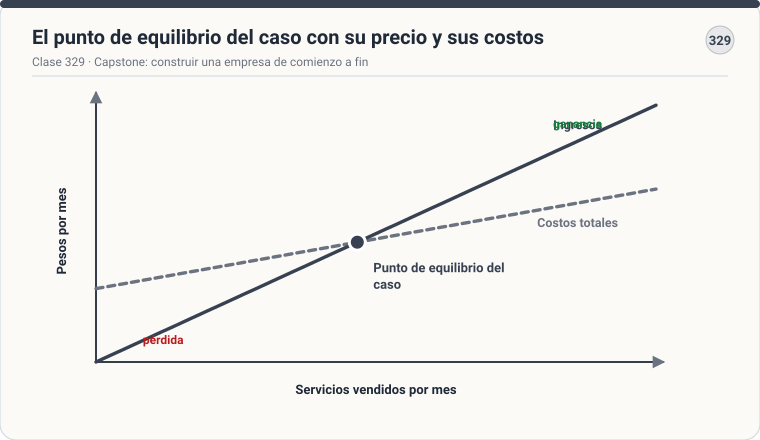

# Clase 329 — Construir presupuesto, pricing y flujo de caja

> **Parte 24 · Capstone: construir una empresa de comienzo a fin** — clase 7 de 14

**Estado de evidencia:** `GUIA-PRACTICA` · **Jurisdicción:** Chile-first · **Fecha base normativa:** 07-08-2026 
**Decisión que habilita:** construir el modelo financiero completo y coherente del caso 
**Entregable:** secciones 03 y 06 del expediente con planilla de costos, presupuesto, pricing, flujo, equilibrio y tres escenarios

## 🎯 Propósito

Completar costos y proyección con tres escenarios trazables y reconciliarlos con mercado, Canvas, forecast y caja.

## 📚 Resultados de aprendizaje

Al finalizar esta clase podrás:

1. **Definir** con precisión los cuatro conceptos de la tabla siguiente y usarlos para describir un caso real.
2. **Explicar** por qué esta materia condiciona decisiones de otras partes del programa.
3. **Decidir** —construir el modelo financiero completo y coherente del caso— y justificar la decisión por escrito.
4. **Producir** el entregable de la clase y contrastarlo contra su criterio de aceptación.
5. **Distinguir** el dato estable del dato dinámico que exige revalidación en la fuente oficial.

## 🧩 Conceptos centrales

| Concepto | Comprensión verificable |
|---|---|
| **Presupuesto del caso** | Estimación de desembolsos hasta operación estable. |
| **Pricing** | Precio fijado con método declarado. |
| **Flujo de caja** | Proyección con supuestos explícitos. |
| **Punto de equilibrio** | Volumen mínimo de ventas. |

## 🗺️ Modelo mental: El punto de equilibrio del caso con su precio y sus costos

> **La idea en una frase:** Este bloque completa las secciones de costos y proyección del expediente: integra costos fijos, variables y semifijos, directos e indirectos, con un precio defendido y un flujo de caja coherente con el canvas.

**Lectura guiada:** Los costos parten de un nivel fijo y suben con el volumen; los ingresos parten de cero. El cruce es el volumen mínimo del caso. El flujo de caja dice cuánto tardas en llegar a él.

**Piénsalo así:** Es la fecha en que una obra empieza a rendir: antes hay pérdida, después ganancia, y el flujo de caja dice si aguantas hasta ese día.

## 📖 Desarrollo

### 1. El fondo del asunto

Este bloque completa las secciones 03 Costos y 06 Proyección del expediente y obliga a revisar el Canvas. La planilla integra costos fijos, variables y semifijos; directos e indirectos; CAPEX y OPEX; costo unitario, contribución, capacidad, utilización, punto de equilibrio y sensibilidad. Los escenarios conservador, base y expansivo reconcilian volumen, precio, ventas, ingresos, margen, inversión inicial, capital de trabajo, caja, runway y capital requerido, distinguiendo datos históricos, supuestos y cálculos derivados.

### 2. Cómo se traduce en la práctica

Construye la planilla de costos fijos, variables y semifijos del caso, con supuestos y fuentes. Calcula el punto de equilibrio y el flujo de caja de 13 semanas y de 12 meses, con escenarios conservador, base y expansivo. Defiende el precio con el valor para el cliente, el costo y el mercado. Revisa el canvas: si el modelo financiero lo contradice, corrige el canvas.

### 3. Marco aplicable y quién interviene

- integración de todas las partes anteriores del programa
- criterio de defensa: coherencia entre decisiones, evidencia y caja
- trazabilidad a fuente oficial en cada afirmación regulatoria

**Autoridades o contrapartes involucradas:** todas las anteriores según la línea de negocio elegida.
**Profesionales de apoyo:** fundador, contador, abogado, especialista sectorial. La participación concreta depende del riesgo, del
tamaño de la empresa y de la actividad económica.

### 4. Los números, paso a paso

El servicio de mantención de bicicletas eléctricas cobra $35.000 por servicio con un costo variable de $14.000 (repuestos y comisión): margen de contribución $21.000. Sus costos fijos son $1.260.000 al mes (arriendo, herramientas, seguro y su sueldo). El punto de equilibrio es 60 servicios al mes. Si llega a 60 en el mes 7 y el capital de trabajo cubre los meses de pérdida, el flujo es viable; si no, debe reducir los costos fijos o subir el precio (cifras ilustrativas).

### 5. En qué se apoya

- **Financial Intelligence** (Harvard Business Review Press): Berman y Knight explican los costos fijos y variables, el punto de equilibrio y la lectura del flujo de caja.
- **The Strategy and Tactics of Pricing** (Prentice Hall): Nagle y Holden proponen fijar precios con base en el valor percibido por el cliente, además del costo y de la competencia.

*Las lecturas de apoyo ofrecen marcos conceptuales; lo que exige la ley chilena se verifica en las fuentes oficiales de esta clase.*

## 🧪 Taller guiado

Aplica esta clase a **una** de las siguientes líneas de negocio y repite después el ejercicio con
una segunda línea de carga regulatoria distinta:

| Línea | Carga regulatoria |
|---|---|
| SaaS B2B con IA | media |
| Servicios profesionales | baja |
| E-commerce D2C | media |
| Alimentos o foodtech | alta |
| Exportación de servicios | media |
| Fintech regulada | alta |
| Construcción o servicios técnicos | alta |

**Secuencia de trabajo:**

1. Delimita el contexto: actividad económica, escala, comuna y etapa de la empresa.
2. Reúne los antecedentes que la decisión exige y anota la fecha de cada fuente.
3. Identifica las alternativas reales, incluida la de no hacer nada.
4. Evalúa el impacto en mercado, caja, personas, regulación y operación.
5. Toma la decisión y regístrala con sus supuestos.
6. Produce el entregable.
7. Contrástalo contra el criterio de aceptación.
8. Anota lo que requiere validación profesional y programa su revisión.

### 📦 Entregable

Secciones 03 y 06 del expediente con planilla de costos, presupuesto, pricing, flujo, equilibrio y tres escenarios.

Debe incluir decisión, supuestos, fuentes con fecha de consulta, responsable, riesgos
identificados y próximos pasos.

## 🏆 Reto verificable

Resuelve la misma materia para una segunda línea de negocio con distinta carga regulatoria y
explica por escrito **qué cambió, por qué y qué fuente lo determina**.

## ✅ Criterio de aceptación

- [ ] las cifras son consistentes entre mercado, Canvas, forecast y flujo
- [ ] cada cifra conserva fuente o fórmula y tipo de procedencia
- [ ] los tres escenarios incluyen capacidad, caja, break-even, runway cuando aplica y capital requerido
- [ ] cada afirmación regulatoria está referida a una fuente oficial con fecha de consulta;
- [ ] los datos dinámicos quedan marcados para revalidación;
- [ ] hay un responsable asignado y evidencia reproducible del trabajo.

## ⚠️ Errores frecuentes

**Propios de esta clase:**

- Presentar documentos financieros con cifras inconsistentes entre sí.
- Usar cifras sin clasificarlas como históricas, supuestas o derivadas.

**Característicos de la parte 24:**

- Producir documentos bonitos sin coherencia numérica entre ellos.
- Copiar el caso de otra empresa sin adaptar actividad, comuna ni escala.

## 🇨🇱 Checklist Chile

- [ ] ¿existe norma o autoridad específica para esta materia?
- [ ] ¿la fuente consultada está vigente a la fecha de ejecución?
- [ ] ¿se activa algún trámite ante el SII?
- [ ] ¿se activa algún requisito municipal o sectorial?
- [ ] ¿afecta a consumidores o al tratamiento de datos personales?
- [ ] ¿afecta a trabajadores o a la seguridad y salud en el trabajo?
- [ ] ¿afecta a impuestos, contabilidad o caja?
- [ ] ¿afecta a contratos o a propiedad intelectual?
- [ ] ¿requiere renovación, reporte periódico o revalidación?

## ❓ Preguntas de comprobación

1. ¿Coinciden mercado, forecast, Canvas, planilla de costos y flujo?
2. ¿Qué cifra es histórica, supuesta o derivada y dónde está su fuente o fórmula?
3. ¿Cuánto capital exige cada escenario y qué supuesto cambia más el resultado?

## 🔗 Fuentes oficiales

**Registro de Empresas y Sociedades / ChileAtiende — Constitución de empresas**  
<https://www.chileatiende.gob.cl/fichas/21409-tu-empresa> · verificado 2026-11-05

- *Qué contiene:* Describe el régimen simplificado de la Ley 20.659: qué tipos societarios admite el formulario electrónico, quiénes deben firmar, qué documentos entrega el sistema y cómo se hacen después las modificaciones.
- *Cómo leerla:* Entra por el tipo societario que ya elegiste, no al revés. La ficha dice qué campos pide el formulario; si tu estatuto necesita una cláusula que el formulario no soporta, la respuesta es la ruta notarial.
- *Uso en esta clase:* aporta el marco de «Constitución de empresas» para construir el modelo financiero completo y coherente del caso.

**Servicio de Impuestos Internos — Nuevos contribuyentes, inicio de actividades y DTE**  
<https://www.sii.cl/ayudas/nuevos_contribuyentes/boleta-vys-facturador.html> · verificado 2026-11-05

- *Qué contiene:* Reúne el circuito completo del contribuyente nuevo: obtención de RUT, declaración de inicio de actividades, elección de códigos de actividad económica y habilitación para emitir documentos tributarios electrónicos.
- *Cómo leerla:* Sepáralo en dos actos distintos que la página trata seguidos: el RUT identifica, el inicio de actividades habilita. Lo que te bloquea para facturar casi siempre está en el segundo, no en el primero.
- *Uso en esta clase:* aporta el marco de «Nuevos contribuyentes, inicio de actividades y DTE» para construir el modelo financiero completo y coherente del caso.

**Servicio de Impuestos Internos — Regímenes tributarios · Operación Renta 2026**  
<https://www.sii.cl/destacados/renta/2026/intermediarios/regimenes_tributarios/> · verificado 2026-11-05

- *Qué contiene:* Compara los regímenes vigentes: requisitos de ingreso y permanencia, tipo de propietarios admitidos, forma de determinar la base imponible y cómo se imputa el crédito contra los impuestos finales de los dueños.
- *Cómo leerla:* Lee primero la columna de requisitos de propietarios: descarta regímenes antes de comparar tasas. Las tasas cambian por ley y por período transitorio, así que anota la fecha de consulta junto a cada cifra que uses.
- *Uso en esta clase:* aporta el marco de «Regímenes tributarios · Operación Renta 2026» para construir el modelo financiero completo y coherente del caso.

**Harvard Business Review Press — Financial Intelligence**  
<https://openlibrary.org/isbn/9781591397649> · verificado 2026-11-25

- *Qué contiene:* Explica a personas no financieras cómo leer estados financieros, márgenes, flujo de caja y capital de trabajo.
- *Cómo leerla:* Úsalo como marco conceptual para entender el porqué de la práctica, nunca como prueba de lo que exige la ley chilena; para eso están las fuentes oficiales de la clase.
- *Uso en esta clase:* aporta el marco de «Financial Intelligence» para construir el modelo financiero completo y coherente del caso.

**Prentice Hall — The Strategy and Tactics of Pricing**  
<https://openlibrary.org/isbn/9780132043588> · verificado 2026-11-25

- *Qué contiene:* Tratado de fijación de precios basada en el valor percibido por el cliente. Se usa como lectura de apoyo conceptual y no como fuente normativa.
- *Cómo leerla:* Úsalo como marco conceptual para entender el porqué de la práctica, nunca como prueba de lo que exige la ley chilena; para eso están las fuentes oficiales de la clase.
- *Uso en esta clase:* aporta el marco de «The Strategy and Tactics of Pricing» para construir el modelo financiero completo y coherente del caso.

Complementos del repositorio: [glosario](../../../docs/19_GLOSSARY.md) ·
[ruta de lecturas](../../../docs/15_BOOKS_AND_LEARNING_PATH.md) ·
[catálogo de fuentes](../../../docs/16_OFFICIAL_SOURCE_CATALOG.md).

> [!IMPORTANT]
> Material educativo. Para una decisión real de alto impacto hay que verificar la fuente oficial
> vigente y validar con el profesional competente.

---

| Anterior | Índice | Siguiente |
|---|---|---|
| [← 328 · Diseñar inicio SII, régimen y calendario tributario](../class-06-disenar-inicio-sii-regimen-y-calendario-tributario/README.md) | [Parte 24](../README.md) · [Programa](../../../README.md) | [330 · Diseñar contratos y mapa de compliance →](../class-08-disenar-contratos-y-mapa-de-compliance/README.md) |
