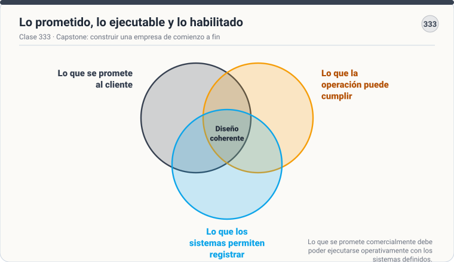

# Clase 333 — Construir operación, ventas y stack tecnológico

> **Parte 24 · Capstone: construir una empresa de comienzo a fin** — clase 11 de 14

**Estado de evidencia:** `GUIA-PRACTICA` · **Jurisdicción:** Chile-first · **Fecha base normativa:** 07-08-2026 
**Decisión que habilita:** diseñar la operación, el motor comercial y el stack tecnológico del caso 
**Entregable:** diseño operativo-comercial-tecnológico del caso con procesos, embudo y arquitectura de sistemas

## 🎯 Propósito

Integrar operación, motor comercial y stack tecnológico verificando que lo prometido comercialmente sea ejecutable.

## 📚 Resultados de aprendizaje

Al finalizar esta clase podrás:

1. **Definir** con precisión los cuatro conceptos de la tabla siguiente y usarlos para describir un caso real.
2. **Explicar** por qué esta materia condiciona decisiones de otras partes del programa.
3. **Decidir** —diseñar la operación, el motor comercial y el stack tecnológico del caso— y justificar la decisión por escrito.
4. **Producir** el entregable de la clase y contrastarlo contra su criterio de aceptación.
5. **Distinguir** el dato estable del dato dinámico que exige revalidación en la fuente oficial.

## 🧩 Conceptos centrales

| Concepto | Comprensión verificable |
|---|---|
| **Operación del caso** | Procesos que entregan la promesa al cliente. |
| **Motor comercial** | Sistema de adquisición y retención. |
| **Stack tecnológico** | Conjunto mínimo de sistemas. |
| **Coherencia operativa** | Correspondencia entre promesa, proceso y capacidad. |

## 🗺️ Modelo mental: Lo prometido, lo ejecutable y lo habilitado

> **La idea en una frase:** Esta etapa integra operación, ventas y tecnología en un diseño coherente: lo que se promete comercialmente debe poder ejecutarse operativamente con los sistemas definidos.

**Cómo leerlo:** Los tres círculos deben coincidir. Si ventas promete una entrega en 24 horas y la operación necesita 72, o si el sistema no registra lo que se vendió, la promesa se rompe.

**Piénsalo así:** Es un restaurante donde el menú, la cocina y la caja deben hablar el mismo idioma: lo que se ofrece, lo que se puede cocinar y lo que se puede cobrar.

## 📖 Desarrollo

### 1. El fondo del asunto

Esta etapa integra operación, ventas y tecnología en un diseño coherente: lo que se promete comercialmente debe poder ejecutarse operativamente con los sistemas definidos. La evaluación busca justamente las inconsistencias entre esos tres planos.

### 2. Cómo se traduce en la práctica

Diseña el proceso de punta a punta, desde la primera consulta hasta la postventa. Verifica que cada promesa comercial tenga un responsable y un recurso. Define el stack tecnológico mínimo, la fuente de verdad de cada dato y los respaldos. Aplica controles de seguridad básicos. Anota los supuestos de capacidad y la métrica de cumplimiento.

### 3. Marco aplicable y quién interviene

- integración de todas las partes anteriores del programa
- criterio de defensa: coherencia entre decisiones, evidencia y caja
- trazabilidad a fuente oficial en cada afirmación regulatoria

**Autoridades o contrapartes involucradas:** todas las anteriores según la línea de negocio elegida.
**Profesionales de apoyo:** fundador, contador, abogado, especialista sectorial. La participación concreta depende del riesgo, del
tamaño de la empresa y de la actividad económica.

### 4. Cómo se decide, paso a paso

Decide con tres preguntas. Uno: ¿qué promete el motor comercial: plazos, precios, garantías? Dos: ¿puede la operación cumplirlo con sus recursos? Tres: ¿el stack mínimo (facturación, CRM, agenda, almacenamiento) registra y respalda cada paso? El caso promete atención en 48 horas, revisa su capacidad real y ajusta a 72 con una agenda en línea que muestra la disponibilidad (caso ilustrativo).

### 5. En qué se apoya

- **The Goal** (North River Press): Goldratt muestra que el desempeño del sistema depende de la restricción, por lo que las promesas comerciales deben ajustarse a la capacidad real.
- **Lean Thinking** (Free Press): Womack y Jones proponen diseñar el flujo desde la perspectiva del valor para el cliente y eliminar lo que no lo agrega.

*Las lecturas de apoyo ofrecen marcos conceptuales; lo que exige la ley chilena se verifica en las fuentes oficiales de esta clase.*

## 🧪 Taller guiado

Aplica esta clase a **una** de las siguientes líneas de negocio y repite después el ejercicio con
una segunda línea de carga regulatoria distinta:

| Línea | Carga regulatoria |
|---|---|
| SaaS B2B con IA | media |
| Servicios profesionales | baja |
| E-commerce D2C | media |
| Alimentos o foodtech | alta |
| Exportación de servicios | media |
| Fintech regulada | alta |
| Construcción o servicios técnicos | alta |

**Secuencia de trabajo:**

1. Delimita el contexto: actividad económica, escala, comuna y etapa de la empresa.
2. Reúne los antecedentes que la decisión exige y anota la fecha de cada fuente.
3. Identifica las alternativas reales, incluida la de no hacer nada.
4. Evalúa el impacto en mercado, caja, personas, regulación y operación.
5. Toma la decisión y regístrala con sus supuestos.
6. Produce el entregable.
7. Contrástalo contra el criterio de aceptación.
8. Anota lo que requiere validación profesional y programa su revisión.

### 📦 Entregable

Diseño operativo-comercial-tecnológico del caso con procesos, embudo y arquitectura de sistemas.

Debe incluir decisión, supuestos, fuentes con fecha de consulta, responsable, riesgos
identificados y próximos pasos.

## 🏆 Reto verificable

Resuelve la misma materia para una segunda línea de negocio con distinta carga regulatoria y
explica por escrito **qué cambió, por qué y qué fuente lo determina**.

## ✅ Criterio de aceptación

- [ ] la promesa comercial es ejecutable con el proceso diseñado
- [ ] el stack es proporcional a la etapa y al presupuesto
- [ ] cada afirmación regulatoria está referida a una fuente oficial con fecha de consulta;
- [ ] los datos dinámicos quedan marcados para revalidación;
- [ ] hay un responsable asignado y evidencia reproducible del trabajo.

## ⚠️ Errores frecuentes

**Propios de esta clase:**

- Prometer niveles de servicio que el proceso diseñado no puede sostener.
- Definir un stack tecnológico desproporcionado para la etapa del caso.

**Característicos de la parte 24:**

- Producir documentos bonitos sin coherencia numérica entre ellos.
- Copiar el caso de otra empresa sin adaptar actividad, comuna ni escala.

## 🇨🇱 Checklist Chile

- [ ] ¿existe norma o autoridad específica para esta materia?
- [ ] ¿la fuente consultada está vigente a la fecha de ejecución?
- [ ] ¿se activa algún trámite ante el SII?
- [ ] ¿se activa algún requisito municipal o sectorial?
- [ ] ¿afecta a consumidores o al tratamiento de datos personales?
- [ ] ¿afecta a trabajadores o a la seguridad y salud en el trabajo?
- [ ] ¿afecta a impuestos, contabilidad o caja?
- [ ] ¿afecta a contratos o a propiedad intelectual?
- [ ] ¿requiere renovación, reporte periódico o revalidación?

## ❓ Preguntas de comprobación

1. ¿Puede tu proceso diseñado sostener el nivel de servicio que prometes?
2. ¿Tu stack tecnológico es proporcional a la etapa y al presupuesto?
3. ¿Qué volumen puede atender tu operación antes de saturarse?

## 🔗 Fuentes oficiales

**Registro de Empresas y Sociedades / ChileAtiende — Constitución de empresas**  
<https://www.chileatiende.gob.cl/fichas/21409-tu-empresa> · verificado 2026-11-05

- *Qué contiene:* Describe el régimen simplificado de la Ley 20.659: qué tipos societarios admite el formulario electrónico, quiénes deben firmar, qué documentos entrega el sistema y cómo se hacen después las modificaciones.
- *Cómo leerla:* Entra por el tipo societario que ya elegiste, no al revés. La ficha dice qué campos pide el formulario; si tu estatuto necesita una cláusula que el formulario no soporta, la respuesta es la ruta notarial.
- *Uso en esta clase:* aporta el marco de «Constitución de empresas» para diseñar la operación, el motor comercial y el stack tecnológico del caso.

**Servicio de Impuestos Internos — Nuevos contribuyentes, inicio de actividades y DTE**  
<https://www.sii.cl/ayudas/nuevos_contribuyentes/boleta-vys-facturador.html> · verificado 2026-11-05

- *Qué contiene:* Reúne el circuito completo del contribuyente nuevo: obtención de RUT, declaración de inicio de actividades, elección de códigos de actividad económica y habilitación para emitir documentos tributarios electrónicos.
- *Cómo leerla:* Sepáralo en dos actos distintos que la página trata seguidos: el RUT identifica, el inicio de actividades habilita. Lo que te bloquea para facturar casi siempre está en el segundo, no en el primero.
- *Uso en esta clase:* aporta el marco de «Nuevos contribuyentes, inicio de actividades y DTE» para diseñar la operación, el motor comercial y el stack tecnológico del caso.

**Servicio de Impuestos Internos — Regímenes tributarios · Operación Renta 2026**  
<https://www.sii.cl/destacados/renta/2026/intermediarios/regimenes_tributarios/> · verificado 2026-11-05

- *Qué contiene:* Compara los regímenes vigentes: requisitos de ingreso y permanencia, tipo de propietarios admitidos, forma de determinar la base imponible y cómo se imputa el crédito contra los impuestos finales de los dueños.
- *Cómo leerla:* Lee primero la columna de requisitos de propietarios: descarta regímenes antes de comparar tasas. Las tasas cambian por ley y por período transitorio, así que anota la fecha de consulta junto a cada cifra que uses.
- *Uso en esta clase:* aporta el marco de «Regímenes tributarios · Operación Renta 2026» para diseñar la operación, el motor comercial y el stack tecnológico del caso.

**North River Press — The Goal**  
<https://openlibrary.org/isbn/9781622313945> · verificado 2026-11-25

- *Qué contiene:* Novela que presenta la teoría de las restricciones: identificar y gestionar el cuello de botella de un sistema.
- *Cómo leerla:* Úsalo como marco conceptual para entender el porqué de la práctica, nunca como prueba de lo que exige la ley chilena; para eso están las fuentes oficiales de la clase.
- *Uso en esta clase:* aporta el marco de «The Goal» para diseñar la operación, el motor comercial y el stack tecnológico del caso.

**Free Press — Lean Thinking**  
<https://openlibrary.org/isbn/9780684810355> · verificado 2026-11-25

- *Qué contiene:* Presenta los principios lean: valor, flujo, tracción y perfección. Se usa como lectura de apoyo conceptual y no como fuente normativa.
- *Cómo leerla:* Úsalo como marco conceptual para entender el porqué de la práctica, nunca como prueba de lo que exige la ley chilena; para eso están las fuentes oficiales de la clase.
- *Uso en esta clase:* aporta el marco de «Lean Thinking» para diseñar la operación, el motor comercial y el stack tecnológico del caso.

Complementos del repositorio: [glosario](../../../docs/19_GLOSSARY.md) ·
[ruta de lecturas](../../../docs/15_BOOKS_AND_LEARNING_PATH.md) ·
[catálogo de fuentes](../../../docs/16_OFFICIAL_SOURCE_CATALOG.md).

> [!IMPORTANT]
> Material educativo. Para una decisión real de alto impacto hay que verificar la fuente oficial
> vigente y validar con el profesional competente.

---

| Anterior | Índice | Siguiente |
|---|---|---|
| [← 332 · Diseñar estructura de cargos y responsabilidades](../class-10-disenar-estructura-de-cargos-y-responsabilidades/README.md) | [Parte 24](../README.md) · [Programa](../../../README.md) | [334 · Preparar financiación y data room →](../class-12-preparar-financiacion-y-data-room/README.md) |
