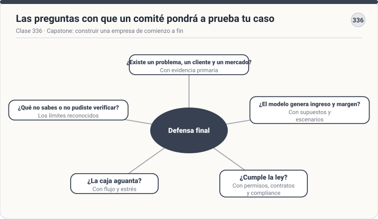

# Clase 336 — Defensa final ante comité empresarial

> **Parte 24 · Capstone: construir una empresa de comienzo a fin** — clase 14 de 14

**Estado de evidencia:** `GUIA-PRACTICA` · **Jurisdicción:** Chile-first · **Fecha base normativa:** 07-08-2026 
**Decisión que habilita:** sostener el caso completo ante preguntas adversariales 
**Entregable:** Expediente de viabilidad completo, anexos coherentes y presentación de defensa con trazabilidad de fuentes

## 🎯 Propósito

Defender un Expediente de viabilidad coherente que responda las preguntas de inversión con evidencia, fuentes y límites declarados.

## 📚 Resultados de aprendizaje

Al finalizar esta clase podrás:

1. **Definir** con precisión los cuatro conceptos de la tabla siguiente y usarlos para describir un caso real.
2. **Explicar** por qué esta materia condiciona decisiones de otras partes del programa.
3. **Decidir** —sostener el caso completo ante preguntas adversariales— y justificar la decisión por escrito.
4. **Producir** el entregable de la clase y contrastarlo contra su criterio de aceptación.
5. **Distinguir** el dato estable del dato dinámico que exige revalidación en la fuente oficial.

## 🧩 Conceptos centrales

| Concepto | Comprensión verificable |
|---|---|
| **Defensa** | Presentación y sostenimiento de las decisiones ante un comité. |
| **Coherencia integral** | Consistencia entre todos los documentos del caso. |
| **Trazabilidad a fuente** | Capacidad de respaldar cada afirmación regulatoria. |
| **Límite reconocido** | Supuesto que el caso declara como no verificado. |

## 🗺️ Modelo mental: Las preguntas con que un comité pondrá a prueba tu caso

> **La idea en una frase:** La defensa final usa el expediente de viabilidad como índice de la carpeta completa: debe responder con evidencia si existe mercado, cliente y problema real, si el modelo genera ingreso y si se cumple la ley, y reconocer los límites.

**Cómo leerlo:** Cada satélite es una pregunta que un comité hará. Responder con una fuente, una fecha y un número es más convincente que una opinión. Reconocer un límite también es una forma de rigor.

**Una analogía:** Es la defensa de una tesis: no se trata de no tener dudas, sino de saber cuáles son y de mostrar cómo las enfrentarías.

## 📖 Desarrollo

### 1. El fondo del asunto

La defensa final usa el Expediente de viabilidad como índice de la carpeta completa. Debe responder con evidencia si existe mercado, cliente y problema real; si el modelo genera ingresos y la estructura de costos lo sostiene; qué aliados son críticos; cuánto capital se necesita; qué supuesto puede destruir el negocio y qué evidencia falta antes de invertir más. Cada afirmación conserva fuente y fecha, cada cifra su procedencia o fórmula, y cada interpretación se distingue del hecho que la origina.

### 2. Cómo se traduce en la práctica

Prepara la defensa con el expediente como índice. Para cada pregunta probable, ten a mano la respuesta, la evidencia, la fuente y la fecha. Anticipa preguntas adversariales: si el mercado es real, si los números cierran, si cumple la ley, qué pasa si algo falla. Declara los supuestos y los límites, y qué harías para cerrarlos. Practica con alguien que te contradiga.

### 3. Marco aplicable y quién interviene

- integración de todas las partes anteriores del programa
- criterio de defensa: coherencia entre decisiones, evidencia y caja
- trazabilidad a fuente oficial en cada afirmación regulatoria

**Autoridades o contrapartes involucradas:** todas las anteriores según la línea de negocio elegida.
**Profesionales de apoyo:** fundador, contador, abogado, especialista sectorial. La participación concreta depende del riesgo, del
tamaño de la empresa y de la actividad económica.

### 4. Una conversación que enseña

Comité: «Dice que hay demanda. ¿Qué evidencia tiene?». Estudiante: «Cuatro de veinte entrevistados pagaron una seña de $20.000; está en la sección de mercado con fecha y fuente». Comité: «¿Y si pierde a su mejor cliente?». Estudiante: «Mi caja resiste cinco meses; mi plan es reducir costos y diversificar». Comité: «¿Qué no pudo verificar?». Estudiante: «La tarifa de la patente en esta comuna: lo consulté con una estimación y declaré el supuesto» (conversación ilustrativa).

### 5. En qué se apoya

- **Constitución de empresas** (Registro de Empresas y Sociedades / ChileAtiende): El Registro de Empresas y Sociedades es una de las fuentes oficiales con que se respalda la estructura jurídica del caso.
- **Thinking in Bets** (Portfolio): Duke recomienda separar lo que se sabe de lo que se supone y declarar la incertidumbre, que es la actitud de una buena defensa.

*Las lecturas de apoyo ofrecen marcos conceptuales; lo que exige la ley chilena se verifica en las fuentes oficiales de esta clase.*

## 🧪 Taller guiado

Aplica esta clase a **una** de las siguientes líneas de negocio y repite después el ejercicio con
una segunda línea de carga regulatoria distinta:

| Línea | Carga regulatoria |
|---|---|
| SaaS B2B con IA | media |
| Servicios profesionales | baja |
| E-commerce D2C | media |
| Alimentos o foodtech | alta |
| Exportación de servicios | media |
| Fintech regulada | alta |
| Construcción o servicios técnicos | alta |

**Secuencia de trabajo:**

1. Delimita el contexto: actividad económica, escala, comuna y etapa de la empresa.
2. Reúne los antecedentes que la decisión exige y anota la fecha de cada fuente.
3. Identifica las alternativas reales, incluida la de no hacer nada.
4. Evalúa el impacto en mercado, caja, personas, regulación y operación.
5. Toma la decisión y regístrala con sus supuestos.
6. Produce el entregable.
7. Contrástalo contra el criterio de aceptación.
8. Anota lo que requiere validación profesional y programa su revisión.

### 📦 Entregable

Expediente de viabilidad completo, anexos coherentes y presentación de defensa con trazabilidad de fuentes.

Debe incluir decisión, supuestos, fuentes con fecha de consulta, responsable, riesgos
identificados y próximos pasos.

## 🏆 Reto verificable

Resuelve la misma materia para una segunda línea de negocio con distinta carga regulatoria y
explica por escrito **qué cambió, por qué y qué fuente lo determina**.

## ✅ Criterio de aceptación

- [ ] el expediente responde las nueve preguntas de viabilidad con evidencia trazable
- [ ] mercado, cliente, costos, modelo, aliados y proyección son numéricamente coherentes
- [ ] los supuestos no verificados y la evidencia pendiente están declarados explícitamente
- [ ] cada afirmación regulatoria está referida a una fuente oficial con fecha de consulta;
- [ ] los datos dinámicos quedan marcados para revalidación;
- [ ] hay un responsable asignado y evidencia reproducible del trabajo.

## ⚠️ Errores frecuentes

**Propios de esta clase:**

- Defender afirmaciones regulatorias o cifras sin poder citar fuente, fecha o fórmula.
- Presentar seis secciones correctas por separado pero incompatibles entre sí.

**Característicos de la parte 24:**

- Producir documentos bonitos sin coherencia numérica entre ellos.
- Copiar el caso de otra empresa sin adaptar actividad, comuna ni escala.

## 🇨🇱 Checklist Chile

- [ ] ¿existe norma o autoridad específica para esta materia?
- [ ] ¿la fuente consultada está vigente a la fecha de ejecución?
- [ ] ¿se activa algún trámite ante el SII?
- [ ] ¿se activa algún requisito municipal o sectorial?
- [ ] ¿afecta a consumidores o al tratamiento de datos personales?
- [ ] ¿afecta a trabajadores o a la seguridad y salud en el trabajo?
- [ ] ¿afecta a impuestos, contabilidad o caja?
- [ ] ¿afecta a contratos o a propiedad intelectual?
- [ ] ¿requiere renovación, reporte periódico o revalidación?

## ❓ Preguntas de comprobación

1. ¿Puedes responder las nueve preguntas de viabilidad y llegar desde cada respuesta hasta su evidencia?
2. ¿Coinciden mercado, modelo, costos, aliados y proyección en cifras y supuestos?
3. ¿Qué evidencia falta antes de invertir más y quién es responsable de obtenerla?

## 🔗 Fuentes oficiales

**Registro de Empresas y Sociedades / ChileAtiende — Constitución de empresas**  
<https://www.chileatiende.gob.cl/fichas/21409-tu-empresa> · verificado 2026-11-05

- *Qué contiene:* Describe el régimen simplificado de la Ley 20.659: qué tipos societarios admite el formulario electrónico, quiénes deben firmar, qué documentos entrega el sistema y cómo se hacen después las modificaciones.
- *Cómo leerla:* Entra por el tipo societario que ya elegiste, no al revés. La ficha dice qué campos pide el formulario; si tu estatuto necesita una cláusula que el formulario no soporta, la respuesta es la ruta notarial.
- *Uso en esta clase:* aporta el marco de «Constitución de empresas» para sostener el caso completo ante preguntas adversariales.

**Servicio de Impuestos Internos — Nuevos contribuyentes, inicio de actividades y DTE**  
<https://www.sii.cl/ayudas/nuevos_contribuyentes/boleta-vys-facturador.html> · verificado 2026-11-05

- *Qué contiene:* Reúne el circuito completo del contribuyente nuevo: obtención de RUT, declaración de inicio de actividades, elección de códigos de actividad económica y habilitación para emitir documentos tributarios electrónicos.
- *Cómo leerla:* Sepáralo en dos actos distintos que la página trata seguidos: el RUT identifica, el inicio de actividades habilita. Lo que te bloquea para facturar casi siempre está en el segundo, no en el primero.
- *Uso en esta clase:* aporta el marco de «Nuevos contribuyentes, inicio de actividades y DTE» para sostener el caso completo ante preguntas adversariales.

**Dirección del Trabajo — Relaciones laborales y obligaciones del empleador**  
<https://www.dt.gob.cl/> · verificado 2026-11-05

- *Qué contiene:* Concentra el Código del Trabajo aplicado: dictámenes que interpretan la norma en casos concretos, la plataforma Mi DT para registrar contratos y finiquitos, y las guías de fiscalización.
- *Cómo leerla:* Los dictámenes valen más que las guías divulgativas: describen cómo la autoridad resolvió un caso real. Busca por materia y contrasta la fecha, porque un dictamen posterior puede cambiar el criterio anterior.
- *Uso en esta clase:* aporta el marco de «Relaciones laborales y obligaciones del empleador» para sostener el caso completo ante preguntas adversariales.

**Servicio Nacional del Consumidor — Ley 19.496, comercio electrónico y garantía legal**  
<https://www.sernac.cl/> · verificado 2026-11-05

- *Qué contiene:* Publica la interpretación aplicada de la Ley del Consumidor: deberes de información en la oferta, reglas del comercio electrónico, garantía legal, contratos de adhesión y el procedimiento de reclamos.
- *Cómo leerla:* Entra por el rubro de tu negocio y revisa las alertas y procedimientos colectivos publicados: muestran qué está fiscalizando el servicio ahora, que es mejor predictor de tu riesgo que la lectura abstracta de la ley.
- *Uso en esta clase:* aporta el marco de «Ley 19.496, comercio electrónico y garantía legal» para sostener el caso completo ante preguntas adversariales.

**Biblioteca del Congreso Nacional · LeyChile — Normativa oficial consolidada**  
<https://www.bcn.cl/leychile/> · verificado 2026-11-05

- *Qué contiene:* Publica el texto oficial y consolidado de leyes, decretos y reglamentos, con la versión vigente a una fecha, el historial de modificaciones y la tramitación que las originó.
- *Cómo leerla:* Usa siempre el selector de versión vigente a la fecha en que ejecutarás el trámite, no la última publicada. Y lee el artículo transitorio: en normas en implantación gradual —jornada, datos personales— ahí está la fecha que realmente te aplica.
- *Uso en esta clase:* aporta el marco de «Normativa oficial consolidada» para sostener el caso completo ante preguntas adversariales.

**Portfolio — Thinking in Bets**  
<https://openlibrary.org/isbn/9780735216358> · verificado 2026-11-25

- *Qué contiene:* Aplica la lógica de las apuestas a la decisión bajo incertidumbre: separar la calidad de la decisión del resultado.
- *Cómo leerla:* Úsalo como marco conceptual para entender el porqué de la práctica, nunca como prueba de lo que exige la ley chilena; para eso están las fuentes oficiales de la clase.
- *Uso en esta clase:* aporta el marco de «Thinking in Bets» para sostener el caso completo ante preguntas adversariales.

Complementos del repositorio: [glosario](../../../docs/19_GLOSSARY.md) ·
[ruta de lecturas](../../../docs/15_BOOKS_AND_LEARNING_PATH.md) ·
[catálogo de fuentes](../../../docs/16_OFFICIAL_SOURCE_CATALOG.md).

> [!IMPORTANT]
> Material educativo. Para una decisión real de alto impacto hay que verificar la fuente oficial
> vigente y validar con el profesional competente.

---

| Anterior | Índice | Siguiente |
|---|---|---|
| [← 335 · Simular crisis, continuidad y cierre](../class-13-simular-crisis-continuidad-y-cierre/README.md) | [Parte 24](../README.md) · [Programa](../../../README.md) | **Fin del programa** |
