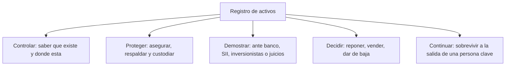
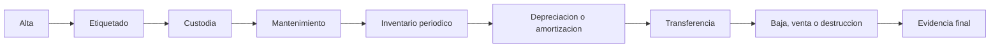

# Activos, registros y evidencia empresarial: saber qué tienes, quién lo tiene y cómo demostrarlo

> **En una frase:** lo que no está registrado, ni tiene dueño ni custodio ni evidencia, es difícil de defender, de
> asegurar, de vender y de explicar ante un banco, un inversionista o una fiscalización. Este manual te enseña a
> inventariar tus activos (físicos, intangibles, financieros y de datos), a seguir su ciclo de vida y a dejar la evidencia
> que importa.

Material educativo, sin revisión legal ni contable. Las reglas contables y tributarias sobre depreciación, valorización y
plazos de conservación cambian y dependen del caso: **consulta a tu contador** y verifica en el SII. Las cifras de los
ejemplos son **ilustrativas**.

---

## 1. Para qué sirve un registro de activos



| Quién lo pide | Para qué |
|---|---|
| Un banco o proveedor de leasing | Evaluar garantías y capacidad |
| Un inversionista | Due diligence: qué es realmente de la empresa |
| El SII o el contador | Depreciación, bajas y respaldos de gastos |
| Una aseguradora | Valorizar el riesgo y pagar un siniestro |
| Un comprador de la empresa | Qué se transfiere y con qué condiciones |
| Tú mismo | Evitar compras duplicadas y pérdidas |

---

## 2. Los cinco tipos de activos

### 2.1. Activos tangibles

| Tipo | Ejemplos | Qué cuidar |
|---|---|---|
| Caja y equipos | Efectivo, cajas registradoras, herramientas | Custodia y arqueos |
| Computadores y dispositivos | Notebooks, teléfonos, servidores | Asignación a personas, cifrado, respaldo |
| Mobiliario | Escritorios, sillas, estanterías | Inventario y ubicación |
| Maquinaria | Equipos de producción | Mantenimiento y seguro |
| Vehículos | Camionetas, motos | Padrón, permisos, seguro |
| Inventario | Mercaderías, insumos | Conteos, rotación, mermas |
| Instalaciones | Local, bodega, mejoras | Título (propiedad o arriendo), permisos |

### 2.2. Activos intangibles

| Tipo | Ejemplos | Qué cuidar |
|---|---|---|
| Marca | Nombre, logo | Registro y uso consistente |
| Dominios | Sitio web, correos | Titularidad a nombre de la empresa, renovación |
| Software propio y código fuente | Aplicaciones, scripts | Titularidad de derechos, repositorios, licencias |
| Bases de datos | Clientes, productos | Base legal y seguridad |
| Documentación y procesos (SOP) | Manuales, procedimientos | Versionado y acceso |
| Contenido | Textos, fotos, videos | Derechos de autor y licencias |
| Patentes y diseños | Invenciones, diseños industriales | Registro y plazos |
| Secretos comerciales | Fórmulas, métodos, listas | Acuerdos de confidencialidad, acceso restringido |
| Relaciones contractuales | Contratos con clientes y proveedores | Vigencia, renovaciones, cláusulas |
| Reputación | Reseñas, confianza de clientes | Gestión de la calidad y respuesta a crisis |

### 2.3. Activos financieros

| Tipo | Qué cuidar |
|---|---|
| Caja y bancos | Conciliación mensual, firmas autorizadas |
| Depósitos | Vencimientos y condiciones |
| Inversiones | Política y custodia |
| Cuentas por cobrar | Antigüedad, riesgo de incobrabilidad, documentación |
| Garantías | Vigencia, monto y quién las tiene |

### 2.4. Capital humano

Las personas **no son «activos contables» de propiedad de la empresa**, pero el conocimiento organizacional sí debe
gestionarse para reducir el **riesgo de persona clave** (key-person risk): que algo crítico dependa de una sola persona.

### 2.5. Datos: un activo que también es una responsabilidad

Una base de datos puede producir valor y, al mismo tiempo, crear una obligación legal. Para cada conjunto de datos,
mantén:

| Campo | Pregunta |
|---|---|
| Finalidad | ¿Para qué se usa? |
| Categorías | ¿Qué tipos de datos contiene? |
| Origen | ¿De dónde vienen? |
| Titular | ¿De quién son los datos? |
| Sistema | ¿Dónde están almacenados? |
| Destinatarios | ¿A quién se comparten? |
| Proveedor | ¿Quién los trata por ti? |
| País | ¿En qué país se almacenan o procesan? |
| Plazo de retención | ¿Cuánto tiempo se guardan? |
| Base de licitud | ¿Qué justifica el tratamiento? |
| Controles | ¿Qué medidas de seguridad existen? |

Para el marco legal de datos personales y comercio electrónico, revisa el
[manual de consumidor, comercio electrónico y privacidad](09_CONSUMER_ECOMMERCE_PRIVACY.md).

---

## 3. El registro mínimo de activos

Campos recomendados para cada activo:

`asset_id, tipo, descripcion, propietario_legal, custodio, ubicacion, fecha_alta, costo, valor_contable, serie,
licencia, criticidad, backup, seguro, fecha_revision, estado`.

| Campo | Qué anotar | Error frecuente |
|---|---|---|
| **asset_id** | Código único y estable (por ejemplo, EQ-0001) | Reutilizar códigos |
| **tipo** | Categoría (equipo, vehículo, software, marca, dominio, dato) | Categorías ambiguas |
| **descripcion** | Qué es, marca y modelo | Descripciones vagas |
| **propietario_legal** | Quién es dueño ante la ley (empresa, socio, tercero) | Activos a nombre de una persona |
| **custodio** | Persona responsable del uso y cuidado | Nadie asignado |
| **ubicacion** | Dónde está físicamente o dónde reside (nube, repositorio) | «En la oficina» |
| **fecha_alta** | Cuándo ingresó | No registrar |
| **costo** | Precio de adquisición | Omitir impuestos y costos de instalación |
| **valor_contable** | Valor según contabilidad (consulta al contador) | Confundir con valor de mercado |
| **serie** | Número de serie, patente o identificador | No registrar |
| **licencia** | Tipo de licencia, vencimiento, número de puestos | Licencias vencidas |
| **criticidad** | Alta, media o baja según impacto en la operación | No priorizar |
| **backup** | Si existe copia, dónde y cada cuánto | Copia no probada |
| **seguro** | Póliza y cobertura | Suponer cobertura |
| **fecha_revision** | Última verificación física o lógica | Nunca revisar |
| **estado** | Operativo, en reparación, en bodega, dado de baja | Estados desactualizados |

### 3.1. Dónde llevarlo

| Tamaño | Herramienta razonable |
|---|---|
| Micro | Planilla compartida con control de cambios |
| Pequeña | Planilla estructurada o módulo de inventario del sistema contable |
| Mediana | Sistema de gestión de activos o ERP |
| Cualquiera | Para activos digitales, un gestor de cuentas y credenciales con control de acceso |

> **Regla práctica:** el mejor registro es el que se **mantiene**. Empieza simple, con los activos críticos y de mayor
> valor, y amplía.

---

## 4. Ciclo de vida de un activo

**Flujo:** alta → etiquetado → custodia → mantenimiento → inventario → depreciación o amortización → transferencia →
baja, venta o destrucción → evidencia.



| Evento | Qué se hace | Evidencia que debe quedar |
|---|---|---|
| **Alta** | Se compra o recibe, se registra y se asigna código | Factura o contrato, acta de recepción, número de serie |
| **Etiquetado** | Se rotula físicamente o se identifica digitalmente | Foto o registro del código |
| **Custodia** | Se asigna a una persona o área | Acta de asignación firmada |
| **Mantenimiento** | Se repara o actualiza | Órdenes de trabajo y facturas |
| **Inventario** | Se verifica que existe y su estado | Acta de conteo |
| **Depreciación o amortización** | Se reconoce el desgaste o el uso (según contabilidad) | Cuadro del contador |
| **Transferencia** | Cambia de custodio o ubicación | Acta de traspaso |
| **Baja, venta o destrucción** | Sale del patrimonio | Autorización, acta de baja, comprobantes y tratamiento contable y tributario |

---

## 5. La evidencia que debe quedar

| Evidencia | Para qué sirve |
|---|---|
| **Factura o contrato** | Probar adquisición y propiedad |
| **Acta de recepción** | Probar que llegó y en qué estado |
| **Número de serie** | Identificar el bien y reclamar garantías o seguros |
| **Licencia** | Probar el derecho de uso del software |
| **Asignación a persona** | Saber quién responde por el bien |
| **Mantenimiento** | Probar el cuidado y la vida útil |
| **Seguro** | Respaldar un siniestro |
| **Backup, si es digital** | Recuperar ante pérdida |
| **Baja autorizada** | Justificar que ya no existe |
| **Tratamiento tributario y contable** | Sostener el registro ante el SII |

### 5.1. Cómo organizar la evidencia

```text
evidencia/
  activos/
    EQ-0001-notebook/
      01-factura.pdf
      02-acta-recepcion.pdf
      03-asignacion.pdf
      04-mantenciones/
      05-baja.pdf
```

**Reglas simples:**

1. Un código de activo por carpeta o por registro.
2. Nombres de archivo con fecha y tipo.
3. Acceso restringido y copia de respaldo.
4. Revisión anual de que la evidencia coincide con el registro.

---

## 6. Propietario, custodio y usuario: tres personas distintas

Un error muy común es creer que quien usa un bien es su dueño. Distingue:

| Rol | Pregunta | Ejemplo |
|---|---|---|
| **Propietario legal** | ¿Quién es dueño ante la ley? | La sociedad compró el notebook |
| **Custodio** | ¿Quién responde por su cuidado? | La jefa de operaciones |
| **Usuario** | ¿Quién lo usa día a día? | Un analista |

### 6.1. Cómo se tiene un bien: cada forma, su evidencia

| Forma | Qué significa | Evidencia clave |
|---|---|---|
| **Propiedad** | El bien es de la empresa | Factura a nombre de la empresa, inscripción cuando corresponde |
| **Leasing** | Se usa pagando cuotas, con opción de compra | Contrato, cuotas, seguro, quién asume el mantenimiento |
| **Arriendo** | Se paga por usarlo, sin opción de compra | Contrato y condiciones de término |
| **Comodato** | Se presta gratuitamente para un uso | Contrato escrito, plazo y restitución |
| **Bien de un socio o trabajador** | Está a nombre de una persona | Contrato de aporte, préstamo o comodato por escrito |
| **Licencia de software** | Derecho de uso, no propiedad | Licencia, número de puestos, vencimiento |

> **Cuidado:** si el activo más importante de tu negocio (el dominio, la cuenta publicitaria, el vehículo, el código)
> está a nombre de una persona y no de la empresa, el día que esa persona se vaya o discuta, tienes un problema. Regulariza
> la titularidad y deja evidencia.

---

## 7. Propiedad intelectual y activos digitales

### 7.1. Qué proteger y cómo

| Activo | Cómo se protege (visión general) | Qué verificar con un abogado |
|---|---|---|
| **Marca** | Registro ante el organismo de propiedad industrial (INAPI) | Disponibilidad, clases y vigencia |
| **Software y código fuente** | Derechos de autor y contratos | Quién lo escribió y cómo se cedieron los derechos |
| **Contenido** (textos, imágenes, videos) | Derechos de autor | Licencias de terceros y autorizaciones de uso |
| **Patentes y diseños** | Registro con requisitos propios | Plazos y novedad |
| **Secretos comerciales** | Reserva y acuerdos de confidencialidad | Quién tiene acceso y bajo qué compromiso |
| **Dominios** | Registro a nombre del titular | Titular, correo de contacto y renovación |

### 7.2. El problema de «lo hizo un freelancer»

Si un tercero desarrolló tu sitio, tu logo o tu software, **no asumas que los derechos son tuyos**. Revisa que el contrato
diga expresamente qué se cede, con qué alcance y por cuánto tiempo, y que incluya el código fuente o los archivos
editables. Sin eso, puedes depender de la buena voluntad del autor.

### 7.3. Software de terceros y de código abierto

| Situación | Qué cuidar |
|---|---|
| Licencias comerciales | Número de usuarios, vigencia y uso permitido |
| Código abierto | Tipo de licencia y obligaciones (atribución, publicación de cambios, restricciones comerciales) |
| Herramientas de IA | Condiciones de uso, propiedad de lo generado y tratamiento de los datos que subes |

### 7.4. Cuentas y credenciales

Las cuentas críticas (correo corporativo, banco, hosting, plataformas de venta, redes sociales) deben tener:

1. **Titular y correo de recuperación de la empresa**, no de una persona.
2. **Segundo factor de autenticación** gestionado por más de una persona autorizada.
3. **Registro de quién tiene acceso** y de cuándo se revisa.
4. **Procedimiento de baja** de accesos cuando alguien se va.

---

## 8. Persona clave y continuidad

### 8.1. Qué es el riesgo de persona clave

Aparece cuando algo importante depende del conocimiento, los accesos o las relaciones de **una sola persona**.

| Señal | Ejemplo |
|---|---|
| Solo una persona sabe cómo hacer un proceso | Solo la contadora sabe cerrar el mes |
| Solo una persona tiene una contraseña o llave | El fundador es el único administrador de la tienda |
| Solo una persona tiene la relación con un cliente clave | El vendedor «es dueño» de la cuenta |
| Un proveedor depende de una persona | Un freelancer único mantiene el sistema |

### 8.2. Cómo reducirlo

| Medida | Descripción |
|---|---|
| **Documentar** | Procedimientos escritos (SOP) de las tareas críticas |
| **Duplicar accesos** | Al menos dos personas autorizadas en cuentas críticas |
| **Capacitar en cruz** | Alguien más sabe hacer lo esencial |
| **Compartir relaciones** | Más de una persona conoce a cada cliente clave |
| **Contratos y confidencialidad** | Cláusulas claras sobre información y propiedad |
| **Plan de continuidad** | Qué se hace si alguien falta una semana o se va |

### 8.3. Lista de salida de una persona

- [ ] Recuperar equipos, llaves y credenciales.
- [ ] Revocar accesos a sistemas, cuentas y repositorios.
- [ ] Transferir la titularidad de cuentas que estaban a su nombre.
- [ ] Traspasar conocimiento y tareas pendientes.
- [ ] Recordar las obligaciones de confidencialidad.
- [ ] Actualizar el registro de custodios.
- [ ] Guardar la evidencia del cierre.

---

## 9. Inventario físico: cómo contar sin volverse loco

| Método | Descripción | Cuándo usarlo |
|---|---|---|
| **Conteo total** | Se cuenta todo en un día o fin de semana | Cierre anual o empresas pequeñas |
| **Conteo cíclico** | Se cuentan categorías o zonas en rotación | Inventarios grandes, para no detener la operación |
| **Clasificación ABC** | A: pocos ítems de alto valor (más control); B: intermedios; C: muchos de bajo valor | Priorizar esfuerzo |
| **Conteo ciego** | El contador no ve la cantidad registrada | Evitar sesgos |

**Ejemplo ilustrativo.** Una tienda tiene 800 productos. Los 80 de mayor valor (10 %) representan el 70 % del valor del
inventario: son la categoría A y se cuentan cada mes. Los 240 intermedios se cuentan cada trimestre y los 480 restantes
cada año. Así el control se concentra donde más importa.

### 9.1. Qué hacer con las diferencias

| Paso | Acción |
|---:|---|
| 1 | Verificar el conteo (recontar) |
| 2 | Revisar movimientos recientes sin registrar |
| 3 | Clasificar la causa (error de registro, merma, robo, daño) |
| 4 | Aprobar el ajuste por una persona distinta de quien contó |
| 5 | Registrar la corrección con evidencia |
| 6 | Corregir el proceso que originó la diferencia |

---

## 10. Baja, venta y destrucción

| Caso | Qué hacer | Evidencia |
|---|---|---|
| **Baja por obsolescencia o daño** | Autorización, registro del motivo y destino | Acta de baja, fotos, tratamiento contable según el contador |
| **Venta** | Documento de venta, traspaso de titularidad cuando corresponde | Factura o contrato, inscripción si aplica |
| **Donación** | Autorización y respaldo; consulta tributaria | Acta y comprobante |
| **Destrucción de equipos con datos** | Borrado seguro o destrucción física verificable | Certificado de destrucción o registro del borrado |
| **Pérdida o robo** | Denuncia cuando corresponda y aviso al seguro | Denuncia y comunicación a la aseguradora |

> **Nunca deseches un equipo con datos sin borrarlos de forma segura.** Un disco no formateado correctamente puede
> exponer datos de clientes y de la empresa.

---

## 11. Seguros y activos

| Pregunta | Por qué importa |
|---|---|
| ¿Qué bienes están cubiertos y por qué valor? | El valor asegurado debe reflejar la reposición |
| ¿Qué riesgos cubre y cuáles excluye? | Evitar sorpresas ante un siniestro |
| ¿Hay deducible y límites? | Calcular el costo real de un siniestro |
| ¿Está actualizado el registro de activos? | La aseguradora puede pedir pruebas |
| ¿Quién llama a la aseguradora y en qué plazo? | Muchas pólizas exigen aviso rápido |

Conserva fotos, facturas y números de serie: son tu mejor prueba para cobrar un seguro.

---

## 12. Cuando venden tu empresa (o quieres venderla)

Un comprador querrá comprobar qué activos existen, que son de la empresa y que están libres de problemas.

| Qué pedirá | Qué debes poder mostrar |
|---|---|
| Lista de activos | Registro actualizado con valores |
| Titularidad | Facturas, inscripciones y contratos a nombre de la empresa |
| Propiedad intelectual | Registros y cesiones de derechos |
| Contratos | Vigentes, con cláusulas de cambio de control revisadas |
| Datos | Inventario, bases de licitud y contratos con proveedores |
| Persona clave | Plan de traspaso y dependencias |
| Gravámenes | Prendas, hipotecas y garantías vigentes |
| Seguros | Pólizas y siniestros |

Tener el registro al día **antes** de que alguien lo pida acorta el proceso y mejora tu posición.

### 12.1. Cinco pruebas rápidas de salud de tu registro

Hazlas una vez al año, en una tarde, con una muestra pequeña:

1. **Prueba de existencia:** elige diez activos del registro y verifica que existen y están donde dice.
2. **Prueba de completitud:** elige diez activos físicos de la oficina y verifica que están en el registro.
3. **Prueba de titularidad:** para cinco activos importantes, encuentra la factura o el contrato a nombre de la empresa.
4. **Prueba de acceso:** para tres cuentas críticas, confirma quién tiene acceso y que el correo de recuperación es de la
   empresa.
5. **Prueba de recuperación:** restaura un archivo importante desde el respaldo y comprueba que funciona.

Anota el resultado y las correcciones. Si una prueba falla en más de dos de cada diez casos, el registro no es confiable
todavía y conviene dedicarle un esfuerzo mayor antes de depender de él para un seguro, un crédito o una venta.

---

## 13. Ocho situaciones para practicar

> Casos ilustrativos, con nombres y cifras inventados. No son asesoría.

### 13.1. El dominio a nombre del desarrollador

**Situación.** El dominio de una tienda fue registrado por el programador, a su nombre y con su correo.

**Análisis.** La empresa depende de él para renovar o cambiar el dominio. Si hay un conflicto, puede perder el sitio.

**Decisión.** Transferir la titularidad a la empresa y dejar el correo de recuperación corporativo.

### 13.2. El computador que «nadie sabe dónde está»

**Situación.** En el inventario anual falta un notebook de 900.000 pesos. Nadie lo asignó formalmente.

**Análisis.** Sin acta de asignación, es difícil determinar responsabilidades. Además, el equipo puede contener datos.

**Decisión.** Investigar, registrar la pérdida, avisar al seguro si corresponde, revocar accesos y establecer actas de
asignación desde ahora.

### 13.3. El software sin licencia

**Situación.** Una empresa usa 12 copias de un programa con licencia para 5 puestos.

**Análisis.** Es un riesgo de incumplimiento de licencia y de reclamos del titular.

**Decisión.** Regularizar las licencias o reemplazar el software y mantener un registro de licencias.

### 13.4. La persona clave que se va

**Situación.** El único administrador de la tienda en línea renuncia con una semana de aviso.

**Análisis.** Si no se traspasan accesos y conocimiento, la tienda puede quedar paralizada.

**Decisión.** Aplicar la lista de salida, duplicar accesos y documentar los procedimientos críticos.

### 13.5. La mercadería que no coincide

**Situación.** El inventario físico muestra 15 % menos unidades que el sistema.

**Análisis.** Puede haber errores de registro, mermas o robos. Hay que investigar antes de ajustar.

**Decisión.** Conteo recontado, revisión de movimientos, análisis de causas y ajuste aprobado por otra persona.

### 13.6. El logo hecho por un amigo

**Situación.** Un amigo diseñó el logo sin contrato. Años después, la empresa quiere registrarlo y vender franquicias.

**Análisis.** Sin cesión de derechos escrita, puede haber dudas sobre la titularidad del diseño.

**Decisión.** Firmar un contrato de cesión con el autor antes de seguir invirtiendo en la marca.

### 13.7. El servidor desechado

**Situación.** Se vendió un servidor antiguo sin borrar los discos.

**Análisis.** Los datos de clientes pueden quedar expuestos, con consecuencias legales y reputacionales.

**Decisión.** Establecer un procedimiento de borrado seguro y exigir evidencia.

### 13.8. Un incendio y la póliza

**Situación.** Un incendio daña la bodega. La aseguradora pide pruebas de lo que había.

**Análisis.** Sin registro, fotos y facturas, la reclamación se complica.

**Decisión.** Mantener un registro actualizado y respaldos de la evidencia fuera del local.

---

## 14. Catálogo de errores frecuentes

| N.º | Error | Consecuencia | Cómo evitarlo |
|---:|---|---|---|
| 1 | No tener registro de activos | No se sabe qué hay ni dónde | Registro mínimo |
| 2 | Activos a nombre de personas | Dependencia y conflictos | Titularidad de la empresa |
| 3 | Sin custodio asignado | Nadie responde | Acta de asignación |
| 4 | No guardar facturas ni garantías | Pérdida de derechos | Carpeta de evidencia |
| 5 | Cuentas críticas con un solo acceso | Bloqueo ante ausencia | Doble acceso autorizado |
| 6 | Dominios y marcas sin controlar vencimientos | Pérdida del activo | Calendario de renovaciones |
| 7 | Software sin licencia | Reclamos | Registro de licencias |
| 8 | Freelancer sin cesión de derechos | Dudas sobre la propiedad | Contrato con cesión |
| 9 | Inventario sin conteos | Diferencias no detectadas | Conteo cíclico |
| 10 | Ajustes sin aprobación | Fraude o errores | Aprobación independiente |
| 11 | Equipos desechados con datos | Fuga de datos | Borrado seguro |
| 12 | Seguros con valores desactualizados | Subcobertura | Revisión anual |
| 13 | No documentar procesos críticos | Riesgo de persona clave | SOP escritos |
| 14 | Mezclar bienes personales y de la empresa | Confusión patrimonial | Separación y contratos |
| 15 | Registro desactualizado | Pierde utilidad | Revisión periódica |

---

## 15. Calendario, listas y plantillas

### 15.1. Calendario de gestión de activos

| Cuándo | Tarea |
|---|---|
| Cada alta | Registrar, etiquetar y asignar custodio |
| Cada mes | Conteo de inventario categoría A; revisión de licencias por vencer |
| Cada trimestre | Revisión de accesos a cuentas críticas; conteo de categoría B |
| Cada año | Inventario completo, revisión de seguros, renovación de dominios y marcas, revisión de la evidencia |
| Cada salida de persona | Lista de salida |
| Cada baja | Acta y tratamiento contable |

### 15.2. Acta de asignación de un activo

| Campo | Contenido |
|---|---|
| Código del activo | |
| Descripción y serie | |
| Estado al entregar | |
| Custodio | |
| Fecha | |
| Condiciones de uso | Uso laboral, cuidado, devolución |
| Firma del custodio y de la empresa | |

### 15.3. Acta de baja

| Campo | Contenido |
|---|---|
| Código y descripción | |
| Motivo | Obsolescencia, daño, venta, pérdida |
| Destino | Venta, destrucción, donación |
| Datos eliminados (sí/no y método) | |
| Autorizado por | |
| Tratamiento contable y tributario (según contador) | |
| Fecha y firmas | |

### 15.4. Matriz de persona clave

| Proceso o activo crítico | Persona que lo conoce | Respaldo | Documentación | Riesgo | Acción |
|---|---|---|---|---|---|
| | | | | | |

### 15.5. Registro de licencias y vencimientos

| Software o servicio | Tipo de licencia | Puestos | Vencimiento | Responsable | Costo anual |
|---|---|---:|---|---|---:|
| | | | | | |

---

## 16. Preguntas frecuentes

**1. ¿Tengo que llevar un registro de activos si soy una microempresa?**
No hay una única forma obligatoria para todos, pero un registro simple te protege y facilita la contabilidad, los seguros
y la venta de tu empresa. Consulta a tu contador por las exigencias contables.

**2. ¿Qué diferencia hay entre costo y valor contable?**
El costo es lo que pagaste; el valor contable es el que resulta de la contabilidad (por ejemplo, tras depreciaciones).
Consulta a tu contador.

**3. ¿Debo depreciar mis activos?**
La contabilidad y la normativa tributaria tienen reglas de depreciación; la vida útil y el método dependen del caso.
Consulta al contador y revisa las instrucciones del SII.

**4. ¿Puedo registrar un activo a nombre de un socio?**
Es posible, pero genera riesgos; si ocurre, deja un contrato escrito (aporte, préstamo o comodato) y evidencia.

**5. ¿Cómo sé si un software necesita licencia?**
Revisa los términos de uso del proveedor. Si no está claro, pregunta por escrito.

**6. ¿Qué pasa si pierdo una factura?**
Pide una copia al proveedor y guarda el respaldo digital. La factura es parte de la evidencia del activo y del gasto.

**7. ¿Cómo registro un activo digital como un dominio?**
Con tipo «dominio», titular, correo de recuperación, vencimiento y responsable de renovación.

**8. ¿Cada cuánto debo hacer un inventario?**
Al menos una vez al año, con conteos cíclicos más frecuentes para lo de mayor valor.

**9. ¿Qué hago con equipos que dejaron de usarse?**
Dar de baja con acta, borrar datos de forma segura y decidir su destino (venta, donación o destrucción).

**10. ¿Qué es un comodato?**
Un contrato en que una parte presta gratuitamente un bien a otra para su uso y restitución. Hazlo por escrito.

**11. ¿Cómo evito que un trabajador se lleve información?**
Con accesos mínimos, acuerdos de confidencialidad, registro de accesos, lista de salida y revocación inmediata.

**12. ¿Es necesario registrar mi marca?**
Registrar la marca da protección y claridad; consulta a un abogado de propiedad industrial sobre cobertura y clases.

**13. ¿Los datos de clientes son un activo?**
Pueden generar valor, pero también obligaciones; deben tener base de licitud, seguridad y política de retención.

**14. ¿Debo asegurar todos mis activos?**
Depende del riesgo y del valor; prioriza los críticos y consulta a un corredor de seguros.

**15. ¿Cómo valoro mi inventario?**
Con el método que defina tu contador y la normativa; no con una estimación informal.

**16. ¿Qué evidencia necesito para vender un activo?**
Documento de venta, evidencia de titularidad y el tratamiento tributario y contable.

**17. ¿Puedo usar un solo código para varios activos iguales?**
Es mejor un código único por activo; para lotes de consumibles, un código por lote.

**18. ¿Y si un trabajador daña un equipo?**
Aplica el procedimiento interno y la ley; consulta a un abogado laboral antes de descontar o sancionar.

**19. ¿Cómo gestiono herramientas de IA como activos?**
Registra la herramienta, quién tiene acceso, qué datos se envían, las condiciones del proveedor y la evidencia de las
decisiones tomadas con ella.

**20. ¿Quién debe custodiar las contraseñas?**
Un gestor de credenciales con acceso controlado, con al menos dos personas autorizadas.

**21. ¿Cómo hago un backup bien hecho?**
Copias periódicas, en lugares separados y con pruebas de restauración.

**22. ¿Qué hago si pierdo un equipo con datos?**
Avisar de inmediato, revocar accesos, evaluar el riesgo para los datos y registrar el incidente.

**23. ¿Qué es la baja contable?**
El registro que retira un activo del patrimonio; su tratamiento tributario debe revisarse con el contador.

**24. ¿Cómo uso este manual junto con otros?**
Para datos personales, ver el manual de consumidor y privacidad; para cumplimiento, el manual de compliance.

**25. ¿Cuándo llamar a un profesional?**
Para contratos de cesión de derechos, registro de marcas, tratamiento contable y tributario, seguros y ventas de la
empresa. Ver la [guía de cuándo llamar a un profesional](18_WHEN_TO_CALL_A_PROFESSIONAL.md).

---

## 17. Glosario

| Término | Significado |
|---|---|
| Activo | Recurso con valor para la empresa |
| Amortización | Reconocimiento gradual del costo de un activo intangible |
| Comodato | Préstamo gratuito de un bien para su uso |
| Contabilización | Registro de un hecho en la contabilidad |
| Custodio | Persona responsable del cuidado de un activo |
| Depreciación | Reconocimiento gradual del desgaste de un activo físico |
| Inventario cíclico | Conteo por rotación de categorías |
| Key-person risk | Riesgo de depender de una persona |
| Leasing | Arriendo con opción de compra |
| Propietario legal | Dueño del activo ante la ley |
| SOP | Procedimiento operativo estándar |
| Titularidad | Quién figura como dueño o titular de un bien o derecho |
| Valor contable | Valor registrado según la contabilidad |

---

## 18. Fuentes y vigencia

| Fuente | Qué contiene |
|---|---|
| [SII](https://www.sii.cl/) | Instrucciones tributarias sobre activos, depreciación y documentos |
| [INAPI](https://www.inapi.cl/) | Registro de marcas, patentes y diseños |
| [Manual de consumidor y privacidad](09_CONSUMER_ECOMMERCE_PRIVACY.md) | Datos personales y comercio electrónico |
| [Manual de compliance](13_COMPLIANCE_RISK.md) | Sistema de cumplimiento y evidencia |

**Límites:** este manual no es asesoría legal, contable ni tributaria; no se leyó normativa contable ni tributaria
específica sobre depreciación; las cifras de los ejemplos son ilustrativas. Para decidir a quién consultar, usa la
[guía de cuándo llamar a un profesional](18_WHEN_TO_CALL_A_PROFESSIONAL.md).
