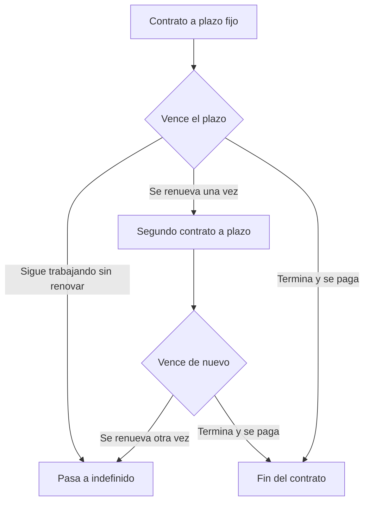
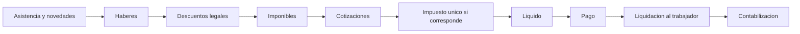

# Flujo laboral en Chile 2026: de la contratación al finiquito

> **En una frase:** contratar a una persona es una cadena de decisiones con plazos legales, costos visibles y costos
> ocultos. Este manual recorre esa cadena completa (alta, contrato, jornada, pago, seguridad social, prevención, acoso y
> término) con los artículos del Código del Trabajo que importan, ejemplos con números y listas que puedes usar.

Material educativo, sin revisión legal. Las referencias al Código del Trabajo se leyeron del texto en Ley Chile (BCN);
las **cifras de los ejemplos son ilustrativas**. Las leyes laborales cambian con frecuencia y la Dirección del Trabajo
(DT) emite interpretaciones: verifica en [dt.gob.cl](https://www.dt.gob.cl/) antes de actuar y consulta a un abogado
laboral en cualquier situación conflictiva.

---

## 1. Cómo leer este manual

| Si quieres… | Ve a… |
|---|---|
| Contratar a tu primera persona | Secciones 2 y 3 |
| Entender jornada, horas extra y descansos | Sección 4 |
| Calcular y pagar remuneraciones | Sección 5 |
| Evitar problemas de seguridad social y prevención | Secciones 6 y 7 |
| Cumplir la Ley Karin | Sección 8 |
| Terminar una relación laboral sin errores | Sección 9 |
| Practicar con casos | Sección 10 |
| Tener listas y plantillas | Sección 12 |

---

## 2. El alta: de la necesidad al primer día

**Flujo:** necesidad → diseño del cargo → presupuesto → selección → oferta → contrato → registro → onboarding →
prevención → acceso a sistemas → objetivos.

| Paso | Qué se hace | Error frecuente | Evidencia que debe quedar |
|---|---|---|---|
| Necesidad | Definir el problema que resuelve la contratación | Contratar por urgencia sin definir la función | Nota de necesidad |
| Diseño del cargo | Función, lugar, jornada, a quién reporta | Cargo difuso que luego genera conflicto | Descripción del cargo |
| Presupuesto | Costo total mensual y anual, no solo el sueldo | Olvidar cotizaciones del empleador, feriado, equipamiento | Hoja de costos |
| Selección | Entrevistas y verificación de antecedentes pertinentes | Pedir datos que no corresponden o discriminar | Registro del proceso |
| Oferta | Condiciones por escrito antes del contrato | Ofertas verbales que luego se discuten | Carta de oferta |
| Contrato | Documento firmado por ambas partes | Firmarlo tarde o no entregar copia | Contrato firmado |
| Registro | Alta en la contabilidad, la nómina y los organismos de seguridad social | Incorporar sin registrar | Comprobantes |
| Onboarding | Presentación, políticas, reglamento interno | Omitir el reglamento y las políticas de seguridad | Acta de inducción |
| Prevención | Información de riesgos y entrega de elementos de protección | Dejarlo «para después» | Registro de entrega |
| Accesos | Cuentas y permisos mínimos necesarios | Dar accesos amplios por comodidad | Registro de accesos |
| Objetivos | Metas y forma de evaluación | Evaluar sin criterios previos | Documento de objetivos |

### 2.1. El costo real de contratar

El costo no es solo el sueldo. Una hoja de costos mínima incluye:

| Concepto | Observación |
|---|---|
| Sueldo y otras remuneraciones | Según el contrato |
| Cotizaciones y aportes a cargo del empleador | Dependen del trabajador y del tipo de contrato; consulta al contador |
| Feriado anual | Se devenga y se paga con remuneración íntegra |
| Gratificaciones o bonos pactados | Solo si están en el contrato o la ley |
| Equipos, licencias y espacio | Computador, software, herramientas |
| Capacitación y prevención | Inducción y elementos de protección |
| Costos de término eventuales | Aviso, indemnizaciones y finiquito |

**Ejemplo ilustrativo.** Si el sueldo pactado es 900.000 pesos y el contador estima que los costos adicionales del
empleador, el feriado y el equipamiento suman 28 % del sueldo, el costo mensual real es 900.000 × 1,28 = 1.152.000 pesos.
Planificar con 900.000 deja un déficit de 252.000 pesos al mes (28 %).

---

## 3. El contrato de trabajo

### 3.1. Forma y plazo

El contrato de trabajo es consensual, pero **debe constar por escrito** y firmarse por ambas partes en dos ejemplares,
quedando uno en poder de cada contratante (Código del Trabajo, art. 9).

| Regla | Qué dice el Código del Trabajo (art. 9) |
|---|---|
| Plazo para escriturar | **Quince días** desde que se incorpora el trabajador; **cinco días** si es por obra, trabajo o servicio determinado o de duración inferior a treinta días |
| Sanción por no escriturar | Multa a beneficio fiscal de **una a cinco UTM** |
| Si el trabajador se niega a firmar | El empleador envía el contrato a la Inspección del Trabajo para que requiera la firma |
| Si no hay contrato escrito | La falta hace presumir que las estipulaciones son **las que declare el trabajador** |
| Ejemplar en el lugar de trabajo | El empleador debe mantener un ejemplar del contrato, y en su caso del finiquito, en el lugar de trabajo o en uno autorizado |

> **Lección práctica:** un contrato tardío o ausente no te protege, te perjudica: si hay una discusión, se presume lo
> que diga el trabajador.

### 3.2. Contenido mínimo (art. 10)

| N.º | Estipulación mínima |
|---:|---|
| 1 | Lugar y fecha del contrato |
| 2 | Individualización de las partes: nacionalidad, domicilio, correo electrónico si lo tienen, fechas de nacimiento e ingreso del trabajador |
| 3 | Naturaleza de los servicios y lugar o ciudad donde se prestan (pueden señalarse dos o más funciones) |
| 4 | Monto, forma y período de pago de la remuneración |
| 5 | Duración y distribución de la jornada, salvo sistema de turnos regido por el reglamento interno |
| 6 | Plazo del contrato |
| 7 | Demás pactos que acuerden las partes |

Además deben señalarse los beneficios adicionales en especie (casa habitación, luz, combustible, alimento u otras
prestaciones). Si para la contratación se hace cambiar de domicilio al trabajador, debe dejarse testimonio del lugar de
procedencia. Si por la naturaleza de los servicios se precisa el desplazamiento, el lugar de trabajo es toda la zona
geográfica que comprenda la actividad de la empresa.

### 3.3. Tipos de contrato según su duración

| Tipo | Regla principal | Dónde verificar |
|---|---|---|
| Indefinido | Sin fecha de término; se termina por las causales legales | Arts. 159 a 161 |
| Plazo fijo | Duración máxima de **un año**; **dos años** para gerentes o personas con título profesional o técnico de una institución de educación superior reconocida | Art. 159 N.º 4 |
| Por obra o faena | Dura mientras dure el trabajo o servicio que lo originó | Art. 159 N.º 5 |

**Cómo un plazo fijo se transforma en indefinido (art. 159 N.º 4):**

1. Si el trabajador sigue prestando servicios con conocimiento del empleador **después de expirado el plazo**.
2. Con la **segunda renovación** de un contrato de plazo fijo.
3. Si prestó servicios discontinuos en virtud de **más de dos contratos a plazo**, durante doce meses o más en un
   período de quince meses desde la primera contratación: se presume legalmente que es de duración indefinida.

### 3.4. ¿Honorarios o contrato de trabajo?

Pagar «a honorarios» no convierte una relación laboral en civil. El Código del Trabajo define el contrato de trabajo y
presume la existencia de relación laboral cuando una persona presta servicios personales bajo dependencia y
subordinación a cambio de una remuneración (arts. 7 y 8). Algunos indicios que la hacen sospechosa de ser laboral:

- horario fijo y control de asistencia;
- supervisión directa y órdenes del empleador;
- exclusividad o dependencia económica;
- uso de equipos y espacios del empleador;
- continuidad en el tiempo.

Si hay dudas, consulta antes con un abogado laboral: la reclasificación posterior puede significar pagos retroactivos.

### 3.5. Anexos, políticas y reglamento interno

Los cambios de condiciones (función, lugar, jornada, remuneración) se hacen por **anexo escrito y firmado**. Las
políticas y el reglamento interno complementan, pero no reemplazan, lo que dice el contrato. Entrega y deja constancia de
la recepción.

---

## 4. Jornada y descansos

### 4.1. Jornada ordinaria 2026

Desde el **26 de abril de 2026**, la segunda etapa de la Ley 21.561 reduce la jornada ordinaria de 44 a **42 horas
semanales**. La DT emitió interpretación sobre su implementación; revisa su sitio para el detalle por tipo de jornada
(fuente: [dt.gob.cl](https://www.dt.gob.cl/)).

### 4.2. Horas extraordinarias

| Regla | Contenido | Artículo |
|---|---|---|
| Cuándo se pactan | Solo para atender **necesidades o situaciones temporales** de la empresa | 32 |
| Forma y vigencia | Por escrito, con vigencia transitoria **no superior a tres meses**, renovable por acuerdo | 32 |
| Máximo diario | Hasta **dos horas por día** en faenas que no perjudiquen la salud | 31 |
| Aunque no haya pacto escrito | Se consideran extraordinarias las que se trabajen en exceso de la jornada pactada **con conocimiento del empleador** | 32 |
| Recargo | **50 %** sobre el sueldo convenido para la jornada ordinaria; se liquidan y pagan con las remuneraciones del período | 32 |
| Compensación | Por escrito, pueden pactarse hasta **cinco días hábiles** de descanso adicional al año, usados dentro de los seis meses siguientes | 32 |

**Ejemplo ilustrativo.** Si el valor de la hora ordinaria de un trabajador, según la fórmula que corresponda, es de
5.000 pesos, la hora extra se paga con 50 % de recargo: 7.500 pesos. Si trabajó 6 horas extra con conocimiento del
empleador en el mes, corresponden 6 × 7.500 = 45.000 pesos adicionales, aunque no existiera pacto escrito.

> **Cuidado:** que «nadie pidió» las horas extra no basta: si las trabajó con tu conocimiento, se consideran
> extraordinarias.

### 4.3. Registro de asistencia

Aunque no es la única forma de controlar la jornada, un registro confiable (libro, reloj, sistema digital autorizado)
protege a ambas partes. Revisa con la DT los sistemas permitidos y qué trabajadores pueden estar exentos de control de
jornada: la ley presume que el trabajador está afecto a jornada, entre otros casos, cuando debe registrar su ingreso o
egreso o se le descuentan atrasos (art. 42 letra a).

### 4.4. Feriado anual

Los trabajadores con **más de un año** de servicio tienen derecho a un feriado anual de **quince días hábiles**, con
remuneración íntegra; en la Región de Magallanes, la Región de Aysén y la Provincia de Palena es de **veinte días
hábiles**. Se concede de preferencia en primavera o verano, considerando las necesidades del servicio (art. 67).
Planifica los feriados con anticipación y registra su otorgamiento.

---

## 5. Remuneraciones

### 5.1. Qué es remuneración

El Código del Trabajo enumera, entre otras, estas formas de remuneración (art. 42):

| Tipo | Qué es |
|---|---|
| Sueldo o sueldo base | Estipendio obligatorio y fijo, en dinero, pagado por períodos iguales; **no puede ser inferior a un ingreso mínimo mensual** salvo trabajadores exentos de jornada |
| Sobresueldo | Remuneración de las horas extraordinarias |
| Comisión | Porcentaje sobre el precio de ventas o compras |
| Participación | Proporción de utilidades de un negocio o empresa |
| Gratificación | Parte de las utilidades con que el empleador beneficia al trabajador (consulta las reglas aplicables) |

### 5.2. Flujo mensual de remuneraciones

| Etapa | Qué verificar | Error frecuente |
|---|---|---|
| Novedades | Ausencias, licencias, horas extra, bonos | No registrar licencias y pagar de más |
| Haberes | Sueldo, comisiones, gratificación, otros | Omitir pagos pactados |
| Descuentos | Solo los permitidos por ley o autorizados | Descontar sin respaldo |
| Imponibles | Qué conceptos son imponibles | Clasificar mal un bono |
| Cotizaciones | Cálculo y declaración a los organismos | Pagar tarde o con montos erróneos |
| Impuesto único | Retención cuando corresponda | No retener o retener mal |
| Pago | Fecha y forma acordadas | Pagar fuera de plazo |
| Liquidación | Entregar el detalle al trabajador | No entregarla o entregarla incompleta |
| Contabilización | Registrar el gasto y las obligaciones | Contabilizar solo al pagar |

### 5.3. Ejemplo de liquidación simplificada (ilustrativa)

> Las tasas reales de cotización, topes y tramos de impuesto se actualizan; este ejemplo solo muestra la estructura.

| Concepto | Monto (pesos) |
|---|---:|
| Sueldo base | 800.000 |
| Horas extra | 45.000 |
| Bono por meta | 100.000 |
| **Total haberes** | **945.000** |
| Descuentos previsionales y de salud (supuesto de 20 %) | −189.000 |
| Impuesto único (supuesto) | −0 |
| **Líquido a pagar** | **756.000** |

Pide a tu contador las tasas y topes vigentes y no uses este ejemplo para calcular sueldos reales.

---

## 6. Seguridad social

Para cada trabajador, revisa y registra:

| Cobertura | Qué es | Qué debes hacer |
|---|---|---|
| Pensión | Sistema de ahorro previsional | Afiliar y cotizar según la normativa vigente |
| Salud | Fonasa o isapre | Registrar la elección del trabajador y cotizar |
| Seguro de cesantía | Protección ante pérdida del empleo | Cotizar según el tipo de contrato |
| Accidentes del trabajo y enfermedades profesionales | Seguro social de la Ley 16.744 | Adherir a un organismo administrador y cotizar |
| Otras cotizaciones legales | Según el caso | Consultar al contador |

> **Regla práctica:** declarar y pagar las cotizaciones en plazo no es un detalle administrativo. Su incumplimiento
> puede generar sanciones y problemas serios en un eventual término de contrato. Consulta al contador y a un abogado
> laboral si hay atrasos.

---

## 7. Seguridad y salud en el trabajo

La **Ley 16.744** y el **Decreto 44** forman parte del sistema preventivo. El Decreto 44 rige desde el 1 de febrero de
2025 y exige gestión preventiva de riesgos.

| Obligación práctica | Qué implica |
|---|---|
| Identificar peligros y evaluar riesgos | Matriz de riesgos por puesto o tarea |
| Informar a los trabajadores | Informar los riesgos y las medidas preventivas antes de que realicen la tarea |
| Entregar elementos de protección | Con registro de entrega y capacitación de uso |
| Investigar accidentes e incidentes | Registro, análisis y medidas correctivas |
| Contar con organismos o instancias que correspondan | Comités paritarios y departamentos de prevención según el tamaño y el riesgo |
| Mantener evidencia | Actas, registros, capacitaciones, inspecciones |

Si tu actividad es de riesgo (construcción, logística, alimentos, energía, faenas), contrata un prevencionista desde el
inicio.

---

## 8. Ley Karin: prevención del acoso y la violencia

La empresa debe **prevenir el acoso sexual, el acoso laboral y la violencia en el trabajo** y contar con procedimientos
ajustados a la **Ley 21.643** y su reglamento. Para personas jurídicas, la DT exige representante(s) laboral(es)
electrónico(s) habilitados para los trámites de derivación, aviso y depósito asociados a investigaciones.

Fuente: [DT, información sobre la Ley Karin](https://www.dt.gob.cl/portal/1626/w3-article-126453.html).

### 8.1. Elementos mínimos de un sistema de prevención

| Elemento | Descripción |
|---|---|
| Política | Compromiso escrito de tolerancia cero y descripción de conductas |
| Protocolo | Cómo se denuncia, quién recibe y cómo se investiga |
| Canal de denuncia | Accesible y confidencial |
| Medidas de resguardo | Separación de espacios, ajustes de jornada u otras mientras dura la investigación |
| Capacitación | Periódica y registrada |
| Plazos y registros | Cumplir los plazos legales y conservar evidencia |
| Evaluación | Revisión de riesgos psicosociales y mejora continua |

### 8.2. Qué hacer ante una denuncia

1. **Recibirla** por escrito o dejar constancia si es verbal.
2. **Activar medidas de resguardo** de inmediato.
3. **Cumplir los plazos legales** de derivación o investigación.
4. **Investigar con imparcialidad**: entrevistar, recopilar pruebas, dar derecho a ser oído.
5. **Concluir por escrito** y aplicar las medidas que correspondan.
6. **Informar a los involucrados** y a la DT cuando proceda.
7. **Proteger contra represalias.**

Hacer este proceso con un abogado laboral desde el comienzo evita errores de forma que pueden anular lo actuado.

---

## 9. La baja: terminar la relación laboral sin errores

**Flujo:** causal → documentación → cálculo → notificación → finiquito → pagos → cotizaciones → revocar accesos →
recuperar activos → preservar evidencia → actualizar nómina.

### 9.1. Las causales

| Grupo | Causal | Artículo |
|---|---|---|
| Sin culpa de nadie (art. 159) | Mutuo acuerdo | 159 N.º 1 |
| | Renuncia del trabajador, con **treinta días** de aviso como mínimo | 159 N.º 2 |
| | Muerte del trabajador | 159 N.º 3 |
| | Vencimiento del plazo convenido | 159 N.º 4 |
| | Conclusión del trabajo o servicio que dio origen al contrato | 159 N.º 5 |
| | Caso fortuito o fuerza mayor | 159 N.º 6 |
| Sin indemnización (art. 160) | Conductas indebidas graves, debidamente comprobadas: falta de probidad, acoso sexual, vías de hecho, injurias, conducta inmoral, acoso laboral | 160 N.º 1 |
| | Negociaciones dentro del giro prohibidas por escrito | 160 N.º 2 |
| | No concurrir sin causa justificada: dos días seguidos, dos lunes en el mes o tres días en igual período | 160 N.º 3 |
| | Abandono del trabajo | 160 N.º 4 |
| | Actos, omisiones o imprudencias temerarias que afecten la seguridad o la salud | 160 N.º 5 |
| | Perjuicio material causado intencionalmente | 160 N.º 6 |
| | Incumplimiento grave de las obligaciones del contrato | 160 N.º 7 |
| Con indemnización (art. 161) | **Necesidades de la empresa**: racionalización o modernización, bajas en la productividad, cambios en las condiciones del mercado o de la economía | 161 inc. 1 |
| | Desahucio escrito del empleador para trabajadores con poder de representar al empleador con facultades generales de administración, de casa particular y cargos de exclusiva confianza | 161 inc. 2 |

> **Advertencia:** el Código tiene reglas especiales que protegen a ciertos trabajadores (por ejemplo, fueros). Antes de
> terminar un contrato verifica si el trabajador tiene alguna protección especial.

### 9.2. La carta de término

Cuando el contrato termina por las causales de los números 4, 5 o 6 del art. 159, o por el art. 160, el empleador debe
**comunicarlo por escrito** al trabajador, personalmente o por carta certificada al domicilio del contrato, indicando
**la o las causales y los hechos en que se funda** (art. 162).

| Regla | Detalle (art. 162) |
|---|---|
| Plazo para entregar o enviar | **Tres días hábiles** desde la separación (seis días hábiles en caso fortuito o fuerza mayor) |
| Copia a la Inspección del Trabajo | Dentro del mismo plazo |
| Causal de necesidades de la empresa | Aviso con **treinta días** de anticipación, con copia a la Inspección; o pago de una indemnización sustitutiva equivalente a la última remuneración mensual devengada |
| Contenido adicional | Debe indicar el **monto total a pagar** por indemnizaciones |
| Estado de cotizaciones | Informar por escrito el estado de pago de las cotizaciones devengadas hasta el último día del mes anterior, **adjuntando los comprobantes** |
| Finiquito electrónico | Informar si el finiquito se otorgará y pagará de forma presencial o electrónica, aclarando que es voluntario para el trabajador aceptarlo electrónicamente |

> **El punto más peligroso:** si el empleador **no ha pagado íntegramente las cotizaciones** al momento del despido,
> **el despido no produce el efecto de poner término al contrato** (art. 162). Puede convalidarse pagando las
> imposiciones morosas y comunicándolo por carta certificada, pero hay que pagar las remuneraciones del período
> intermedio. Es el error más caro y más repetido; revisa las cotizaciones **antes** de despedir.

### 9.3. Indemnizaciones: cómo se calculan

| Concepto | Regla | Artículo |
|---|---|---|
| Indemnización sustitutiva del aviso previo | Equivale a la última remuneración mensual devengada, si no se avisó con 30 días | 162 |
| Indemnización por años de servicio (necesidades de la empresa) | **Treinta días** de la última remuneración mensual por cada año de servicio y fracción superior a seis meses, prestados continuamente; **máximo de 330 días** | 163 |
| Base de cálculo | La última remuneración mensual incluye lo que percibía el trabajador al terminar el contrato, incluidas cotizaciones de cargo del trabajador, regalías o especies avaluadas; excluye asignación familiar, sobretiempo y beneficios esporádicos como gratificaciones y aguinaldos; con remuneración variable se usa el promedio de los últimos tres meses; existe un tope que debes verificar en el art. 172 | 172 |
| Vacaciones pendientes | Se pagan en el finiquito | 67 y siguientes |

**Ejemplo 1 (ilustrativo).** Un trabajador con 4 años y 8 meses de servicio y una última remuneración mensual de
900.000 pesos es despedido por necesidades de la empresa **sin aviso previo**.

| Concepto | Cálculo | Monto |
|---|---|---:|
| Años de servicio | 4 años + fracción de 8 meses (superior a seis) = 5 años | |
| Indemnización por años de servicio | 5 × 900.000 | 4.500.000 |
| Sustitutiva del aviso previo | 1 × 900.000 | 900.000 |
| **Total de indemnizaciones** | | **5.400.000** |
| (+) Feriado proporcional y remuneraciones pendientes | Según el caso | Aparte |

**Ejemplo 2 (ilustrativo, tope).** Un trabajador con 14 años de servicio: 14 × 30 = 420 días, pero el máximo es 330
días, es decir, **11 remuneraciones mensuales** (330 / 30).

### 9.4. Si el trabajador reclama: plazos y recargos

El trabajador que considere injustificado, indebido o improcedente el despido, o que no se invocó ninguna causal legal,
puede demandar dentro de **sesenta días hábiles** desde la separación (art. 168). Si el juez le da la razón, ordena
pagar las indemnizaciones con estos recargos:

| Situación | Recargo sobre la indemnización por años de servicio |
|---|---:|
| Aplicación **improcedente** de necesidades de la empresa (art. 161) | 30 % |
| Aplicación **injustificada** del art. 159, o sin causa legal | 50 % |
| Aplicación **indebida** de las causales del art. 160 | 80 % |
| Causales 1, 5 o 6 del art. 160 sin motivo plausible | 100 % adicional |

**Ejemplo 3 (ilustrativo).** En el ejemplo 1, si el juez declara el despido improcedente (necesidades de la empresa), el
recargo del 30 % sobre 4.500.000 es 1.350.000. Con el aviso sustitutivo (900.000), el total sería
4.500.000 + 1.350.000 + 900.000 = 6.750.000 pesos, sin contar otros pagos que ordene el tribunal.

> **Conclusión práctica:** invocar una causal que no puedes probar sale mucho más caro que despedir por necesidades de
> la empresa con las indemnizaciones pagadas y la carta bien escrita.

### 9.5. El finiquito

| Regla | Detalle (art. 177) |
|---|---|
| Forma | Por escrito |
| Validez frente al empleador | Debe ser firmado por el trabajador y ratificado ante un ministro de fe: inspector del trabajo, notario público de la localidad, oficial del Registro Civil o secretario municipal; o firmado por el presidente del sindicato o el delegado sindical respectivos. **Si no, el empleador no puede invocarlo** |
| Plazo | El empleador debe otorgarlo y **poner su pago a disposición dentro de diez días hábiles** desde la separación; puede pactarse pago en cuotas (arts. 63 bis y 169) |
| Finiquito electrónico | Se considera ratificado el otorgado y firmado electrónicamente en el sitio de la DT, con los requisitos legales |
| Contenido mínimo | Causal de terminación, pagos a que dio lugar, sumas pendientes y reserva de derechos del trabajador |

### 9.6. Lista de cierre administrativo

1. Revocar accesos a sistemas, cuentas y bodegas.
2. Recuperar equipos, llaves, credenciales, vehículos y documentos de la empresa.
3. Traspasar el conocimiento crítico y las tareas pendientes.
4. Actualizar la nómina, la contabilidad y los organismos de seguridad social.
5. Preservar la evidencia del proceso (carta, comprobantes, finiquito, correos).
6. Comunicar de forma respetuosa y coordinada al equipo y a los clientes afectados.

---

## 10. Ocho situaciones para practicar

> Casos ilustrativos, con nombres y cifras inventados. No son asesoría.

### 10.1. «Lo contraté de palabra y no firmó nada»

**Situación.** Una cafetería incorpora a una persona el 1 de marzo, sin contrato escrito. El 30 de marzo hay un desacuerdo
sobre el horario y el sueldo.

**Análisis.** Pasaron más de quince días sin escriturar; la falta de contrato escrito hace presumir que las estipulaciones
son las que declare el trabajador (art. 9) y expone a una multa de una a cinco UTM.

**Decisión.** Escriturar de inmediato, con asesoría; si el trabajador no firma, enviar el contrato a la Inspección del
Trabajo.

### 10.2. El tercer contrato a plazo fijo

**Situación.** Una empresa contrata a un diseñador por tres meses, lo renueva por tres y propone una tercera
renovación.

**Análisis.** La segunda renovación de un contrato de plazo fijo lo transforma en indefinido (art. 159 N.º 4).

**Decisión.** Decidir antes de la segunda renovación si se desea una relación indefinida o terminar; no «renovar por
costumbre».

### 10.3. Horas extra «voluntarias»

**Situación.** Un bodeguero se queda 5 horas extra cada semana porque el jefe sabe que hay pedidos urgentes, pero nunca
se firmó pacto.

**Análisis.** Se consideran extraordinarias las horas trabajadas en exceso de la jornada pactada con conocimiento del
empleador, aunque falte el pacto (art. 32), y se pagan con recargo del 50 %. Los pactos escritos duran máximo tres
meses.

**Decisión.** Registrar la jornada, pagar las horas extra y formalizar el pacto si la necesidad es temporal; si es
permanente, ajustar la dotación o la jornada.

### 10.4. El despido con cotizaciones atrasadas

**Situación.** Una empresa despide a una trabajadora por necesidades de la empresa; el empleador debe tres meses de
cotizaciones.

**Análisis.** Sin el pago íntegro de las cotizaciones al momento del despido, este no pone término al contrato (art. 162).
Además, debe informar el estado de pago con comprobantes.

**Decisión.** Regularizar las cotizaciones antes de despedir; consultar a un abogado laboral sobre cómo convalidar y qué
remuneraciones se adeudan.

### 10.5. La denuncia de acoso en un equipo pequeño

**Situación.** Una trabajadora denuncia por escrito a su jefe por conductas de acoso.

**Análisis.** Corresponde activar el protocolo de la Ley 21.643: resguardo inmediato, derivación o investigación dentro
de los plazos, imparcialidad y prohibición de represalias.

**Decisión.** Convocar de inmediato a un abogado laboral y documentar cada paso.

### 10.6. Renuncia verbal

**Situación.** Un trabajador dice «me voy» y deja de venir. El empleador lo considera renuncia.

**Análisis.** La renuncia debe constar por escrito (art. 177) y requiere aviso de treinta días como mínimo (art. 159 N.º
2). Si no concurre dos días seguidos sin causa, puede configurarse una causal del art. 160 que debe comunicarse por
escrito en plazo (art. 162).

**Decisión.** Formalizar por escrito, con la causal que corresponda y los plazos que fija la ley.

### 10.7. El freelance que trabaja nueve horas diarias

**Situación.** Una agencia contrata a un diseñador «a honorarios», con horario fijo, jefe directo y exclusividad.

**Análisis.** Esos indicios (horario, supervisión, exclusividad) pueden llevar a considerar la relación como laboral
(arts. 7 y 8).

**Decisión.** Evaluar con un abogado laboral si corresponde un contrato de trabajo.

### 10.8. El cierre de la empresa

**Situación.** Una empresa debe cerrar y tiene cinco trabajadores.

**Análisis.** El término por necesidades de la empresa exige la carta con anticipación o la indemnización sustitutiva,
el pago de indemnizaciones por años de servicio cuando corresponde y finiquitos válidos. Si la empresa no puede pagar, hay
herramientas legales de insolvencia.

**Decisión.** Consultar a un abogado laboral y de insolvencia antes de comunicar.

---

## 11. Catálogo de errores frecuentes

| N.º | Error | Consecuencia | Cómo evitarlo |
|---:|---|---|---|
| 1 | No escriturar el contrato en 15 días (5 en contratos cortos) | Multa y presunción a favor del trabajador | Calendario de alta |
| 2 | Renovar plazos fijos sin contar | Contrato indefinido | Planilla de contratos y vencimientos |
| 3 | Honorarios con subordinación | Reclasificación y pagos retroactivos | Evaluar indicios antes |
| 4 | No registrar jornada | Dificultad para probar horas | Registro confiable |
| 5 | Horas extra sin pagar | Reclamos | Pagar con recargo del 50 % |
| 6 | Atrasar cotizaciones | Despido sin efecto y deudas | Pagar a tiempo |
| 7 | Carta de término sin hechos | Despido cuestionable | Carta con causal y hechos |
| 8 | Enviar la carta fuera de los tres días hábiles | Incumplimiento formal | Calendario de término |
| 9 | Invocar una causal que no se puede probar | Recargo de 50 % u 80 % | Optar por necesidades de la empresa con pago |
| 10 | Finiquito sin ratificar | No puede invocarse | Ministro de fe o finiquito electrónico |
| 11 | No pagar el finiquito dentro de 10 días hábiles | Reclamos | Preparar el cálculo antes |
| 12 | Ignorar protocolos de la Ley Karin | Sanciones y responsabilidad | Política, protocolo y capacitación |
| 13 | No entregar elementos de protección | Riesgo de accidentes y sanciones | Registro de entrega |
| 14 | Mezclar descuentos no autorizados | Reclamos y multas | Solo descuentos legales o autorizados |
| 15 | No guardar evidencia | Indefensión | Carpeta del trabajador |

---

## 12. Calendario, listas y plantillas

### 12.1. Calendario del empleador

| Cuándo | Tarea |
|---|---|
| Día 1 del trabajador | Contrato firmado, inducción, entrega de elementos de protección, accesos |
| Hasta el día 15 (o 5) | Plazo máximo para el contrato escrito |
| Cada mes | Registrar novedades, calcular remuneraciones, pagar, declarar y pagar cotizaciones, entregar liquidación |
| Cada mes | Revisar horas extra y vencimientos de plazos fijos y de pactos |
| Cada año | Programar el feriado y revisar contratos, anexos y políticas |
| Cada año | Revisar capacitación, matriz de riesgos y protocolos |
| Al término | Carta en tres días hábiles, finiquito en diez días hábiles, cierre administrativo |

### 12.2. Lista de verificación de alta

- [ ] Contrato firmado y copia entregada.
- [ ] Contenido mínimo del art. 10 completo.
- [ ] Inscripción en los organismos de seguridad social.
- [ ] Informe de riesgos y entrega de elementos de protección registrados.
- [ ] Reglamento y políticas entregados con constancia.
- [ ] Accesos mínimos configurados.
- [ ] Objetivos y forma de evaluación definidos.

### 12.3. Lista de verificación de término

- [ ] Causal definida y respaldada con evidencia.
- [ ] Trabajador sin fuero o protección especial verificado.
- [ ] Cotizaciones al día y comprobantes reunidos.
- [ ] Carta con causal, hechos, monto y estado de cotizaciones.
- [ ] Envío en plazo con copia a la Inspección del Trabajo.
- [ ] Cálculo de indemnizaciones, feriado y remuneraciones.
- [ ] Finiquito con ministro de fe o electrónico, pago en diez días hábiles.
- [ ] Cierre administrativo y archivo.

### 12.4. Carpeta del trabajador

| Documento | Contenido |
|---|---|
| Contrato y anexos | Con firma y fecha |
| Antecedentes de ingreso | Los pertinentes y legales |
| Registro de jornada | Asistencia y horas extra |
| Liquidaciones | Entregadas con constancia |
| Prevención | Inducción, entrega de elementos, capacitaciones |
| Evaluaciones | Objetivos y resultados |
| Comunicaciones relevantes | Sanciones, permisos y acuerdos |
| Término | Carta, comprobantes, finiquito |

### 12.5. Hoja de costo mensual de una contratación

| Concepto | Monto |
|---|---:|
| Sueldo base | |
| Otras remuneraciones | |
| Cotizaciones y aportes del empleador | |
| Provisión de feriado | |
| Provisión de término eventual | |
| Equipos y licencias | |
| Capacitación y prevención | |
| **Costo mensual real** | |

---

## 13. Preguntas frecuentes

**1. ¿Puedo contratar a una persona sin contrato escrito mientras preparo los papeles?**
No conviene: debe constar por escrito dentro de quince días (cinco en contratos cortos) y la falta de contrato presume
las condiciones que declare el trabajador (art. 9).

**2. ¿Cuánto puede durar un contrato a plazo fijo?**
Máximo un año; dos años para gerentes o personas con título profesional o técnico de una institución de educación
superior reconocida (art. 159 N.º 4).

**3. ¿Qué pasa si sigue trabajando después del vencimiento?**
Pasa a ser de duración indefinida (art. 159 N.º 4).

**4. ¿Puedo pactar horas extra permanentes?**
No: solo para necesidades o situaciones temporales, con pacto escrito de hasta tres meses, renovable (art. 32).

**5. ¿Cuánto se paga la hora extra?**
Con un recargo del 50 % sobre el sueldo convenido para la jornada ordinaria (art. 32).

**6. ¿Cuántos días de feriado corresponden?**
Quince días hábiles con más de un año de servicio; veinte en Magallanes, Aysén y Palena (art. 67).

**7. ¿La jornada ordinaria cambió en 2026?**
Desde el 26 de abril de 2026 baja de 44 a 42 horas semanales por la Ley 21.561; verifica la interpretación de la DT.

**8. ¿Debo informar el estado de las cotizaciones al despedir?**
Sí, por escrito y con comprobantes; si no están pagadas íntegramente, el despido no pone término al contrato (art. 162).

**9. ¿En cuánto tiempo debo enviar la carta de término?**
En tres días hábiles desde la separación (seis en caso fortuito o fuerza mayor), con copia a la Inspección (art. 162).

**10. ¿Cuánto es la indemnización por años de servicio?**
Treinta días de la última remuneración mensual por año y fracción superior a seis meses, con máximo de 330 días (art. 163),
salvo pacto superior.

**11. ¿Dentro de qué plazo puede demandar el trabajador?**
Sesenta días hábiles desde la separación (art. 168).

**12. ¿Qué recargos hay si el despido se declara injustificado?**
30 %, 50 %, 80 % o más según la causal invocada (art. 168).

**13. ¿Puedo descontar del finiquito lo que me debe el trabajador?**
Solo lo que la ley permita; consulta a un abogado laboral antes de descontar.

**14. ¿El finiquito sin ratificar vale?**
El empleador no puede invocarlo si no está firmado por el trabajador y ratificado ante ministro de fe, o firmado
electrónicamente en el sitio de la DT (art. 177).

**15. ¿Puedo despedir a una persona con licencia médica?**
Hay reglas y protecciones especiales; consulta a un abogado antes.

**16. ¿Qué pasa si el trabajador renuncia sin aviso?**
La renuncia requiere aviso de al menos treinta días (art. 159 N.º 2); consulta cómo formalizar y qué corresponde pagar.

**17. ¿Cuándo es obligatorio el reglamento interno?**
Depende del tamaño de la empresa según la ley; verifica con la DT.

**18. ¿Debo tener comité paritario?**
Depende del número de trabajadores y del riesgo; consulta a un prevencionista.

**19. ¿Qué es un representante laboral electrónico?**
La persona habilitada por la empresa para los trámites electrónicos con la DT, incluyendo los asociados a la Ley Karin.

**20. ¿Puedo grabar o vigilar a mis trabajadores?**
Hay límites por dignidad y privacidad; consulta a un abogado laboral y de datos personales antes de implementar vigilancia.

**21. ¿Qué incluye la «última remuneración mensual» para las indemnizaciones?**
Lo que percibía al terminar el contrato, con inclusiones y exclusiones del art. 172 (por ejemplo, excluye sobretiempo y
gratificaciones esporádicas) y tope que debes verificar.

**22. ¿Qué hago si recibo una citación de la Inspección del Trabajo?**
Responde dentro de plazo con los documentos pedidos y consulta a un abogado laboral.

**23. ¿Los honorarios sirven para evitar el contrato?**
No: si hay subordinación y dependencia, la relación puede ser laboral (arts. 7 y 8).

**24. ¿Puedo contratar a un extranjero?**
Hay requisitos de permiso de trabajo y registros; consulta a un abogado de migración.

**25. ¿Cuándo debo llamar a un profesional?**
Antes de despedir, ante denuncias, ante conflictos colectivos y para cualquier duda sobre jornadas especiales o
subcontratación. Ver la [guía de cuándo llamar a un profesional](18_WHEN_TO_CALL_A_PROFESSIONAL.md).

---

## 14. Glosario

| Término | Significado |
|---|---|
| Anexo de contrato | Documento que modifica condiciones del contrato |
| Causal | Motivo legal para terminar un contrato |
| Desahucio | Aviso escrito del empleador para terminar el contrato en casos especiales |
| Finiquito | Documento que deja constancia del término y de los pagos |
| Fuero | Protección especial frente al despido |
| Gratificación | Parte de las utilidades con que se beneficia al trabajador |
| Hora extraordinaria | Hora trabajada en exceso de la jornada pactada |
| Indemnización sustitutiva del aviso | Pago que reemplaza el aviso previo de 30 días |
| Jornada ordinaria | Horas semanales máximas sin recargo |
| Liquidación de sueldo | Detalle de haberes y descuentos de un período |
| Ministro de fe | Persona que da fe de un acto: inspector, notario, oficial del Registro Civil, secretario municipal |
| Plazo fijo | Contrato con fecha de término |
| Sobresueldo | Remuneración de las horas extraordinarias |

---

## 15. Fuentes y vigencia

| Fuente | Qué contiene |
|---|---|
| [Código del Trabajo en Ley Chile (BCN)](https://www.bcn.cl/leychile/navegar?idNorma=207436) | Texto de los artículos citados |
| [Dirección del Trabajo](https://www.dt.gob.cl/) | Interpretaciones, jornada 2026, Ley Karin y finiquito electrónico |
| [DT, Ley Karin](https://www.dt.gob.cl/portal/1626/w3-article-126453.html) | Obligaciones y representante laboral electrónico |
| [Ley Chile (BCN)](https://www.bcn.cl/leychile/) | Ley 21.561, Ley 21.643, Ley 16.744 y Decreto 44 |

**Límites:** este manual no es asesoría legal; las cifras de los ejemplos son ilustrativas y las reglas laborales cambian.
Verifica siempre el texto vigente y consulta a un abogado laboral en casos conflictivos. Más sobre cuándo y a quién
llamar: [guía de cuándo llamar a un profesional](18_WHEN_TO_CALL_A_PROFESSIONAL.md).
